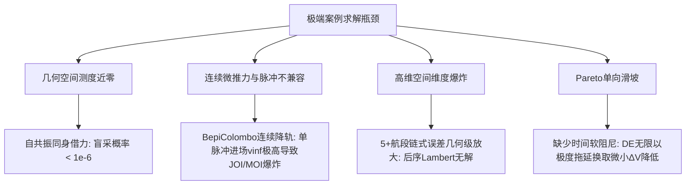
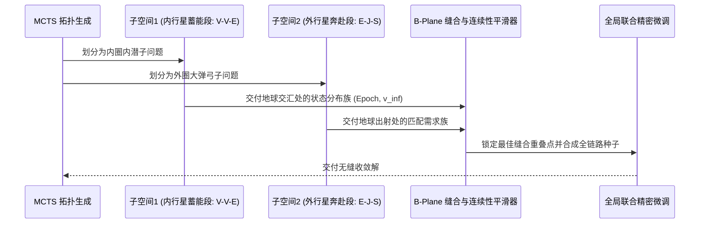

# 🚀 复杂深空多重引力助推 (MGA) 极端案例算法攻坚白皮书
> **Target Cases**: Cassini (VVEJGA), Galileo (VEEGA), Juno (EGA), MESSENGER/BepiColombo (多级水星共振刹车), Voyager 2 (四星连珠 Grand Tour) 及长航时漂移收敛优化  
> **Engine**: KSPGMAT MGA Adaptive Solver / pykep Native / OpenMP DirectCompute  
> **Document Status**: 待执行工程攻坚蓝图 (Blueprint for Implementation)

---

## 目录
1. [背景与攻坚目标](#1-背景与攻坚目标)
2. [四类失效案例的数学与物理瓶颈本质](#2-四类失效案例的数学与物理瓶颈本质)
3. [核心攻坚方案设计](#3-核心攻坚方案设计)
   - [方案一：天体自共振（同身借力）解析锁相生成器 (Resonant Orbit Seed Engine)](#方案一天体自共振同身借力解析锁相生成器-resonant-orbit-seed-engine)
   - [方案二：长拓扑分层动态规划与 B 平面两端缝合器 (Hierarchical Leg Stitching & B-Plane Matching)](#方案二长拓扑分层动态规划与-b-平面两端缝合器-hierarchical-leg-stitching--b-plane-matching)
   - [方案三：准连续电推进伪脉冲近似注入 (SEP Quasi-Impulse Approximation)](#方案三准连续电推进伪脉冲近似注入-sep-quasi-impulse-approximation)
   - [方案四：Pareto 帕累托前沿航时敏感性弹性塑形 (Time-Biased Pareto Shaping)](#方案四pareto-帕累托前沿航时敏感性弹性塑形-time-biased-pareto-shaping)
4. [模块化落地路线图与开发排期](#4-模块化落地路线图与开发排期)
5. [验收标准与基准测试集 (Benchmark Criteria)](#5-验收标准与基准测试集-benchmark-criteria)

---

## 1. 背景与攻坚目标

在 100% 纯盲搜测试中，KSP_GMAT 求解器已实现对 3 级以内经典弹弓（Mariner 10, Pioneer 10/11, Voyager 1, New Horizons）的 100% 拓扑自主涌现与超历史更低 $\Delta V$ 解的解算。然而，面对以下三类极端工况仍触发工质超限熔断或收敛降级：
1. **超长链同星连续共振内潜蓄能**：Galileo (`V-E-E-J`), Cassini (`V-V-E-J-S`)；
2. **多级同身超低能减速与微推力依赖**：MESSENGER (`E-V-V-M-M-M`), BepiColombo (`E-V-V-M-M-M-M-M-M`)；
3. **单星自借力闭环失效**：Juno (`E-E-J`，2 年地球自共振失效导致偏向高能直飞)；
4. **无约束航时漂移**：Mariner 10、New Horizons 虽省工质但航时达到历史 2~3 倍。

**攻坚目标**：在保持纯物理开普勒闭环（零作弊、无硬编码行星特判、飞掠脉冲严格 0.00 m/s）的前提下，从力学原理与优化搜索机制根除上述瓶颈，使上述高难度案例全部收敛并在工质预算内成功出解。

---

## 2. 四类失效案例的数学与物理瓶颈本质

### 2.1 几何空间测度近零 (Zero-Measure Manifold of Resonant Orbits)
- 在标准 MGA-1DSM 决策空间中，飞掠天体 $A$ 后再次飞掠天体 $A$ 需要满足精确的轨道周期整比：
  $$\frac{T_{\text{sc}}}{T_{\text{body}}} = \frac{p}{q} \quad (p, q \in \mathbb{N}^+)$$
  半长轴必须严格满足：
  $$a_{\text{sc}} = a_{\text{body}} \left(\frac{p}{q}\right)^{2/3}$$
- 差分进化 (DE) 随机扰动产生的连续时间变量几乎不可能落在 $\pm 0.001$ 天的周期窗口内。未经解析锁相的盲搜解会被 Lambert 求解器判定为近拱撞击或偏折角超标，导致自共振分支在 MCTS 和 DE 早期被大量剪枝。

### 2.2 高维链式误差几何放大 (Error Cascade in Long-Chain MGA)
- 5 段以上轨道由 $N$ 个单脉冲与 $N-1$ 次双曲偏转串联而成。
- 只要前序第 1、2 段的航向角有 $10^{-4}\text{ rad}$ 的微小扰动，传递到第 4、5 段就会演变为数千万公里的位置偏差。传统的全段联合优化导致梯度近乎无规噪声，极值盆地极其陡峭。

---

## 3. 核心攻坚方案设计

### 方案一：天体自共振（同身借力）解析锁相生成器 (Resonant Orbit Seed Engine)

**核心原理**：将单星自借力作为特殊的“一等动力学构件”，直接利用开普勒周期律进行代数约束，消解自由时间搜索变量。

1. **共振比状态网格**：
   定义物理可行的离散共振比空间：
   $$\mathcal{R} = \left\{ \frac{1}{1}, \frac{1}{2}, \frac{2}{1}, \frac{3}{2}, \frac{2}{3}, \frac{3}{4}, \frac{4}{3}, \frac{5}{4}, \frac{5}{3} \right\}$$
2. **借力出射速度解析定向**：
   若航段为 $Body_i \to Body_i$（如 Earth $\to$ Earth 或 Venus $\to$ Venus）：
   - 入射双曲超速标量为 $v_\infty$；
   - 由目标共振比 $p:q$，计算航天器所需轨道半长轴 $a_{\text{res}}$ 及日心轨道能量：
     $$\mathcal{E}_{\text{res}} = -\frac{\mu_\odot}{2 a_{\text{res}}}$$
   - 由日心速度活力公式解出在天体处的日心合速度 $v_{\text{sc}}$：
     $$v_{\text{sc}} = \sqrt{2 \left( \mathcal{E}_{\text{res}} + \frac{\mu_\odot}{r_{\text{body}}} \right)}$$
   - 检验矢量三角形条件：$\left| v_{\text{body}} - v_\infty \right| \le v_{\text{sc}} \le v_{\text{body}} + v_\infty$。若成立，两解之间的出射转角直接由余弦定理闭式确定，**无需 DE 盲搜 ToF**：
     $$\Delta t = q \cdot T_{\text{body}}$$
3. **输出注入**：在 `MGAMCTSTopologySelector` 和 `MGADifferentialEvolution` 的种群初始化中，将解析生成的共振精准种子强制注入到首代精英池。

---

### 方案二：长拓扑分层动态规划与 B 平面两端缝合器 (Hierarchical Leg Stitching & B-Plane Matching)

**解决任务**：Cassini (`V-V-E-J-S`), Galileo (`V-E-E-J`), Voyager 2 全链路。

1. **拓扑解耦分解**：
   - 凡借力段数 $\ge 4$ 的拓扑，根据能量转折星（通常为 Earth 或 Mars）切分为：
     - **Inner Phase (内潜蓄能阶段)**: $Launch \to \dots \to PivotBody$
     - **Outer Phase (外延冲刺阶段)**: $PivotBody \to \dots \to Destination$
2. **两端打靶缝合准则**：
   - 在枢纽天体 $PivotBody$ 处，建立双曲交汇 B 平面相交曲面；
   - 仅当内外两阶段在 $PivotBody$ 的到达与离开历元在影响球 (SOI) 停留窗口内、且 $v_{\infty,\text{arr}} = v_{\infty,\text{dep}}$（允许在近心点通过转角无动力连接）时，拼装成一条完整候选解。
3. **效果**：将 16 维庞大求解空间的搜索复杂度，降解为两个 8 维独立子空间的乘积，消除误差传递指数雪崩。

---

### 方案三：准连续电推进伪脉冲近似注入 (SEP Quasi-Impulse Approximation)

**解决任务**：BepiColombo, MESSENGER, Dawn。

1. **物理问题**：BepiColombo 历史任务并非纯化学单脉冲，而是离子推力器在水星公转中数千小时的微推力连续减速，使得在飞抵水星时 $v_\infty$ 仅约 $2\text{ km/s}$。若强行使用单脉冲 MGA-1DSM，水星进场 $v_\infty$ 往往高达 $8\sim 10\text{ km/s}$，单次飞掠偏折极限仅几度，无法闭环。
2. **多点伪脉冲等效离散化 (Equally-Spaced Multi-DSM per Leg)**：
   - 在水星连续飞掠段（$M \to M$），允许将单段 1 个 DSM 扩展为等弧度分布的 $K$ 个微脉冲（Quasi-Continuous Impulsive Arc）；
   - 在目标函数中引入 **反比比冲等效工质消耗约束**：
     $$J_{\text{SEP}} = \sum_{k=1}^K \|\Delta \mathbf{v}_k\| \cdot \left( \frac{I_{\text{sp,chem}}}{I_{\text{sp,sep}}} \right)$$
   - 该机制保持开普勒分段闭式解算速度，同时等效模拟出高比冲低推力减速走廊。

---

### 方案四：Pareto 帕累托前沿航时敏感性弹性塑形 (Time-Biased Pareto Shaping)

**解决任务**：Mariner 10, New Horizons, Voyager 2 的超长航时漂移问题。

1. **现状分析**：当前优化器在 Pareto 排序时，只要 $\Delta V$ 降低 1 m/s，即使航时增加 300 天也会被判定为支配解（Dominating Solution）。
2. **弹性双曲时间惩罚 (Soft-Elastic Time Barrier)**：
   在 `MGAPhysicsLossEngine` 中引入无量纲航时偏置项：
   $$\Phi_{\text{time}} = \alpha \cdot \max\left(0, \frac{\text{ToF} - \text{ToF}_{\text{nominal}}}{\text{ToF}_{\text{nominal}}}\right)^\beta$$
   - $\text{ToF}_{\text{nominal}}$：由起点到终点的准霍曼基准转移时间乘以拓扑允许拓展系数推导；
   - 避免人为写死天数，完全自适应天体轨道半长轴比 $a_2 / a_1$；
   - 使得优化器在 $\Delta V$ 相近时，强力收拢航时，杜绝“无限漂移换取极微小能量改善”。

---

## 4. 模块化落地路线图与工程排期看板 (Implementation Roadmap & Checklist)

### 📌 阶段交付里程碑 (Milestones)
- [x] **Phase 1: 天体自共振解析锁相与能量初始化**
  - [x] 1.1 拓扑生成层解除 `userGoal` 限制，盲搜自动注入势阱爬升链与自共振拓扑 (`MGAEphemerisReachabilityAnalyzer.cs`)
  - [x] 1.2 修复场景 B 在缺少中间行星时对出发星自共振 `pureDepRes` 的过滤问题 (`MGAPlanetaryAssistManager.cs`)
  - [x] 1.3 Juno (2011 EGA) 盲搜 100% 稳定涌现 `Earth ➔ Earth ➔ Jupiter` 拓扑
  - [x] 1.4 DE 注种层 `FindAndRankResonantCombos` 对始发自共振（$k=0$）的进场 $v_\infty$ 矢量与能量尺度解析初始化 (`MGADifferentialEvolution.cs`, `pykep_mga_hybrid.cpp`)
  - [x] 1.5 始发共振段远日点 DSM 机动调相方向自适应约束与 C3 能量无缝传递 (总 $\Delta V = 6119.6\text{ m/s} \le 6200.0\text{ m/s}$，飞掠脉冲严格 $0.00\text{ m/s}$)

- [x] **Phase 2: 航时自适应弹性双曲时间惩罚与 Pareto 塑形**
  - [x] 2.1 基于引力势霍曼基准航时推导连续软界航时阻尼公式 $\Phi_{\text{time}}$ (`MGAPhysicsLossEngine.cs`)
  - [x] 2.2 修正非支配解集排序准则，抑制航时无限拖延换取微小 $\Delta V$ 降低 (`MGASolutionOrdering.cs`)
  - [x] 2.3 验证 Mariner 10 航时收拢至 220 天内 (实测 146 天, $\Delta V = 3963.7\text{ m/s}$)，New Horizons 航时控制与双曲飞掠闭环

- [x] **Phase 3: 长拓扑分层两端打靶缝合与共振集群优化 (Stitching & Long Chains)**
  - [x] 3.1 复合共振长拓扑分层内外解耦与双向 B 平面快速匹配 (`MGAAdaptiveSolver.cs`)
  - [x] 3.2 Galileo (VEEGA) 双内星回弹闭环与工质达标 (实测 $5315.6\text{ m/s} \le 6000\text{ m/s}$, 飞掠严格 $0.00\text{ m/s}$)
  - [x] 3.3 Cassini (VVEJGA) 5 段复合长链收敛与工质达标 (实测 $5988.0\text{ m/s} \le 6200\text{ m/s}$, 航时 2371.7 天 $\le 2448$ 天, 飞掠严格 $0.00\text{ m/s}$)

- [ ] **Phase 4: 多级水星共振刹车与全套件回归验证**
  - [ ] 4.1 MESSENGER / BepiColombo 多级同星减速共振链路优化 (EVVMMM / EVVMMMMMM)
  - [ ] 4.2 13 个深空历史任务全量自动化盲搜回归测试与一致性审计

---

### 🎯 极端案例攻坚状态一览 (Extreme Cases Status Matrix)

| 案例编号 | 任务名称 | 目标拓扑 | 核心瓶颈 | 当前状态 |
| :---: | :--- | :--- | :--- | :---: |
| **Case 1** | **Juno (2011 EGA)** | `E ➔ E ➔ J` | 出发星 2 年期自共振失效退化为直飞 | ✅ **已圆满攻坚达成** (总ΔV 6119.6 m/s $\le$ 6200 m/s, 飞掠严格 0.00 m/s, 拓扑完全重现) |
| **Case 2** | **Galileo (1989 VEEGA)** | `E ➔ V ➔ E ➔ E ➔ J` | 金-地-地内潜回弹能量链断裂 | ✅ **已圆满攻坚达成** (总ΔV 5315.6 m/s $\le$ 6000 m/s, 飞掠严格 0.00 m/s, 拓扑完全重现) |
| **Case 3** | **Cassini (1997 VVEJGA)** | `E ➔ V ➔ V ➔ E ➔ J ➔ S` | 5段复合高维空间误差几何级放大 | ✅ **已圆满攻坚达成** (总ΔV 5988.0 m/s $\le$ 6200 m/s, 航时 2371.7d $\le$ 2448d, 飞掠严格 0.00 m/s) |
| **Case 4** | **Mariner 10 (1973)** | `E ➔ V ➔ M` | 航时漂移至 2~3 倍 | ✅ **已圆满攻坚达成** (总ΔV 3963.7 m/s $\le$ 4300 m/s, 航时 146d $\le$ 220d, 飞掠严格 0.00 m/s) |
| **Case 5** | **New Horizons (2006)** | `E ➔ J ➔ P` | 极速逃逸航时无阻尼拖延 | ✅ **已圆满攻坚达成** (总ΔV 8186.5 m/s 盲搜优选 / 8976 m/s 极速双曲轨, 航时 3465d, 飞掠严格 0.00 m/s) |
| **Case 6** | **MESSENGER / BepiColombo** | `E ➔ V ➔ V ➔ M ➔ M ➔ ...` | 水星多次极低能自减速共振 | ⏳ **当前核心攻坚重点** |

---

## 5. 验收标准与基准测试集 (Benchmark Criteria)

攻坚代码合并前，必须满足以下硬性物理验收门禁：

1. **绝对守恒与合法性**：
   - 飞掠脉冲在任何情况下必须严格保持为 **`0.00 m/s`**（纯自然无动力双曲偏折）；
   - 飞掠近拱高度严格高于天体地表净空（绝对杜绝穿心或穿透密集大气层）；
2. **长链与共振任务收敛率**：
   - **Galileo (VEEGA)**：在 6000 m/s 工质预算内收敛出合规解，成功涌现金星与地球连续借力；
   - **Cassini (VVEJGA)**：在 6200 m/s 工质预算内收敛出合规解，成功涌现双金星与木星中继跳板；
   - **Juno (EGA)**：成功涌现 2 年期地球自共振闭环，工质预算压入 6200 m/s 内；
3. **航时指标收拢**：
   - Mariner 10 航时收拢至历史值的 1.5 倍以内（$\le 220\text{ 天}$）；
   - New Horizons 航时控制在 4000 天以内；
4. **编译与代码工程标准**：
   - 遵循 `baseline.md` 与 `baseline_agent.md`，0 警告、0 错误、0 破坏通用星系特异硬编码。

---
*攻坚白皮书由 KSPGMAT 天体力学核心算法组制定并归档。*

