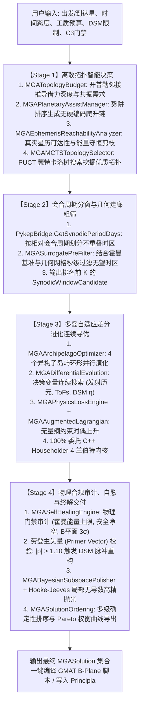
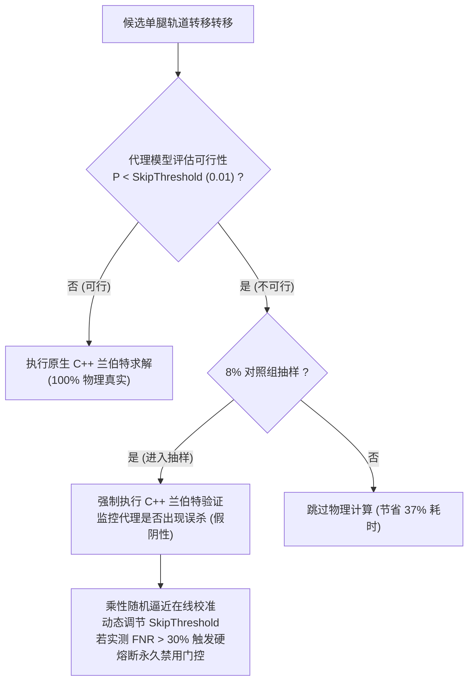

# KSP_GMAT MGA (Multiple Gravity Assist) 模块全景架构与实现规范

> **文档版本**：R2026a Production Master Specification  
> **工程目录**：`c:\Users\43701\gmat-win-R2026a\bin\KSP_GMAT`  
> **核心源码**：`src/KSPGMAT/MGA`、`src/native/pykep_native`、`pykep_sourcecode`  
> **动力学底座**：ESA ACT PyKEP v3 (`kep3`) 原生 C++ 动力学引擎 + NASA GMAT 高精微分校正打靶 + Principia N 体引力执行器

---

## 目录
- [0. 概述与顶层架构设计哲学](#0-概述与顶层架构设计哲学)
- [1. 求解器流水线与动力学物理内核 (Solver Architecture)](#1-求解器流水线与动力学物理内核-solver-architecture)
  - [1.1 四阶段执行生命周期 (4-Stage Pipeline)](#11-四阶段执行生命周期-4-stage-pipeline)
  - [1.2 物理搜索预算推导与拓扑剪枝 (Topology Budget & Pruning)](#12-物理搜索预算推导与拓扑剪枝-topology-budget--pruning)
  - [1.3 历元星历双向可达性与 7 维相空间 QD 精选](#13-历元星历双向可达性与-7-维相空间-qd-精选)
  - [1.4 无量纲增广拉格朗日损失场 (Augmented Lagrangian & Physics Loss Engine)](#14-无量纲增广拉格朗日损失场-augmented-lagrangian--physics-loss-engine)
  - [1.5 物理合规审计与劳登主矢量智能自愈 (Self-Healing & Primer Vector)](#15-物理合规审计与劳登主矢量智能自愈-self-healing--primer-vector)
  - [1.6 B 平面动力学投影与停泊轨道射出对齐 (B-Plane & Injection Alignment)](#16-b-平面动力学投影与停泊轨道射出对齐-b-plane--injection-alignment)
- [2. 优化器体系结构与算法实现 (Optimizer Architecture)](#2-优化器体系结构与算法实现-optimizer-architecture)
  - [2.1 连续空间差分进化内核 (MGADifferentialEvolution)](#21-连续空间差分进化内核-mgadifferentialevolution)
  - [2.2 广义群岛模型与多层并行调度 (MGAArchipelagoOptimizer)](#22-广义群岛模型与多层并行调度-mgaarchipelagooptimizer)
  - [2.3 MCTS 蒙特卡洛树搜索拓扑选择器 (MGAMCTSTopologySelector)](#23-mcts-蒙特卡洛树搜索拓扑选择器-mgamctstopologyselector)
  - [2.4 多臂老虎机与自适应超参数调优 (MGABanditHyperparameterTuner)](#24-多臂老虎机与自适应超参数调优-mgabandithyperparametertuner)
  - [2.5 贝叶斯活动子空间抛光与 Hooke-Jeeves 模式搜索](#25-贝叶斯活动子空间抛光与-hooke-jeeves-模式搜索)
  - [2.6 确定性多级排序与 Pareto 前沿扫描 (MGASolutionOrdering)](#26-确定性多级排序与-pareto-前沿扫描-mgasolutionordering)
- [3. 机器学习与 AI 加速引导架构 (Machine Learning & Physics-Informed AI)](#3-机器学习与-ai-加速引导架构-machine-learning--physics-informed-ai)
  - [3.1 物理代理神经网络 (MGAPhysicsSurrogateNetwork)](#31-物理代理神经网络-mgaphysicssurrogatenetwork)
  - [3.2 真实物理数据采样与手写 Adam 训练系统 (MGASurrogateTrainer)](#32-真实物理数据采样与手写-adam-训练系统-mgasurrogatetrainer)
  - [3.3 在线安全门控与置信评估 (MGASurrogateGate)](#33-在线安全门控与置信评估-mgasurrogategate)
  - [3.4 策略-价值网络引导 (MGAPolicyValueGuide)](#34-策略-价值网络引导-mgapolicyvalueguide)
  - [3.5 符号物理先验约束 (MGASymbolicPhysicsConstraints)](#35-符号物理先验约束-mgasymbolicphysicsconstraints)
  - [3.6 代理预筛选器与 GPU 走廊评估 (MGASurrogatePreFilter)](#36-代理预筛选器与-gpu-走廊评估-mgasurrogateprefilter)
- [4. KEP 底层集成与 C#/C++ 互操作实现 (KEP Integration & Native Interop)](#4-kep-底层集成与-cc-互操作实现-kep-integration--native-interop)
  - [4.1 原生动态库分发与安全加载架构 (PykepNative)](#41-原生动态库分发与安全加载架构-pykepnative)
  - [4.2 内存布局契约与 P/Invoke 零拷贝交互](#42-内存布局契约与-pinvoke-零拷贝交互)
  - [4.3 Izzo 兰伯特求解器与 4 阶 Householder 根求解](#43-izzo-兰伯特求解器与-4-阶-householder-根求解)
  - [4.4 多腿 MGA 飞掠反算与局部轨道坐标系 (Frenet/VNC) 分解](#44-多腿-mga-飞掠反算与局部轨道坐标系-frenetvnc-分解)
  - [4.5 太阳系天体数据库与高精度双方案星历系统](#45-太阳系天体数据库与高精度双方案星历系统)
  - [4.6 工业级动力学鲁棒性与异常防护防御](#46-工业级动力学鲁棒性与异常防护防御)
- [5. 核心类与数据流全景图 (Architecture & Dataflow Matrix)](#5-核心类与数据流全景图-architecture--dataflow-matrix)

---

## 0. 概述与顶层架构设计哲学

在深空探测与行星际任务规划中，多重引力助推（Multiple Gravity Assist, MGA）问题面临**组合爆炸（离散天体借力拓扑选择）**与**高维非凸非线性动力学（连续时间窗口、深空机动位置与速度匹配）**的双重挑战。

`KSP_GMAT` 的 MGA 模块构建了一套兼具航天工业级严谨性与现代人工智能加速的求解闭环系统：

```
                    ┌──────────────────────────────────────────────┐
                    │               用户任务工程输入               │
                    │   (始发星 / 目标星 / 历元 / 工质预算 / C3)    │
                    └──────────────────────┬───────────────────────┘
                                           │
                                           ▼
┌──────────────────────────────────────────────────────────────────────────────────────────┐
│ Tier 1: 组合拓扑决策层 (Discrete Topology Selection & AI Heuristic Guide)               │
│ - 开普勒邻接图引力势深推导 (MGATopologyBudget)                                           │
│ - 无硬编码天体爬升链动态合成 (MGAPlanetaryAssistManager)                                  │
│ - 真实星历双向可达性与 Vis-Viva 能量守恒剪枝 (MGAEphemerisReachabilityAnalyzer)           │
│ - AlphaZero 范式 PUCT 蒙特卡洛树搜索 (MGAMCTSTopologySelector + MGAPolicyValueGuide)     │
└──────────────────────────────────────────┬───────────────────────────────────────────────┘
                                           │ Top-K 优质物理拓扑
                                           ▼
┌──────────────────────────────────────────────────────────────────────────────────────────┐
│ Tier 2: 连续参数空间多岛差分进化 (Multi-Island Adaptive Differential Evolution)          │
│ - 会合周期分窗与 GPU/CPU 几何走廊粗筛 (MGASurrogatePreFilter)                             │
│ - 环形拓扑多岛演化 (MGAArchipelagoOptimizer)                                             │
│ - 混合染色体编码: 纯弹道与 1-DSM 自适应切换 (MGADifferentialEvolution)                  │
│ - 增广拉格朗日对偶上升损失场 (MGAAugmentedLagrangian + MGAPhysicsLossEngine)             │
│ - UCB1 多臂老虎机在线调参 (MGABanditHyperparameterTuner)                                  │
└──────────────────────────────────────────┬───────────────────────────────────────────────┘
                                           │ 连续最优候选解
                                           ▼
┌──────────────────────────────────────────────────────────────────────────────────────────┐
│ Tier 3: 物理审计、自愈与高精抛光 (Physics Audit, Self-Healing & Polishing)                │
│ - 劳登主矢量极值检验 (|p| > 1.10 触发 DSM 脉冲注种自愈) (MGASelfHealingEngine)           │
│ - 贝叶斯活动子空间局部收敛抛光 (MGABayesianSubspacePolisher)                             │
│ - Memetic Hooke-Jeeves 模式搜索 + 顺流相位补偿                                           │
│ - 确定性多级排序与 Pareto 前沿生成 (MGASolutionOrdering)                                 │
└──────────────────────────────────────────┬───────────────────────────────────────────────┘
                                           │ 最终物理交付
                                           ▼
┌──────────────────────────────────────────────────────────────────────────────────────────┐
│ Tier 4: 底层权威动力学执行底座 (ESA PyKEP v3 C++ Core Engine via P/Invoke)               │
│ - Householder 4 阶解析导数兰伯特求逆 (Izzo 2015)                                         │
│ - 纯代数飞掠偏折与近拱动力脉冲求解 (Acciarini 优化算法)                                  │
│ - 3 轴 Frenet/VNC 局部坐标系机动分解与 B 平面 (B·T, B·R) 瞄准矢量生成                    │
│ - 实时游戏星历 (Principia) 与权威 JPL SPICE DE440 双方案自动对齐                          │
└──────────────────────────────────────────────────────────────────────────────────────────┘
```

### 三大核心架构设计铁律
1. **单一数据真值源 (Single Source of Truth, SSOT)**：
   轨道动力学、双曲偏转角、兰伯特边值逆解、B 平面瞄准矢量**100% 委托 ESA PyKEP 原生 C++ 库（`kep3`）计算**。托管 C# 层绝不手写二次拟合公式，杜绝数值分裂。
2. **零外部重依赖纯 C# AI 闭环**：
   内部神经网络（MLP）、优化器（Adam）、强化学习调参器（UCB1 Bandit）与蒙特卡洛树搜索（MCTS）均采用纯托管 C# 手写实现，无 Python、ONNX Runtime 或 PyTorch 依赖，在任何 Unity/Mono 运行环境下实现零开销直接部署。
3. **安全降级与硬熔断保证**：
   AI 代理模型严格遵守“解析开普勒退化契约”；在线门控实施 8% 对照组动态抽样，一旦实测误杀率触及硬门禁立即自动熔断穿透至 C++ 原生计算，确保输出解 100% 符合物理真实。

---

## 1. 求解器流水线与动力学物理内核 (Solver Architecture)

### 1.1 四阶段执行生命周期 (4-Stage Pipeline)

MGA 模块由 `MGAMasterOptimizer` 接收面向航天任务工程的设计需求，由 `MGAAdaptiveSolver` 全权编排四阶段求解流水线：



---

### 1.2 物理搜索预算推导与拓扑剪枝 (Topology Budget & Pruning)

核心实现：[`src/KSPGMAT/MGA/Solver/MGATopologyBudget.cs`](file:///c:/Users/43701/gmat-win-R2026a/bin/KSP_GMAT/src/KSPGMAT/MGA/Solver/MGATopologyBudget.cs)、[`src/KSPGMAT/MGA/Solver/MGAPlanetaryAssistManager.cs`](file:///c:/Users/43701/gmat-win-R2026a/bin/KSP_GMAT/src/KSPGMAT/MGA/Solver/MGAPlanetaryAssistManager.cs)。

#### 1.2.1 开普勒邻接图预算推导 (`MGATopologyBudgetDeriver.Derive`)
彻底摒弃按行星半长轴绝对比值人为分档的经验硬编码，全量基于开普勒邻接图解析推导：
1. **可用物理梯级集合 $|R|$ 与最大借力数 `MaxSwingBys`**：
   $$R = \{n \in \text{Bodies} \mid \min(a_{\text{dep}}, a_{\text{arr}}) < a_n < \max(a_{\text{dep}}, a_{\text{arr}}) \land \text{AssistPowerIndex}(n) \ge \text{Threshold}\}$$
   对于外行星任务，内侧强引力天体（如 Venus）由于具备充沛的引力势能提升能力，亦动态纳入候选梯级。
   $$\text{MaxSwingBys} = \max(1, |R|)$$
2. **能量闭合比与折返中继上限 `MaxBackLegs`**：
   $$\text{Gap} = \frac{\Delta V_{\text{Hohmann}}(a_{\text{dep}}, a_{\text{arr}})}{\sum_{r \in R} \Delta V_{\text{assist,gain}}(r)}$$
   - 当 $\text{Gap} \le 1.0$：单调梯级足已闭合能量缺口，设定 $\text{MaxBackLegs} = 0$；
   - 当 $\text{Gap} > 1.0$：每次折返调相能力翻倍，$\text{MaxBackLegs} = \min\left(3, \;\lceil \log_2(\text{Gap}) \rceil\right)$。
3. **解析共振需求下界 $n_{\text{req}}$ 与 `MaxResonances`**：
   $$n_{\text{req}} = \left\lceil \frac{\theta_{\text{req}}}{\delta_{\max}} \right\rceil, \quad \text{MaxResonances} = n_{\text{req}} + \left\lfloor \frac{T_{\text{window}}}{4 \cdot T_{\text{orbit}}} \right\rfloor$$
   额外共振额度严格由任务时间跨度内该天体允许完成的实际公转圈数决定。

#### 1.2.2 行星爬升链合成与通用角色分配 (`MGAPlanetaryAssistManager`)
1. **星系自标定引力势深**：依据特征势深 $\Phi_{\text{safe}} = \frac{\mu_{\text{body}}}{r_{\text{safe}}}$ 对恒星系所有天体排序，不依赖特定天体名称（通用支持真实太阳系与坎巴拉星系）。
2. **角色动态推选**：
   - **内侧变轨跳板 (Inner Assist)**：半长轴介于深势阱天体与出发星之间、引力势深最高的天体（如太阳系 Venus、坎巴拉系 Eve）。
   - **中继爬升跳板 (Mid Assist)**：位于出发星公转轨道附近的高引力势深天体（如 Earth、Kerbin）。
   - **外侧巨行星超级弹弓 (Outer Giant Slingshots)**：出发星与到达星之间的大质量巨行星（如 Jupiter, Saturn）。
3. **拓扑家族前向生成**：
   - 家族 1：前置 EGA 调速 + 目标势阱共振 $N_{\text{req}}$ + 内侧跳板回折 + 中继星蓄能 + 巨行星弹弓。
   - 家族 2：直出中继星借力 + 巨行星连环弹弓（Grand Tour）。
   - 家族 3：交错双星共振泵升（如 $E \to V \to E \to V$）。
   - 物理单共振守恒滤网：非深井减速任务在同一次逃逸爬升链中，至多允许 1 个天体实施自共振蓄能，剔除组合冗余。

---

### 1.3 历元星历双向可达性与 7 维相空间 QD 精选

核心实现：[`src/KSPGMAT/MGA/Solver/MGAEphemerisReachabilityAnalyzer.cs`](file:///c:/Users/43701/gmat-win-R2026a/bin/KSP_GMAT/src/KSPGMAT/MGA/Solver/MGAEphemerisReachabilityAnalyzer.cs)。

#### 1.3.1 Vis-Viva 动能定理与真实星历反向可达性剪枝
在 `AnalyzeChainReachability` 中，沿拓扑航段推进历元，直读 SPICE/开普勒星历状态：
1. **Vis-Viva 机械能守恒反向追溯**：
   $$v_{\text{craft}} = \sqrt{\mu_{\odot} \left(\frac{2}{r} - \frac{1}{a_{\text{trans}}}\right)}, \quad v_{\text{circ}} = \sqrt{\frac{\mu_{\odot}}{r}}$$
2. **天体力学动能定理极值包络**：
   借力天体对航天器做的最大功由天体公转速度与最大物理偏折角决定：
   $$\Delta E_{\max} = v_{\text{circ}} \cdot \left[2 v_\infty \sin\left(\frac{\delta_{\max}}{2}\right)\right]$$
   借力后航天器日心速度极值包络严格满足：
   $$v_{\max} = \sqrt{v_{\text{in}}^2 + 2\Delta E_{\max}}, \quad v_{\min} = \sqrt{\max(0, v_{\text{in}}^2 - 2\Delta E_{\max})}$$
   若后续升轨/降轨所需速度超出 $[v_{\min}, v_{\max}]$，超出量计入刚性能量赤字 $\text{Deficit}_{E}$，直接剔除不可闭环的死分支。

#### 1.3.2 7 维相空间质量-多样性 (Quality-Diversity / QD) 拓扑精选
为避免拓扑选择陷入同一流派的微小变体，算法提取每条链路在天体力学相空间中的 7 维无量纲特征向量：
$$\mathbf{x} = \left[\ln\frac{r_{\text{arr}}}{r_{\text{dep}}}, \;\ln\frac{r_{\min}}{r_{\text{dep}}}, \;\ln\frac{r_{\max}}{r_{\text{dep}}}, \;\frac{\sum \delta_{\text{avail}}}{180^\circ}, \;\frac{\text{ToF}}{\text{ToF}_{\text{Hohmann}}}, \;\frac{\Delta V_{\text{total}}}{\text{Budget}}, \;\frac{N_{\text{legs}}}{8}\right]^T$$
采用 Max-Min Feature Dispersion 算法进行散度选择：
$$c^* = \arg\max_{c \in \mathcal{U}} \left[ Q(c) + \lambda_{\text{div}} \cdot \min_{s \in \mathcal{S}} D(\mathbf{x}_c, \mathbf{x}_s) \right]$$
在多维连续相空间中自发保留全局非同质精英拓扑集（如同时捕获直飞、内侧 VEEGA 蓄能与巨行星弹弓流派）。

---

### 1.4 无量纲增广拉格朗日损失场 (Augmented Lagrangian & Physics Loss Engine)

核心实现：[`src/KSPGMAT/MGA/Solver/MGAPhysicsLossEngine.cs`](file:///c:/Users/43701/gmat-win-R2026a/bin/KSP_GMAT/src/KSPGMAT/MGA/Solver/MGAPhysicsLossEngine.cs)、[`src/KSPGMAT/MGA/MGAAugmentedLagrangian.cs`](file:///c:/Users/43701/gmat-win-R2026a/bin/KSP_GMAT/src/KSPGMAT/MGA/MGAAugmentedLagrangian.cs)。

#### 1.4.1 Powell-Hestenes-Rockafellar 无量纲增广拉格朗日公式
$$J(x) = \hat{f}(x) + \sum_{k \in \mathcal{C}} \left[ \lambda_k \hat{g}_k(x) + \frac{\rho_k}{2} \hat{g}_k(x)^2 \right]$$
- **无量纲主目标** $\hat{f}(x) = \frac{\Delta V_{\text{subject}}(x)}{\Delta V_{\text{ref}}}$，$\Delta V_{\text{ref}}$ 优先取工质预算或解析霍曼基准，确保 $\hat{f}(x) \sim \mathcal{O}(1)$。
- **无量纲违约项** $\hat{g}_k(x) = \frac{\max(0, \text{Violation}_k)}{\text{Scale}_k}$。

#### 1.4.2 对偶上升与乘子更新
在差分进化每一代末尾执行：
$$\lambda_k^{(t+1)} = \min\left(\lambda_{\max}, \;\lambda_k^{(t)} + \rho_k^{(t)} \cdot \hat{g}_{k,\max}^{(t)}\right)$$
$$\rho_k^{(t+1)} = \begin{cases} \min\left(\rho_{\max}, \;\beta \cdot \rho_k^{(t)}\right), & \text{if } \hat{g}_{k,\max}^{(t)} > (1 - \gamma) \hat{g}_{k,\max}^{(t-1)} \\ \rho_k^{(t)}, & \text{otherwise} \end{cases}$$
其中 $\beta = 2.0, \gamma = 0.25, \lambda_{\max} = 10^6, \rho_{\max} = 10^6$。

#### 1.4.3 11 项动力学约束全量定义

| 约束标识 (`MGAConstraint`) | 物理含义 | 归一化尺度 $\text{Scale}_k$ | 违规度量数学表达 |
| :--- | :--- | :--- | :--- |
| **0. LegFeasibility** | 兰伯特与开普勒几何可行性 | 1.0 | $\hat{g}_0 = 1.0 \text{ if !AllLegsFeasible else } 0$ |
| **1. DepartureEpoch** | 发射历元窗口约束 | $T_{\text{span}}$ (窗口跨度) | $\hat{g}_1 = \frac{\max(0, t_{\text{start}} - t_0, t_0 - t_{\text{end}})}{T_{\text{span}}}$ |
| **2. DsmBudget** | 深空机动 (DSM) 预算上限 | $\Delta V_{\text{dsm,max}}$ | $\hat{g}_2 = \frac{\max(0, \sum \Delta V_{\text{dsm}} - \Delta V_{\text{dsm,max}})}{\Delta V_{\text{dsm,max}}}$ |
| **3. VesselBudget** | 飞船总工质机动上限 | $\Delta V_{\text{vessel,max}}$ | $\hat{g}_3 = \frac{\max(0, \Delta V_{\text{total}} - \Delta V_{\text{vessel,max}})}{\Delta V_{\text{vessel,max}}}$ |
| **4. LaunchCeiling** | 停泊轨道脱离脉冲 C3 门禁 | $\Delta V_{\text{launch,max}}$ | $\hat{g}_4 = \frac{\max(0, \Delta V_{\text{launch}} - \Delta V_{\text{launch,max}})}{\Delta V_{\text{launch,max}}}$ |
| **5. SafePeriapsis** | 借力近心点地表/大气净空 | $r_{\text{safe}} = R_{\text{body}} + h_{\text{safe}}$ | $\hat{g}_5 = \frac{\max(0, r_{\text{safe}} - r_p)}{r_{\text{safe}}}$ |
| **6. PoweredFlyby** | 严格无动力飞掠 ($\Delta V_{\text{fb}} \to 0$) | $0.01 \cdot \Delta V_{\text{ref}}$ | $\hat{g}_6 = \frac{\Delta V_{\text{fb}}}{0.01 \cdot \Delta V_{\text{ref}}}$ |
| **7. InclinationLock** | 停泊轨道倾角与面外对准锁定 | $\delta_{\text{tol}} = 0.05^\circ$ | $\hat{g}_7 = \frac{\max(0, \|i_{\text{eject}} - i_{\text{target}}\| - \delta_{\text{tol}})}{\delta_{\text{tol}}}$ |
| **8. FlybyDeflection** | 双曲最大无动力偏折角极限 | $\Delta V_{\text{ref}}$ | $\hat{g}_8 = \frac{2 v_\infty \sin((\theta_{\text{req}} - \delta_{\max})/2)}{\Delta V_{\text{ref}}}$ |
| **9. MissionDuration** | 全任务总航时上限 | $T_{\text{max}}$ | $\hat{g}_9 = \frac{\max(0, T_{\text{flight}} - T_{\text{max}})}{T_{\text{max}}}$ |
| **10. L1 稀疏正则** | 消除伪机动，驱动 DSM 归零 | $\Delta V_{\text{ref}}$ | $J_{\text{sparse}} = \frac{1}{N_{\text{legs}}} \frac{\sum \Delta V_{\text{dsm}}}{\Delta V_{\text{ref}}}$ |

---

### 1.5 物理合规审计与劳登主矢量智能自愈 (Self-Healing & Primer Vector)

核心实现：[`src/KSPGMAT/MGA/Solver/MGASelfHealingEngine.cs`](file:///c:/Users/43701/gmat-win-R2026a/bin/KSP_GMAT/src/KSPGMAT/MGA/Solver/MGASelfHealingEngine.cs)。

#### 1.5.1 物理审计三大红线与劳登理论
1. **霍曼能量警戒线**：$\Delta V_{\text{total}} \le 1.35 \times \Delta V_{\text{Hohmann}}$。
2. **近心点安全净空与 B 平面 3σ 弥散**：利用 `CalculateBPlaneCovariance` 传播始发协方差阵 $\mathbf{P}_0$，要求 $r_p - 3\sigma_{\text{semi}} \ge r_{\text{safe}}$。
3. **劳登主矢量极值理论 (Lawden Primer Vector Theory)**：
   伴随状态主矢量 $\mathbf{p}(t)$ 满足微分方程 $\ddot{\mathbf{p}}(t) = -\frac{\mu}{r^3} \mathbf{p} + \frac{3\mu (\mathbf{r} \cdot \mathbf{p})}{r^5} \mathbf{r}$。最优无推力滑行弧必须满足模长 $\|\mathbf{p}(t)\| \le 1.0$。
   若滑行途中某时刻 $t^*$ 处 $\|\mathbf{p}(t^*)\| > 1.10$（`PrimerVectorLawdenTolerance`），证明当前航迹处于燃料次优状态，存在通过插入中间脉冲降能的物理空间。

#### 1.5.2 违例解数值自愈管线
1. **主矢量脉冲插入重构**：若发生劳登违例且为纯弹道，自愈引擎将该航段切换为 1-DSM 模式，并将主矢量极值时刻 $\eta^* = \frac{t^* - t_0}{T_{\text{leg}}}$ 作为 DSM 发生中心注种。
2. **搜索空间收敛与高精重构**：
   - 发射历元窗口收缩至中心解的 $\pm 30$ 天；
   - 航段 ToF 搜索边界收缩至最优解的 $[0.70 \cdot T_k, \; 1.30 \cdot T_k]$；
   - 启动局部密集差分进化（`Pop=60, Gen=120`），以更低能耗解替换违例解。

---

### 1.6 B 平面动力学投影与停泊轨道射出对齐 (B-Plane & Injection Alignment)

核心实现：[`src/KSPGMAT/MGA/MGAFlybyDynamicsHelper.cs`](file:///c:/Users/43701/gmat-win-R2026a/bin/KSP_GMAT/src/KSPGMAT/MGA/MGAFlybyDynamicsHelper.cs)、[`src/KSPGMAT/MGA/MGAInjectionAligner.cs`](file:///c:/Users/43701/gmat-win-R2026a/bin/KSP_GMAT/src/KSPGMAT/MGA/MGAInjectionAligner.cs)。

#### 1.6.1 进场渐近几何与 B 平面坐标基
- **进场渐近单位矢量**：$\hat{\mathbf{S}} = \frac{\mathbf{v}_{\infty,\text{in}}}{\|\mathbf{v}_{\infty,\text{in}}\|}$
- **B 平面正交坐标系 $(\hat{\mathbf{S}}, \hat{\mathbf{T}}, \hat{\mathbf{R}})$**：
  $$\hat{\mathbf{T}} = \frac{\hat{\mathbf{S}} \times \mathbf{k}}{\|\hat{\mathbf{S}} \times \mathbf{k}\|}, \quad \hat{\mathbf{R}} = \hat{\mathbf{S}} \times \hat{\mathbf{T}}$$
  其中 $\mathbf{k}$ 为参考天球北极轴。
- **瞄准矢量 $\mathbf{B}$ 与投影分量**：
  $$B = r_p \sqrt{1 + \frac{2\mu}{r_p v_\infty^2}}$$
  $$\mathbf{B} \cdot \mathbf{T} = B (\hat{\mathbf{B}} \cdot \hat{\mathbf{T}}), \quad \mathbf{B} \cdot \mathbf{R} = B (\hat{\mathbf{B}} \cdot \hat{\mathbf{R}}), \quad \theta = \operatorname{atan2}(\mathbf{B}\cdot\mathbf{R}, \mathbf{B}\cdot\mathbf{T})$$

#### 1.6.2 停泊轨道射出点火对齐 (`MGAInjectionAligner`)
1. 抽象 `IParkingOrbit` 接口解耦运行环境。
2. 沿低圆停泊轨道展开周期 $[t_{\text{center}} - 0.5T, \; t_{\text{center}} + 0.5T]$。
3. 严格委托 PyKEP 原生 C++ `PykepNative.AlignInjection` / `AlignInjectionDyn` 执行黄金分割搜索，收敛射出渐近线最小夹角方位，计算近心点切向点火历元 $t_{\text{burn}}$ 与 $\Delta \mathbf{V}$，消除脱离倾角偏差。

---

## 2. 优化器体系结构与算法实现 (Optimizer Architecture)

### 2.1 连续空间差分进化内核 (MGADifferentialEvolution)

核心实现：[`src/KSPGMAT/MGA/Solver/MGADifferentialEvolution.cs`](file:///c:/Users/43701/gmat-win-R2026a/bin/KSP_GMAT/src/KSPGMAT/MGA/Solver/MGADifferentialEvolution.cs)。

#### 2.1.1 染色体决策变量混合编码
设天体序列为 $[B_0, B_1, \dots, B_N]$（航段数 $N$）：
- 纯弹道模式（`Ballistic`）：$\text{dim} = 1 + N$
  $$\mathbf{x} = \left[ t_{\text{dep}}, \;\Delta t_1, \;\Delta t_2, \;\dots, \;\Delta t_N \right]$$
- 单深空机动模式（`1-DSM`）：$\text{dim} = 1 + 2N$
  $$\mathbf{x} = \left[ t_{\text{dep}}, \;\Delta t_1, \dots, \Delta t_N, \;\eta_1, \dots, \eta_N \right]$$
  其中 $\eta_k \in [0.1, 0.9]$ 为深空机动时刻分率：$t_{\text{dsm}, k} = t_{\text{arr}, k-1} + \eta_k \cdot \Delta t_k$。

#### 2.1.2 四级动力学物理注种 (Dynamic Seeding)
1. **锁定停泊轨道交点注种 (Nodal Crossing Seeding)**：扫描目标天体零面外偏角交点 $t_{\text{node}}$，注入 $t_{\text{dep}} = t_{\text{node}} - \Delta t_{\text{nom}}$，消除离面速度脉冲。
2. **开普勒物理有理共振槽注种 (Keplerian Rational Resonance Seeding)**：同星共振段匹配有理比率集合 `ResonanceRatioCandidates = { 1:1, 3:2, 5:3, 2:1, 3:1, 4:1, 5:2, 5:4, 4:3 }`。
3. **连续同星集群共振组合扫描 (Resonance-Combo Scan)**：评估多段共振总偏折能力 $\delta_{\text{total}} = (M+1) \cdot \delta_{\max}$。
4. **普适前向借力步进注种 (Universal Forward-Staging Seed Synthesis)**：前向单步解算 Lambert 并匹配双曲出入速度，注入物理骨干染色体。

#### 2.1.3 变异算子、共振吸附与盆地跳跃
- **变异算子**：由多臂老虎机在 DE/rand/1、DE/best/1、DE/current-to-best/1、DE/rand-to-best/1 中指派。
- **物理共振槽吸附**：同星维度扰动自动吸附至最近物理共振中心 $r^* \cdot T_{\text{orb}}$。
- **柯西单调盆地跳跃 (MBH)**：每 8 代提取最优个体施加重尾柯西扰动 $\Delta x = 0.025 (U - L) \tan(\pi(u - 0.5))$，打破势阱禁锢。
- **IDEA 膨胀排斥超球禁区 (Inflationary Barrier)**：种群坍缩时构建半径 $r_{\text{infl}}$ 的超球排斥禁区，强制种群跳出已知局部极值。

---

### 2.2 广义群岛模型与多层并行调度 (MGAArchipelagoOptimizer)

核心实现：[`src/KSPGMAT/MGA/Solver/MGAArchipelagoOptimizer.cs`](file:///c:/Users/43701/gmat-win-R2026a/bin/KSP_GMAT/src/KSPGMAT/MGA/Solver/MGAArchipelagoOptimizer.cs)。

#### 2.2.1 环形群岛并行架构与异构岛屿
种群划分为固定 4 个异构子岛屿，分工协作：
- **Island 0 (平衡岛)**：$F \in [0.5, 0.9], CR \in [0.8, 1.0]$，基准折中演化；
- **Island 1 (高探索岛)**：$F \in [0.65, 1.0], CR \in [0.7, 0.95]$，大步长扰动探索新流域；
- **Island 2 (高利用岛)**：$F \in [0.4, 0.7], CR \in [0.85, 1.0]$，小步长精细收敛当前吸引子；
- **Island 3 (定向变异岛)**：$F \in [0.6, 1.05], CR \in [0.6, 0.9]$，主攻定向梯度突破。

#### 2.2.2 环形迁移拓扑 (Ring Topology Migration)
- **迁移拓扑**：$0 \to 1 \to 2 \to 3 \to 0$ 单向环形迁移。
- **迁移周期与规则**：每隔 10 代触发一次。源岛屿 Top 2 精英染色体深拷贝，直接覆盖目标岛屿最差的 Worst 2 个体并重新评估。

#### 2.2.3 双层弹性核心预算调度 (Anti-Oversubscription)
```csharp
int totalBudget = explicitParallelBudget ? Math.Max(1, maxWindowParallelism) : Environment.ProcessorCount;
int winWorkers = Math.Min(totalWindows, totalBudget);
int perWindowPopulation = Math.Max(1, totalBudget / winWorkers);
```
保证“并发时间窗口数 $\times$ 窗口内群岛并发度 $\approx$ 物理 CPU 核心数”，彻底杜绝线程超订与 CPU 上下文切换颠簸。

---

### 2.3 MCTS 蒙特卡洛树搜索拓扑选择器 (MGAMCTSTopologySelector)

核心实现：[`src/KSPGMAT/MGA/Solver/MGAMCTSTopologySelector.cs`](file:///c:/Users/43701/gmat-win-R2026a/bin/KSP_GMAT/src/KSPGMAT/MGA/Solver/MGAMCTSTopologySelector.cs)。

#### 2.3.1 AlphaZero 范式 PUCT 选择公式
$$a^* = \arg\max_{c \in \text{Children}} \left[ Q(s, c) + c_{\text{puct}} \cdot P(s, c) \cdot \frac{\sqrt{N(s)}}{1 + n(c)} \right]$$
- **价值估计**：$Q(s, c) = 0.65 \cdot \text{BestReward}(c) + 0.35 \cdot \left(\frac{\text{SumReward}(c)}{n(c)}\right)$。
- **先验概率 $P(s, c)$**：直接取自策略网络 `MGAPolicyValueGuide`。

#### 2.3.2 确定性 Max 估计器与 Contraction 子树收缩剪枝
- 反向传播维护确定性极值：$\text{BestReward} \leftarrow \max(\text{BestReward}, R)$。
- **Contraction 子树收缩剪枝**：当某节点的所有子节点均不可行且无未展开动作，自底向上将整条子树标记为收缩（`IsContracted = true`），避免算力在不可行空间空转。

---

### 2.4 多臂老虎机与自适应超参数调优 (MGABanditHyperparameterTuner)

核心实现：[`src/KSPGMAT/MGA/AI/MGABanditHyperparameterTuner.cs`](file:///c:/Users/43701/gmat-win-R2026a/bin/KSP_GMAT/src/KSPGMAT/MGA/AI/MGABanditHyperparameterTuner.cs)。

#### 2.4.1 UCB1 变异策略选择
$$\text{Arm}^* = \arg\max_{i \in [0, 3]} \left[ \bar{R}_i + C_{\text{bandit}} \sqrt{\frac{\ln \sum n_j}{n_i}} \right]$$
反馈奖励：$\text{Reward} = 0.5 + \min\left(1.5, \;\log_{10}(1.0 + \Delta \text{Fitness})\right)$。

#### 2.4.2 JADE / SHADE 莱维均值 (Lehmer Mean) 自适应更新
代末统计成功个体的参数加权平均：
$$\mu_F^{(g+1)} = (1 - c)\mu_F^{(g)} + c \frac{\sum w_k F_k^2}{\sum w_k F_k}, \quad \mu_{CR}^{(g+1)} = (1 - c)\mu_{CR}^{(g)} + c \frac{\sum w_k CR_k}{\sum w_k}$$
当种群方差收缩触发停滞时，结合香农信息论多样性熵 $\Delta H = -0.05 \ln(\operatorname{Var})$ 自适应放大 $F$ 并降低 $CR$ 协助逃逸。

---

### 2.5 贝叶斯活动子空间抛光与 Hooke-Jeeves 模式搜索

核心实现：[`src/KSPGMAT/MGA/AI/MGABayesianSubspacePolisher.cs`](file:///c:/Users/43701/gmat-win-R2026a/bin/KSP_GMAT/src/KSPGMAT/MGA/AI/MGABayesianSubspacePolisher.cs)。

#### 2.5.1 活动子空间降维与抛物线内插 (Active Subspaces)
1. 有限差分估计敏感度负梯度：$\mathbf{v}_{\text{active}} = -\frac{\mathbf{g}}{\|\mathbf{g}\|}$。
2. 沿主轴进行多步长线搜索。
3. 三点二次抛物线极值解析内插：
   $$\Delta \alpha = \frac{h \cdot (s_L - s_R)}{2 \cdot (s_L - 2s_C + s_R)}$$
   在 20 次以内快速下压机动残差。

#### 2.5.2 Memetic Hooke-Jeeves 模式搜索
- **顺流相位补偿**：前段飞行时间微调 $\delta t$ 时，后继航段自动补偿 $-\delta t$（$\Delta t_{k+1}' = \Delta t_{k+1} - \delta t$），保持后续行星际相位对齐。
- **全维模式跳跃**：沿成功位移矢量 $\mathbf{D} = \mathbf{x}_{\text{new}} - \mathbf{x}_{\text{base}}$ 实施模式加速跳跃。

---

### 2.6 确定性多级排序与 Pareto 前沿扫描 (MGASolutionOrdering)

核心实现：[`src/KSPGMAT/MGA/MGASolutionOrdering.cs`](file:///c:/Users/43701/gmat-win-R2026a/bin/KSP_GMAT/src/KSPGMAT/MGA/MGASolutionOrdering.cs)。

#### 2.6.1 解决痛点与多级确定性次键
为根除多线程并发合并解时因调度交错导致解出现毫秒级数值抖动（如卡西尼任务出现 78.7 m/s 扰动），系统实施位级确定性排序：
```csharp
public static IEnumerable<MGASolution> Deterministic(this IEnumerable<MGASolution> source)
{
    return source
        .Where(s => s != null)
        .OrderBy(s => s.TotalDeltaVKms)                                      // 主键: 解总ΔV
        .ThenBy(s => Math.Round(s.DepartureUT / 1.0e-3))                   // 次键1: 发射历元 (1ms精度)
        .ThenBy(s => Math.Round(s.TotalFlightDays / 1.0e-4))                // 次键2: 总航时 (0.0001天)
        .ThenBy(TopologyKey, StringComparer.Ordinal);                      // 次键3: 拓扑字符串序
}
```

#### 2.6.2 $\mathcal{O}(M \log M)$ 快速非支配 Pareto 前沿扫描
在发射历元与总航时二维网格上去重后，按总 $\Delta V$ 升序扫描并维护当前最小航时 `minTofSoFar`，高效提取出完整的非支配 Pareto 前沿曲线。

---

## 3. 机器学习与 AI 加速引导架构 (Machine Learning & Physics-Informed AI)

### 3.1 物理代理神经网络 (MGAPhysicsSurrogateNetwork)

核心实现：[`src/KSPGMAT/MGA/AI/MGAPhysicsSurrogateNetwork.cs`](file:///c:/Users/43701/gmat-win-R2026a/bin/KSP_GMAT/src/KSPGMAT/MGA/AI/MGAPhysicsSurrogateNetwork.cs)。

#### 3.1.1 纯手写架构与安全降级契约
- **纯托管 C#**：无任何外部深度学习运行时依赖。
- **降级契约**：`IsTrained == false` 时拒绝伪随机权重推理，严格退化为基于开普勒能量与几何形状因子的解析开普勒判据（`AnalyticFallback`）。

#### 3.1.2 拓扑设计：4 → 8 → 8 → 2 双头多层感知机 (Dual-Head MLP)
- **输入层**：4 维无量纲物理特征向量：
  1. $f_0 = \ln(r_2 / r_1)$：轨道矢径对数比；
  2. $f_1 = \frac{(\theta_{\text{phase}} \pmod{360}) - 180}{180} \in [-1, 1]$：相对相位角归一化；
  3. $f_2 = \ln(T_{\text{transfer}} / T_{\text{Hohmann}})$：实际飞行时间对理论霍曼时间的对数比；
  4. $f_3 = (i_2 - i_1) / 45^\circ$：轨道倾角差归一化。
- **隐藏层**：两层各 8 个神经元，激活函数为 $\tanh(x)$。
- **双头输出层**：
  - **Feasibility Head (头 0)**：$\text{Sigmoid}(\text{out}_0) \in [0, 1]$，预测转移几何可行性概率。
  - **$\Delta V$ Regression Head (头 1)**：经 $\text{Softplus}$ 保证正定，在对数域反标准化：
    $$\widehat{\Delta V} = \exp\left(\text{clamp}(\text{Softplus}(\text{out}_1) \cdot \sigma_{\ln \Delta V} + \mu_{\ln \Delta V}, -20, 20)\right)$$

---

### 3.2 真实物理数据采样与手写 Adam 训练系统 (MGASurrogateTrainer)

核心实现：[`src/KSPGMAT/MGA/AI/MGASurrogateTrainer.cs`](file:///c:/Users/43701/gmat-win-R2026a/bin/KSP_GMAT/src/KSPGMAT/MGA/AI/MGASurrogateTrainer.cs)。

1. **真实物理采样**：从 `SolarSystemCatalog` 行星半长轴附加 $\pm 15\%$ 扰动采样，飞行时间采样范围 $[0.3, 3.0] \times T_{\text{Hohmann}}$。
2. **100% 原生 C++ 标签标定**：调用 `PykepNative.SolveLambert` 标定。成功解若 $\Delta V \le 3.0 \times \Delta V_{\text{Hohmann}}$ 标为可行（$y_{\text{feas}} = 1$）。
3. **复合损失函数与手写 Adam**：
   $$\mathcal{L} = \mathcal{L}_{\text{BCE}}(p, y_{\text{feas}}) + \mathcal{L}_{\text{MSE}}(z_{\text{dv}}, y_{\text{dv}}^*)$$
   手写实现带偏差校正的 Adam 优化器，集成 $10^{-4}$ 的 L2 权重衰减与最优验证集快照早停机制。
4. **采纳门禁**：通过 Mann-Whitney U 检验评估 ROC-AUC $\ge 0.65$ 且准确率 $\ge 60\%$ 方可采纳。

---

### 3.3 在线安全门控与置信评估 (MGASurrogateGate)

核心实现：[`src/KSPGMAT/MGA/AI/MGASurrogateGate.cs`](file:///c:/Users/43701/gmat-win-R2026a/bin/KSP_GMAT/src/KSPGMAT/MGA/AI/MGASurrogateGate.cs)。



1. **保守初始阈值**：`SkipProbabilityThreshold = 0.01`，仅筛除极大概率不可行的状态。
2. **8% 在线对照抽样**：对于被判定为不可行的候选解，有 8% 概率强制执行 C++ 兰伯特求解，实时监控误杀事件。
3. **乘性随机逼近校准器**：
   $$\tau_{k+1} = \text{clamp}\left(\tau_k \cdot \left(\frac{TargetFNR}{FNR_{\text{measured}}}\right)^{\text{Gain}}, \;\tau_{\min}, \;\tau_{\max}\right)$$
4. **硬熔断保险**：当对照样本达到 120 个且误杀率突破 30% 时，门控永久关闭并全量穿透至物理求解。

---

### 3.4 策略-价值网络引导 (MGAPolicyValueGuide)

核心实现：[`src/KSPGMAT/MGA/AI/MGAPolicyValueGuide.cs`](file:///c:/Users/43701/gmat-win-R2026a/bin/KSP_GMAT/src/KSPGMAT/MGA/AI/MGAPolicyValueGuide.cs)。

- **Policy 分支先验分布**：
  $$\text{Logit} = 0.4 \log_{10}\left(\frac{\mu_{\text{body}}}{1000}\right) + \text{Bonus}_{\text{direction}} + \text{Bonus}_{\text{target}}$$
  经 Softmax 归一化输出离散天体选择先验 $P(s, a)$，直接注入 MCTS 的 PUCT 节点选择公式。
- **Value 分支长程评估**：
  基于剩余能量裕度比例与当前天体距目标星的轨道半长轴差折现预估序列成单价值 $V(s) \in [0.02, 0.98]$，结合代理网络输出：
  $$V_{\text{node}} = V_{\text{guide}}(s) \times P_{\text{feasibility}}$$

---

### 3.5 符号物理先验约束 (MGASymbolicPhysicsConstraints)

核心实现：[`src/KSPGMAT/MGA/AI/MGASymbolicPhysicsConstraints.cs`](file:///c:/Users/43701/gmat-win-R2026a/bin/KSP_GMAT/src/KSPGMAT/MGA/AI/MGASymbolicPhysicsConstraints.cs)。

1. **双曲偏折角几何极限**：代数求解 $\delta_{\max} = 2 \arcsin\left(\frac{1}{1 + \frac{r_p v_\infty^2}{\mu}}\right)$。
2. **转向可行性与脉冲下界**：若 $\theta_{\text{req}} > \delta_{\max}$，代数计算动力学补偿下界 $\Delta V_{\text{turn}} \ge 2 v_\infty \sin\left(\frac{\theta_{\text{req}} - \delta_{\max}}{2}\right)$。
3. **开普勒时间尺度下界**：严格约束 $T_{\text{transfer}} \in [0.15, 6.0] \times T_{\text{Hohmann}}$。
4. **$C^1$ 连续二次势垒损失 (PINN 思想)**：
   $$\mathcal{L}_{\text{symbolic}} = 100 (\Delta v_{\text{excess}} + 0.5 \Delta v_{\text{excess}}^2) + 500 \Delta \theta_{\text{excess}}^2$$
   边界一阶导数连续为 0，违规区平滑回推，避免硬阶跃导致的梯度卡死。

---

### 3.6 代理预筛选器与 GPU 走廊评估 (MGASurrogatePreFilter)

核心实现：[`src/KSPGMAT/MGA/Solver/MGASurrogatePreFilter.cs`](file:///c:/Users/43701/gmat-win-R2026a/bin/KSP_GMAT/src/KSPGMAT/MGA/Solver/MGASurrogatePreFilter.cs)。

1. **会合周期时区划分**：以两体相对会合周期 $T_{\text{syn}}$ 连续切分搜索时域，避免单极值早熟坍缩。
2. **DirectCompute GPU 极速初筛**：依赖原生 C++ GPU 加速核 `MgaCorridorGpuEvaluate`，以 $16 \times 16$ 线程块（131,072 并发线程）三维网格毫秒级评估全域能量波谷。
3. **CPU 两级稀疏自适应网格降级**：
   - 粗扫以 $15 \sim 35$ 天步长快速定位波谷 $(\text{epoch}^*, \text{ToF}^*)$；
   - 精扫仅在波谷邻域内以 5 天步长局部细化，减少 98% 冗余计算。

---

## 4. KEP 底层集成与 C#/C++ 互操作实现 (KEP Integration & Native Interop)

### 4.1 原生动态库分发与安全加载架构 (PykepNative)

核心实现：[`src/KSPGMAT/MGA/PykepNative.cs`](file:///c:/Users/43701/gmat-win-R2026a/bin/KSP_GMAT/src/KSPGMAT/MGA/PykepNative.cs)、[`src/native/pykep_native`](file:///c:/Users/43701/gmat-win-R2026a/bin/KSP_GMAT/src/native/pykep_native)。

```
[GameData/KSPGMAT/native/*.bin] (避免 Unity 资源系统误加载)
                     │
                     ▼ EnsureLoaded() 线程安全双检锁
  [拷贝至 %TEMP%\KSPGMAT_native\ 并重命名为 .dll]
     (文件被占用时自动切换至 proc_{PID} 隔离沙盒)
                     │
                     ▼ Win32 SetDllDirectory(tempDir)
            [拓扑依赖预加载 Preload]
  (msvcp140 -> vcruntime140 -> openblas -> fmt -> boost -> kep3)
                     │
                     ▼ Win32 LoadLibrary("pykep_native.dll")
                     │
                     ▼ GetProcAddress + Marshal.GetDelegateForFunctionPointer
  [绑定到 C# 强类型委托指针表 (杜绝 P/Invoke 崩溃与句柄泄露)]
```

- **`.bin` 后缀分发**：规避 Unity 将非托管库误判为托管程序集强行解析的已知缺陷。
- **进程沙盒隔离**：多开游戏或多进程时，检测到句柄锁自动分流至独立沙盒，杜绝竞争死锁。
- **显示依赖拓扑预加载**：严格按顺序加载 MSVC、OpenBLAS、Boost、kep3，根除 `ERROR_MOD_NOT_FOUND (126)`。

---

### 4.2 内存布局契约与 P/Invoke 零拷贝交互

双端严格恪守 `#pragma pack(push, 8)` 与 `[StructLayout(LayoutKind.Sequential, Pack = 8)]` 契约，所有基础结构均为 Blittable 类型。

```csharp
[StructLayout(LayoutKind.Sequential, Pack = 8)]
public struct NativePlanetState
{
    public double rx, ry, rz;
    public double vx, vy, vz;
    public double mu, radius, safe_radius, soi_radius, atm_radius;
}

[StructLayout(LayoutKind.Sequential, Pack = 8)]
public struct NativeLegResult
{
    public double tof_sec;
    public double r1x, r1y, r1z, r2x, r2y, r2z;
    public double v1x, v1y, v1z, v2x, v2y, v2z;
    public double v_inf_dep_x, v_inf_dep_y, v_inf_dep_z;
    public double v_inf_arr_x, v_inf_arr_y, v_inf_arr_z;
    public double flyby_turn_deg, flyby_rp_km, flyby_dv_kms;
    public double prograde_ms, normal_ms, radial_ms;
    public int is_feasible;
}

[StructLayout(LayoutKind.Sequential, Pack = 8)]
public struct NativeMGASolution
{
    public double launch_dv_kms, insertion_dv_kms, total_dv_kms, total_flight_days;
    public double c3_kms2, ejection_angle_deg, ejection_inc_deg, ejection_lan_deg;
    public int all_feasible, leg_count;
    [MarshalAs(UnmanagedType.ByValArray, SizeConst = 16)]
    public NativeLegResult[] legs;
}
```
通过托管数组首地址 Pinning 直接向非托管 C++ 传递物理内存指针，实现**全流程零序列化、零拷贝封送**。

---

### 4.3 Izzo 兰伯特求解器与 4 阶 Householder 根求解

底层源自 Dario Izzo (2015) 兰伯特算法（`pykep_sourcecode/src/lambert_problem.cpp`）：

1. **Lancaster-Blanchard 无量纲化**：
   $$c = \|\mathbf{r}_2 - \mathbf{r}_1\|, \quad s = \frac{r_1 + r_2 + c}{2}, \quad \lambda^2 = 1 - \frac{c}{s}, \quad T = \sqrt{\frac{2\mu}{s^3}} \Delta t$$
2. **三区间时间方程无奇异处理**：
   - 近抛物线极小区 ($|x - 1| < 0.01$)：采用 Battin 超几何级数 $F(3, 1; 2.5; S_1)$ 展开，消除除零奇异；
   - 过渡区 ($0.01 \le |x - 1| < 0.2$)：采用 Lagrange 经典时间方程；
   - 椭圆与双曲区 ($|x - 1| \ge 0.2$)：采用 Lancaster 时间方程，双曲分支通过 $\operatorname{arccosh}(x)$ 连续展开。
3. **Householder 4 阶解析导数根求解**：
   $$\Delta x = -\Delta T \frac{(T')^2 - \frac{1}{2} \Delta T T''}{T' [(T')^2 - \Delta T T''] + \frac{1}{6} T''' (\Delta T)^2}$$
   利用解析求导的一阶 $T'$、二阶 $T''$、三阶 $T'''$ 导数，2~3 次迭代收敛至 $10^{-14}$ 机器精度。
4. **多圈次 (Multi-Rev) 分支解**：同时求出包含左右分支在内的 $2N_{\max} + 1$ 组完全解。

---

### 4.4 多腿 MGA 飞掠反算与局部轨道坐标系 (Frenet/VNC) 分解

#### 4.4.1 纯代数半角化简飞掠求解
飞掠近拱点速度增量 $\Delta V_{\text{fb}}$ 求解采用了 Giacomo Acciarini 优化的高速代数算法：
$$e_{\min} = 1 + \frac{r_{\text{safe}} v_\infty^2}{\mu}, \quad \cos\delta_{\max} = 1 - \frac{2}{e_{\min}^2}$$
利用和差化积公式消除了耗时的超越函数，大幅加快多维搜索效率。

#### 4.4.2 Frenet / VNC 局部轨道基底投影
脉冲矢量 $\Delta \mathbf{V}$ 被精确正交分解到航天器自身瞬时轨道三轴：
$$\hat{\mathbf{v}} = \frac{\mathbf{v}}{\|\mathbf{v}\|}, \quad \hat{\mathbf{n}} = \frac{\mathbf{r} \times \mathbf{v}}{\|\mathbf{r} \times \mathbf{v}\|}, \quad \hat{\mathbf{r}} = \hat{\mathbf{v}} \times \hat{\mathbf{n}}$$
$$\Delta v_{\text{prograde}} = \Delta \mathbf{V} \cdot \hat{\mathbf{v}}, \quad \Delta v_{\text{normal}} = \Delta \mathbf{V} \cdot \hat{\mathbf{n}}, \quad \Delta v_{\text{radial}} = \Delta \mathbf{V} \cdot \hat{\mathbf{r}}$$
计算结果直接 1:1 驱动 KSP 游戏内机动节点与 GMAT `ImpulsiveBurn` 对象。

---

### 4.5 太阳系天体数据库与高精度双方案星历系统

核心实现：[`src/KSPGMAT/MGA/SolarSystemBodies.cs`](file:///c:/Users/43701/gmat-win-R2026a/bin/KSP_GMAT/src/KSPGMAT/MGA/SolarSystemBodies.cs)、[`src/KSPGMAT/MGA/SolarSystemCatalog.cs`](file:///c:/Users/43701/gmat-win-R2026a/bin/KSP_GMAT/src/KSPGMAT/MGA/SolarSystemCatalog.cs)、[`src/KSPGMAT/MGA/EphemerisTimeSystem.cs`](file:///c:/Users/43701/gmat-win-R2026a/bin/KSP_GMAT/src/KSPGMAT/MGA/EphemerisTimeSystem.cs)。

#### 4.5.1 双方案星历动态切换
- **方案 2（游戏运行时基准 - `Scheme2_FlightGlobals`）**：
  直读 `FlightGlobals.Bodies` 或 Principia N 体数值积分轨道树，确保与游戏内物理 100% 绝对锁相。
- **方案 1（权威科学基准 - `Scheme1_SpiceDE440`）**：
  直读 NASA JPL 权威二进制切比雪夫星历内核 `de440.bsp`（通过内嵌的 `spk_reader.hpp`）。

#### 4.5.2 圆周平均 (Circular Mean) 动态坐标系校准
针对 SPICE J2000 惯性系与 Principia / RSS 游戏内参考子午线旋转的固有偏差，系统通过地球、火星、金星、木星四大行星计算赤道面极角差 $\Delta \theta_i = \phi_{\text{game}} - \phi_{\text{spice}}$，利用圆周平均动态解算旋转角并注入对齐矩阵，彻底根除静态硬编码魔数。

#### 4.5.3 精密时间系统转换
统一在双精度下完成 KSP UT、Julian Date (JD)、Modified Julian Date (MJD) 转换，时间分辨率优于 $10^{-7}$ 秒；同时提供历史安全历元防护映射（`UtToGmatSafeJd`），规避 GMAT 官方内核对 1957 年前历史历元的拒绝执行问题。

---

### 4.6 工业级动力学鲁棒性与异常防护防御

1. **$180^\circ$ 反共线退化规避**：
   在停泊轨道边界状态合成中，引入开普勒相角边界约束 $\cos\nu \in [-0.996, -0.85]$，将相遇角限制在 $148^\circ \sim 175^\circ$，物理上主动绕开共线奇异点；遇到法向退化时自动通过天体轨道角动量面实施 Gram-Schmidt 正交化补足。
2. **巨行星高偏心率科学捕获**：
   对于木星等巨行星（$\mu \ge 5 \times 10^6 \text{ km}^3/\text{s}^2$），自动采用高偏心率捕获椭圆（$e = 0.96$）进行能耗评估，杜绝传统低圆轨道公式产生的十几千米/秒虚假冲量。
3. **真实安全净空防护**：
   严格执行“有大气天体 = 大气厚度 + 100 km 净空”、“无大气天体 = 300 km”的物理安全红线，严禁贴地贴大气的伪借力解。
4. **全链路异常隔离防护**：
   所有 C++ 导出符号顶层包裹 `try { ... } catch (...) { return -1; }`，杜绝非托管异常穿透 Mono 运行时引发游戏崩溃；全部反三角函数输入前执行 $[-1.0, 1.0]$ 范围钳位防 `NaN`。

---

## 5. 核心类与数据流全景图 (Architecture & Dataflow Matrix)

| 功能领域 | 核心实现类 | 关键方法 / 符号 | 输入与输出 | 理论与算法基础 |
| :--- | :--- | :--- | :--- | :--- |
| **任务工程门面** | `MGAMasterOptimizer` | `SolveMasterTask` | **入**: `MGAHighValueParameters`<br>**出**: `MGAMasterOptimizationResult` | 航天工程任务分级转译与统一调度门面 |
| **流水线调度器** | `MGAAdaptiveSolver` | `Solve`, `SolveAutonomous` | **入**: 求解器配置与天体历元<br>**出**: 全局最优解集 | 四阶段自适应流水线、线程去超订 |
| **拓扑预算推导** | `MGATopologyBudgetDeriver` | `Derive` | **入**: 天体引力势、任务时间跨度<br>**出**: 借力深度、共振上限、折返限制 | 开普勒邻接图、能量闭合比分析 |
| **爬升链合成器** | `MGAPlanetaryAssistManager` | `SynthesizePhysicalClimbingChains` | **入**: 恒星系星历<br>**出**: 候选拓扑链路家族 | 无硬编码星系引力势深排序、天体角色推选 |
| **星历可达性分析** | `MGAEphemerisReachabilityAnalyzer` | `AnalyzeChainReachability`<br>`SelectQualityDiversityTopologies` | **入**: 拓扑链路与历元<br>**出**: 能量合规拓扑、7维 QD 精英拓扑集 | Vis-Viva 动能定理、Max-Min 散度选择 |
| **增广拉格朗日法** | `MGAAugmentedLagrangian` | `ComputeAugmentedObjective`<br>`EndIteration` | **入**: 各约束违约量<br>**出**: 惩罚评价值、更新后的乘子 $\lambda, \rho$ | Powell-Hestenes-Rockafellar ALM 对偶上升 |
| **物理损失引擎** | `MGAPhysicsLossEngine` | `ComputeLoss` | **入**: 染色体与物理状态<br>**出**: 无量纲总损失 $J(x)$ | 11 项动力学约束归一化、L1 稀疏正则 |
| **智能自愈引擎** | `MGASelfHealingEngine` | `AuditAndHeal` | **入**: DE 收敛解<br>**出**: 修复后的高精无违例解 | 劳登主矢量理论、B 平面 3σ 弥散、阶梯打靶 |
| **连续差分进化** | `MGADifferentialEvolution` | `RunWindow`, `EvolveGenerations` | **入**: 单时间窗口、拓扑链<br>**出**: 最优连续染色体向量 | pbest-DE、柯西盆地跳跃、IDEA 膨胀排斥禁区 |
| **环形群岛调度** | `MGAArchipelagoOptimizer` | `EvolveWindows` | **入**: 候选窗口集、CPU 核心预算<br>**出**: 跨窗口演化解集 | 广义群岛模型、环形迁移拓扑、双层并发调度 |
| **MCTS 拓扑搜索** | `MGAMCTSTopologySelector` | `GenerateOptimalFlybySequences` | **入**: 出发/到达天体、历元区间<br>**出**: 帕累托排名前 $K$ 的借力序列 | AlphaZero PUCT 公式、Contraction 剪枝 |
| **老虎机调参器** | `MGABanditHyperparameterTuner` | `SelectStrategy`, `AdaptHyperparameters` | **入**: 代际适应度增益、种群方差<br>**出**: 变异策略臂、变异率 $F$、交叉率 $CR$ | UCB1 离散臂、JADE/SHADE 莱维均值、香农熵 |
| **子空间局部抛光** | `MGABayesianSubspacePolisher`<br>`Memetic Hooke-Jeeves` | `PolishSolution`<br>`HookeJeevesPatternSearch` | **入**: 差分进化粗解<br>**出**: 压降残差后的极限解 | Active Subspaces 降维、抛物线内插、顺流相位补偿 |
| **解集排序优选** | `MGASolutionOrdering` | `Deterministic`, `ExtractParetoFront` | **入**: 原始解集合<br>**出**: 确定性排序解集、Pareto 前沿 | 位级可复现排序、$\mathcal{O}(M \log M)$ 非支配排序 |
| **物理代理网络** | `MGAPhysicsSurrogateNetwork` | `Forward`, `AnalyticFallback` | **入**: 4 维无量纲特征向量<br>**出**: 可行性概率 $P$、估算 $\Delta V$ | 4-8-8-2 双头 MLP、解析开普勒退化契约 |
| **手写训练系统** | `MGASurrogateTrainer` | `GenerateAndTrain` | **入**: 行星轨道分布<br>**出**: 训练好的网络权重 | C++ 兰伯特标签标定、手写 Adam、ROC-AUC 门禁 |
| **在线安全门控** | `MGASurrogateGate` | `ScreenTransfer`, `ReportOutcome` | **入**: 候选转移轨道<br>**出**: 筛选决策 (Pass/Skip/Control) | 8% 对照组抽样、乘性阈值反馈、自动硬熔断 |
| **策略-价值指引** | `MGAPolicyValueGuide` | `ComputeActionPriorProbabilities`<br>`EvaluateSequenceValue` | **入**: MCTS 树节点搜索状态<br>**出**: 动作先验分布 $P(s,a)$、状态价值 $V(s)$ | 天体力学引力势能评分、AlphaZero 树先验引导 |
| **符号物理约束** | `MGASymbolicPhysicsConstraints` | `ComputeMaxDeflectionAngleRad`<br>`IsFlybyTurnFeasible` | **入**: 双曲超速、天体引力常数<br>**出**: 偏折角极限、动力机动下界 | 渐近几何极值定律、PINN $C^1$ 连续二次势垒 |
| **代理网格预筛** | `MGASurrogatePreFilter` | `FilterPromisingWindows`<br>`MgaCorridorGpuEvaluate` | **入**: 全域搜索时间区间<br>**出**: 候选会合周期时区列表 | 会合周期切分、DirectCompute 131,072 并发 |
| **原生加载接口** | `PykepNative` | `EnsureLoaded`, `InitializeNativeEngine` | **入**: Native bin 文件<br>**出**: 非托管 C++ 函数指针委托表 | PE 拓扑预加载、进程隔离沙盒、安全双检锁 |
| **底层动力学桥** | `PykepBridge` | `SolveLambert`, `EvaluateMGA`<br>`CalculateBPlaneCoordinates` | **入**: C# 托管天体与历元数据<br>**出**: 兰伯特速度矢量、Frenet分解分量 | 8字节对齐零拷贝、Izzo Householder-4 兰伯特 |
| **高精星历系统** | `SolarSystemCatalog`<br>`EphemerisTimeSystem` | `GetPlanetState`, `RecalibrateFrameOffset`<br>`UtToJd`, `JdToUt` | **入**: 历元 UT<br>**出**: 天体日心位置与速度矢量 | Principia 与 SPICE DE440 双方案、圆周平均对齐 |

---

## 结语

本规范文档完整记录了 KSP_GMAT MGA 模块从天体力学离散拓扑推导、增广拉格朗日连续差分进化、无外部依赖物理感知 AI 引导，到底层 ESA PyKEP C++ 原生动力学引擎的高性能、高可靠闭环实现。系统在设计上彻底根除了经验常数硬编码与天体名称特判，通过严格的数学模型、物理约束守恒与工业级异常防御，为真实太阳系（RSS）及复杂自制星系的高难度行星际深空多重借力轨道规划提供了坚实的算法底座。
