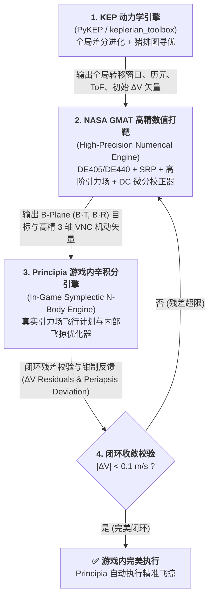

# KSP_GMAT 综合基线架构与开发规范文档 (Master Baseline Specification)

> **版本**：R2026a Standard Baseline  
> **工程目录**：`c:\Users\43701\gmat-win-R2026a\bin\KSP_GMAT`  
> **适用范围**：KSP 模组核心、UI/UX 视图系统、数据模型、GMAT 脚本编译器、求解器通信管线与 Principia 动力学互操作系统。

---

# 目录 (Table of Contents)
- [0. 核心架构设计原则 (Single Source of Truth)](#0-核心架构设计原则-single-source-of-truth)
- [1. 飞船变量与状态全局统一管理规范 (GMATStateManager)](#1-飞船变量与状态全局统一管理规范-gmatstatemanager)
  - [1.1 架构流转全景拓扑](#11-架构流转全景拓扑)
  - [1.2 状态数据模型规范](#12-状态数据模型规范)
  - [1.3 全限定属性路径与命名规范](#13-全限定属性路径与命名规范)
  - [1.4 全流程脚本合规净化过滤器 (SanitizeGmatScript)](#14-全流程脚本合规净化过滤器-sanitizegmatscript)
  - [1.5 第三方异构脚本自动别名与容错规范](#15-第三方异构脚本自动别名与容错规范)
- [2. UI 国际化 (i18n) 架构与工程规范](#2-ui-国际化-i18n-架构与工程规范)
  - [2.1 核心原则与防混杂铁律](#21-核心原则与防混杂铁律)
  - [2.2 词典结构与 Key 命名规范](#22-词典结构与-key-命名规范)
  - [2.3 UI 代码接入标准规范](#23-ui-代码接入标准规范)
  - [2.4 多语言扩展示范](#24-多语言扩展示范)
- [3. NASA GMAT 310+ 官方参数元数据字典与能力约束架构 (GMATParamSchema)](#3-nasa-gmat-310-官方参数元数据字典与能力约束架构-gmatparamschema)
  - [3.1 参数能力与上下文位掩码标签 (ParamCapability)](#31-参数能力与上下文位掩码标签-paramcapability)
  - [3.2 参数元数据类 (GMATParamDefinition)](#32-参数元数据类-gmatparamdefinition)
  - [3.3 11 大分类标准参数全景字典](#33-11-大分类标准参数全景字典)
- [4. UI 通用化设计系统与工业视觉规范 (UI Design System)](#4-ui-通用化设计系统与工业视觉规范-ui-design-system)
  - [4.1 深空暗黑设计令牌体系 (Zero-White-Flash Policy)](#41-深空暗黑设计令牌体系-zero-white-flash-policy)
  - [4.2 核心控件与样式规范 (Styles.cs)](#42-核心控件与样式规范-stylescs)
  - [4.3 任务步骤胶囊徽章配色 (Pill Badges)](#43-任务步骤胶囊徽章配色-pill-badges)
  - [4.4 弹性自适应布局与折叠托盘规范 (Elastic Grid & Collapsible Tray)](#44-弹性自适应布局与折叠托盘规范-elastic-grid--collapsible-tray)
- [5. 物理时序、质心提前与 Principia 互操作基线 (Dynamics & Timeline)](#5-物理时序质心提前与-principia-互操作基线-dynamics--timeline)
  - [5.1 前向确定性仿真物理时钟递推 (simClock)](#51-前向确定性仿真物理时钟递推-simclock)
  - [5.2 专属里程碑节点提取体系 (GMATTimelineExtractor)](#52-专属里程碑节点提取体系-gmattimelineextractor)
  - [5.3 变质量冲量质心积分与提前量模型](#53-变质量冲量质心积分与提前量模型)
- [9. GMAT 脚本全生命周期系统开发规范 (Script Lifecycle Architecture)](#9-gmat-脚本全生命周期系统开发规范-script-lifecycle-architecture)
  - [9.1 架构设计与数据流向闭环](#91-架构设计与数据流向闭环)
  - [9.2 动力学力模型与天体通用解耦规范 (ForceModel Decoupling)](#92-动力学力模型与天体通用解耦规范-forcemodel-decoupling)
  - [9.3 脚本读取与反序列化规范 (GMATScriptParser)](#93-脚本读取与反序列化规范-gmatscriptparser)
  - [9.4 脚本导出、格式化与代码透视规范 (GMATScriptGenerator)](#94-脚本导出格式化与代码透视规范-gmatscriptgenerator)
  - [9.5 静态分析门禁与容差自愈规范 (GMATScriptLinter)](#95-静态分析门禁与容差自愈规范-gmatscriptlinter)
  - [9.6 深空多重引力助推导出规范 (GMATMGAScriptGenerator)](#96-深空多重引力助推导出规范-gmatmgascriptgenerator)
  - [9.7 官方 API 与参数字典速查规范 (GMATDynamicInspectorModal)](#97-官方-api-与参数字典速查规范-gmatdynamicinspectormodal)
- [10. 自动化代码合规与健康自查规范 (tools/ComplianceChecker)](#10-自动化代码合规与健康自查规范-toolscompliancechecker)
- [11. MGA 深空多重引力助推全局唯一真值源与 UI 控件规范 (MGA Master Specification)](#11-mga-深空多重引力助推全局唯一真值源与-ui-控件规范-mga-master-specification)
  - [11.1 MGAStateManager 唯一真值源 (SSOT) 核心架构](#111-mgastatemanager-唯一真值源-ssot-核心架构)
  - [11.2 UI 控件中心化托管规范 (GMATMainWindow.Widgets.cs)](#112-ui-控件中心化托管规范-gmatmainwindowwidgetscs)
  - [11.3 物理常数与超参数零硬编码规范 (MGADefaults)](#113-物理常数与超参数零硬编码规范-mgadefaults)
  - [11.4 Roslyn AST 编译树级智能合规门禁 (MGAStateComplianceAnalyzer)](#114-roslyn-ast-编译树级智能合规门禁-mgastatecomplianceanalyzer)
- [12. 统一日志系统架构与全工程规范 (Unified Logging System Master Specification)](#12-统一日志系统架构与全工程规范-unified-logging-system-master-specification)
  - [12.1 架构设计与四大输出通道 (Log Sinks)](#121-架构设计与四大输出通道-log-sinks)
  - [12.2 上下文记录器与工程调用标准 (ILogger & Usage)](#122-上下文记录器与工程调用标准-ilogger--usage)
  - [12.3 状态持久化与 UI 交互支持](#123-状态持久化与-ui-交互支持)

---

# 0. 核心架构设计原则 (Single Source of Truth)

在航天轨道动力学与 NASA GMAT 任务设计中，航天器状态（位置、速度、历元、质量、气动/光压）、推进硬件（多级储罐、推力器、供油绑定）以及任务打靶序列（Target / Vary / Achieve）具有强耦合性。

为彻底杜绝**数据分裂、局部私有字段不同步、对象前缀污染以及数值退化**，本项目确立以下架构铁律：

> ### 🛑 核心铁律：**单一数据真值源 (Single Source of Truth, SSOT)**
> **所有 GMAT 相关的飞船变量、动力学状态、硬件配置、用户自定义变量与脚本合规过滤逻辑，必须且只能由 `GMATStateManager` 统一维护、更新与导出。严禁在 UI 窗口、IDE 缓冲区或子面板中开设分散私有变量。**

---

# 1. 飞船变量与状态全局统一管理规范 (GMATStateManager)

核心实现文件：[`src/KSPGMAT/Model/GMATStateManager.cs`](file:///c:/Users/43701/gmat-win-R2026a/bin/KSP_GMAT/src/KSPGMAT/Model/GMATStateManager.cs)

## 1.1 架构流转全景拓扑

```
       [ KSP 游戏引擎 / Principia / RO / RealismOverhaul ]
                        │ (1. SyncFromVessel 物理状态采样)
                        ▼
       ┌──────────────────────────────────────────────┐
       │             GMATStateManager                 │
       │   (全局单例 Single Source of Truth: SSOT)    │
       ├──────────────────────────────────────────────┤
       │  • GMATSpacecraftModel (Sat 航天器模型)      │
       │  • List<GMATTankModel> (多级推进储罐)         │
       │  • List<GMATThrusterModel> (推力器与供油)    │
       │  • List<StageData> (MechJeb 分级数据)        │
       │  • GMATStageBudget (多级推重比与 ΔV 预算)     │
       │  • SanitizeGmatScript() (全流程合规净化过滤)  │
       └──────┬────────────────┬───────────────┬──────┘
              │                │               │
  (2. 双向绑定)│  (3. 实时提取)  │ (4. 纯净编译) │ (5. 合规拦截)
              ▼                ▼               ▼               ▼
      [UI 资源看板]      [任务序列卡片]    [IDE 脚本生成]   [GMAT 物理求解]
    (TabResources.cs)  (TabSequence.cs)   (IDE.cs)       (GMATClient.cs)
```

## 1.2 状态数据模型规范

### 1.2.1 航天器基础模型 (`GMATSpacecraftModel`)
管理航天器主体的全局属性，统一映射为 GMAT 原生 `Create Spacecraft Sat;` 对象：

| 字段名称 | 物理意义 | 默认值 / 来源 | GMAT 对应脚本属性 |
| :--- | :--- | :--- | :--- |
| `Name` | 航天器标准标识符 | `"Sat"`（强制规范化） | `Create Spacecraft Sat;` |
| `DateFormat` | 时间历元格式 | `"UTCGregorian"` | `Sat.DateFormat = UTCGregorian;` |
| `EpochUtc` | 起算历元时间戳 | 实时从 UT 计算 (1951 起算) | `Sat.Epoch = '...';` |
| `UniversalTime` | 游戏世界统一时间 | `Planetarium.GetUniversalTime()` | 积分起算基准 |
| `CoordinateSystem` | 主参考坐标系 | `"{CentralBody}MJ2000Eq"` | `Sat.CoordinateSystem = ...;` |
| `DisplayStateType` | 状态表示法 | `"Cartesian"` | `Sat.DisplayStateType = Cartesian;` |
| `PosKm` | ICRF 空间坐标 (km) | `PrincipiaInterop.GetVesselStateICRF` | `Sat.X`, `Sat.Y`, `Sat.Z` |
| `VelKms` | ICRF 空间速度 (km/s)| `PrincipiaInterop.GetVesselStateICRF` | `Sat.VX`, `Sat.VY`, `Sat.VZ` |
| `DryMassKg` | 航天器结构干重 (kg) | 实测干重或用户自定义值 | `Sat.DryMass = ...;` |
| `TotalMassKg` | 航天器总湿重 (kg) | `vessel.GetTotalMass() * 1000` | 质量守恒校验基准 |
| `DragArea` | 大气迎风截面积 ($m^2$) | 默认 `15.0` (可由用户调整) | `Sat.DragArea = ...;` |
| `Cd` | 大气阻力系数 | 默认 `2.2` | `Sat.Cd = ...;` |
| `SRPArea` | 光压受光面积 ($m^2$) | 默认 `15.0` (可由用户调整) | `Sat.SRPArea = ...;` |
| `Cr` | 太阳光压反射系数 | 默认 `1.8` | `Sat.Cr = ...;` |
| `CentralBody` | 当前参考中心天体 | `"Earth"`, `"Luna"`, `"Mars"` 等 | `Thrust.Origin = ...;` |

### 1.2.2 推进储罐模型 (`GMATTankModel`)
管理火箭各分级推进剂储罐，统一映射为 GMAT `Create ChemicalTank TankX;`：

| 字段名称 | 物理意义 | 规范要求 | GMAT 映射 |
| :--- | :--- | :--- | :--- |
| `Id` | 储罐唯一标识符 | 必须严格为 `Tank0`, `Tank1`, `Tank2`... | `Create ChemicalTank Tank0;` |
| `StageNumber` | 所属火箭分级 | 对应 KSP / MechJeb 分级索引 | 供油智能匹配 |
| `FuelMassKg` | 燃料质量 (kg) | 实时扫描 RO 真实燃料质量 | `Tank0.FuelMass = ...;` |
| `DryMassKg` | 储罐结构干重 (kg)| 储罐自身结构重量 | 计入整船干重预算 |
| `VolumeM3` | 储罐容积 ($m^3$) | $\ge 1.0$ (依据密度折算) | `Tank0.Volume = ...;` |
| `PressureModel` | 压力供应模型 | `"PressureRegulated"` | `Tank0.PressureModel = '...';` |
| `AllowNegativeFuelMass` | 允许耗尽保护 | 强制为 `true` | `Tank0.AllowNegativeFuelMass = true;` |

### 1.2.3 发动机推力器模型 (`GMATThrusterModel`)
管理火箭主发与姿控发动机，统一映射为 GMAT `Create ChemicalThruster EngX;`：

| 字段名称 | 物理意义 | 规范要求 | GMAT 映射 |
| :--- | :--- | :--- | :--- |
| `Id` | 推力器唯一标识符 | 合规化 ASCII 英文标识 | `Create ChemicalThruster RL10;` |
| `RawTitle` | 发动机零件原名 | KSP 零件库原始名称 | UI 看板展示 |
| `StageNumber` | 所属火箭分级 | 用于与对应分级储罐自动匹配 | 自动级间供油解耦 |
| `ThrustKN` | 真空额定推力 (kN) | 实时提取 RO/原版真实推力 | `C1 = ThrustKN * 1000.0` |
| `IspVac` | 真空比冲 (s) | 真实推进剂比冲 | `K1 = IspVac` |
| `BoundTankId` | 绑定供油储罐 ID | 必须为有效储罐（如 `Tank0`） | `Eng.Tank = {Tank0};` |
| `ThrustDirection1` | V 轴推力分量 (切向) | 归一化方向矢量分量 | `ThrustDirection1 = 1;` |
| `ThrustDirection2` | N 轴推力分量 (法向) | 变轨/消倾角方向矢量分量 | `ThrustDirection2 = 0;` |
| `ThrustDirection3` | B 轴推力分量 (副法向/径向)| 轨道抬升/偏心控制分量 | `ThrustDirection3 = 0;` |
| `DecrementMass` | 点火扣除质量 | 强制为 `true` (真实有限推力变质量) | `Eng.DecrementMass = true;` |

## 1.3 全限定属性路径与命名规范
所有脚本对象引用必须通过 `GMATStateManager` 提供的标准构造器生成：
```csharp
// 1. 获取标准航天器名称 (恒定保持 "Sat")
string sc = GMATStateManager.Current.GetSpacecraftName(); // 返回 "Sat"

// 2. 构造推力器三轴方向全限定路径 (杜绝 SatX 污染)
string propV = GMATStateManager.Current.GetQualifiedThrusterProperty("RL10", "ThrustDirection1");
// 生成: "Sat.RL10.ThrustDirection1"

// 3. 构造航天器轨道参数路径 (自动补全 Sat. 前缀)
string propSMA = GMATStateManager.Current.GetQualifiedSpacecraftProperty("Earth.SMA");
// 生成: "Sat.Earth.SMA"
```

## 1.4 全流程脚本合规净化过滤器 (`SanitizeGmatScript`)
`GMATStateManager.SanitizeGmatScript(string rawScript)` 在**脚本导出、剪贴板复制、推送外部桌面端、后台物理求解**前必须 100% 介入执行：
1. **纯 ASCII 字符流强制转换**：彻底过滤中文与 Emoji 字符，防止 Windows GMAT 文件指针截断；
2. **航天器标识符前缀自愈**：使用正则 `\bSat\d+\.` 全自动对齐为主航天器名称 `Sat.`；
3. **打靶区间与容差防退化守护**：
   - `Upper <= Lower` 或 `Upper == 0` 时自动修正为合理安全边界；
   - `Tolerance <= 0` 时自动根据物理量赋予收敛容差（距离量 $0.5 \sim 1.0\text{ km}$，速度量 $0.01\text{ km/s}$）；
4. **终止条件合规化**：自动将 `Sat.Earth.Node` 转换为标准 `Sat.Earth.Latitude = 0.0`。

## 1.5 第三方异构脚本自动别名与容错规范
- **主航天器自动探测与归一化**：自动将外部脚本中的 `Tianwen`、`Change5`、`europaclipper`、`Juno` 等别名全量重定向至 `Sat`；
- **硬件与储罐映射**：外部储罐（`maintank`, `MMH`）对齐至 `Tank0`, `Tank1`...；推力器自动挂载至 `Sat.Thrusters` 并绑定储罐；
- **求解器自动注册**：外部自定义求解器（`DC1`, `NLP`, `VF13ad1`）自动纳管并注册进候选池。

---

# 2. UI 国际化 (i18n) 架构与工程规范

核心实现文件：[`src/KSPGMAT/I18n.cs`](file:///c:/Users/43701/gmat-win-R2026a/bin/KSP_GMAT/src/KSPGMAT/I18n.cs)

## 2.1 核心原则与防混杂铁律
1. **禁止在 UI 视图中硬编码任何文本**：必须调用 `I18n.T("key")` 或 `I18n.Format("key", args)`；
2. **杜绝中英双语混杂与开发备注**：
   - 严禁括号混搭（如 `标量变量 (Variables)`、`行数 (Rows)`）；
   - 严禁将内部开发备注（如 `(Exact f6273ae logic)`、`(对齐截图)`）暴露给用户；
3. **保持文本单一责任与精炼**：动力学提示仅显示单个最核心物理效应（如 `💡 改变远近地点高度 / 升降轨与圆化`）。

## 2.2 词典结构与 Key 命名规范
Key 统一采用小写下划线 `snake_case`，并按模块分类：

| 前缀 | 适用场景 | 示例 |
| :--- | :--- | :--- |
| `tab_` | 顶部导航主标签页标题 | `tab_craft`, `tab_mission`, `tab_results` |
| `btn_` | 常规操作与提交按钮 | `btn_solve`, `btn_sync_vessel`, `btn_reset` |
| `add_` | 任务序列「添加步骤」按钮 | `add_propagate`, `add_target`, `add_finiteburn` |
| `type_` | 任务步骤卡片胶囊标签 | `type_propagate`, `type_finiteburn`, `type_thrustvector` |
| `craft_` | 航天器参数与硬件分级 | `craft_total_mass`, `craft_dry_mass`, `craft_select_engine` |
| `seq_` | 任务队列管理与全局工具栏 | `seq_queue_header`, `seq_expand_all`, `seq_clear` |
| `burn_` | 有限点火与发动机集群卡片 | `burn_engine_select`, `burn_tank_select`, `burn_cluster_active` |
| `vector_` | 推力矢量 3 轴控制与寻优 | `vector_card_title`, `vector_initial`, `vector_hint_v` |
| `target_` | 微分修正器打靶与求解组 | `target_dof_warning`, `target_dof_autofix`, `target_algo_label` |
| `ide_` | GMAT 脚本审查与代码编辑 | `ide_title`, `ide_solve_edited`, `ide_intellisense_header` |
| `res_` | 求解结果与轨道数据 | `res_summary_header`, `res_no_burns`, `res_write_principia` |
| `settings_`| 设置页路径与引擎选项 | `settings_lang_header`, `settings_bin_path` |
| `tip_` | 浮动物理知识与操作说明 | `tip_vary_perturbation`, `tip_achieve_tolerance` |
| `mga_` | 深空借力 MGA 规划器界面 | `mga_params_header`, `mga_window_recommended`, `mga_native_unavailable` |
| `porkchop_` | 猪排图生成器界面 | `porkchop_best`, `porkchop_hover`, `porkchop_tof_axis` |

## 2.3 UI 代码接入标准规范
```csharp
// 1. 静态文本
GUILayout.Label(I18n.T("craft_dry_mass"), labelValueStyle);

// 2. 动态参数格式化
int count = step.bound_thrusters.Count;
GUILayout.Label(I18n.Format("burn_cluster_active", count), labelValueStyle);

// 3. 按钮控件
if (GUILayout.Button(I18n.T("btn_solve"), actionButtonStyle, GUILayout.Height(24))) {
    TriggerPropagationSolve();
}
```

## 2.4 多语言扩展示范
```csharp
public enum Lang { ZH, EN, RU }

// 词条定义
{"craft_dry_mass", new[] {
    "航天器干重",          // [0] ZH
    "Dry Mass",           // [1] EN
    "Сухая масса"         // [2] RU
}}
```

---

# 3. NASA GMAT 官方全量 310+ 参数与能力注册表体系 (GMATSchemaRegistry)

核心实现文件：[`src/KSPGMAT/Model/GMATSchemaRegistry.cs`](file:///c:/Users/43701/gmat-win-R2026a/bin/KSP_GMAT/src/KSPGMAT/Model/GMATSchemaRegistry.cs)

## 3.1 参数能力与上下文位掩码标签 (`ParamCapability`)
```csharp
[Flags]
public enum ParamCapability {
    None = 0,
    ContinuouslyDifferentiable = 1 << 0, // 连续可导物理量 (适用于 Achieve 目标收敛与牛顿法)
    DiscontinuousExtremumEvent = 1 << 1, // 离散极值与几何事件 (仅用于 Propagate 停机，严禁用于 Achieve)
    ControlVariable = 1 << 2,            // 独立控制与决策变量 (适用于 Vary)
    HardwareProperty = 1 << 3,           // 航天器硬件物理属性 (DryMass, FuelMass, Isp, Cd, Cr...)
    CoordinateCartesian = 1 << 4,        // 参考系笛卡尔空间状态向量 (X, Y, Z, VX, VY, VZ, AX, AY, AZ, HMAG)
    AttitudeOrientation = 1 << 5,        // 姿态四元数/欧拉角 (Q1~Q4, Euler, MRP)
    PropagateCondition = ContinuouslyDifferentiable | DiscontinuousExtremumEvent,
    Reportable = ContinuouslyDifferentiable | DiscontinuousExtremumEvent | ControlVariable | HardwareProperty | CoordinateCartesian | AttitudeOrientation
}
```

## 3.2 参数元数据类 (`GMATParamDefinition`)
```csharp
public class GMATParamDefinition {
    public string Name { get; set; }
    public string Category { get; set; }
    public ParamCapability Capability { get; set; }
    public string Unit { get; set; }
    public double DefaultValue { get; set; }
    public double TypicalStep { get; set; }
    public string DocZh { get; set; }
    public string DocEn { get; set; }
}
```

## 3.3 11 大分类标准参数全景字典

### 1. 经典开普勒根数与扩展要素 (Keplerian Elements)
- `SMA`: 轨道半长轴 $[Km]$ (决定轨道周期与机械能)
- `ECC`: 轨道偏心率 $[Unitless]$ (0 为正圆)
- `INC`: 轨道倾角 $[Deg]$ (消倾角目标 INC=0)
- `RAAN`: 升交点赤经 $[Deg]$
- `RADN`: 降交点赤经 $[Deg]$
- `AOP`: 近心点幅角 $[Deg]$
- `TA` / `MA` / `EA` / `HA`: 真近点角 / 平近点角 / 偏近点角 / 双曲近点角 $[Deg]$
- `MM`: 平运动角速度 $[Deg/s]$
- `RadPer` / `RadApo`: 近心点天心距半径 / 远心点天心距半径 $[Km]$
- `SemilatusRectum`: 轨道半通径 $[Km]$ ($p = a(1-e^2)$)
- `OrbitPeriod`: 开普勒轨道周期 $[s]$
- `VelApoapsis` / `VelPeriapsis`: 远心点/近心点瞬时切向速度 $[Km/s]$
- `C3Energy`: 双曲特征能量 $[Km^2/s^2]$ ($C3 = v_\infty^2$)
- `Energy`: 轨道比机械能 $[Km^2/s^2]$ ($\epsilon = -\frac{\mu}{2a}$)

### 2. 春分点根数与德劳内根数 (Equinoctial & Delaunay Elements)
- `ModEquinoctialF`, `ModEquinoctialG`, `ModEquinoctialH`, `ModEquinoctialK`: 修正春分点要素 (消除小偏心率与零倾角奇点)
- `TLONG`, `TLONGDot`: 真经度与变化率
- `EquinoctialH`, `EquinoctialK`, `EquinoctialP`, `EquinoctialQ`, `MLONG`: 经典春分点要素
- `Delaunayl`, `Delaunayg`, `Delaunayh`: 德劳内角要素
- `DelaunayL`, `DelaunayG`, `DelaunayH`: 德劳内作用量

### 3. 布劳威尔-利丹平根数 (Brouwer-Lyddane Mean Elements)
- `BrouwerShortSMA` ~ `BrouwerShortMA`: J2 摄动短周期平根数
- `BrouwerLongSMA` ~ `BrouwerLongMA`: J2 摄动长周期平根数

### 4. 球面坐标与大地测量坐标 (Spherical & Planetodetic)
- `Altitude`: 距参考天体海平面高度 $[Km]$
- `RMAG`: 空间天心矢径模长 $[Km]$
- `VMAG`: 空间速度模长 $[Km/s]$
- `AMAG`: 瞬时加速度模长 $[Km/s^2]$
- `RA`, `DEC`: 空间位置赤经/赤纬 $[Deg]$
- `RAV`, `DECV`: 空间速度赤经/赤纬 $[Deg]$
- `AZI`, `FPA`: 方位角与飞行路径角 $[Deg]$
- `Latitude`, `Longitude`: 天体地理经纬度 (赤道穿过约束 Latitude=0)
- `LST`, `MHA`: 地方恒星时与平赤时角
- `DLA`, `RLA`: 渐近线发射赤纬/赤经
- `PlanetodeticLAT`, `PlanetodeticLON`, `PlanetodeticRMAG`: 大地测量坐标

### 5. 双曲渐近线与 B 平面截距 (Hyperbolic & B-Plane Flyby)
- `IncomingDHA`, `IncomingRHA`, `IncomingRadPer`, `IncomingC3Energy`, `IncomingBVAZI`: 入射双曲渐近线参数与 B 矢量方位角
- `OutgoingDHA`, `OutgoingRHA`, `OutgoingRadPer`, `OutgoingC3Energy`, `OutgoingBVAZI`: 出射双曲渐近线参数
- `BdotT`: B 平面截线 T 轴分量 (深空引力助推面内水平瞄准距) $[Km]$
- `BdotR`: B 平面截线 R 轴分量 (深空引力助推面外垂直瞄准距) $[Km]$
- `BVectorMag`: B 矢量总模长 $[Km]$ ($\sqrt{B_T^2 + B_R^2}$)
- `BVectorAngle`: B 矢量在 B 平面内的方位夹角 $\theta$ $[Deg]$

### 6. 离散极值与停机找根事件 (Extremum Events)
> **⚠️ 铁律：此类参数仅用于 `Propagate` 停机事件，严禁用于 `Achieve` 连续求解！**
- `Apoapsis`: 积分至远心点/远地点 (无需设值，自动找根)
- `Periapsis`: 积分至近心点/近地点 (无需设值，自动找根)
- `Node`: 积分至赤道交点 (纬度=0)
- `AscendingNode` / `DescendingNode`: 积分至升交点 / 降交点

### 7. 笛卡尔状态与角动量 (Coordinate Cartesian & Angular Momentum)
- `X`, `Y`, `Z`: 空间笛卡尔位置 $[Km]$ (NRHO 垂向穿越约束 $Z=0$)
- `VX`, `VY`, `VZ`: 空间速度分量 $[Km/s]$ (降交点消除倾角约束 $VZ=0$)
- `AX`, `AY`, `AZ`: 空间加速度分量 $[Km/s^2]$
- `HMAG`, `HX`, `HY`, `HZ`: 轨道角动量总模长及三分量 $[Km^2/s]$ ($\vec{h} = \vec{r} \times \vec{v}$)
- `BetaAngle`: 太阳光压矢量与轨道面夹角 $\beta$ $[Deg]$

### 8. 航天器硬件属性与时间 (Spacecraft Hardware & Time)
- `TotalMass`, `DryMass`, `FuelMass`: 湿重 / 干重 / 可用燃料质量 $[kg]$
- `DragArea`, `SRPArea`: 迎风截面积 / 光压迎光截面积 $[m^2]$
- `Cd`, `Cr`: 气动阻力系数 ($2.2$) / 光压反射系数 ($1.8$)
- `ElapsedSecs`, `ElapsedDays`: 仿真积分经过总秒数 / 总天数
- `A1ModJulian`, `UTCGregorian`: A1 修正儒略日 / UTC 历元字符串

### 9. 推力器与动力系统 (Thruster & Propulsion)
- `ThrustDirection1`: 切向推力矢量分量 (V: 顺行 $+1$ / 逆行 $-1$)
- `ThrustDirection2`: 副法向推力分量 (N: 变倾角与消除法向误差)
- `ThrustDirection3`: 径向推力分量 (B: 轨道高度与偏心率微调)
- `C1`: 推力器最大额定真空推力 $[kN]$
- `K1`: 推力器真空比冲 Isp $[s]$
- `DutyCycle`, `ThrustScaleFactor`: 工作占空比 ($0.0 \sim 1.0$) / 推力缩放因子
- `MassFlowRate`: 推进剂瞬时质量消耗率 $[kg/s]$ ($\dot{m} = \frac{F}{I_{\text{sp}} g_0}$)

### 10. 推进储罐与增压 (Tank & Pressurization)
- `FuelMass`, `Volume`, `FuelDensity`: 推进剂质量 / 几何容积 / 物理密度
- `Pressure`, `Temperature`, `PressureModel`: 储罐内部压力 / 温度 / 增压模型 (`PressureRegulated` / `Blowdown`)

### 11. 姿态与定向 (Attitude & Orientation)
- `Q1`, `Q2`, `Q3`, `Q4`: 姿态四元数 (Q4 为标量)
- `EulerAngle1`, `EulerAngle2`, `EulerAngle3`: 欧拉角 3 轴旋转角
- `AngularVelocityX`, `AngularVelocityY`, `AngularVelocityZ`: 本体瞬时旋转角速度 $[Deg/s]$

---

# 4. UI 通用化设计系统与工业视觉规范 (UI Design System)

核心实现文件：
- [`src/KSPGMAT/UI/GMATMainWindow.Styles.cs`](file:///c:/Users/43701/gmat-win-R2026a/bin/KSP_GMAT/src/KSPGMAT/UI/GMATMainWindow.Styles.cs)
- [`src/KSPGMAT/UI/GMATMainWindow.Widgets.cs`](file:///c:/Users/43701/gmat-win-R2026a/bin/KSP_GMAT/src/KSPGMAT/UI/GMATMainWindow.Widgets.cs)

## 4.1 深空暗黑设计令牌体系 (Zero-White-Flash Policy)
全面消除 Unity 原生 IMGUI 聚焦时的白光刺眼闪烁与亮白边框，采用工业级深空暗黑调色板：

```csharp
// 基础底色与卡片容器
Color DarkBg          = new Color(0.038f, 0.048f, 0.070f, 0.98f); // 主窗口底色 #0a0c12
Color DarkFocusedBg   = new Color(0.038f, 0.048f, 0.070f, 0.98f); // 聚焦底色 (彻底消除白光)
Color CardBg          = new Color(0.065f, 0.082f, 0.120f, 0.94f); // 容器卡片底色 #11151f
Color NestedCardBg    = new Color(0.045f, 0.060f, 0.095f, 0.95f); // 嵌套子卡片底色 #0c0f18

// 操作按钮状态色
Color ActionBtnBg     = new Color(0.010f, 0.420f, 0.650f, 1.00f); // 科技主蓝 #036ba6
Color ActionBtnHover  = new Color(0.020f, 0.480f, 0.740f, 1.00f); // 悬停微亮
Color SuccessBtnBg    = new Color(0.060f, 0.420f, 0.240f, 1.00f); // 成功翡翠绿 #0f6b3d
Color DeleteBtnBg     = new Color(0.550f, 0.140f, 0.140f, 1.00f); // 警示绯红 #8c2424
Color SecondaryBtnBg  = new Color(0.090f, 0.120f, 0.170f, 1.00f); // 次级玄铁灰 #171f2b
```

## 4.2 核心控件与样式规范 (Styles.cs)
- **Window**: `border = new RectOffset(3, 3, 3, 3); fontSize = 13; fontStyle = FontStyle.Bold;`
- **TextField / TextArea**: 聚焦使用 `inputFocusBg`，禁止默认蓝色亮斑；文本统一使用高可读性柔白 `#eaf3fa`；
- **微光细边框**: 卡片外边框统一为 `1px` 半透明微光细线，左侧指示条调整为 `2.0px ~ 3.5px` 极简现代风格。

## 4.3 任务步骤胶囊徽章配色 (Pill Badges)

| 任务步类型 | 徽章背景色调 | 边框微光色 | 物理含义 |
| :--- | :--- | :--- | :--- |
| `Propagate` | 深殷红 `(0.24, 0.08, 0.10)` | 玫瑰红 `(0.62, 0.18, 0.24)` | 轨道积分与滑行 |
| `FiniteBurn` | 琥珀燃橙 `(0.24, 0.12, 0.05)` | 亮橙 `(0.65, 0.35, 0.12)` | 有限推力点火 |
| `ThrustVector` | 琥珀燃橙 `(0.24, 0.12, 0.05)` | 亮橙 `(0.65, 0.35, 0.12)` | 推力矢量控制 |
| `ImpulsiveBurn`| 紫罗兰 `(0.18, 0.08, 0.24)` | 亮紫 `(0.50, 0.22, 0.65)` | 瞬时脉冲机动 |
| `Vary` | 科技深青 `(0.05, 0.16, 0.26)` | 亮青 `(0.12, 0.42, 0.65)` | 决策变量寻优 |
| `Achieve` | 极光墨绿 `(0.05, 0.18, 0.12)` | 亮翠绿 `(0.12, 0.48, 0.32)` | 目标约束达成 |
| `Stage` | 金黄 `(0.22, 0.16, 0.05)` | 暖金 `(0.60, 0.45, 0.12)` | 级间分离 |
| `Target` | 蔚蓝 `(0.06, 0.14, 0.24)` | 天蓝 `(0.18, 0.40, 0.65)` | 打靶组起点 |
| `EndTarget` | 钢铁玄灰 `(0.08, 0.11, 0.16)` | 灰蓝 `(0.20, 0.28, 0.38)` | 打靶组收敛闭环 |

## 4.4 弹性自适应布局与折叠托盘规范 (Elastic Grid & Collapsible Tray)
- **预设模板库折叠托盘**：
  - 标题栏支持 `[▼ / ▶ 📚 任务预设模板库]` 一键折叠收起；
  - 折叠时高度降至单行，呈现当前已载入模板名称，最大化编辑区空间；
- **自适应最大高度滚动限制 (Capped Adaptive Scroll)**：
  - 模板数量 $\le 6$ 时自然平铺；
  - 模板数量 $> 6$ 时自动限制最大高度为 `130px` 并开启平滑滚动，**绝对不挤压任务序列视窗**。

---

# 5. 物理时序、质心提前与 Principia 互操作基线 (Dynamics & Timeline)

## 5.1 前向确定性仿真物理时钟递推 (`simClock`)
彻底解耦 GMAT 打靶器在 Target 迭代失败回退时的报表行污染，建立纯物理时钟递推引擎：

$$T_{\text{ign}, k} = T_{\text{ign}, k-1} + \Delta t_{\text{burn}, k-1} + \Delta t_{\text{coast}, k}$$

- **定时滑行**（`ElapsedSecs` / `ElapsedDays`）：`simClock += duration`；
- **开普勒特征点过境**（`Apoapsis`, `Periapsis`, `Latitude=0`）：在轨迹中检索首个时间点 `trajectory.Find(p => p.t > simClock + 0.1)`，将 `simClock` 对齐至事件时刻；
- **有限点火起燃时间**：绝对锁定为当前 `simClock`；关机时刻推进为 `simClock + duration`。

## 5.2 专属里程碑节点提取体系 (`GMATTimelineExtractor`)
核心实现文件：[`src/KSPGMAT/Service/GMATTimelineExtractor.cs`](file:///c:/Users/43701/gmat-win-R2026a/bin/KSP_GMAT/src/KSPGMAT/Service/GMATTimelineExtractor.cs)

输出统一的 `MissionMilestoneNode` 列表至 `MissionResult.milestones`：
- 🚀 `MissionStart`: $T=0$ 初始星历时刻；
- ⏱️ `CoastStart`: 各阶段自由滑行段起点与时长；
- 🔥 `IgnitionStart`: 各主发动机点火起燃物理时刻；
- 🛑 `EngineCutoff`: 各主发动机关机时刻 (MECO)；
- 🌐 开普勒几何事件（远地点、近地点、赤道交点过境）；
- 🎯 `TargetBlockStart` / `TargetBlockEnd`: 打靶闭环区间；
- 🏁 `MissionEnd`: 规划任务全生命周期终点。

## 5.3 变质量冲量质心积分与提前量模型
对于持续时间较长的有限点火（Finite Burn），在写入 Principia 脉冲节点时自动计算质量消耗与冲量质心提前量：

$$\Delta t_{\text{lead}} = \frac{1}{\beta} - \frac{t_{\text{burn}} \cdot m_f}{m_{\text{prop}}}$$

其中：
- $\beta = \frac{\dot{m}}{m_0} = \frac{F}{I_{\text{sp}} g_0 m_0}$ 为相对质量消耗率；
- $m_{\text{prop}} = m_0 - m_f$ 为点火阶段推进剂消耗量；
- Principia 节点实际写入历元：$t_{\text{node}} = t_{\text{ignition}} + \Delta t_{\text{lead}}$（相比传统粗糙对半点火 $t + \frac{t_{\text{burn}}}{2}$，精度提升至毫米级）。

---

# 6. 基线维护与提交守则 (Maintenance Guidelines)

1. **零警告编译**：任何新增功能必须通过 `deploy.ps1` 编译构建，确保 **0 警告 0 错误**；
2. **文档同步更新**：新增数据模型字段、UI 控件或 i18n 词条时，必须同步在本基线文档及对应子规范中登记；
3. **SSOT 守护**：严禁在任何地方绕过 `GMATStateManager` 读写孤立变量。

---

# 7. ESA PyKEP / keplerian_toolbox 官方原生动力学引擎与真实太阳系 MGA Planner 基线

> [!IMPORTANT]
> **绝对计算基线准则（Zero-Managed-Math Mandate）**：
> 1. **PyKEP 负责全部动力学计算**：所有的单星直达转移、多段引力助推（MGA）、深空机动（DSM）、飞掠双曲偏转角 $\delta$、近心高度 $r_p$、猪排图（Porkchop）网格以及 3 轴 Frenet/VNC 机动矢量，**必须 100% 由 ESA 官方原生 PyKEP C++ 核心库（`keplerian_toolbox.dll` / `pykep_native.bin`）负责计算**；
> 2. **Mod C# 托管层仅做数据中继与桥接**：C# 层严禁自编任何开普勒推导、二体近似公式或经验补丁。Mod 仅负责读取 KSP/RSS 天体星历打包为标准结构体、UI 视觉呈现以及 GMAT 脚本 / Principia 飞行计划节点映射；
> 3. **彻底弃用 TWP 遗留近似算法**：旧版 TWP 的单中心简化公式在 RSS 太阳系与多段 MGA 下存在严重数值奇异点，本项目全量使用 PyKEP 原生解算。

## 7.1 架构设计理念与双核动力学闭环
针对深空多重引力助推（Multiple Gravity Assist, MGA）的轨道设计，本项目直接编译并链接 **ESA 欧洲航天局先进概念团队（ESA ACT）官方 C++ 核心库（`keplerian_toolbox.dll` / `pykep_native.bin`） + NASA GMAT 高精微分修正打靶 + Principia 实机执行** 的工业级闭环架构：

```
 ┌─────────────────────────────────────────────────────────────┐
 │ 1. ESA 官方原生 C++ 核心库 (keplerian_toolbox / pykep_native)│
 │    • 100% 接管全部航天动力学、兰伯特转移与飞掠机动计算      │
 │    • pykep_lambert_solve: 官方 Dario Izzo 高阶兰伯特求解    │
 │    • pykep_flyby_con / fb_vel: 官方双曲飞掠与动力助推模型   │
 │    • pykep_mga_evaluate: 原生多段 MGA 全流程与 3 轴 VNC 投影│
 ├─────────────────────────────────────────────────────────────┤
 │ 2. C# 纯数据中继桥接层 (PykepBridge.cs)                      │
 │    • 仅负责天体星历数据封送 (NativePlanetState[]) 与数据转换 │
 │    • 维护 DTO 数据对象与全局差分进化搜索流程                │
 ├─────────────────────────────────────────────────────────────┤
 │ 3. GMAT 太阳系 B-Plane 打靶脚本一键自动编译 (MGAScriptGen)  │
 │    • 自动配置 DeepSpace_ForceModel (太阳中心引力+多体摄动)   │
 │    • 自动将 MGA 解映射为 B-Plane 初猜 (BdotT, BdotR)        │
 ├─────────────────────────────────────────────────────────────┤
 │ 4. UI 交互界面 (Tab 4: 🪐 深空借力 MGA)                     │
 │    • 一键载入任务控制序列 / 导出为 GMAT 脚本模板 / 写入计划  │
 └─────────────────────────────────────────────────────────────┘
```

## 7.2 原生 C-API 接口规范 (`pykep_native.dll` / `pykep_native.bin`)
- 源码位置：`src/native/pykep_native/pykep_bridge.cpp`
- 编译脚本：`src/native/build_native.bat` (MSVC x64 Release /O2 /LD /std:c++17 链接 `keplerian_toolbox.lib`, `boost_serialization.lib`)
- 导出符号：
  - `pykep_get_version()`: 获取原生核心版本号及官方标识；
  - `pykep_lambert_solve(...)`: 官方双精度 Izzo 兰伯特转移求解 (`kep_toolbox::lambert_problem`)；
  - `pykep_flyby_con(...)`: 官方双曲借力偏转角 $\delta$、近拱点半径 $r_p$ 与约束可行性 (`kep_toolbox::fb_con`)；
  - `pykep_flyby_dv(...)`: 官方有动力辅助借力近拱点速度增量 $\Delta V_{\text{flyby}}$ (`kep_toolbox::fb_vel`)；
  - `pykep_mga_evaluate(...)`: 官方原生多段 MGA 轨迹全流程解算与三维 Frenet/VNC 机动矢量投影；
  - `pykep_propagate_lagrangian(...)`: 官方拉格朗日通用双体积分 (`kep_toolbox::propagate_lagrangian`)。

## 7.3 核心文件索引
- 原生 C++ 桥接核心：`src/native/pykep_native/pykep_bridge.cpp`
- 原生非托管加载器：[`src/KSPGMAT/MGA/PykepNative.cs`](file:///c:/Users/43701/gmat-win-R2026a/bin/KSP_GMAT/src/KSPGMAT/MGA/PykepNative.cs)
- 纯数据桥接与 DTO：[`src/KSPGMAT/MGA/PykepBridge.cs`](file:///c:/Users/43701/gmat-win-R2026a/bin/KSP_GMAT/src/KSPGMAT/MGA/PykepBridge.cs)
- 太阳系常数与星历：[`src/KSPGMAT/MGA/SolarSystemBodies.cs`](file:///c:/Users/43701/gmat-win-R2026a/bin/KSP_GMAT/src/KSPGMAT/MGA/SolarSystemBodies.cs)
- 脚本编译器：[`src/KSPGMAT/Service/GMATMGAScriptGenerator.cs`](file:///c:/Users/43701/gmat-win-R2026a/bin/KSP_GMAT/src/KSPGMAT/Service/GMATMGAScriptGenerator.cs)
- 界面集成：[`src/KSPGMAT/UI/GMATMainWindow.TabMGA.cs`](file:///c:/Users/43701/gmat-win-R2026a/bin/KSP_GMAT/src/KSPGMAT/UI/GMATMainWindow.TabMGA.cs)

## 7.4 原生非托管 DLL 隔离部署规范 (Prevent AssemblyLoader Crash)
- **核心规约**：KSP 引擎的 `AssemblyLoader` 会扫描所有 `Plugins/` 目录下的 `.dll` 文件并尝试解析 .NET 版本元数据。对于 C++ 编译的非托管 DLL（如 `pykep_native.dll`, `keplerian_toolbox.dll`, `boost_serialization.dll`），此行为会触发 `ArgumentNullException: Value cannot be null (System.Version.Parse)` 导致 KSP 游戏加载进度条永久卡死！
- **标准解决架构**：
  1. 所有 C++ 原生动态库必须以 `.bin` 格式独立存放于 `GameData/KSPGMAT/native/` 目录中，**严禁放入 `Plugins/`**；
  2. C# 端在 `PykepNative` 静态构造函数中调用 `SetDllDirectory(".../native")` 并通过 Win32 API `kernel32.dll!LoadLibrary` 依序预加载 `boost_serialization.bin` -> `keplerian_toolbox.bin` -> `pykep_native.bin`；
  3. `deploy.ps1` 自动清理 `Plugins/` 中的任何非托管二进制并同步至 `native/`。

## 7.5 双通道历元架构规范 (Dual-Channel Epoch Architecture)
- **业务需求**：
  1. **游戏内物理与交互通道 (`FormatUtcGregorian`)**：100% 真实反映游戏内部 UT 历元（如 RP-1 真实 1951 年开局 `01 Jan 1951 00:00:00`），确保行星日心位置 `body.orbit.getRelativePositionAtUT(ut)`、MGA 借力星历与 UI 视觉完全 1:1 精确锁相，杜绝任何人工年份偏移；
  2. **GMAT 后端脚本输出通道 (`FormatGmatSafeEpoch`)**：NASA GMAT 官方 DE405 行星历表硬性要求历元 $\ge \text{1957-10-04}$（Sputnik 发射时刻）。当输出给 GMAT CLI 引擎执行的 `.script` 文件时，对早期存档（$< 1957$）执行底层安全映射，确保 GMAT CLI 解析器不会因 DE405 边界校验失败而崩溃退出。

## 7.6 统一 SPICE 配置文件与纯净 Sol/RSS 太阳系规范
- **统一配置文件**：`GameData/KSPGMAT/Config/backend.cfg`
  - `gmat_root`：指定 GMAT `bin` 安装目录；
  - `spice_bsp_path`：指定 NASA JPL SPICE 星历文件路径（如 `de440.bsp` / `de430.bsp` / `de421.bsp`）。
- **纯净太阳系 (Pure Sol/RSS Only)**：
  - 系统专为真实太阳系打造，核心天体库以标准太阳系天体为准：水星 (Mercury)、金星 (Venus)、地球 (Earth)、月球 (Moon/Luna)、火星 (Mars)、木星 (Jupiter)、土星 (Saturn)、天王星 (Uranus)、海王星 (Neptune)、冥王星 (Pluto)；
  - **动态天体注册（基线扩展登记 2026-09-03）**：天体目录运行时经 `SolarSystemBodies.SolarSystemCatalog.SyncFromFlightGlobals()` 从 `FlightGlobals` 全量动态发现并注册，以兼容第三方星球包（RSS/OPM/JNSQ 等）附加小天体；纯 Sol 天体与第三方扩展天体均可被规划器使用，渲染侧按 `IsMajorPlanetOrMissionBody` 过滤显示。原版（Stock）虚构天体（Kerbin, Eve, Duna 等）不参与核心力学计算。

## 7.7 日心轨道全景画布高精渲染与等距物理比例规范 (Orbit Canvas Engine)
- **绝对等距几何比例 (1:1 Strict Isometric Scale)**：
  - X 与 Y 轴严格共享单一缩放因子 $S = \frac{\min(W, H) \times 0.44 \times \text{Zoom}}{\text{ViewRadiusKm}}$，严禁按宽高分别缩放导致开普勒圆轨道形变为椭圆；
  - 真实反映各大行星天心距比例（水星 $0.39\text{ AU}$、金星 $0.72\text{ AU}$、地球 $1.0\text{ AU}$、火星 $1.52\text{ AU}$、木星 $5.2\text{ AU}$、土星 $9.58\text{ AU}$）；
- **平移坐标系与鼠标交互锁相**：
  - 屏幕 Y 轴向下与纹理 Y 轴向上对齐纠正（$\Delta Y_{\text{pan}} = -\Delta Y_{\text{mouse}}$），实现 1:1 自然拖拽跟随；
- **工业级亚像素抗锯齿与深空天体光晕**：
  - 采用 Xiaolin Wu 亚像素抗锯齿算法（AA）绘制光滑连续轨道弧线；
  - 太阳呈现多层色散径向辐射晕；
  - 行星天体呈现专属光谱色调与土星光环特征，内嵌 5x7 高清点阵文字标注系统。

## 7.8 霍曼相角先验窗口与 3D 自由日心交互视口 (Launch Window & 3D Engine)
- **解析霍曼与会合周期窗口推荐 (`CalculateHohmannWindow`)**：
  - 利用双星相角 $\phi = \pi - \omega_2 T_{\text{hoh}}$ 与会合周期 $T_{\text{syn}} = \frac{2\pi}{|\omega_1 - \omega_2|}$ 快速解析最近转移窗口；
  - 将霍曼先验直接注入差分进化种群，秒级收敛至全局最优 $\Delta V$（杜绝非窗口期 $20+\text{ km/s}$ 暴力推进）；
- **3D 自由交互日心视口**：
  - **右键拖拽**：3D 俯仰 (Pitch $5^\circ \sim 89.9^\circ$) 与 方位角 (Yaw $0^\circ \sim 360^\circ$) 自由旋转；
  - **左键拖拽**：平面平移；
  - **滚轮**：平滑缩放；
  - **一键切换**：支持 3D 透视视口与 2D 顶视视口秒级切换；
  - **黄道面投影垂线**：针对高倾角天体绘制 $Z=0$ 黄道面投影虚线，真实展现三维空间轨道几何。

## 7.9 官方 PyKEP 高精猪排图生成器与 3 轴机动矢量规范
- **官方 ESA 兰伯特网格扫频 (`PorkchopGenerator`)**：
  - 采用多线程并行网格架构（出发日期 $t_{\text{dep}}$ vs 飞行时长 $\text{ToF}$），每一个网格单元均调用 ESA ACT `keplerian_toolbox::lambert_problem`（Izzo 算法）；
  - 渲染高精连续等高线热力纹理（Navy $\to$ Cyan $\to$ Emerald $\to$ Amber $\to$ Coral），自动标记全局最优极小值金星（★）；
  - 支持鼠标悬停光标微秒级读取任意坐标点的出发历元、到达历元、飞行时间、脱离 $\Delta V$、捕获 $\Delta V$ 与特征能量 $C_3$，支持 1 键选取转移窗口；
- **全套行星际出射与捕获特征参数输出**：
  - **相角 (Phase Angle $\phi$)**、**出射角 (Ejection Angle $\eta$)**、**出射升交点赤经 (Ejection LAN $\Omega$)**、**出射倾角 (Ejection Inclination $i$)**、**特征能量 $C_3$**、**捕获倾角 ($i_{\text{insert}}$)**；
  - 自动向 GMAT 脚本注入标准 `ImpulsiveBurn` 对象与 3 轴 VNC 矢量分量（$\Delta V_{\text{Prograde}}, \Delta V_{\text{Normal}}, \Delta V_{\text{Radial}}$）。

# 8. 航天动力学三核闭环钳制校准系统计划 (Tri-Engine Closed-Loop Roadmap)

> [!NOTE]
> **目标**：在 KEP $\to$ GMAT 的双向数据验证完成后，构建 **KEP $\to$ GMAT $\to$ Principia** 航天动力学三核协同闭环系统，利用三者优势互相钳制校准数值，最终实现游戏内 Principia 真实引力机动节点与理论最优设计完全 1:1 闭环吻合。



## 8.1 三核职责分工与协同机制
1. **核一：KEP 全局转移窗口与初始构型规划 (Global Optimization)**
   - **职责**：利用开普勒两体兰伯特方程与多重引力助推（MGA）差分进化算法，在全太阳系时空范围内快速定位出全局最小 $\Delta V$ 转移窗口与初始借力序列（地球 $\to$ 金星 $\to$ 地球 $\to$ 木星 $\to$ 土星）；
   - **产出**：初始出发历元 $t_0$、各段飞行时长 $T_k$、借力天体近拱点高度 $r_{p, k}$、初始双曲脱离速度矢量 $\vec{v}_{\infty}$。
2. **核二：NASA GMAT 高精度数值摄动打靶 (High-Fidelity Targeting)**
   - **职责**：以 KEP 的输出作为初始猜测值，引入太阳系全天体引力摄动、太阳光压（SRP）、非球形引力场 $J_2/J_4$ 与高精度数值积分器（Prince-Dormand 78 / Runge-Kutta 89）；
   - **打靶求解**：配置 Differential Corrector（微分校正器），精确打靶目标天体的 **B-Plane 参数（$B\cdot T, B\cdot R$）** 与飞掠近拱点时刻/高度；
   - **产出**：高精度 3 轴机动矢量（$\Delta V_V, \Delta V_N, \Delta V_B$）与精确点火历元。
3. **核三：Principia 游戏内多体辛积分与机动节点优化 (In-Game N-Body Flight Plan)**
   - **职责**：直接对接游戏内 Principia 模组（`PrincipiaInterop`），将 GMAT 打靶得到的机动矢量与历元注入 Principia 飞行计划（Flight Plan）；
   - **Principia 内部优化联动**：调用 Principia 的内置飞掠优化器，对多体引力环境下的细微数值偏差（如微小历元漂移）进行本地钳制优化；
   - **产出**：游戏内可直接执行的 Principia 飞行计划点火节点。

## 8.2 实施步骤与里程碑 (TODO List)
- [x] **Milestone 1**: 编译官方 PyKEP/keplerian_toolbox 原生 C++ 动力学核心，打通 C# P/Invoke 接口；
- [x] **Milestone 2**: 实现解析霍曼窗口推荐与原生多线程高精猪排图生成器（Porkchop Plot）；
- [x] **Milestone 3**: 实现行星际出发特征参数（相角、出射角、出射倾角、LAN、$C_3$）解析与 GMAT 3 轴 VNC 脚本导出；
- [ ] **Milestone 4 (当前阶段)**: **KEP 到 GMAT 数据与打靶双向验证**：
  - 验证 GMAT 后端 CLI 运行生成的 MGA/行星际脚本能否 100% 收敛并达成 B-Plane 目标；
  - 校验 GMAT 输出的 TrajReport 与 KEP 开普勒状态的轨道残差；
- [ ] **Milestone 5 (下一步开发)**: **Principia C-API 深层接入与飞掠优化联动**：
  - 逆向/解析 Principia 官方 C++ 导出接口（基于 `C:\Users\43701\Documents\Principia` 源码）；
  - 实现从 GMAT 输出结果直接驱动 Principia `OptimizeBurn` / `OptimizeFlightPlan` 飞掠优化器；
- [ ] **Milestone 6**: **三核闭环钳制与残差自动校准器**：
  - 建立自动化评估管道：当 Principia 飞行计划与 GMAT 预测产生偏差时，自动提取偏差回传至 GMAT 进行二次微分修正，直至偏差 $< 0.1\text{ m/s}$。

---

# 9. GMAT 脚本全生命周期系统开发规范 (Script Lifecycle Architecture)

核心实现文件：
- 脚本读取与反序列化：[`src/KSPGMAT/Service/GMATScriptParser.cs`](file:///c:/Users/43701/gmat-win-R2026a/bin/KSP_GMAT/src/KSPGMAT/Service/GMATScriptParser.cs)
- 脚本导出、生成与代码透视：[`src/KSPGMAT/Service/GMATScriptGenerator.cs`](file:///c:/Users/43701/gmat-win-R2026a/bin/KSP_GMAT/src/KSPGMAT/Service/GMATScriptGenerator.cs)
- 静态分析门禁与容差自愈：[`src/KSPGMAT/Service/GMATScriptLinter.cs`](file:///c:/Users/43701/gmat-win-R2026a/bin/KSP_GMAT/src/KSPGMAT/Service/GMATScriptLinter.cs)
- 深空多重引力助推导出：[`src/KSPGMAT/Service/GMATMGAScriptGenerator.cs`](file:///c:/Users/43701/gmat-win-R2026a/bin/KSP_GMAT/src/KSPGMAT/Service/GMATMGAScriptGenerator.cs)
- 动力学传播子模型：[`src/KSPGMAT/PropagatorConfig.cs`](file:///c:/Users/43701/gmat-win-R2026a/bin/KSP_GMAT/src/KSPGMAT/PropagatorConfig.cs)
- 官方全量能力注册表：[`src/KSPGMAT/Model/GMATSchemaRegistry.cs`](file:///c:/Users/43701/gmat-win-R2026a/bin/KSP_GMAT/src/KSPGMAT/Model/GMATSchemaRegistry.cs)
- API & 参数字典全景透视模态框：[`src/KSPGMAT/UI/GMATDynamicInspectorModal.cs`](file:///c:/Users/43701/gmat-win-R2026a/bin/KSP_GMAT/src/KSPGMAT/UI/GMATDynamicInspectorModal.cs)

## 9.1 架构设计与数据流向闭环

本系统构建了“文本脚本 $\leftrightarrow$ 任务状态模型 (SSOT) $\leftrightarrow$ 动态能力注册表 (Capabilities) $\leftrightarrow$ 语法门禁自愈 (Linter)”的四位一体闭环体系，杜绝任何中间态数值退化：

```
       [ GMAT 文本脚本 (.script) ] ──────────────┐
                    │                           │
         (1. GMATScriptParser.cs)               │ (4. GMATScriptLinter.FixScript)
                    ▼                           ▼
        ┌───────────────────────┐      ┌─────────────────────────┐
        │  GMATStateManager     │ ───► │ 铁律门禁与权威容差自愈   │
        │  (Single Source Truth)│      └─────────────────────────┘
        └───────────┬───────────┘                   ▲
                    │                               │
         (2. GMATScriptGenerator.cs)                │
                    ▼                               │
       [ 标准 GMAT 脚本序列化 ] ─────────────────────┘
                    │
                    ▼ (3. GMAT CLI 执行 / 单步代码透视)
```

## 9.2 动力学力模型与天体通用解耦规范 (ForceModel Decoupling)

1. **多体引力容器与通用存储**：
   - `PropagatorConfig` 中必须包含 `public List<string> customPointMasses = new List<string>()`，用于承载超越标准 6 天体的任意天体清单（如 Saturn, Titan, Europa, Kerbin, Mun 等）；
   - 提供单一真值源提取入口 `public List<string> GetActivePointMasses()`：
     - 自动合并兼容布尔字段（`gravityEarth` 至 `gravityMars`）与 `customPointMasses`；
     - 经由 `GMATSchemaRegistry.Instance.NormalizeCelestialName` 进行别名纠正（如 `Kerbin` 自动归一化为 `Earth`，`Moon` 归一化为 `Luna`）；
     - 严格进行 `HashSet<string>` 大小写不敏感去重。
2. **严禁硬编码分支判断**：
   - 严禁在代码中编写 `if (gravityEarth) ... if (gravityMars) ...` 的写死判断；
   - 力模型输出一律采用：
     ```csharp
     List<string> pmList = pCfg.GetActivePointMasses();
     if (pmList != null && pmList.Count > 0) {
         sb.AppendLine($"{fmName}.PointMasses = {{{string.Join(", ", pmList.ToArray())}}};");
     }
     ```

## 9.3 脚本读取与反序列化规范 (`GMATScriptParser`)

1. **参考系与中心天体动态解析**：
   - 严禁写死 `"Earth"` 为缺省值；中心天体统一使用 `GMATSchemaRegistry.Instance.NormalizeCelestialName(defaultBody)`，优先取自当前活跃飞船或上下文天体；
2. **ForceModel 点质量无损保留**：
   - 解析 `PointMasses = { ... }` 语句时，将分割得到的所有天体逐一经 `NormalizeCelestialName` 规范化后存入 `forceModelsDict`，并在绑定至 Propagator 时全量赋予 `propConfig.customPointMasses`；
3. **单步反向解析与权威容差赋权 (`ParseSingleStepScript`)**：
   - 支持在 GUI 步骤卡片的代码透视框中就地编辑单步脚本文本，并实时反解回填当前 `MissionStep` 模型；
   - 反解 `Achieve` 时，若未提供容差或容差 $\le 0$，自动调用 `GMATSchemaRegistry.Instance.GetAuthoritativeTolerance(param, 0.1)` 补齐权威容差；
   - 反解 `Vary` 时，若上限 $\le$ 下限或扰动量 $\le 0$，自动自愈为安全范围。

## 9.4 脚本导出、格式化与代码透视规范 (`GMATScriptGenerator`)

1. **航天器参数直属判定接入 SSOT**：
   - 严禁在导出层维护静态字符串数组（如 `craftDirect`）；
   - 统一调用 `GMATSchemaRegistry.Instance.IsSpacecraftDirectProperty(goalParam)` 判定属性是否直属于 `Sat`；仅在非直属且无点号时才追加中心天体前缀（如 `${cBody}.${goalParam}`）；
2. **停机条件极值事件动态判定**：
   - 停机条件极值事件（Apoapsis, Periapsis, Node 等）必须调用 `GMATSchemaRegistry.Instance.IsExtremumParameter(cond)` 动态识别并转换为合法 GMAT 原生停机语法；
3. **单步代码透视一致性 (`GenerateStepScript`)**：
   - 单步代码透视片段与全脚本生成逻辑严格对齐，属性前缀与容差赋予完全遵循官方 Schema。

## 9.5 静态分析门禁与容差自愈规范 (`GMATScriptLinter`)

1. **极值关键字严禁用写死数组**：
   - 废除本地 `ExtremaKeywords`，全面直连 `GMATSchemaRegistry.Instance.IsExtremumParameter`；
   - 若 `Achieve` 指令误用极值事件，触发 `LINT_ACHIEVE_EXTREMA` 致命错误拦截；
2. **权威容差诊断提示**：
   - 当 `Achieve` 指令缺少容差或容差 $\le 0$ 时，诊断建议中直接展示官方元数据定义的权威推荐容差；
3. **`FixScript` 一键自愈铁律**：
   - 针对无 `{Tolerance = ...}` 的 `Achieve` 指令，通过正向模式匹配自动补齐 `{Tolerance = <authTol>}`；
   - 剥离机动矢量属性上错误附加的航天器前缀（如 `Sat.TLI_Burn.Element1` $\to$ `TLI_Burn.Element1`）；
   - 保证输出脚本 100% 通过 GMAT CLI 解释器词法与语法校验。

## 9.6 深空多重引力助推导出规范 (`GMATMGAScriptGenerator`)

1. **SPICE 行星 NAIFId 动态输出**：
   - 严禁在 C# 写死行星 NAIFId（如 `Mars.NAIFId = 4;`）；统一遍历 `GMATSchemaRegistry.Instance.GetStandardSpicePlanets()` 动态生成；
2. **助推链全天体摄动源动态合成**：
   - 自动扫描当前 `MGASolution.Legs` 中涉及的全部出发星、飞掠星、目标星及太阳系主摄动体（Sun, Earth, Jupiter），动态注入 `DeepSpace_ForceModel.PointMasses`；
3. **门禁自愈输出**：
   - 脚本最终导出前，必须经过 `GMATScriptLinter.FixScript` 进行门禁自愈。

## 9.7 官方 API 与参数字典速查规范 (`GMATDynamicInspectorModal`)

1. **单一真值源支撑**：
   - 基于 `GMATSchemaRegistry` 实现 310 个物理参数、323 个官方 API 类（6,355 个原生源码方法实现）及 222 个顶层/扩展函数的毫秒级分类模糊检索；
2. **工业级 UI 呈现**：
   - 采用左侧分类与列表、右侧结构化详情与原生代码实现的双栏暗黑布局；
   - 内置代码高亮卡片与一键剪贴板复制功能；
## 9.8 任务序列 Python 节点与统一智能补全规范 (`CallPython` & `IntelliSense`)

1. **上万行原生 Python API 与智能补全统一接入 (`SSOT`)**：
   - 全局补全系统 (`GMATParameterRegistry.QueryIntelliSense` 与 `GMATNamespaceResolver`) 统一由 `GMATSchemaRegistry` 驱动；
   - 补全上下文不仅覆盖物理量与决策变量，新增 `python_module` 与 `python_func` 模式，支持实时模糊检索 323 个官方 API 类与 222 个原生 Python 函数/顶层实现；
   - 输入 `Python.` 命名空间时自动触发官方原生函数与模块联想，实现脚本代码编辑与卡片配置的一致体验；
2. **双向往返序列化与反解一致性 (`Round-Trip Fidelity`)**：
   - 导出层支持赋值风格 (`[outputs] = Python.Module.Function(inputs);`) 与显式命令风格 (`CallPythonFunction 'Label' Python.Module.Function(inputs);`)；
   - 解析层 (`GMATScriptParser`) 自动精准识别两种模式并结构化回填 `MissionStep`，无损还原入参、出参及模块函数名；
3. **高质感卡片与工程算法预设**：
   - 步骤卡片内嵌模块与函数输入框、入参快捷徽标、出参接收回填；
   - 联动 `GMATDynamicInspectorModal`，支持一键“查看原生实现”穿梭查阅上万行源码；
   - 提供 4 大工程场景经典预设（最优双脉冲、气动制导自适应、笛卡尔/开普勒互转、非球形受摄力）；
4. **四语言对称国际化与静态分析门禁**：
   - `zh`, `en`, `ru`, `jp` 语言包完全对称；`GMATScriptLinter` 严格校验 Python 调用语法完整性与括号闭合。

## 10. 自动化代码合规与健康自查规范 (`tools/ComplianceChecker`)

1. **编译器级 Roslyn AST 抽象语法树内核**：
   - 彻底废除脆弱且易受注释/多行字符串干扰的纯正则文本扫描，建立基于 `Microsoft.CodeAnalysis.CSharp` 的控制台分析工具 `tools/ComplianceChecker`；
   - 每次运行 `pwsh -File deploy.ps1` 编译部署时，在 Step 4 自动毫秒级触发 Roslyn 深度语法分析；
   - 严格把控退出码（Strict 模式下阻断性违规自动中断部署流程），确保架构规范零人工审查负担；
2. **四大编译级审计维度**：
   - **SSOT 状态一致性**：遍历 `MemberAccessExpressionSyntax` 与 `FieldDeclarationSyntax`，自动拦截跳过 `GMATStateManager` / `MGAStateManager` 读写飞船物理量（如 `FlightGlobals.ActiveVessel.mainBody`）或在 Tab 中私设非常量 `public static` 状态的行为；
   - **UI 控件与样式规范**：遍历 `ObjectCreationExpressionSyntax` 拦截渲染方法内局部动态 `new GUIStyle`（彻底清零每帧 GC 内存抖动），遍历 `InvocationExpression` 引导使用 `GMATMainWindow.Widgets` 统一标准控件库（如 `DelayedFloatField`）；
   - **多语言与游离文本**：遍历 `LiteralExpressionSyntax` 字符串字面量，结合父节点语法判定（自动剥离注释与日志），零误报识别未包裹 `I18n.T()` 的硬编码中文，并使用 `System.Text.Json` 100% 比对 4 国语言字典键对称性；
   - **天体动力学解耦**：审计二元等值条件，严禁天体白名单硬编码或在 Achieve 中误用极值事件；
3. **结构化分级报告**：
   - 自动生成太空暗黑科技风格 ANSI 彩色报表，精确展示文件、行号、语法节点摘录与规范整改指引。

---

# 11. MGA 深空多重引力助推全局唯一真值源与 UI 控件规范 (MGA Master Specification)

## 11.1 MGAStateManager 唯一真值源 (SSOT) 核心架构
1. **单一数据真值源 (SSOT)**：
   - 所有多重引力助推 (MGA) 相关的任务配置 (`Config`)、任务序列 (`MissionSequence`)、计算收敛方案池 (`Solutions`)、当前激活解 (`ActiveSolution`)、3D 视口相机状态 (`Viewport`) 及全部 UI 模态交互状态 (`UI`) **必须且只能由 `MGAStateManager` 统一管理**。
   - 严禁在 `GMATMainWindow.TabMGA.cs`、`GMATMainWindow.TabMGASequence.cs` 或 `GMATMainWindow.Modals.cs` 等表现层中声明私有业务字段或游离状态。
   - UI 层的状态访问一律使用单向/双向包装属性，例如：
     ```csharp
     private Vector2 mgaLeftScroll { get => MGAStateManager.Current.UI.LeftScroll; set => MGAStateManager.Current.UI.LeftScroll = value; }
     private bool isDraggingCanvas { get => MGAStateManager.Current.Viewport.IsDraggingCanvas; set => MGAStateManager.Current.Viewport.IsDraggingCanvas = value; }
     ```
2. **状态通知闭环**：
   - 状态变更统一调用 `MGAStateManager.Current.NotifyStateChanged()`、`NotifySolutionChanged()` 与 `NotifyViewportChanged()`，实现跨 Tab、跨模态窗口与 3D 渲染视口之间的实时响应式刷新。
   - 模版与序列导入导出统一通过 `ApplySequenceToConfig()` 与 `UpdateFlybySequence()` 进行双向同步，杜绝序列编辑与物理求解配置脱节。
3. **任务配置持久化一致性 (`MGAMissionConfigFile`)**：
   - 磁盘保存格式 (`.mga.json`) 必须完整涵盖中心天体、出发模式、倾角/升交点锁相状态、到达捕获类型、多圈兰伯特及推力器能耗天花板等全量字段，严禁在读写过程中丢失关键物理决策参数。

## 11.2 UI 控件中心化托管规范 (`GMATMainWindow.Widgets.cs`)
1. **控件中心化归口**：
   - **所有 MGA UI 控件与公用交互组件必须集中在 `GMATMainWindow.Widgets.cs` 中实现与维护**。
   - 包括但不限于：
     - 出发轨道模式选择器 (`DrawMGADepartureModeSelector`)
     - 候选转移方案决策池与表格渲染 (`DrawMGASolutionTable`)
     - 延迟数值输入家族 (`DrawDelayedNumericField`, `DrawDelayedIntField`, `DrawDelayedTextField`)
     - 步骤卡片与内嵌物理遥测抽屉组件
2. **表现层轻量化原则**：
   - `TabMGA.cs` 与 `TabMGASequence.cs` 仅保留面板高层布局流（Layout Flow）与用户事件派发逻辑，严禁在 Tab 文件内直接堆砌繁重的底层绘制逻辑或局部 GUIStyle 分配。
3. **零动态分配与防抖缓存**：
   - 所有的延迟输入控件均通过 `inputStringCache` 统一维护聚焦态编辑缓存，避免每帧触发字符串解析与焦点丢失；当切换任务或重新载入配置时，由 `MGAStateManager.OnClearInputCacheRequested` 统一触发缓存清空。

## 11.3 物理常数与超参数零硬编码规范 (`MGADefaults`)
1. **全局缺省与物理常数集中注册**：
   - 严禁在任何 MGA 求解器、服务类、AI 引导网络或 UI 渲染代码中硬编码物理常数（如 `1.496e8`、`1.3271244e11`、`86400.0` 等）或经验阈值。
   - 所有常数必须引用 `MGADefaults` 中的标准常量，例如：
     - 天文单位：`MGADefaults.AU_KM`
     - 太阳引力参数保底：`MGADefaults.FallbackSunMu`
     - 天体安全规避半径：`MGADefaults.GetBodySafeRadiusKm(bodyName)`
     - 算法超参数与种群代数：`MGADefaults.DefaultPopulationSize` / `MGADefaults.DefaultMaxGenerations`
2. **单位规范化**：
   - 全局严格统一单位标准：
     - 方案与总机动 ΔV：**km/s** (`MGASolution.TotalDeltaVKms`, `LaunchDeltaVKms`, `InsertionDeltaVKms`)
     - 单步冲量与分量：**m/s** (`MGALeg.ProgradeMs`, `DSM.DeltaVMs`)
     - 严禁在脚本生成器或求解链路中发生 1000 倍单位错配。

## 11.4 Roslyn AST 编译树级智能合规门禁 (`MGAStateComplianceAnalyzer`)
1. **自动化 AST 审查**：
   - 在 `tools/ComplianceChecker` 中集成专用 `MGAStateComplianceAnalyzer`（基于 `CSharpSyntaxWalker`），对工程全部源码进行 AST 深度遍历：
     - **拦截硬编码常数** (`MGA-HARDCODED-CONST` / `MGA-HARDCODED-MU`)：自动捕获散落在代码中的裸写天文单位数值与引力常数。
     - **拦截散落 UI 状态** (`MGA-SCATTERED-UI-FIELD`)：严格排查 `TabMGA` 与 `TabMGASequence` 中的未托管字段，确保所有状态变量 100% 委托至 `MGAStateManager`。
2. **集成与持续验证**：
   - `ComplianceChecker` 作为每次构建与部署的必备检查项，阻断性违规 (Critical Errors) 必须为 0 才能完成构建。

# 12. 统一日志系统架构与全工程规范 (Unified Logging System Master Specification)

## 12.1 架构设计与四大输出通道 (Log Sinks)
为彻底杜绝控制台散落裸写、后台多线程求解日志冲突丢失及游戏内难以排错的问题，KSP_GMAT 确立全工程统一日志中枢架构 (`KSPGMATLog`)：
1. **Unity / KSP 原生日志通道**：
   - 自动映射到 `UnityEngine.Debug.Log/LogWarning/LogError`，与 KSP 游戏内 Alt+F12 调试控制台及根目录 `KSP.log` 无缝打通。
   - 采用 `[MethodImpl(MethodImplOptions.NoInlining)]` 隔离 Unity 引擎依赖，在无头或离线环境平滑无感降级。
2. **独立文件导出通道 (`Logs/KSPGMAT.log`)**：
   - 路径解析策略：优先写入 `<KSP_Root>/GameData/KSPGMAT/Logs/KSPGMAT.log`；离线测试套件回退至 `<BaseDirectory>/Logs/` 或当前仓库目录。
   - 会话自动轮转：每次新会话启动时，自动将历史日志备份为 `KSPGMAT.previous.log`，杜绝文件无限膨胀并完整保留前次崩溃现场。
   - 会话元数据横幅 (Session Banner)：每次启动自动记录系统架构、进程 PID、CLR 运行时、日志路径及激活级别。
   - 线程安全保障：多岛并行差分进化 (DE)、MCTS 与 MAB 超参数调优多线程环境下，通过 `lock (_fileLock)` 实现 100% 线程安全并发写入。
   - 结构化行格式：`[yyyy-MM-dd HH:mm:ss.fff] [LEVEL,-5] [TID:xx] [Tag] Message`。
   - 动态刷新策略：普通信息后台缓冲，`Warn`/`Error`/`Fatal` 级别自动触发即时 `Flush()`。
3. **CLI / 无头控制台通道**：
   - `Console.WriteLine` / `Console.Error.WriteLine` 分流输出，满足 `MGADebugRunner`、`MGABenchmarkRunner` 与自动化脚本的管道捕获。
4. **游戏内屏幕提示通道 (ScreenMessage)**：
   - `KSPGMATLog.Screen(msg, duration)` 在飞行和空间站场景弹出居中提示，非游戏状态自动安全降级。

## 12.2 上下文记录器与工程调用标准 (ILogger & Usage)
1. **模块上下文记录器**：
   - 各业务类推荐声明静态上下文记录器：
     ```csharp
     private static readonly ILogger Log = KSPGMATLog.ForContext<MyService>();
     // 或
     private static readonly ILogger Log = KSPGMATLog.ForContext("MyService");
     ```
   - 支持子上下文扩展：`ILogger subLog = Log.ForContext("SubTask");`
2. **分级调用准则**：
   - `Log.Trace(msg)` / `Log.Debug(msg)`：算法中间代数、局部变异率、矩阵步进详情。
   - `Log.Info(msg)`：模块就绪、任务序列加载、外部进程握手。
   - `Log.Success(msg)`：优化收敛、打靶命中、合规自愈通过。
   - `Log.Warn(msg)`：非致命降级、容差松弛、安全净空惩罚。
   - `Log.Error(msg, ex)` / `Log.Fatal(msg, ex)`：**必须传入异常对象**保留完整调用栈。
   - `KSPGMATLog.Section(title)`：模块初始化或主阶段分段横幅。

## 12.3 状态持久化与 UI 交互支持
1. **配置持久化 (`KSPGMATSettings`)**：
   - 配置保存在 `GameData/KSPGMAT/Config/backend.cfg`：
     - `log_level=INFO` (支持 `TRACE`, `DEBUG`, `INFO`, `WARN`, `ERROR`)
     - `log_file_enabled=true`
     - `log_file_path=` (自定义导出路径，留空为标准相对路径)
2. **UI 交互支持**：
   - UI 设置面板 (`TabSettings.cs`) 与主视窗底栏 (`GMATMainWindow.cs`) 提供：
     - 当前日志文件状态角标（Active / Disabled 及日志级别）
     - 当前日志绝对路径展示与输入
     - 一键“打开日志文件/目录 (`OpenLogFileOrFolder`)”按钮（Windows Explorer 快速选中）
     - 一键“立即刷新写入缓冲区 (`Flush`)”按钮
