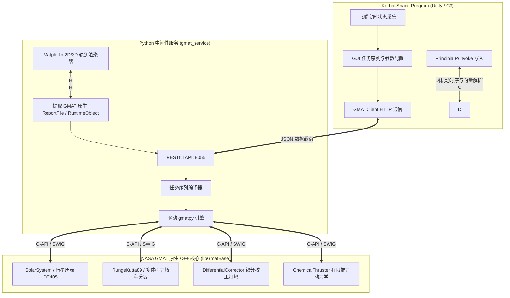

# KSP_GMAT 项目工程底线与架构开发规范 (Project Baseline & Engineering Principles)

> **版本**：v1.0  
> **适用范围**：KSP_GMAT 整个技术栈（C# 游戏客户端模组、Python 桥接服务、GMAT 脚本编译引擎、数据传输字典库）

---

## 0. 核心宗旨 (Core Mission)

本项目旨在将 **NASA 通用任务分析工具 (GMAT, General Mission Analysis Tool)** 工业级的高精度深空轨道动力学与优化能力，无缝引入 **Kerbal Space Program (KSP)**，深度服务于 **Principia（N 体引力环境）** 与 **Realism Overhaul (RO) / Real Solar System (RSS)** 真实太阳系玩家。

为保证项目的学术严肃性、工程可维护性与跨平台通用性，杜绝“为跑通单个案例而写死捷径”，特制定本项目工程底线。**任何新功能开发、重构与合并请求均必须严格恪守本规范。**

---

## 1. 绝对红线：严禁走捷径与伪造物理数值 (Zero Numerical Faking Red Line)

> ### 🛑 核心原则：**Python 和 C# 绝不参与物理数值仿真计算，所有天体力学必须由 GMAT 原生引擎 100% 求解。**

1. **严禁自研/简化物理算法**：
   - 严禁在 Python 桥接层或 C# 模组中编写开普勒二体推进、Vis-Viva 活力公式、圆轨道速度估算、打靶梯度数值拟合等逻辑来“替代”或“加速”物理计算；
   - 所有轨道动力学传播、引力摄动、多体积分必须全部交由 GMAT 原生 C++ 求解器（`libGmatBase` / `gmatpy`）执行。
2. **严禁将有限推力伪造为瞬时脉冲**：
   - 有限点火（Finite Burn）必须通过 GMAT 原生 `FiniteBurn` + `ChemicalThruster` + 变质量航天器动力学微分方程求解；
   - 严禁在 Python 或 C# 中使用齐奥尔科夫斯基公式自行推演等效瞬时脉冲；
   - 必须保留 GMAT 原生报告的完整物理边界状态（点火时长、实际消耗燃料质量、推进剂剩余、终态开普勒根数）。
3. **严禁伪造打靶收敛结果**：
   - 任务打靶（Targeting）必须由 GMAT 原生 `DifferentialCorrector` / `Target` / `Vary` / `Achieve` 在收敛容差内真实求解；
   - 严禁在打靶发散时通过外部硬编码插值或手动赋值伪造“求解成功”。

---

## 2. 架构底线：标准化与通用化 (Standardization & Generalization)

> ### 🌐 核心原则：**全面对齐 NASA GMAT 官方工业规范，杜绝特化孤岛与私有协议。**

1. **坐标系与参考基准必须标准化**：
   - **绝对禁止引入非标准、私有或不可移植的旋转坐标系**（例如不可移植的硬编码私有旋转系）；
   - 统一使用天体标准惯性参考系（如 `Earth.MJ2000Eq`、`Luna.MJ2000Eq`、`ICRF`）或 GMAT 官方标准内建坐标系；
   - 星历系统严格对齐 JPL DE405 / DE421 基准，确保与 Principia ICRF 轴向和历元零漂移。
2. **监测变量与终止条件必须标准化**：
   - **严禁采用任何非标几何假设断言**（例如硬编码 `Z=0`、`VZ=0` 这类假设轨道完全共面且无倾角的特化私有条件）；
   - 必须使用 GMAT 原生参数系统：
     - 时间与历元：`ElapsedSecs`、`ElapsedDays`、`A1ModJulian`、`UTCGregorian`
     - 几何极值点：`Apoapsis` (远心点)、`Periapsis` (近心点)、`Node` (交点)
     - 空间位置与高度：`RMAG`、`Altitude`、`Latitude`、`Longitude`
     - 轨道根数：`SMA`、`ECC`、`INC`、`RAAN`、`AOP`、`TA`、`Energy`、`OrbitPeriod`
3. **全天体系统通用化适配**：
   - 系统架构必须通用支持任意天体（地球、月球、火星、木星、金星、太阳、小行星，乃至 Principia / RSS 自定义星系）；
   - 严禁在逻辑深处假设“中心天体一定叫 Earth”或“伴星一定叫 Luna”；
   - 引力场参数、点质量摄动源、大气模型匹配必须完全依据当前环境动态构建。

---

## 3. 代码底线：彻底根除硬编码 (Zero Hardcoding Principle)

> ### 🔍 核心原则：**一切天体物理参数与引擎能力均由 GMAT 运行时动态提取，绝不死板写死。**

1. **动力学参数零硬编码**：
   - 天体赤道半径（$R_{eq}$）与标准引力常数（$\mu$）严禁在 C# 或 Python 脚本中硬编码静态字典，必须通过 `gmatpy` 从 GMAT `SolarSystem` 单例实时读取；
   - 可用积分器列表（`RungeKutta89`、`PrinceDormand78` 等）与大气模型列表（`MSISE90`、`JacchiaRoberts` 等）必须通过 `Moderator.GetListOfAllFactoryItems()` 运行时自检发现；
   - 动力学监测参数（315+ 项）与终止条件（103+ 项）必须由 `gmat_catalog.py` 自动反射导出，确保 GMAT 引擎升级时零代码修改自动对齐。
2. **界面与交互零硬编码**：
   - 严禁在 GUI 中写死静态窗口分辨率（如 `880x660`、`1080x760`）；
   - 界面必须按用户显示器的物理分辨率（`Screen.width` / `Screen.height`）自适应比例居中；
   - 必须支持全自由交互式拖拽缩放（Resize Handle ◢）与全屏/还原切换，内部所有列宽、卡片与滚动区必须基于实时容器尺寸做 100% 响应式延伸。
3. **环境与路径零硬编码**：
   - 严禁在代码中写死任何带有开发者私有用户名的绝对路径（如 `C:\Users\username\...`）；
   - 外部调用必须基于相对路径、注册表发现、游戏根目录 `KSPUtil.ApplicationRootPath` 或环境变量动态定位。

---

## 4. 架构分工与边界职责 (System Boundaries & Separation of Concerns)

- **NASA GMAT 原生引擎**：唯一的物理计算、积分与微分校正打靶权威。
- **Python 桥接服务**：纯粹的调度器与编译器。负责将 JSON 序列翻译为 100% 标准 GMAT 脚本并调起 `gmatpy`，提取真实运算产物并提供可视化，**绝不自作主张修改或二次近似任何物理量**。
- **KSP C# 客户端**：纯粹的人机交互层与游戏数据桥梁。负责精准采集游戏物理数据，提供符合人体工学的响应式现代 UI，并将计算结果准确接入 Principia 飞行计划。

---

## 5. 健壮性与通用工程基准 (Robustness & Engineering Standards)

1. **类型安全与序列化容灾**：
   - 鉴于 Unity 原生 `JsonUtility` 对 `double` 类型的缺陷，跨语言数据交换必须采用兼容性解析机制，防止关键参数被静默忽略；
   - 静态字典与能力库在任何离线、文件损毁等异常场景下，必须具备静态保底核心数据，保证界面永远可用。
2. **多语言与现代化交互**：
   - 所有界面文本必须全面接入 `I18n` 模块，保持中/英无缝双语切换；
   - 天体力学晦涩参数必须配备 Tooltip 鼠标悬停物理释义与标准单位徽章（如 `[km]`、`[s]`、`[deg]`）。
3. **编译与发布标准**：
   - C# 源码在 Release 模式下必须保持 **0 Errors / 0 Warnings**；
   - 剥离所有体积冗余的 GMAT 官方二进制库（.exe、.dll 等），保持模组分发包极致轻量。

---

## 6. 开发者合并自检清单 (Developer PR Checklist)

在提交任何改动前，请对照以下准则自检：

- [ ] **物理真实性**：是否存在在 Python 或 C# 里写公式算轨道、算点火量的偷懒逻辑？（**必须为否**）
- [ ] **参数标准化**：是否使用了非官方标准的私有参考系或非标硬编码条件（如 `EarthMoonRot`、`Z=0`）？（**必须为否**）
- [ ] **数据无写死**：天体半径、引力参数、积分器列表是否全由 GMAT 动态导出？（**必须为是**）
- [ ] **界面自适应**：GUI 窗口是否能在各种屏幕分辨率下正常展示、自由缩放，无固定像素锁定？（**必须为是**）
- [ ] **路径规范**：代码中是否包含任何开发者的私有机器绝对路径？（**必须为否**）
- [ ] **双语与提示**：新增界面元素是否补齐了中英文词条与 Tooltip 释义？（**必须为是**）
