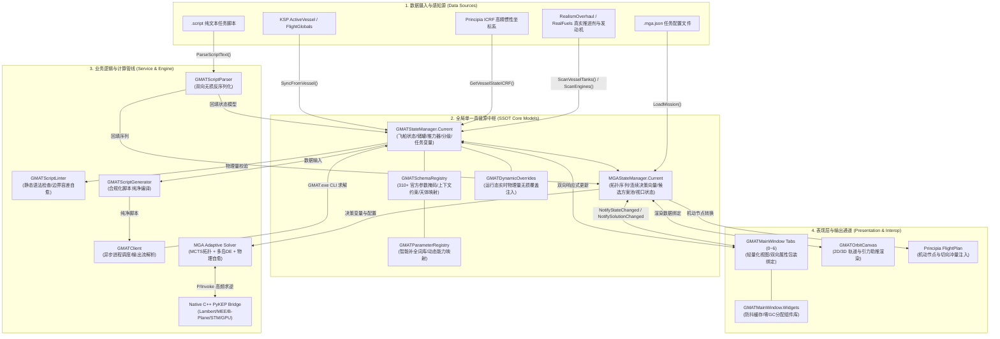
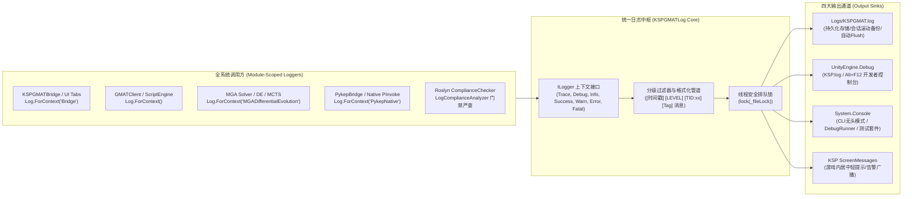
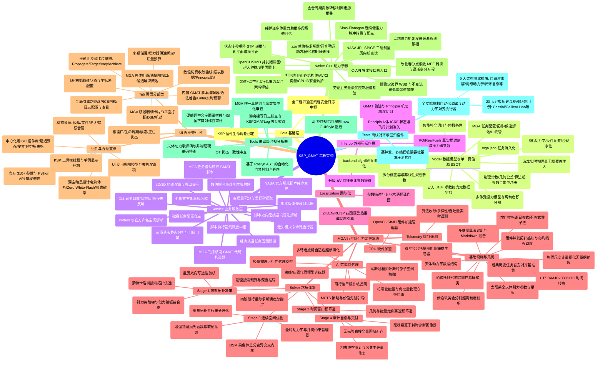
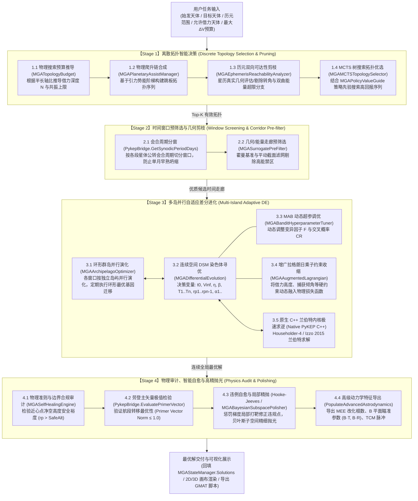
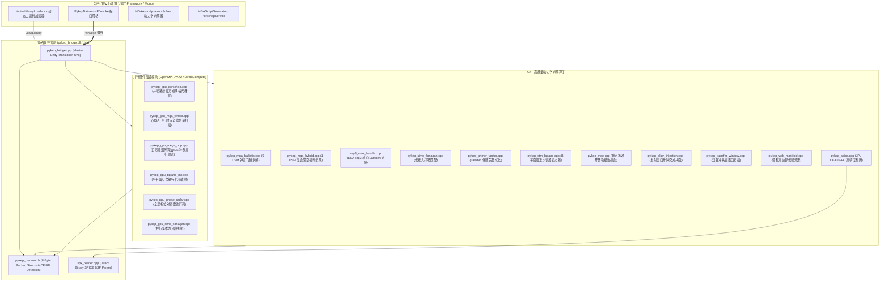
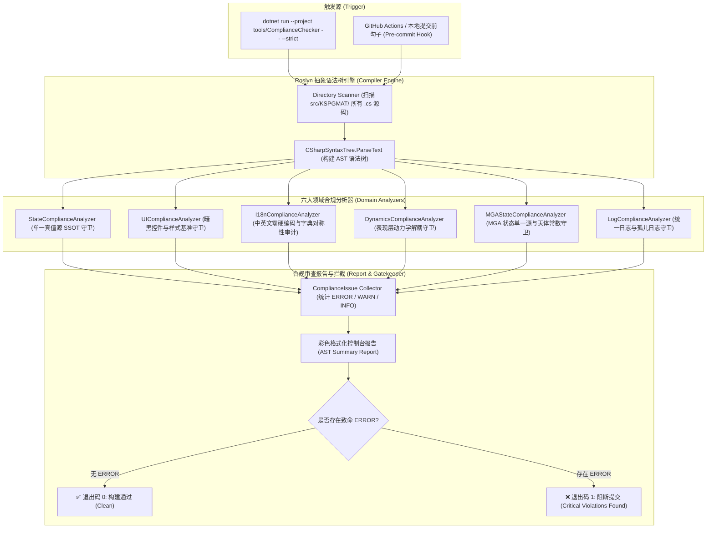
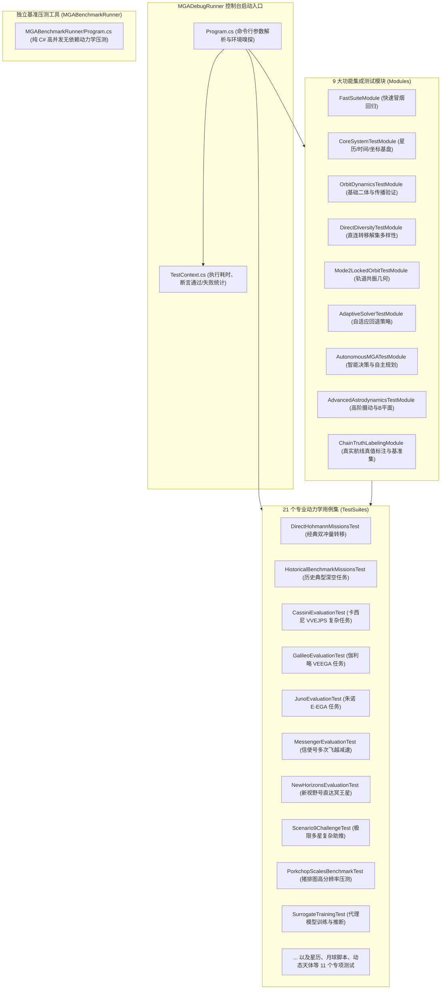

# KSP_GMAT 全代码库架构职责全景脑图文档 (Codebase Architecture & Responsibilities Mindmap)

> **版本**：R2026a Standard Master Architecture  
> **更新时间**：2026-09-13  
> **工程全称**：KSP_GMAT (Kerbal Space Program to NASA GMAT High-Precision Astrodynamics Interop & Autonomous MGA Optimization Suite)  
> **文档定位**：全代码库架构蓝图、全模块职责定义、数据流转拓扑、单一真值源 (SSOT) 规范与基线约束权威手册。

---

## 快速导航目录 (Table of Contents)
- [1. 全局架构设计原则与双核驱动机制](#1-全局架构设计原则与双核驱动机制)
  - [1.1 单一真值源 (SSOT) 全局拓扑流转](#11-单一真值源-ssot-全局拓扑流转)
  - [1.2 统一日志系统 (KSPGMATLog) 全局贯穿拓扑](#12-统一日志系统-kspgmatlog-全局贯穿拓扑)
  - [1.3 全工程高层分层架构 Mermaid 关系流转拓扑图](#13-全工程高层分层架构-mermaid-关系流转拓扑图)
  - [1.4 全工程全景脑图 (Mermaid Mindmap)](#14-全工程全景脑图-mermaid-mindmap)
- [2. 核心基础设施层 (Core)](#2-核心基础设施层-core)
  - [2.1 KSPGMATBridge.cs](#21-kspgmatbridgecs)
  - [2.2 KSPGMATLog.cs](#22-kspgmatlogcs)
- [3. 数据模型与单一真值源层 (Model)](#3-数据模型与单一真值源层-model)
  - [3.1 GMATStateManager.cs](#31-gmatstatemanagercs)
  - [3.2 MGAStateManager.cs](#32-mgastatemanagercs)
  - [3.3 GMATSchemaRegistry.cs](#33-gmatschemaregistrycs)
  - [3.4 GMATParameterRegistry.cs](#34-gmatparameterregistrycs)
  - [3.5 KSPGMATSettings.cs](#35-kspgmatsettingscs)
  - [3.6 MGAMissionConfigFile.cs](#36-mgamissionconfigfilecs)
  - [3.7 PropagatorConfig.cs](#37-propagatorconfigcs)
  - [3.8 SolverConfig.cs](#38-solverconfigcs)
  - [3.9 GMATDynamicOverrides.cs](#39-gmatdynamicoverridescs)
- [4. 业务服务与编译链路层 (Service)](#4-业务服务与编译链路层-service)
  - [4.1 GMATClient.cs](#41-gmatclientcs)
  - [4.2 GMATScriptGenerator.cs](#42-gmatscriptgeneratorcs)
  - [4.3 GMATScriptParser.cs](#43-gmatscriptparsercs)
  - [4.4 GMATScriptLinter.cs](#44-gmatscriptlintercs)
  - [4.5 GMATMGAScriptGenerator.cs](#45-gmatmgascriptgeneratorcs)
  - [4.6 MGAGMATScriptBuilder.cs](#46-mgagmatscriptbuildercs)
  - [4.7 GMATOrbitCanvas.cs](#47-gmatorbitcanvascs)
  - [4.8 GMATBlueprintLibrary.cs](#48-gmatblueprintlibrarycs)
  - [4.9 GMATTemplateManager.cs](#49-gmattemplatemanagercs)
  - [4.10 GMATConsoleRunner.cs](#410-gmatconsolerunnercs)
  - [4.11 GMATDiffEngine.cs](#411-gmatdiffenginecs)
  - [4.12 GMATNamespaceResolver.cs](#412-gmatnamespaceresolvercs)
  - [4.13 GMATScriptEngine.cs](#413-gmatscriptenginecs)
  - [4.14 GMATSolutionMapper.cs](#414-gmatsolutionmappercs)
  - [4.15 GMATTimelineExtractor.cs](#415-gmattimelineextractorcs)
  - [4.16 MGAMissionRepository.cs](#416-mgamissionrepositorycs)
- [5. 外部引擎互操作层 (Interop)](#5-外部引擎互操作层-interop)
  - [5.1 PrincipiaInterop.cs](#51-principiainteropcs)
  - [5.2 MechJebInterop.cs](#52-mechjebinteropcs)
  - [5.3 ROEngineInterop.cs](#53-roengineinteropcs)
  - [5.4 PrincipiaNodeComparison.cs](#54-principianodecomparisoncs)
- [6. 多语言国际化体系 (Localization)](#6-多语言国际化体系-localization)
  - [6.1 I18n.cs](#61-i18ncs)
  - [6.2 GMATI18n.cs](#62-gmati18ncs)
- [7. 深空多重引力助推系统 (MGA System)](#7-深空多重引力助推系统-mga-system)
  - [7.1 MGA 根目录基础设施与几何管线](#71-mga-根目录基础设施与几何管线)
    - [7.1.1 CPUMonitor.cs](#711-cpumonitorcs)
    - [7.1.2 EphemerisTimeSystem.cs](#712-ephemeristimesystemcs)
    - [7.1.3 MGAAugmentedLagrangian.cs](#713-mgaaugmentedlagrangiancs)
    - [7.1.4 MGABenchmarkSuite.cs](#714-mgabenchmarksuitecs)
    - [7.1.5 MGADebugReporter.cs](#715-mgadebugreportercs)
    - [7.1.6 MGAFlybyDynamicsHelper.cs](#716-mgaflybydynamicshelpercs)
    - [7.1.7 MGAInjectionAligner.cs](#717-mgainjectionalignercs)
    - [7.1.8 MGAPhysicalScales.cs](#718-mgaphysicalscalescs)
    - [7.1.9 MGASolutionOrdering.cs](#719-mgasolutionorderingcs)
    - [7.1.10 PorkchopGenerator.cs](#7110-porkchopgeneratorcs)
    - [7.1.11 PykepBridge.cs](#7111-pykepbridgecs)
    - [7.1.12 PykepNative.cs](#7112-pykepnativecs)
    - [7.1.13 SolarSystemBodies.cs](#7113-solarsystembodiescs)
    - [7.1.14 SolarSystemCatalog.cs](#7114-solarsystemcatalogcs)
  - [7.2 MGA AI 智能决策与物理代理 (MGA/AI)](#72-mga-ai-智能决策与物理代理-mgaai)
    - [7.2.1 MGABanditHyperparameterTuner.cs](#721-mgabandithyperparametertunercs)
    - [7.2.2 MGABayesianSubspacePolisher.cs](#722-mgabayesiansubspacepolishercs)
    - [7.2.3 MGAPhysicsSurrogateNetwork.cs](#723-mgaphysicssurrogatenetworkcs)
    - [7.2.4 MGAPolicyValueGuide.cs](#724-mgapolicyvalueguidecs)
    - [7.2.5 MGASurrogateGate.cs](#725-mgasurrogategatecs)
    - [7.2.6 MGASurrogateTrainer.cs](#726-mgasurrogatetrainercs)
    - [7.2.7 MGASymbolicPhysicsConstraints.cs](#727-mgasymbolicphysicsconstraintscs)
  - [7.3 MGA GPU 硬件加速管线 (MGA/GPU)](#73-mga-gpu-硬件加速管线-mgagpu)
    - [7.3.1 MGAGpuAccelerationManager.cs](#731-mgagpuaccelerationmanagercs)
  - [7.4 MGA 动力学优化器体系 (MGA/Solver)](#74-mga-动力学优化器体系-mgasolver)
    - [7.4.1 MGA 四阶段求解流程全景图](#741-mga-四阶段求解流程全景图)
    - [7.4.2 MGAAdaptiveSolver.cs](#742-mgaadaptivesolvercs)
    - [7.4.3 MGAArchipelagoOptimizer.cs](#743-mgaarchipelagooptimizercs)
    - [7.4.4 MGAConstraintManager.cs](#744-mgaconstraintmanagercs)
    - [7.4.5 MGADifferentialEvolution.cs](#745-mgadifferentialevolutioncs)
    - [7.4.6 MGAEphemerisReachabilityAnalyzer.cs](#746-mgaephemerisreachabilityanalyzercs)
    - [7.4.7 MGAHistoricalBlindSearchSuite.cs](#747-mgahistoricalblindsearchsuitecs)
    - [7.4.8 MGAMasterOptimizer.cs](#748-mgamasteroptimizercs)
    - [7.4.9 MGAMCTSTopologySelector.cs](#749-mgamctstopologyselectorcs)
    - [7.4.10 MGAPhysicsLossEngine.cs](#7410-mgaphysicslossenginecs)
    - [7.4.11 MGAPlanetaryAssistManager.cs](#7411-mgaplanetaryassistmanagercs)
    - [7.4.12 MGASelfHealingEngine.cs](#7412-mgaselfhealingenginecs)
    - [7.4.13 MGAStepProfiler.cs](#7413-mgastepprofilercs)
    - [7.4.14 MGASurrogatePreFilter.cs](#7414-mgasurrogateprefiltercs)
    - [7.4.15 MGATopologyBudget.cs](#7415-mgatopologybudgetcs)
  - [7.5 MGA 探针遥测与诊断 (MGA/Telemetry)](#75-mga-探针遥测与诊断-mgatelemetry)
    - [7.5.1 MGAPipelineTelemetryProbe.cs](#751-mgapipelinetelemetryprobecs)
- [8. 用户交互与工业视觉展示层 (UI)](#8-用户交互与工业视觉展示层-ui)
  - [8.1 GMATMainWindow.cs](#81-gmatmainwindowcs)
  - [8.2 GMATMainWindow.TabCraft.cs](#82-gmatmainwindowtabcraftcs)
  - [8.3 GMATMainWindow.TabResources.cs](#83-gmatmainwindowtabresourcescs)
  - [8.4 GMATMainWindow.TabSequence.cs](#84-gmatmainwindowtabsequencecs)
  - [8.5 GMATMainWindow.TabMGA.cs](#85-gmatmainwindowtabmgacs)
  - [8.6 GMATMainWindow.TabMGASequence.cs](#86-gmatmainwindowtabmgasequencecs)
  - [8.7 GMATMainWindow.TabResults.cs](#87-gmatmainwindowtabresultscs)
  - [8.8 GMATMainWindow.TabSettings.cs](#88-gmatmainwindowtabsettingscs)
  - [8.9 GMATMainWindow.IDE.cs](#89-gmatmainwindowidecs)
  - [8.10 GMATMainWindow.Modals.cs](#810-gmatmainwindowmodalscs)
  - [8.11 GMATMainWindow.Models.cs](#811-gmatmainwindowmodelscs)
  - [8.12 GMATMainWindow.Styles.cs](#812-gmatmainwindowstylescs)
  - [8.13 GMATMainWindow.Widgets.cs](#813-gmatmainwindowwidgetscs)
  - [8.14 GMATDynamicInspectorModal.cs](#814-gmatdynamicinspectormodalcs)
  - [8.15 ToolbarRegistration.cs](#815-toolbarregistrationcs)
- [9. 原生 C++ 动力学与硬件加速管道 (Native)](#9-原生-c-动力学与硬件加速管道-native)
  - [9.1 pykep_bridge.cpp & pykep_common.h](#91-pykep_bridgecpp--pykep_commonh)
  - [9.2 kep3_core_bundle.cpp](#92-kep3_core_bundlecpp)
  - [9.3 pykep_align_injection.cpp](#93-pykep_align_injectioncpp)
  - [9.4 pykep_gpu_bplane_mc.cpp](#94-pykep_gpu_bplane_mccpp)
  - [9.5 pykep_gpu_mega_pop.cpp](#95-pykep_gpu_mega_popcpp)
  - [9.6 pykep_gpu_mga_tensor.cpp](#96-pykep_gpu_mga_tensorcpp)
  - [9.7 pykep_gpu_phase_radar.cpp](#97-pykep_gpu_phase_radarcpp)
  - [9.8 pykep_gpu_porkchop.cpp](#98-pykep_gpu_porkchopcpp)
  - [9.9 pykep_gpu_sims_flanagan.cpp](#99-pykep_gpu_sims_flanagancpp)
  - [9.10 pykep_mee.cpp](#910-pykep_meecpp)
  - [9.11 pykep_mga_ballistic.cpp](#911-pykep_mga_ballisticcpp)
  - [9.12 pykep_mga_hybrid.cpp](#912-pykep_mga_hybridcpp)
  - [9.13 pykep_primer_vector.cpp](#913-pykep_primer_vectorcpp)
  - [9.14 pykep_sims_flanagan.cpp](#914-pykep_sims_flanagancpp)
  - [9.15 pykep_spice.cpp](#915-pykep_spicecpp)
  - [9.16 pykep_stm_bplane.cpp](#916-pykep_stm_bplanecpp)
  - [9.17 pykep_transfer_window.cpp](#917-pykep_transfer_windowcpp)
  - [9.18 pykep_wsb_manifold.cpp](#918-pykep_wsb_manifoldcpp)
  - [9.19 spk_reader.hpp](#919-spk_readerhpp)
  - [9.20 build_native.bat](#920-build_nativebat)
- [10. 编译级 AST 合规自查工具体系 (Tools/ComplianceChecker)](#10-编译级-ast-合规自查工具体系-toolscompliancechecker)
  - [10.1 Program.cs & ComplianceIssue.cs](#101-programcs--complianceissuecs)
  - [10.2 StateComplianceAnalyzer.cs](#102-statecomplianceanalyzercs)
  - [10.3 UIComplianceAnalyzer.cs](#103-uicomplianceanalyzercs)
  - [10.4 I18nComplianceAnalyzer.cs](#104-i18ncomplianceanalyzercs)
  - [10.5 DynamicsComplianceAnalyzer.cs](#105-dynamicscomplianceanalyzercs)
  - [10.6 MGAStateComplianceAnalyzer.cs](#106-mgastatecomplianceanalyzercs)
  - [10.7 LogComplianceAnalyzer.cs](#107-logcomplianceanalyzercs)
- [11. 离线对齐与回归测试套件 (Tests)](#11-离线对齐与回归测试套件-tests)
  - [11.1 MGADebugRunner 架构与模块体系](#111-mgadebugrunner-架构与模块体系)
    - [11.1.1 Program.cs & TestContext.cs](#1111-programcs--testcontextcs)
    - [11.1.2 Modules/ 9 大专项测试模块](#1112-modules-9-大专项测试模块)
    - [11.1.3 TestSuites/ 20 大场景与历史任务对齐用例](#1113-testsuites-20-大场景与历史任务对齐用例)
  - [11.2 MGABenchmarkRunner 架构与性能评测](#112-mgabenchmarkrunner-架构与性能评测)
- [12. 总结与架构演进守则](#12-总结与架构演进守则)

---

# 1. 全局架构设计原则与双核驱动机制

KSP_GMAT 是连接游戏仿真引擎（Kerbal Space Program）、高精度外部天体动力学数值系统（NASA GMAT）以及行星际低能多重引力助推轨迹优化内核（ESA PyKEP v3 C++ 原生库与 C# 自适应算法群）的高集成度航天动力学架构。

工程确立了**两大贯穿全生命周期的核心支柱**：
1. **单一数据真值源 (Single Source of Truth, SSOT)**：由 `GMATStateManager` 与 `MGAStateManager` 集中托管全生命周期状态，杜绝任何中间状态在 UI、编辑器缓冲区或子算法内部的私自分裂。
2. **全工程统一日志中枢 (KSPGMATLog)**：提供线程安全、多通道分流（Unity Debug、滚动持久化文件、CLI 控制台、GUI 悬浮提示）、上下文隔离 (`ILogger`) 的统一日志基础设施，禁止代码库中存在任何孤立游离日志。

---

## 1.1 单一真值源 (SSOT) 全局拓扑流转



---

## 1.2 统一日志系统 (KSPGMATLog) 全局贯穿拓扑



---

## 1.3 全工程高层分层架构 Mermaid 关系流转拓扑图

```mermaid
graph TB
    %% 样式定义
    classDef coreStyle fill:#1e293b,stroke:#38bdf8,stroke-width:2px,color:#f8fafc;
    classDef modelStyle fill:#0f172a,stroke:#818cf8,stroke-width:2px,color:#f8fafc;
    classDef serviceStyle fill:#1e1b4b,stroke:#c084fc,stroke-width:2px,color:#f8fafc;
    classDef mgaStyle fill:#311042,stroke:#f43f5e,stroke-width:2px,color:#f8fafc;
    classDef uiStyle fill:#172554,stroke:#60a5fa,stroke-width:2px,color:#f8fafc;
    classDef nativeStyle fill:#064e3b,stroke:#34d399,stroke-width:2px,color:#f8fafc;
    classDef toolStyle fill:#451a03,stroke:#fb923c,stroke-width:2px,color:#f8fafc;
    classDef testStyle fill:#365314,stroke:#a3e635,stroke-width:2px,color:#f8fafc;

    subgraph Layer_Core ["1. 基础设施层 (Core & Localization)"]
        KSPGMATBridge["KSPGMATBridge.cs\n(生命周期/启动器)"]:::coreStyle
        KSPGMATLog["KSPGMATLog.cs\n(统一日志/多通道分流)"]:::coreStyle
        I18n["I18n.cs & GMATI18n.cs\n(四国语言/热插拔动态词典)"]:::coreStyle
    end

    subgraph Layer_Model ["2. 数据模型与真值源 (Model - SSOT)"]
        GMATStateManager["GMATStateManager.cs\n(飞船/储罐/推力器/变量/净化器)"]:::modelStyle
        MGAStateManager["MGAStateManager.cs\n(MGA任务/序列/候选解/UI状态/MGADefaults)"]:::modelStyle
        GMATSchemaRegistry["GMATSchemaRegistry.cs\n(官方参数元数据/能力位掩码)"]:::modelStyle
        GMATParameterRegistry["GMATParameterRegistry.cs\n(智能补全字典/停机条件定义)"]:::modelStyle
        KSPGMATSettings["KSPGMATSettings.cs\n(backend.cfg 配置持久化)"]:::modelStyle
        MGAMissionConfigFile["MGAMissionConfigFile.cs\n(MGA任务序列持久化模型)"]:::modelStyle
        PropagatorConfig["PropagatorConfig.cs\n(积分器与受摄多体引力场配置)"]:::modelStyle
        SolverConfig["SolverConfig.cs\n(微分修正器/优化器配置)"]:::modelStyle
        GMATDynamicOverrides["GMATDynamicOverrides.cs\n(无损物理状态动态覆盖管理器)"]:::modelStyle
    end

    subgraph Layer_Service ["3. 业务服务与编译链路 (Service)"]
        GMATClient["GMATClient.cs\n(CLI 进程驱动/报表反解)"]:::serviceStyle
        GMATScriptGenerator["GMATScriptGenerator.cs\n(GMAT 脚本编译生成器)"]:::serviceStyle
        GMATScriptParser["GMATScriptParser.cs\n(GMAT 脚本语法解析反解器)"]:::serviceStyle
        GMATScriptLinter["GMATScriptLinter.cs\n(静态合规分析与自愈门禁)"]:::serviceStyle
        GMATMGAScriptGenerator["GMATMGAScriptGenerator.cs\n(MGA 航段脚本生成器)"]:::serviceStyle
        GMATOrbitCanvas["GMATOrbitCanvas.cs\n(2D/3D 轨道交互视口画布)"]:::serviceStyle
        GMATTimelineExtractor["GMATTimelineExtractor.cs\n(变质量冲量质心积分/时序提取)"]:::serviceStyle
        GMATBlueprintLibrary["GMATBlueprintLibrary.cs\n(任务蓝图预设库)"]:::serviceStyle
        GMATTemplateManager["GMATTemplateManager.cs\n(脚本模版库管理器)"]:::serviceStyle
        GMATDiffEngine["GMATDiffEngine.cs\n(脚本文本差异对比引擎)"]:::serviceStyle
    end

    subgraph Layer_Interop ["4. 外部游戏与动力学系统互操作 (Interop)"]
        PrincipiaInterop["PrincipiaInterop.cs\n(Principia N体动力学与飞行计划反射注入)"]:::coreStyle
        MechJebInterop["MechJebInterop.cs\n(MechJeb 分级 ΔV/推力提取)"]:::coreStyle
        ROEngineInterop["ROEngineInterop.cs\n(RO/RealFuels 真实燃料密度与发动机)"]:::coreStyle
        PrincipiaNodeComparison["PrincipiaNodeComparison.cs\n(GMAT与Principia机动节点精度比对)"]:::coreStyle
    end

    subgraph Layer_MGA ["5. 深空多重引力助推系统 (MGA Suite)"]
        direction TB
        subgraph MGA_Root ["MGA 核心管线"]
            PykepBridge["PykepBridge.cs & PykepNative.cs\n(P/Invoke 原生互操作桥)"]:::mgaStyle
            SolarSystemCatalog["SolarSystemCatalog.cs\n(太阳系全天体引力常数与星历)"]:::mgaStyle
            PorkchopGenerator["PorkchopGenerator.cs\n(双星会合猪排图能量栅格生成器)"]:::mgaStyle
            MGAInjectionAligner["MGAInjectionAligner.cs\n(停泊轨逃逸渐近线黄金分割锁相)"]:::mgaStyle
        end
        subgraph MGA_AI ["MGA AI 智能与代理"]
            MGABandit["MGABanditHyperparameterTuner.cs\n(多臂老虎机动态超参演化)"]:::mgaStyle
            MGAPhysicsSurrogate["MGAPhysicsSurrogateNetwork.cs\n(轻量物理可行性代理模型)"]:::mgaStyle
            MGAPolicyGuide["MGAPolicyValueGuide.cs\n(MCTS 策略与价值先验引导)"]:::mgaStyle
        end
        subgraph MGA_Solver ["MGA 动力学求解体系"]
            MGAMasterOptimizer["MGAMasterOptimizer.cs\n(四阶段求解调度总管)"]:::mgaStyle
            MGAMCTS["MGAMCTSTopologySelector.cs\n(离散借力拓扑蒙特卡洛树搜索)"]:::mgaStyle
            MGAArchipelago["MGAArchipelagoOptimizer.cs\n(多岛并行差分进化环形迁移)"]:::mgaStyle
            MGADE["MGADifferentialEvolution.cs\n(连续空间 DSM 染色体寻优内核)"]:::mgaStyle
            MGASelfHealing["MGASelfHealingEngine.cs\n(物理准则审计/劳登主矢量自愈)"]:::mgaStyle
        end
    end

    subgraph Layer_UI ["6. 用户界面表现与交互层 (UI)"]
        GMATMainWindow["GMATMainWindow.cs\n(主视窗/生命周期/分部类聚合)"]:::uiStyle
        TabCraft["GMATMainWindow.TabCraft.cs\n(Tab 0: 飞船与坐标系看板)"]:::uiStyle
        TabResources["GMATMainWindow.TabResources.cs\n(Tab 1: 推进储罐与发动机看板)"]:::uiStyle
        TabSequence["GMATMainWindow.TabSequence.cs\n(Tab 2: 任务控制步骤序列卡片)"]:::uiStyle
        TabMGA["GMATMainWindow.TabMGA.cs\n(Tab 3: MGA 总体设计/猪排图/决策池)"]:::uiStyle
        TabMGASequence["GMATMainWindow.TabMGASequence.cs\n(Tab 4: MGA 航段明细/B平面打靶)"]:::uiStyle
        TabResults["GMATMainWindow.TabResults.cs\n(Tab 5: 求解结果与Principia比对)"]:::uiStyle
        TabSettings["GMATMainWindow.TabSettings.cs\n(Tab 6: 全局设置与日志监视)"]:::uiStyle
        IDE["GMATMainWindow.IDE.cs\n(脚本编辑/语法高亮/实时Linter)"]:::uiStyle
        Widgets["GMATMainWindow.Widgets.cs\n(中心化零GC控件库/DelayedNumericField)"]:::uiStyle
        Styles["GMATMainWindow.Styles.cs\n(深空暗黑设计系统/配色令牌)"]:::uiStyle
    end

    subgraph Layer_Native ["7. 原生 C++ 动力学核 (Native C++ Engine)"]
        NativeBridge["pykep_bridge.cpp & pykep_common.h\n(C-API 导出接口/AVX2向量数学/硬件探测)"]:::nativeStyle
        Kep3Bundle["kep3_core_bundle.cpp\n(Izzo 兰伯特求解器/开普勒递推)"]:::nativeStyle
        NativeBallistic["pykep_mga_ballistic.cpp & pykep_mga_hybrid.cpp\n(纯弹道与多模式借力高速评估)"]:::nativeStyle
        NativeSTM["pykep_stm_bplane.cpp & pykep_primer_vector.cpp\n(状态转移矩阵/B平面映射/劳登主矢量)"]:::nativeStyle
        NativeGPU["pykep_gpu_*.cpp\n(SIMD/GPU 猪排图与超大种群评估)"]:::nativeStyle
    end

    subgraph Layer_Tools ["8. 合规自查工具体系 (Tools)"]
        ComplianceChecker["ComplianceChecker/Program.cs\n(Roslyn AST 编译级代码合规引擎)"]:::toolStyle
        Analyzers["六大合规分析器\n(SSOT / UI样式 / 多语言 / 动力学 / MGA / 日志)"]:::toolStyle
    end

    subgraph Layer_Tests ["9. 离线对齐与回归基准 (Tests)"]
        MGADebugRunner["MGADebugRunner\n(9 大测试模块 / 20 大历史场景对齐)"]:::testStyle
        MGABenchmarkRunner["MGABenchmarkRunner\n(高吞吐并发基准性能评测)"]:::testStyle
    end

    %% 核心拓扑连接关系
    KSPGMATBridge --> GMATMainWindow
    KSPGMATBridge --> ROEngineInterop
    KSPGMATBridge --> GMATClient

    GMATMainWindow --> TabCraft & TabResources & TabSequence & TabMGA & TabMGASequence & TabResults & TabSettings & IDE
    GMATMainWindow --- Widgets
    GMATMainWindow --- Styles

    TabCraft & TabResources & TabSequence <--> GMATStateManager
    TabMGA & TabMGASequence <--> MGAStateManager

    PrincipiaInterop --> GMATStateManager
    ROEngineInterop --> GMATStateManager
    MechJebInterop --> GMATStateManager

    GMATStateManager --> GMATScriptGenerator
    GMATScriptGenerator --> GMATClient
    GMATClient --> GMATScriptParser
    GMATScriptParser --> GMATStateManager

    MGAStateManager <--> MGAMasterOptimizer
    MGAMasterOptimizer --> MGAMCTS --> MGAArchipelago --> MGADE --> MGASelfHealing
    MGADE <--> PykepBridge
    PykepBridge <--> NativeBridge
    NativeBridge --- Kep3Bundle & NativeBallistic & NativeSTM & NativeGPU

    ComplianceChecker --- Analyzers
    MGADebugRunner --> MGAMasterOptimizer
    MGABenchmarkRunner --> MGAMasterOptimizer
```



---

## 1.4 全工程全景脑图 (Mermaid Mindmap)




# 2. 核心基础设施层 (Core)

核心基础设施层位于 `src/KSPGMAT/Core/`，负责提供 KSP 模组的主生命周期驱动以及全工程通用的日志中枢。

---
### 2.1 KSPGMATBridge.cs
- **【文件路径】**：[`src/KSPGMAT/Core/KSPGMATBridge.cs`](file:///c:/Users/43701/gmat-win-R2026a/bin/KSP_GMAT/src/KSPGMAT/Core/KSPGMATBridge.cs)
- **【核心职责】**：作为 KSP 游戏生命周期的主入口点 (`[KSPAddon(KSPAddon.Startup.Flight, false)]`)，挂载在飞行场景中。初始化全局日志系统 `KSPGMATLog.Init()`，输出会话横幅与运行态环境；动态挂载 UI 根控制器 `GMATMainWindow`；探测关键前置依赖模组（RealismOverhaul、RealFuels、Principia）并记录初始化提示；触发 GMAT 外部 CLI 执行引擎连通性嗅探 (`GMATClient.CheckConnection`)；在场景销毁 (`OnDestroy`) 时强制刷新日志缓冲区 (`KSPGMATLog.Flush()`)。
- **【关键类与方法】**：`public class KSPGMATBridge : MonoBehaviour`；`Awake()`（插件初始化、日志启动、挂载主视窗、探测 RO/Principia 状态、探测 GMAT CLI 可用性）；`OnDestroy()`（插件退出清理与日志刷盘）。
- **【上游调用方/依赖方】**：KSP 游戏引擎底层（通过 `KSPAddon` 特性在飞行场景加载时反射创建）。
- **【下游依赖】**：[`KSPGMATLog`](file:///c:/Users/43701/gmat-win-R2026a/bin/KSP_GMAT/src/KSPGMAT/Core/KSPGMATLog.cs)、[`GMATMainWindow`](file:///c:/Users/43701/gmat-win-R2026a/bin/KSP_GMAT/src/KSPGMAT/UI/GMATMainWindow.cs)、[`ROEngineInterop`](file:///c:/Users/43701/gmat-win-R2026a/bin/KSP_GMAT/src/KSPGMAT/Interop/ROEngineInterop.cs)、[`GMATClient`](file:///c:/Users/43701/gmat-win-R2026a/bin/KSP_GMAT/src/KSPGMAT/Service/GMATClient.cs)。
- **【基线规范约束】**：**单例生命周期**：必须使用 `DontDestroyOnLoad` 确保跨场景常驻，严禁重复创建；**统一日志**：必须通过 `KSPGMATLog.Info` / `KSPGMATLog.Warn` 输出日志，严禁裸写 `Debug.Log`。

---
### 2.2 KSPGMATLog.cs
- **【文件路径】**：[`src/KSPGMAT/Core/KSPGMATLog.cs`](file:///c:/Users/43701/gmat-win-R2026a/bin/KSP_GMAT/src/KSPGMAT/Core/KSPGMATLog.cs)
- **【核心职责】**：提供全系统唯一的企业级统一日志引擎，支撑高频并发多线程动力学算法（DE、MCTS、多岛演化）的安全日志记录。实现四大输出通道（Unity 原生 Debug、文件系统持久化日志 `Logs/KSPGMAT.log`、CLI 控制台输出、KSP 游戏内屏幕浮动提示）。支持上下文记录器工厂 (`KSPGMATLog.ForContext<T>()` 与 `KSPGMATLog.ForContext(tag)`)；自动管理日志生命周期（启动时自动将历史文件归档为 `KSPGMAT.previous.log` 防止无限膨胀）；严格通过 `lock (_fileLock)` 保障多线程并发安全；提供系统环境横幅打印（操作系统架构、CLR 版本、进程 PID、活动日志级别）。
- **【关键类与方法】**：`public enum LogLevel { Trace, Debug, Info, Warn, Error, Fatal }`；`public interface ILogger`（定义模块化记录接口 `Trace`, `Debug`, `Info`, `Success`, `Warn`, `Error`, `Fatal`, `Section`, `ForContext`）；`public static class KSPGMATLog`（`Init()`, `ForContext<T>()`, `ForContext(tag)`, `Write(...)`, `Screen(...)`, `Flush()`, `OpenLogFileOrFolder()`）。
- **【上游调用方/依赖方】**：全工程所有业务类与测试套件（Core、Model、Service、Interop、MGA、UI、Tests）。
- **【下游依赖】**：`System.IO.StreamWriter`、`UnityEngine.Debug`（非强制无感知安全降级）。
- **【基线规范约束】**：**唯一性铁律**：除 `KSPGMATLog.cs` 自身外，全工程所有文件严禁裸写 `UnityEngine.Debug.*`、`Console.Write*` 或 `MonoBehaviour.print`；受 `tools/ComplianceChecker/Analyzers/LogComplianceAnalyzer.cs` 严格把关，违规将直接阻断编译部署。

---

# 3. 数据模型与单一真值源层 (Model)

数据模型层位于 `src/KSPGMAT/Model/`，承载系统所有的物理实体、配置参数、状态变量与单一真值源 (SSOT) 核心枢纽。

---
### 3.1 GMATStateManager.cs
- **【文件路径】**：[`src/KSPGMAT/Model/GMATStateManager.cs`](file:///c:/Users/43701/gmat-win-R2026a/bin/KSP_GMAT/src/KSPGMAT/Model/GMATStateManager.cs)
- **【核心职责】**：**核心设计铁律（SSOT）**：作为整个 GMAT 任务状态的全局单一真值源，集中维护航天器、多级储罐、推力器、用户自定义变量、微分修正器、坐标系及受摄力模型。`SyncFromVessel(Vessel)` 一键从当前 KSP 载具采样真实质量、推进剂余量、发动机额定推力/比冲与 Principia ICRF 空间坐标；`SanitizeGmatScript(string)` 全流程脚本合规净化过滤器，剔除多余航天器定义、统一重构航天器标识符为标准规范 `Sat`；`ValidateAndSanitizeState(...)` 全面执行非零与物理合理性校验，对非法数值自动恢复官方标准默认值并记录警告；维护官方参数标准缺省值字典 `GMATDefaults`。
- **【关键类与方法】**：`public class GMATStateManager`（`Current`, `SyncFromVessel()`, `ValidateAndSanitizeState()`, `SanitizeGmatScript()`, `GetSpacecraftName()`, `NotifyStateChanged()`）；`GMATSpacecraftModel`, `GMATTankModel`, `GMATThrusterModel`, `GMATVariableModel`, `GMATArrayModel`, `GMATStringModel`, `GMATSolverModel`, `GMATBurnModel`, `GMATOrbitViewModel`, `GMATReportFileModel`, `GMATStageBudget`, `GMATDefaults`。
- **【上游调用方/依赖方】**：UI 表现层（`TabCraft`, `TabResources`, `TabSequence`, `IDE`）；服务层（`GMATScriptGenerator`, `GMATScriptParser`, `GMATClient`, `GMATTimelineExtractor`）；互操作层（`PrincipiaInterop`, `ROEngineInterop`, `MechJebInterop`）。
- **【下游依赖】**：[`MGAStateManager`](file:///c:/Users/43701/gmat-win-R2026a/bin/KSP_GMAT/src/KSPGMAT/Model/MGAStateManager.cs)、[`GMATSchemaRegistry`](file:///c:/Users/43701/gmat-win-R2026a/bin/KSP_GMAT/src/KSPGMAT/Model/GMATSchemaRegistry.cs)、[`GMATDynamicOverrides`](file:///c:/Users/43701/gmat-win-R2026a/bin/KSP_GMAT/src/KSPGMAT/Model/GMATDynamicOverrides.cs)。
- **【基线规范约束】**：**SSOT 铁律**：严禁任何 UI 面板或子模块私设非常量公共状态字段（受 `StateComplianceAnalyzer` 检查）；所有脚本对象引用必须通过 `GMATStateManager` 提供的标准构造器生成。

---
### 3.2 MGAStateManager.cs
- **【文件路径】**：[`src/KSPGMAT/Model/MGAStateManager.cs`](file:///c:/Users/43701/gmat-win-R2026a/bin/KSP_GMAT/src/KSPGMAT/Model/MGAStateManager.cs)
- **【核心职责】**：**MGA 单一真值源 (SSOT)**：管理所有行星际多重引力助推的任务配置 (`Config`)、显式任务序列 (`MissionSequence`)、计算收敛方案池 (`Solutions`)、当前激活方案 (`ActiveSolution`)、3D 视口相机状态 (`Viewport`) 及全量 UI 交互状态 (`UI`)。提供全局缺省值与物理常数集中注册表 `MGADefaults`（彻底杜绝天文单位、引力常数、算法超参的散落硬编码）；提供响应式状态通知机制（`NotifyStateChanged()`, `NotifySolutionChanged()`, `NotifyViewportChanged()`, `RequestClearInputCache()`）；管理任务配置持久化（读取与导出 `.mga.json`）；同步任务序列与求解配置（`ApplySequenceToConfig()` 与 `UpdateFlybySequence()`）。
- **【关键类与方法】**：`public static class MGADefaults`（物理常数、天体安全半径、差分进化代数/种群、罚函数权重集中定义）；`public class MGAStateManager`（`Current`, `Config`, `MissionSequence`, `Solutions`, `ActiveSolution`, `UI`, `Viewport`, `SaveMission()`, `LoadMission()`, `ApplySequenceToConfig()`, `UpdateFlybySequence()`）；`MGADepartureMode`, `MGALegStrategy`, `MGAFlybyStrategy`, `MGAEngineMode`, `MGASolution`, `MGALeg`, `DSMResult`, `FlybyResult`。
- **【上游调用方/依赖方】**：UI 表现层（`TabMGA`, `TabMGASequence`, `TabResults`）；求解引擎（`MGAMasterOptimizer`, `MGAAdaptiveSolver`, `MGAArchipelagoOptimizer`, `MGASelfHealingEngine`）；服务层（`GMATMGAScriptGenerator`, `GMATOrbitCanvas`, `MGAMissionRepository`）。
- **【下游依赖】**：[`SolarSystemCatalog`](file:///c:/Users/43701/gmat-win-R2026a/bin/KSP_GMAT/src/KSPGMAT/MGA/SolarSystemCatalog.cs)、[`MGADebugReporter`](file:///c:/Users/43701/gmat-win-R2026a/bin/KSP_GMAT/src/KSPGMAT/MGA/MGADebugReporter.cs)。
- **【基线规范约束】**：**MGA SSOT 铁律**：严禁在 `TabMGA.cs` 或 `TabMGASequence.cs` 中声明私有业务字段或游离状态，UI 必须 100% 使用包装属性访问 `MGAStateManager.Current.UI`；受 `MGAStateComplianceAnalyzer` 严格审查。

---
### 3.3 GMATSchemaRegistry.cs
- **【文件路径】**：[`src/KSPGMAT/Model/GMATSchemaRegistry.cs`](file:///c:/Users/43701/gmat-win-R2026a/bin/KSP_GMAT/src/KSPGMAT/Model/GMATSchemaRegistry.cs)
- **【核心职责】**：作为 NASA GMAT 310+ 官方参数与能力的单一真值源 (`Single Source of Capabilities Truth`)。定义参数能力位掩码枚举 `ParamCapability`（区分连续可导量、离散极值事件、控制变量、硬件属性、笛卡尔坐标与姿态方向）；提供参数元数据类 `GMATParamDefinition`，结合多语言词典键提供国际化文档与单位说明；提供天体命名标准化方法 `NormalizeCelestialName(string)` 与 SPICE NAIF ID 权威映射表；动态从 `gmat_capabilities.json` 或内置官方模式解析开普勒根数、改化春分点、德洛内变量、布劳威尔平根数、球面坐标、双曲与 B 平面参数目录。
- **【关键类与方法】**：`public enum ParamCapability`；`public class GMATParamDefinition`；`public class GMATSchemaRegistry`（`Instance`, `NormalizeCelestialName()`, `IsExtremumParameter()`, `GetStandardSpicePlanets()`, `DirectKeplerian`, `EquinoctialAndDelaunay`, `HyperbolicAndBPlane`, `ExtremumEvents` 等）。
- **【上游调用方/依赖方】**：`GMATParameterRegistry`, `GMATScriptLinter`, `GMATScriptGenerator`, `GMATDynamicInspectorModal`, `PropagatorConfig`。
- **【下游依赖】**：[`I18n`](file:///c:/Users/43701/gmat-win-R2026a/bin/KSP_GMAT/src/KSPGMAT/Localization/I18n.cs)。
- **【基线规范约束】**：**零硬编码与能力门禁**：严禁在代码中写死参数列表，以 JSON 元数据与动态模式为准；极值事件（如 Periapsis, Apoapsis）绝对禁止标记为连续可导或用于 Achieve。

---
### 3.4 GMATParameterRegistry.cs
- **【文件路径】**：[`src/KSPGMAT/Model/GMATParameterRegistry.cs`](file:///c:/Users/43701/gmat-win-R2026a/bin/KSP_GMAT/src/KSPGMAT/Model/GMATParameterRegistry.cs)
- **【核心职责】**：为整个 UI 与 IDE 脚本编辑器提供智能补全（IntelliSense）检索核心。维护积分器停机条件定义表 `PropStopDef`；结合 `GMATSchemaRegistry` 实现参数模糊联想搜索（`QueryIntelliSense`），支持物理量、决策变量、官方类名及原生 Python 模块函数动态推荐；维护可用求解器清单与积分器预设。
- **【关键类与方法】**：`public struct GMATParam`；`public struct PropStopDef`；`public class RawGmatCapabilitiesPayload`；`public static class GMATParameterRegistry`（`QueryIntelliSense()`, `GetStopCondition()`, `AllParameters`, `StopConditions`, `CategoriesList`）。
- **【上游调用方/依赖方】**：`TabSequence`, `IDE`, `GMATDynamicInspectorModal`。
- **【下游依赖】**：[`GMATSchemaRegistry`](file:///c:/Users/43701/gmat-win-R2026a/bin/KSP_GMAT/src/KSPGMAT/Model/GMATSchemaRegistry.cs)、[`I18n`](file:///c:/Users/43701/gmat-win-R2026a/bin/KSP_GMAT/src/KSPGMAT/Localization/I18n.cs)。
- **【基线规范约束】**：**统一补全源**：补全数据必须统一由 `GMATSchemaRegistry` 与 `gmat_capabilities.json` 驱动，禁止孤立手写补全列表。

---
### 3.5 KSPGMATSettings.cs
- **【文件路径】**：[`src/KSPGMAT/Model/KSPGMATSettings.cs`](file:///c:/Users/43701/gmat-win-R2026a/bin/KSP_GMAT/src/KSPGMAT/Model/KSPGMATSettings.cs)
- **【核心职责】**：管理系统全局配置项并持久化保存至 `GameData/KSPGMAT/Config/backend.cfg`。管理 GMAT 根目录路径 (`RootPath` / `gmat_root`)；管理 NASA JPL SPICE BSP 二进制星历文件路径 (`SpiceBspPath` / `spice_bsp_path`) 并自动载入原生 C++ 内核；管理日志系统激活级别 (`LogLevel`) 与独立文件写入开关 (`LogFileEnabled`) 及自定义路径 (`LogFilePath`)。
- **【关键类与方法】**：`public static class KSPGMATSettings`（`ConfigPath`, `RootPath`, `SpiceBspPath`, `LogLevel`, `LogFileEnabled`, `LogFilePath`, `Read()`, `Write()`）。
- **【上游调用方/依赖方】**：`TabSettings`, `GMATClient`, `KSPGMATBridge`, `GMATScriptGenerator`。
- **【下游依赖】**：[`KSPGMATLog`](file:///c:/Users/43701/gmat-win-R2026a/bin/KSP_GMAT/src/KSPGMAT/Core/KSPGMATLog.cs)、[`PykepNative`](file:///c:/Users/43701/gmat-win-R2026a/bin/KSP_GMAT/src/KSPGMAT/MGA/PykepNative.cs)。
- **【基线规范约束】**：**单一持久化**：统一集中读写 `backend.cfg`，禁止在其他模块开设独立的 `.cfg` 读写管道。

---
### 3.6 MGAMissionConfigFile.cs
- **【文件路径】**：[`src/KSPGMAT/Model/MGAMissionConfigFile.cs`](file:///c:/Users/43701/gmat-win-R2026a/bin/KSP_GMAT/src/KSPGMAT/Model/MGAMissionConfigFile.cs)
- **【核心职责】**：定义与外部 JSON 文件（`.mga.json`）完全对应的序列化 DTO 数据传输模型。完整涵盖任务元数据（名称、分类、图标、描述）、几何天体（始发、借力序列、目标行星）、轨道高度、发射锁相控制（倾角、RAAN）、推进策略及显式任务序列卡片步骤；提供与官方基准测试用例互转的方法 `FromBenchmarkCase(...)`。
- **【关键类与方法】**：`public class MGAMissionConfigFile`（`mission_name`, `flyby_sequence`, `departure_pe_km`, `arrival_orbit_type`, `engine_mode`, `FromBenchmarkCase()`）；`public class MGAMissionStep`。
- **【上游调用方/依赖方】**：`MGAMissionRepository`, `MGAStateManager`, `MGABenchmarkSuite`。
- **【下游依赖】**：[`MGAStateManager`](file:///c:/Users/43701/gmat-win-R2026a/bin/KSP_GMAT/src/KSPGMAT/Model/MGAStateManager.cs)。
- **【基线规范约束】**：**持久化完整性**：磁盘格式必须完整保存物理决策参数（包括锁相、C3天花板、多圈兰伯特），严禁反序列化信息丢失。

---
### 3.7 PropagatorConfig.cs
- **【文件路径】**：[`src/KSPGMAT/Model/PropagatorConfig.cs`](file:///c:/Users/43701/gmat-win-R2026a/bin/KSP_GMAT/src/KSPGMAT/Model/PropagatorConfig.cs)
- **【核心职责】**：封装 GMAT 积分器算法（RungeKutta89、PrinceDormand78 等）的高精度数值控制参数（精度、最小/最大步长、误差步进控制）。封装力模型（`ForceModel`）物理环境定义：主天体、多体点质量摄动天体动态集合 (`pointMasses`)、高阶非球形重力场谐波模型、大气阻力模型、太阳辐射光压 (SRP) 及广义相对论效应。
- **【关键类与方法】**：`public class PropagatorConfig`（`integratorType`, `initialStepSize`, `accuracy`, `pointMasses`, `HasPointMass()`, `SetPointMass()`）。
- **【上游调用方/依赖方】**：`GMATStateManager`, `GMATScriptGenerator`, `GMATScriptParser`, `TabSequence`。
- **【下游依赖】**：[`GMATSchemaRegistry`](file:///c:/Users/43701/gmat-win-R2026a/bin/KSP_GMAT/src/KSPGMAT/Model/GMATSchemaRegistry.cs)。
- **【基线规范约束】**：**天体解耦**：点质量天体采用动态 `pointMasses` 列表，严禁代码中针对特定行星进行白名单硬编码。

---
### 3.8 SolverConfig.cs
- **【文件路径】**：[`src/KSPGMAT/Model/SolverConfig.cs`](file:///c:/Users/43701/gmat-win-R2026a/bin/KSP_GMAT/src/KSPGMAT/Model/SolverConfig.cs)
- **【核心职责】**：维护 GMAT 求解器（DifferentialCorrector、Fmincon、Yukon 等）的配置结构。存储求解算法（NewtonRaphson、Broyden）、导数逼近方式（ForwardDifference、CentralDifference）、最大迭代次数与报告级别；提供预设工业标准求解器生成方法 `CreateDefaultPresets()`。
- **【关键类与方法】**：`public class SolverConfig`（`name`, `type`, `algorithm`, `derivativeMethod`, `maxIterations`, `solveMode`, `CreateDefaultPresets()`）。
- **【上游调用方/依赖方】**：`GMATStateManager`, `GMATScriptGenerator`, `GMATScriptParser`。
- **【下游依赖】**：`System.Collections.Generic.Dictionary`。
- **【基线规范约束】**：**权威算法收敛**：预设配置必须符合 NASA GMAT 原生微分修正器规范，严禁私创非法算法类型。

---
### 3.9 GMATDynamicOverrides.cs
- **【文件路径】**：[`src/KSPGMAT/Model/GMATDynamicOverrides.cs`](file:///c:/Users/43701/gmat-win-R2026a/bin/KSP_GMAT/src/KSPGMAT/Model/GMATDynamicOverrides.cs)
- **【核心职责】**：实现“静态任务拓扑与算法结构”与“游戏内实时物理状态（历元、轨道坐标、储罐质量）”的物理级解耦。在完全保留既有原生脚本结构、复杂流程与用户注释的前提下，通过正则表达式将游戏运行态物理快照无损注入脚本；采集载具实时质量、储罐燃料、Principia ICRF 六态向量与双通道星历时间。
- **【关键类与方法】**：`public class GMATDynamicOverrides`（`EnableEpochOverride`, `PosKm`, `VelKms`, `TankFuelOverrides`, `UpdateFromVessel()`, `ApplyOverridesToScript()`）。
- **【上游调用方/依赖方】**：`GMATStateManager`, `GMATClient`, `IDE`。
- **【下游依赖】**：[`PrincipiaInterop`](file:///c:/Users/43701/gmat-win-R2026a/bin/KSP_GMAT/src/KSPGMAT/Interop/PrincipiaInterop.cs)、[`ROEngineInterop`](file:///c:/Users/43701/gmat-win-R2026a/bin/KSP_GMAT/src/KSPGMAT/Interop/ROEngineInterop.cs)、[`EphemerisTimeSystem`](file:///c:/Users/43701/gmat-win-R2026a/bin/KSP_GMAT/src/KSPGMAT/MGA/EphemerisTimeSystem.cs)。
- **【基线规范约束】**：**无损覆盖**：覆盖操作只替换赋值右值，严禁破坏脚本既有结构、空格缩进及注释行。

---

# 4. 业务服务与编译链路层 (Service)

业务服务层位于 `src/KSPGMAT/Service/`，负责 GMAT 脚本全生命周期管理（生成、解析、语法静态审查）、CLI 客户端异步交互、画布渲染与任务时序提取。

---
### 4.1 GMATClient.cs
- **【文件路径】**：[`src/KSPGMAT/Service/GMATClient.cs`](file:///c:/Users/43701/gmat-win-R2026a/bin/KSP_GMAT/src/KSPGMAT/Service/GMATClient.cs)
- **【核心职责】**：负责与外部 NASA GMAT CLI 可执行程序（`gmat.exe` / `GMAT.exe`）进行非阻塞异步进程级交互。`RunScriptAsync(...)` 启动后台进程执行脚本，捕获标准输出和标准错误流，计算求解耗时；提供 Julian Date (JD) 与 UTC Gregorian 历元日期的相互精确转换算法；解析 GMAT 计算生成的轨迹报表文件 (`ParseReportFile`)，提取时间序列、天体距离、速度及开普勒根数；嗅探高精度 JPL SPICE 星历内核配置 (`HasFullSpiceEphemeris`)。
- **【关键类与方法】**：`public static class GMATClient`（`CheckConnection()`, `RunScriptAsync()`, `JdToUtcGregorian()`, `UtcGregorianToJd()`, `ParseReportFile()`, `FormatGmatSafeEpochString()`）；`public class GMATRunResult`；`public class GMATImportResult`。
- **【上游调用方/依赖方】**：`IDE`, `TabResults`, `KSPGMATBridge`。
- **【下游依赖】**：[`KSPGMATLog`](file:///c:/Users/43701/gmat-win-R2026a/bin/KSP_GMAT/src/KSPGMAT/Core/KSPGMATLog.cs)、[`KSPGMATSettings`](file:///c:/Users/43701/gmat-win-R2026a/bin/KSP_GMAT/src/KSPGMAT/Model/KSPGMATSettings.cs)。
- **【基线规范约束】**：**非阻塞进程调度**：进程执行一律走后台异步线程，严禁主线程挂起阻塞游戏帧渲染；标准输出与错误必须完整通过 `KSPGMATLog` 记录。

---
### 4.2 GMATScriptGenerator.cs
- **【文件路径】**：[`src/KSPGMAT/Service/GMATScriptGenerator.cs`](file:///c:/Users/43701/gmat-win-R2026a/bin/KSP_GMAT/src/KSPGMAT/Service/GMATScriptGenerator.cs)
- **【核心职责】**：将 `GMATStateManager` 与任务序列编译输出为 100% 符合 NASA GMAT 官方语法的纯净 `.script` 文本。自动注入 SPICE DE440/DE430 高精星历头部声明；输出规范化 `Create Spacecraft Sat;` 及其全限定属性；导出多级推进系统（`ChemicalTank`, `ChemicalThruster`）、供油管路绑定与减质模型；导出积分器力模型、坐标系定义、微分修正器与优化器；将交互式步骤卡片转译为任务控制序列命令（`Propagate`, `Target / Vary / Achieve`, `Maneuver`, `BeginFiniteBurn / EndFiniteBurn`, `CallPythonFunction`, `Report`）。
- **【关键类与方法】**：`public static class GMATScriptGenerator`（`GenerateScript(Vessel, List<MissionStep>, ...)`）。
- **【上游调用方/依赖方】**：`IDE`, `TabSequence`, `GMATClient`。
- **【下游依赖】**：[`GMATStateManager`](file:///c:/Users/43701/gmat-win-R2026a/bin/KSP_GMAT/src/KSPGMAT/Model/GMATStateManager.cs)、[`GMATSchemaRegistry`](file:///c:/Users/43701/gmat-win-R2026a/bin/KSP_GMAT/src/KSPGMAT/Model/GMATSchemaRegistry.cs)。
- **【基线规范约束】**：**纯净编译**：航天器标识符必须严格保持单一名 `Sat`，所有浮点数采用 `CultureInfo.InvariantCulture` 格式化，杜绝多语言环境逗号小数点。

---
### 4.3 GMATScriptParser.cs
- **【文件路径】**：[`src/KSPGMAT/Service/GMATScriptParser.cs`](file:///c:/Users/43701/gmat-win-R2026a/bin/KSP_GMAT/src/KSPGMAT/Service/GMATScriptParser.cs)
- **【核心职责】**：实现从外部任意合法 GMAT 脚本文件逆向反序列化至系统数据模型（`Round-Trip Fidelity`）。前置调用 `GMATScriptLinter.FixScript` 执行自愈（清洗前缀、修补容差）；结构化提取 Spacecraft、Tank、Thruster、Burn、Propagator、ForceModel、CoordinateSystem、DifferentialCorrector 及 MissionSequence；精准识别 Target 闭包块与 Python 脚本调用（包括赋值模式与显式命令模式）。
- **【关键类与方法】**：`public static class GMATScriptParser`（`ParseScriptFile()`, `ParseScriptText()`）；`public class GMATImportResult`。
- **【上游调用方/依赖方】**：`IDE`, `GMATTemplateManager`, `TabSequence`。
- **【下游依赖】**：[`GMATScriptLinter`](file:///c:/Users/43701/gmat-win-R2026a/bin/KSP_GMAT/src/KSPGMAT/Service/GMATScriptLinter.cs)、[`GMATSchemaRegistry`](file:///c:/Users/43701/gmat-win-R2026a/bin/KSP_GMAT/src/KSPGMAT/Model/GMATSchemaRegistry.cs)。
- **【基线规范约束】**：**双向往返保真度**：解析过程容错性强，能够平滑解析各种第三方生成的非标 GMAT 脚本并安全收敛至 SSOT 模型。

---
### 4.4 GMATScriptLinter.cs
- **【文件路径】**：[`src/KSPGMAT/Service/GMATScriptLinter.cs`](file:///c:/Users/43701/gmat-win-R2026a/bin/KSP_GMAT/src/KSPGMAT/Service/GMATScriptLinter.cs)
- **【核心职责】**：NASA GMAT 脚本静态语法分析与自动化修复门禁引擎。静态拦截非 ASCII 字符、非法航天器前缀（如 `Sat1.`、`DefaultSC.`）、Vary 语句缺失 Upper/MaxStep 上界、Achieve 缺失 Tolerance 容差或误用离散极值事件、未闭合的 Target/EndTarget 语法块；提供全自动无损自愈函数 `FixScript(string script)`。
- **【关键类与方法】**：`public static class GMATScriptLinter`（`Lint(string)`, `FixScript(string)`）；`public class GMATLintReport`；`public class GMATLintIssue`；`public enum GMATLintSeverity`。
- **【上游调用方/依赖方】**：`IDE`, `GMATScriptParser`, `GMATClient`。
- **【下游依赖】**：[`GMATSchemaRegistry`](file:///c:/Users/43701/gmat-win-R2026a/bin/KSP_GMAT/src/KSPGMAT/Model/GMATSchemaRegistry.cs)。
- **【基线规范约束】**：**前置门禁自愈**：在脚本提交 GMAT 外部执行前必须 100% 通过 Linter 校验或自愈，严禁向外部进程传递已知语法崩溃代码。

---
### 4.5 GMATMGAScriptGenerator.cs
- **【文件路径】**：[`src/KSPGMAT/Service/GMATMGAScriptGenerator.cs`](file:///c:/Users/43701/gmat-win-R2026a/bin/KSP_GMAT/src/KSPGMAT/Service/GMATMGAScriptGenerator.cs)
- **【核心职责】**：搭建 MGA 行星际多重引力助推计算解与 NASA GMAT 原生脚本之间的生成桥梁。将复杂的深空借力序列（如 EVEEJ、VVEJS）与 DSM 中途机动，转译为高精度的 GMAT 多星体摄动推进与飞掠瞄准脚本；自动根据天体转移顺序为各航段创建对应的 CoordinateSystem（如 `SunMJ2000Eq`、`VenusMJ2000Eq`、`JupiterMJ2000Eq`）与 Propagator；生成带 Target-Achieve 闭环的精细打靶脚本。
- **【关键类与方法】**：`public static class GMATMGAScriptGenerator`（`GenerateScriptFromMGASolution(MGASolution)`）。
- **【上游调用方/依赖方】**：`TabMGA`, `TabMGASequence`, `IDE`。
- **【下游依赖】**：[`MGAStateManager`](file:///c:/Users/43701/gmat-win-R2026a/bin/KSP_GMAT/src/KSPGMAT/Model/MGAStateManager.cs)、[`GMATStateManager`](file:///c:/Users/43701/gmat-win-R2026a/bin/KSP_GMAT/src/KSPGMAT/Model/GMATStateManager.cs)。
- **【基线规范约束】**：**单位与坐标系统一**：严格保持 km 与 km/s 单位制，正确处理会合坐标系与赤道惯性系的旋转偏置。

---
### 4.6 MGAGMATScriptBuilder.cs
- **【文件路径】**：[`src/KSPGMAT/Service/MGAGMATScriptBuilder.cs`](file:///c:/Users/43701/gmat-win-R2026a/bin/KSP_GMAT/src/KSPGMAT/Service/MGAGMATScriptBuilder.cs)
- **【核心职责】**：底层代码构建器，负责为 MGA 飞掠航段、深空机动脉冲以及终端入轨减速构建细粒度的 GMAT 命令代码块；封装 `Propagate` 停机条件与 `Maneuver` 冲量矢量配置语句。
- **【关键类与方法】**：`public static class MGAGMATScriptBuilder`（`BuildLegCommandBlocks()`, `BuildFlybyManeuver()`）。
- **【上游调用方/依赖方】**：`GMATMGAScriptGenerator`。
- **【下游依赖】**：[`GMATSchemaRegistry`](file:///c:/Users/43701/gmat-win-R2026a/bin/KSP_GMAT/src/KSPGMAT/Model/GMATSchemaRegistry.cs)。
- **【基线规范约束】**：**代码生成规范**：采用严格结构化缩进，所有数值带不变文化格式化字符串。

---
### 4.7 GMATOrbitCanvas.cs
- **【文件路径】**：[`src/KSPGMAT/Service/GMATOrbitCanvas.cs`](file:///c:/Users/43701/gmat-win-R2026a/bin/KSP_GMAT/src/KSPGMAT/Service/GMATOrbitCanvas.cs)
- **【核心职责】**：提供轻量高性能的 2D/3D 轨道交互渲染画布。绘制太阳及各行星真实开普勒公转轨道、拉格朗日转移椭圆/双曲线、借力飞掠双曲渐近线、DSM 机动矢量及探测器当前位置；支持鼠标滚轮缩放、中键/右键平移拖拽、正投影/透视视角切换；维护屏幕与世界空间相互投影视口变换矩阵。
- **【关键类与方法】**：`public class GMATOrbitCanvas`（`DrawOrbitCanvas(Rect, ...)`, `WorldToScreen()`, `ScreenToWorld()`, `ResetView()`）；`public class CanvasPixelBuffer`。
- **【上游调用方/依赖方】**：`TabMGA`, `TabResults`。
- **【下游依赖】**：[`MGAStateManager`](file:///c:/Users/43701/gmat-win-R2026a/bin/KSP_GMAT/src/KSPGMAT/Model/MGAStateManager.cs)、[`SolarSystemCatalog`](file:///c:/Users/43701/gmat-win-R2026a/bin/KSP_GMAT/src/KSPGMAT/MGA/SolarSystemCatalog.cs)。
- **【基线规范约束】**：**视口状态受控**：相机视口拖拽与缩放状态统一归口至 `MGAStateManager.Current.Viewport` 托管，禁止局部私有相机状态分裂。

---
### 4.8 GMATBlueprintLibrary.cs
- **【文件路径】**：[`src/KSPGMAT/Service/GMATBlueprintLibrary.cs`](file:///c:/Users/43701/gmat-win-R2026a/bin/KSP_GMAT/src/KSPGMAT/Service/GMATBlueprintLibrary.cs)
- **【核心职责】**：内置经典航天任务蓝图与任务步骤模板库（如霍曼转移、地球-月球自由返回轨道、静止轨道定点捕获、B 平面瞄准、火星轨道入射等）；提供一键将预设任务序列插入当前步骤队列的功能。
- **【关键类与方法】**：`public static class GMATBlueprintLibrary`（`GetPresets()`, `ApplyBlueprint()`）；`public class GMATBlueprintItem`。
- **【上游调用方/依赖方】**：`TabSequence`, `GMATMainWindow.Modals`。
- **【下游依赖】**：[`GMATStateManager`](file:///c:/Users/43701/gmat-win-R2026a/bin/KSP_GMAT/src/KSPGMAT/Model/GMATStateManager.cs)。
- **【基线规范约束】**：**国际化支持**：蓝图标题与描述必须使用 `I18n.T` 本地化，步骤入参默认值符合物理基准。

---
### 4.9 GMATTemplateManager.cs
- **【文件路径】**：[`src/KSPGMAT/Service/GMATTemplateManager.cs`](file:///c:/Users/43701/gmat-win-R2026a/bin/KSP_GMAT/src/KSPGMAT/Service/GMATTemplateManager.cs)
- **【核心职责】**：管理外部官方脚本模版库（从磁盘扫描 `.script` 模版，分类缓存并向 IDE 提供一键加载）。支持用户自定义模版目录扩展与热刷新。
- **【关键类与方法】**：`public static class GMATTemplateManager`（`ScanTemplates()`, `LoadTemplateText()`）；`public class GMATTemplateInfo`。
- **【上游调用方/依赖方】**：`IDE`, `GMATMainWindow.Modals`。
- **【下游依赖】**：[`KSPGMATSettings`](file:///c:/Users/43701/gmat-win-R2026a/bin/KSP_GMAT/src/KSPGMAT/Model/KSPGMATSettings.cs)。
- **【基线规范约束】**：**路径安全**：磁盘读写受防护，防止相对路径穿越异常。

---
### 4.10 GMATConsoleRunner.cs
- **【文件路径】**：[`src/KSPGMAT/Service/GMATConsoleRunner.cs`](file:///c:/Users/43701/gmat-win-R2026a/bin/KSP_GMAT/src/KSPGMAT/Service/GMATConsoleRunner.cs)
- **【核心职责】**：为外部工具、无头模式或调试脚本提供静默式控制台直接运行通道，执行批处理仿真与测试导出。
- **【关键类与方法】**：`public static class GMATConsoleRunner`（`RunHeadless(string scriptPath, ...)`）。
- **【上游调用方/依赖方】**：外部自动化管道与脱机测试工具。
- **【下游依赖】**：[`GMATClient`](file:///c:/Users/43701/gmat-win-R2026a/bin/KSP_GMAT/src/KSPGMAT/Service/GMATClient.cs)。
- **【基线规范约束】**：**纯控制台规范**：无 GUI 强依赖，异常信息经 `KSPGMATLog` 正确分流至控制台与日志文件。

---
### 4.11 GMATDiffEngine.cs
- **【文件路径】**：[`src/KSPGMAT/Service/GMATDiffEngine.cs`](file:///c:/Users/43701/gmat-win-R2026a/bin/KSP_GMAT/src/KSPGMAT/Service/GMATDiffEngine.cs)
- **【核心职责】**：提供轻量高效的文本逐行差异比对引擎，生成添加、删除、修改状态标记，支持在 IDE 中展示当前代码与保存模版之间的 Diff 视图。
- **【关键类与方法】**：`public static class GMATDiffEngine`（`ComputeDiff(string textA, string textB)`）；`public class GMATDiffResult`；`public class GMATDiffLine`。
- **【上游调用方/依赖方】**：`IDE`。
- **【下游依赖】**：`System.String`。
- **【基线规范约束】**：**算法高效性**：采用经典 LCS 动态规划算法，并对超长脚本提供行数保护与安全回退。

---
### 4.12 GMATNamespaceResolver.cs
- **【文件路径】**：[`src/KSPGMAT/Service/GMATNamespaceResolver.cs`](file:///c:/Users/43701/gmat-win-R2026a/bin/KSP_GMAT/src/KSPGMAT/Service/GMATNamespaceResolver.cs)
- **【核心职责】**：为 Python 模块调用与 NASA GMAT 原生类提供命名空间层级解析与有效性验证，支持 IDE 智能补全时的点号穿透匹配（如 `Python.scipy.optimize`）。
- **【关键类与方法】**：`public static class GMATNamespaceResolver`（`ResolveSymbol()`, `GetChildNamespaces()`）。
- **【上游调用方/依赖方】**：`GMATParameterRegistry`, `IDE`。
- **【下游依赖】**：[`GMATSchemaRegistry`](file:///c:/Users/43701/gmat-win-R2026a/bin/KSP_GMAT/src/KSPGMAT/Model/GMATSchemaRegistry.cs)。
- **【基线规范约束】**：**SSOT 命名映射**：与 `GMATSchemaRegistry` 的 323 个官方类和 222 个 Python 函数保持同步。

---
### 4.13 GMATScriptEngine.cs
- **【文件路径】**：[`src/KSPGMAT/Service/GMATScriptEngine.cs`](file:///c:/Users/43701/gmat-win-R2026a/bin/KSP_GMAT/src/KSPGMAT/Service/GMATScriptEngine.cs)
- **【核心职责】**：脚本执行全流程调度编排服务，串联脚本生成、前置 Linter 静态分析、动态物理量覆盖注入、CLI 异步运行与生成报表反解的整个生命周期。
- **【关键类与方法】**：`public static class GMATScriptEngine`（`ExecutePipelineAsync(Action<MissionResult> onComplete)`）。
- **【上游调用方/依赖方】**：`IDE`, `TabSequence`, `TabResults`。
- **【下游依赖】**：[`GMATScriptGenerator`](file:///c:/Users/43701/gmat-win-R2026a/bin/KSP_GMAT/src/KSPGMAT/Service/GMATScriptGenerator.cs)、[`GMATScriptLinter`](file:///c:/Users/43701/gmat-win-R2026a/bin/KSP_GMAT/src/KSPGMAT/Service/GMATScriptLinter.cs)、[`GMATClient`](file:///c:/Users/43701/gmat-win-R2026a/bin/KSP_GMAT/src/KSPGMAT/Service/GMATClient.cs)。
- **【基线规范约束】**：**闭环数据流**：严格执行 生成 -> 检查 -> 注入 -> 运行 -> 解析 的标准管线。

---
### 4.14 GMATSolutionMapper.cs
- **【文件路径】**：[`src/KSPGMAT/Service/GMATSolutionMapper.cs`](file:///c:/Users/43701/gmat-win-R2026a/bin/KSP_GMAT/src/KSPGMAT/Service/GMATSolutionMapper.cs)
- **【核心职责】**：数值解向业务模型映射器，将微分修正器收敛解或 MGA 优化候选解映射回卡片步骤（`MissionStep`）与推进机动参数中。
- **【关键类与方法】**：`public static class GMATSolutionMapper`（`ApplyToMissionSequence()`, `MapToBurnModels()`）。
- **【上游调用方/依赖方】**：`TabResults`, `TabMGASequence`。
- **【下游依赖】**：[`GMATStateManager`](file:///c:/Users/43701/gmat-win-R2026a/bin/KSP_GMAT/src/KSPGMAT/Model/GMATStateManager.cs)、[`MGAStateManager`](file:///c:/Users/43701/gmat-win-R2026a/bin/KSP_GMAT/src/KSPGMAT/Model/MGAStateManager.cs)。
- **【基线规范约束】**：**双向同步**：保证数值解回填后触发 `NotifyStateChanged()`，UI 实时响应更新。

---
### 4.15 GMATTimelineExtractor.cs
- **【文件路径】**：[`src/KSPGMAT/Service/GMATTimelineExtractor.cs`](file:///c:/Users/43701/gmat-win-R2026a/bin/KSP_GMAT/src/KSPGMAT/Service/GMATTimelineExtractor.cs)
- **【核心职责】**：**变质量冲量质心积分与物理时序提取器**。解析点火历元、推力时长与引力摄动，精确推导变质量过程中的质心位移与里程碑节点（引力球 SOI 切换、近心点飞掠、机动点火起止点）。
- **【关键类与方法】**：`public static class GMATTimelineExtractor`（`ExtractTimeline(List<MissionStep>)`）；`public class MissionMilestoneNode`；`public enum GMATTimelineNodeType`。
- **【上游调用方/依赖方】**：`TabSequence`, `TabResults`。
- **【下游依赖】**：[`GMATStateManager`](file:///c:/Users/43701/gmat-win-R2026a/bin/KSP_GMAT/src/KSPGMAT/Model/GMATStateManager.cs)。
- **【基线规范约束】**：**物理保真度**：变质量有限推力积分严格对齐齐奥尔科夫斯基火箭方程 $\Delta v = I_{sp} g_0 \ln(m_0/m_f)$，杜绝脉冲简化导致的质心误差。

---
### 4.16 MGAMissionRepository.cs
- **【文件路径】**：[`src/KSPGMAT/Service/MGAMissionRepository.cs`](file:///c:/Users/43701/gmat-win-R2026a/bin/KSP_GMAT/src/KSPGMAT/Service/MGAMissionRepository.cs)
- **【核心职责】**：负责 MGA 任务配置文件（`.mga.json`）在本地磁盘的查找、读取、保存与删除，维护用户自定义与系统预设任务库清单。
- **【关键类与方法】**：`public static class MGAMissionRepository`（`GetAllMissions()`, `SaveMission()`, `DeleteMission()`）。
- **【上游调用方/依赖方】**：`TabMGA`, `MGAStateManager`。
- **【下游依赖】**：[`MGAMissionConfigFile`](file:///c:/Users/43701/gmat-win-R2026a/bin/KSP_GMAT/src/KSPGMAT/Model/MGAMissionConfigFile.cs)。
- **【基线规范约束】**：**文件系统容错**：采用 JSON 格式，具备版本兼容与缺失字段缺省回退能力。

---

# 5. 外部引擎互操作层 (Interop)

外部引擎互操作层位于 `src/KSPGMAT/Interop/`，通过反射和安全调用机制，与 KSP 游戏环境下的 Principia、MechJeb 以及 RealismOverhaul 实现物理层面的无缝数据流通。

---
### 5.1 PrincipiaInterop.cs
- **【文件路径】**：[`src/KSPGMAT/Interop/PrincipiaInterop.cs`](file:///c:/Users/43701/gmat-win-R2026a/bin/KSP_GMAT/src/KSPGMAT/Interop/PrincipiaInterop.cs)
- **【核心职责】**：基于高安全性反射技术，与 Principia N体动力学校准系统及真实星历进行无冲突互操作。`GetVesselStateICRF(...)` 实时提取高精度 ICRF 坐标系下的绝对笛卡尔坐标 ($km$) 与绝对速度 ($km/s$)；管理 Principia 飞行计划 (`FlightPlan`)：探测飞行计划是否存在、动态创建/删除飞行计划、设置规划终点时间；将 GMAT / MGA 计算得出的机动节点（冲量矢量、时间戳、点火时长）安全转译并注入到 Principia 飞行计划中（采用 Frenet 导航框架与变质量发动机推力模型）。
- **【关键类与方法】**：`public static class PrincipiaInterop`（`IsPrincipiaInstalled()`, `GetVesselStateICRF()`, `FlightPlanExists()`, `FlightPlanCreate()`, `InsertManoeuvre()`, `ReplaceManoeuvre()`）。
- **【上游调用方/依赖方】**：`GMATStateManager`, `TabResults`, `TabSequence`, `PrincipiaNodeComparison`。
- **【下游依赖】**：`UnityEngine.Vector3d`, `System.Reflection`。
- **【基线规范约束】**：**无强依赖解耦**：必须使用反射解耦 Principia 的强版本绑定，严禁硬引用导致由于 Principia 更新而引发的编译崩溃。

---
### 5.2 MechJebInterop.cs
- **【文件路径】**：[`src/KSPGMAT/Interop/MechJebInterop.cs`](file:///c:/Users/43701/gmat-win-R2026a/bin/KSP_GMAT/src/KSPGMAT/Interop/MechJebInterop.cs)
- **【核心职责】**：通过反射连接 MechJeb2 动力学分析器。提取多级火箭的逐级推重比 (TWR)、真空 ΔV、大气 ΔV、点火时长及级间干湿质量预算，为 `GMATStateManager` 填充 `StageData`。
- **【关键类与方法】**：`public static class MechJebInterop`（`IsMechJebInstalled()`, `GetStageData(Vessel)`）。
- **【上游调用方/依赖方】**：`GMATStateManager.SyncFromVessel`, `TabResources`。
- **【下游依赖】**：`System.Reflection`。
- **【基线规范约束】**：**反射保护**：在未安装 MechJeb 时必须静默安全返回空列表，严禁产生未捕获异常。

---
### 5.3 ROEngineInterop.cs
- **【文件路径】**：[`src/KSPGMAT/Interop/ROEngineInterop.cs`](file:///c:/Users/43701/gmat-win-R2026a/bin/KSP_GMAT/src/KSPGMAT/Interop/ROEngineInterop.cs)
- **【核心职责】**：深度兼容 RealismOverhaul 与 RealFuels 真实推进系统。扫描载具上所有发动机零件与真实推进剂储罐，提取真实额定推力 ($kN$)、真空比冲 ($s$)、推进剂混合比及燃料真实密度 ($kg/m^3$)；支持原版及非 RO 环境下的平滑兼容降级。
- **【关键类与方法】**：`public static class ROEngineInterop`（`IsRealismOverhaulInstalled()`, `ScanVesselTanks()`, `ScanVesselEngines()`）；`public class ROEngineData`；`public class ROTankData`。
- **【上游调用方/依赖方】**：`GMATStateManager`, `KSPGMATBridge`, `TabResources`。
- **【下游依赖】**：`Part`, `PartResource`。
- **【基线规范约束】**：**推进剂真实物理**：在 RO 激活时优先使用真实物理燃料密度，避免原版 5kg/单位 的粗糙估算导致质量预算失真。

---
### 5.4 PrincipiaNodeComparison.cs
- **【文件路径】**：[`src/KSPGMAT/Interop/PrincipiaNodeComparison.cs`](file:///c:/Users/43701/gmat-win-R2026a/bin/KSP_GMAT/src/KSPGMAT/Interop/PrincipiaNodeComparison.cs)
- **【核心职责】**：对比 GMAT 纯数值仿真计算出的变轨机动节点与 Principia 游戏内物理递推节点之间的数值残差。计算时间偏移量、ΔV 矢量差模长、推进剂消耗误差与交会距离差，输出对比评估报告。
- **【关键类与方法】**：`public static class PrincipiaNodeComparison`（`CompareNodes(Vessel, List<GMATBurnModel>)`）；`public class PrincipiaComparisonResult`。
- **【上游调用方/依赖方】**：`TabResults`。
- **【下游依赖】**：[`PrincipiaInterop`](file:///c:/Users/43701/gmat-win-R2026a/bin/KSP_GMAT/src/KSPGMAT/Interop/PrincipiaInterop.cs)。
- **【基线规范约束】**：**残差精度基准**：时间残差要求小于 1.0s，ΔV 误差小于 0.1m/s，为高精度导航提供依据。

---

# 6. 多语言国际化体系 (Localization)

多语言国际化体系位于 `src/KSPGMAT/Localization/`，结合外部 JSON 字典文件实现四国语言（中文 ZH、英语 EN、俄语 RU、日语 JP）的零代码动态热切换。

---
### 6.1 I18n.cs
- **【文件路径】**：[`src/KSPGMAT/Localization/I18n.cs`](file:///c:/Users/43701/gmat-win-R2026a/bin/KSP_GMAT/src/KSPGMAT/Localization/I18n.cs)
- **【核心职责】**：全局统一的多语言翻译引擎，从 `GameData/KSPGMAT/loc/*.json` 自动扫描并加载语言表。动态注册语言包（放入 `ru.json` 或 `jp.json` 即可自动识别，无需重新编译）；提供 `I18n.T(key, args...)` 格式化翻译提取，具备缺省语言自动回退与丢失键自保护能力；提供轨道动力学专业术语徽章键匹配（`OrbKeys`）。
- **【关键类与方法】**：`public static class I18n`（`Reload()`, `T(key, args...)`, `SetLanguage()`, `HasKey()`, `AvailableLanguages`, `OrbKeys`）；`public enum Lang { ZH, EN }`。
- **【上游调用方/依赖方】**：全工程所有 UI 组件、报表生成器与诊断输出类。
- **【下游依赖】**：`System.IO`, `System.Text.Json`。
- **【基线规范约束】**：**零硬编码铁律**：严禁在 UI 渲染代码中硬编码任何中文字符串，所有用户可见文本必须使用 `I18n.T(...)` 包裹；受 `I18nComplianceAnalyzer` 严格把关，违规将触发警告并要求整改。

---
### 6.2 GMATI18n.cs
- **【文件路径】**：[`src/KSPGMAT/Localization/GMATI18n.cs`](file:///c:/Users/43701/gmat-win-R2026a/bin/KSP_GMAT/src/KSPGMAT/Localization/GMATI18n.cs)
- **【核心职责】**：提供面向 NASA GMAT 专用参数、力模型术语及天体命名的国际化门面映射。与 `GMATSchemaRegistry` 紧密协作，为 310+ 官方参数提供动态语言描述支持。
- **【关键类与方法】**：`public static class GMATI18n`（`GetParamDescription()`, `GetCategoryDescription()`）。
- **【上游调用方/依赖方】**：`GMATDynamicInspectorModal`, `TabSequence`, `GMATParameterRegistry`。
- **【下游依赖】**：[`I18n`](file:///c:/Users/43701/gmat-win-R2026a/bin/KSP_GMAT/src/KSPGMAT/Localization/I18n.cs)、[`GMATSchemaRegistry`](file:///c:/Users/43701/gmat-win-R2026a/bin/KSP_GMAT/src/KSPGMAT/Model/GMATSchemaRegistry.cs)。
- **【基线规范约束】**：**术语权威性**：术语翻译严格对齐 NASA 官方手册与中国航天宇航动力学通用标准术语。

---


# 7. 深空多重引力助推系统 (MGA System)

MGA 体系位于 `src/KSPGMAT/MGA/`，是整个 KSP_GMAT 工程最为精密的动力学核心，包含天体几何、AI 智能引导、GPU 硬件加速、四阶段求解器与实时遥测探针。

---

## 7.1 MGA 根目录基础设施与几何管线

### 7.1.1 CPUMonitor.cs
- **【文件路径】**：[`src/KSPGMAT/MGA/CPUMonitor.cs`](file:///c:/Users/43701/gmat-win-R2026a/bin/KSP_GMAT/src/KSPGMAT/MGA/CPUMonitor.cs)
- **【核心职责】**：感知宿主机逻辑与物理 CPU 核心数、实时负载及内存状态，自适应调配多岛差分进化（DE）与并发 MCTS 树搜索的岛屿数量与工作线程池，防止密集计算导致游戏主线程掉帧或卡死。
- **【关键类与方法】**：`public static class CPUMonitor`（`GetLogicalCores()`, `GetOptimalParallelism()`, `TakeSnapshot()`）；`public struct CPUSnapshot`。
- **【上游调用方/依赖方】**：`MGAArchipelagoOptimizer`, `MGAMasterOptimizer`, `MGADifferentialEvolution`。
- **【下游依赖】**：`System.Environment`, `System.Diagnostics.Process`。
- **【基线规范约束】**：**动态节流**：当检测到 CPU 占用率超过 85% 时自动调小岛屿并行度，为游戏物理主线程预留计算资源。

---
### 7.1.2 EphemerisTimeSystem.cs
- **【文件路径】**：[`src/KSPGMAT/MGA/EphemerisTimeSystem.cs`](file:///c:/Users/43701/gmat-win-R2026a/bin/KSP_GMAT/src/KSPGMAT/MGA/EphemerisTimeSystem.cs)
- **【核心职责】**：统一管理航天时间标准。实现 KSP 游戏世界 UT（从 1951 或 1 年起算）、儒略日（Julian Date, JD）、修正儒略日（MJD2000）及 UTC 字符串的双向纳秒级解析与互转，保障星历查找与时间积分无相位漂移。
- **【关键类与方法】**：`public static class EphemerisTimeSystem`（`UtToJd()`, `JdToUt()`, `UtToMjd2000()`, `Mjd2000ToUt()`, `UtToUtcString()`, `UtcStringToUt()`）。
- **【上游调用方/依赖方】**：`GMATStateManager`, `GMATDynamicOverrides`, `PorkchopGenerator`, `PykepBridge`。
- **【下游依赖】**：`KSPGMAT.Model.MGADefaults`。
- **【基线规范约束】**：**时间单一真值**：所有模块的时间转换必须调用此统一体系，严禁局部手动加减 86400 或 2451545.0。

---
### 7.1.3 MGAAugmentedLagrangian.cs
- **【文件路径】**：[`src/KSPGMAT/MGA/MGAAugmentedLagrangian.cs`](file:///c:/Users/43701/gmat-win-R2026a/bin/KSP_GMAT/src/KSPGMAT/MGA/MGAAugmentedLagrangian.cs)
- **【核心职责】**：增强拉格朗日乘子法（Augmented Lagrangian Multiplier Method）。在连续空间优化中，将飞掠近心高度净空、双曲过剩速度匹配、终端轨道倾角等硬等式与不等式约束融合进目标函数，动态更新拉格朗日乘子 $\lambda$ 与惩罚因子 $\mu$。
- **【关键类与方法】**：`public class MGAAugmentedLagrangian`（`ComputeLoss()`, `UpdateMultipliers()`, `Reset()`）；`public class LagrangianMultiplierState`。
- **【上游调用方/依赖方】**：`MGADifferentialEvolution`, `MGAPhysicsLossEngine`。
- **【下游依赖】**：`KSPGMAT.Model.MGADefaults`。
- **【基线规范约束】**：**约束平滑性**：乘子更新采用经典 Powell-Hestenes-Stiefel 递推规则，避免惩罚系数过大引起的数值振荡。

---
### 7.1.4 MGABenchmarkSuite.cs
- **【文件路径】**：[`src/KSPGMAT/MGA/MGABenchmarkSuite.cs`](file:///c:/Users/43701/gmat-win-R2026a/bin/KSP_GMAT/src/KSPGMAT/MGA/MGABenchmarkSuite.cs)
- **【核心职责】**：定义官方权威航天任务基准测试案例集（Galileo VEEGA, Cassini VVEJPS, Messenger, Juno, New Horizons, Rosetta, BepiColombo 等），提供历史真实发射历元、总 ΔV 范围、航时门限与预设拓扑。
- **【关键类与方法】**：`public static class MGABenchmarkSuite`（`GetBenchmarkCases()`, `GetCaseByName()`, `EvaluateResult()`）；`public class BenchmarkCase`；`public class BenchmarkResult`。
- **【上游调用方/依赖方】**：`MGABenchmarkRunner`, `MGADebugRunner`, `MGAMissionConfigFile`。
- **【下游依赖】**：[`SolarSystemCatalog`](file:///c:/Users/43701/gmat-win-R2026a/bin/KSP_GMAT/src/KSPGMAT/MGA/SolarSystemCatalog.cs)。
- **【基线规范约束】**：**基准权威性**：基准数据严格来源于 NASA JPL Horizon 星历和 ESA ACT 论文实测数据，作为算法回归的标准考卷。

---
### 7.1.5 MGADebugReporter.cs
- **【文件路径】**：[`src/KSPGMAT/MGA/MGADebugReporter.cs`](file:///c:/Users/43701/gmat-win-R2026a/bin/KSP_GMAT/src/KSPGMAT/MGA/MGADebugReporter.cs)
- **【核心职责】**：算法调试与诊断报告生成器。收集求解各阶段的收敛代数、违规分布、Pareto 前沿离散度，自动导出富文本与 Markdown 格式的完整飞行任务剖析报告。
- **【关键类与方法】**：`public class MGADebugReporter`（`RecordStage1()`, `RecordStage2()`, `RecordStage3()`, `RecordStage4()`, `GenerateMarkdownReport()`, `ExportToFile()`）。
- **【上游调用方/依赖方】**：`MGAMasterOptimizer`, `MGADebugRunner`。
- **【下游依赖】**：[`KSPGMATLog`](file:///c:/Users/43701/gmat-win-R2026a/bin/KSP_GMAT/src/KSPGMAT/Core/KSPGMATLog.cs)。
- **【基线规范约束】**：**格式规范**：导出的 Markdown 报告内嵌表格与 ASCII 轨迹图，便于飞行规划师离线查阅。

---
### 7.1.6 MGAFlybyDynamicsHelper.cs
- **【文件路径】**：[`src/KSPGMAT/MGA/MGAFlybyDynamicsHelper.cs`](file:///c:/Users/43701/gmat-win-R2026a/bin/KSP_GMAT/src/KSPGMAT/MGA/MGAFlybyDynamicsHelper.cs)
- **【核心职责】**：飞掠动力学核心工具库。计算双曲飞掠转折角 $\delta = 2 \arcsin(1 / (1 + r_p v_\infty^2 / \mu))$、进出速度张角匹配、动力助推脉冲 $\Delta V_p$ 以及最低安全规避高度。
- **【关键类与方法】**：`public static class MGAFlybyDynamicsHelper`（`ComputeFlybyGeometry()`, `CalcDeflectionAngle()`, `CalcPoweredFlybyDeltaV()`）；`public struct FlybyGeometry`。
- **【上游调用方/依赖方】**：`PykepBridge`, `MGADifferentialEvolution`, `MGASelfHealingEngine`。
- **【下游依赖】**：`KSPGMAT.Model.MGADefaults`。
- **【基线规范约束】**：**物理守恒约束**：无动力飞掠前后双曲过剩速度标量严格守恒 ($|v_{\infty}^{-}| = |v_{\infty}^{+}|$)，微小能量变化必须计入动力助推。

---
### 7.1.7 MGAInjectionAligner.cs
- **【文件路径】**：[`src/KSPGMAT/MGA/MGAInjectionAligner.cs`](file:///c:/Users/43701/gmat-win-R2026a/bin/KSP_GMAT/src/KSPGMAT/MGA/MGAInjectionAligner.cs)
- **【核心职责】**：**始发停泊轨道黄金分割锁相求解器**。针对已在轨（模式 2）或自由发射（模式 1），利用黄金分割迭代算法将停泊轨道平面与双曲逃逸渐近线几何对齐，计算精确点火真近点角与相位提前量。
- **【关键类与方法】**：`public static class MGAInjectionAligner`（`AlignInjectionBurn()`, `OptimizeDeparturePhase()`）；`public interface IParkingOrbit`；`public class StateManagedParkingOrbit`；`public class KSPVesselParkingOrbit`。
- **【上游调用方/依赖方】**：`PykepBridge`, `MGADifferentialEvolution`, `TabMGASequence`。
- **【下游依赖】**：[`PykepNative`](file:///c:/Users/43701/gmat-win-R2026a/bin/KSP_GMAT/src/KSPGMAT/MGA/PykepNative.cs)。
- **【基线规范约束】**：**高精锁相**：黄金分割迭代收敛容差达到 $10^{-6}$ 弧度，确保游戏内机动节点注入后直接切入目标双曲线。

---
### 7.1.8 MGAPhysicalScales.cs
- **【文件路径】**：[`src/KSPGMAT/MGA/MGAPhysicalScales.cs`](file:///c:/Users/43701/gmat-win-R2026a/bin/KSP_GMAT/src/KSPGMAT/MGA/MGAPhysicalScales.cs)
- **【核心职责】**：物理量无量纲化与特征缩放引擎。以天文单位 AU、太阳引力常数 $\mu_\odot$ 与特征运行速度进行染色体正规化，彻底杜绝优化矩阵因量纲悬殊（$10^{11}$ 对比 $10^{-3}$）而引发的数值病态与退化。
- **【关键类与方法】**：`public static class MGAPhysicalScales`（`AU_KM`, `SUN_MU`, `V_SCALE`, `ScaleLength()`, `UnscaleLength()`, `ScaleVelocity()`, `UnscaleVelocity()`）。
- **【上游调用方/依赖方】**：`MGADifferentialEvolution`, `MGAMCTSTopologySelector`, `PykepBridge`。
- **【下游依赖】**：`KSPGMAT.Model.MGADefaults`。
- **【基线规范约束】**：**零硬编码常数**：基准数值严格委托 `MGADefaults`，保证算法全局尺度一致。

---
### 7.1.9 MGASolutionOrdering.cs
- **【文件路径】**：[`src/KSPGMAT/MGA/MGASolutionOrdering.cs`](file:///c:/Users/43701/gmat-win-R2026a/bin/KSP_GMAT/src/KSPGMAT/MGA/MGASolutionOrdering.cs)
- **【核心职责】**：帕累托（Pareto）非劣前沿排序与解聚类算法。在总机动 $\Delta V$ 与总飞行时间 (ToF) 构成的多目标空间中进行非支配排序，剔除劣解并按时间窗口聚类，生成候选解决策池。
- **【关键类与方法】**：`public static class MGASolutionOrdering`（`ParetoSort()`, `ClusterBySynodicWindow()`, `SelectKBest()`）。
- **【上游调用方/依赖方】**：`MGAMasterOptimizer`, `MGAArchipelagoOptimizer`, `MGAStateManager`。
- **【下游依赖】**：[`MGAStateManager`](file:///c:/Users/43701/gmat-win-R2026a/bin/KSP_GMAT/src/KSPGMAT/Model/MGAStateManager.cs)。
- **【基线规范约束】**：**非支配排序**：严格遵循 Deb 的 NSGA-II 非劣排序规则，保留边缘最优解。

---
### 7.1.10 PorkchopGenerator.cs
- **【文件路径】**：[`src/KSPGMAT/MGA/PorkchopGenerator.cs`](file:///c:/Users/43701/gmat-win-R2026a/bin/KSP_GMAT/src/KSPGMAT/MGA/PorkchopGenerator.cs)
- **【核心职责】**：双星交会猪排图（Porkchop Plot）能量栅格计算引擎。在出发历元与到达历元二维网格上求解兰伯特问题，生成 $C_3$ 发射能量、到达过剩速度 $V_\infty$ 及总 ΔV 等高线数据。
- **【关键类与方法】**：`public static class PorkchopGenerator`（`GenerateGrid()`, `GenerateGridParallel()`, `FindMinimumC3()`）；`public class PorkchopGrid`；`public struct CellInfo`。
- **【上游调用方/依赖方】**：`TabMGA`, `MGAAdaptiveSolver`。
- **【下游依赖】**：[`PykepBridge`](file:///c:/Users/43701/gmat-win-R2026a/bin/KSP_GMAT/src/KSPGMAT/MGA/PykepBridge.cs)、[`SolarSystemCatalog`](file:///c:/Users/43701/gmat-win-R2026a/bin/KSP_GMAT/src/KSPGMAT/MGA/SolarSystemCatalog.cs)。
- **【基线规范约束】**：**多核/GPU 加速**：支持多线程切片计算与原生 GPU 内核并行加速，万级网格秒级呈现。

---
### 7.1.11 PykepBridge.cs
- **【文件路径】**：[`src/KSPGMAT/MGA/PykepBridge.cs`](file:///c:/Users/43701/gmat-win-R2026a/bin/KSP_GMAT/src/KSPGMAT/MGA/PykepBridge.cs)
- **【核心职责】**：面向 C# 的高级动力学门面。当原生 DLL 就绪时调用 C++ 硬件级计算；在纯托管脱机环境下自动平滑降级至托管纯 C# 算法。涵盖兰伯特多圈求解、弹道 MGA 评估、1-DSM 评估、B 平面瞄准、劳登主矢量与 MEE 转换。
- **【关键类与方法】**：`public static class PykepBridge`（`SolveLambert()`, `EvaluateMGA()`, `EvaluateMGA1DSM()`, `EvaluateHybrid()`, `CalculateBPlane()`, `EvaluatePrimerVector()`, `BuildFullSolution()` 等数十个核心动力学接口）。
- **【上游调用方/依赖方】**：`MGADifferentialEvolution`, `MGAMasterOptimizer`, `MGAAdaptiveSolver`, `MGAInjectionAligner`, `TabMGASequence`。
- **【下游依赖】**：[`PykepNative`](file:///c:/Users/43701/gmat-win-R2026a/bin/KSP_GMAT/src/KSPGMAT/MGA/PykepNative.cs)、[`SolarSystemCatalog`](file:///c:/Users/43701/gmat-win-R2026a/bin/KSP_GMAT/src/KSPGMAT/MGA/SolarSystemCatalog.cs)。
- **【基线规范约束】**：**双轨自适应运行**：具备完整的托管 C# 兜底算法，在无 C++ DLL 环境下保证基础算法逻辑不断裂。

---
### 7.1.12 PykepNative.cs
- **【文件路径】**：[`src/KSPGMAT/MGA/PykepNative.cs`](file:///c:/Users/43701/gmat-win-R2026a/bin/KSP_GMAT/src/KSPGMAT/MGA/PykepNative.cs)
- **【核心职责】**：底层 P/Invoke 接口声明，封装从 `pykep_native.dll` 导出的 C-API 函数。严格映射 8 字节紧凑内存对齐结构体（`LambertSolution`, `LegResult`, `NativeMGASolution`, `NativeLeg1DSMResult`, `NativeBPlaneResult`, `NativePrimerVectorResult` 等）。
- **【关键类与方法】**：`public static class PykepNative`（`IsAvailable`, `pykep_lambert_solve()`, `pykep_mga_evaluate()`, `pykep_mga_hybrid_evaluate()`, `pykep_calc_bplane()`, `pykep_calc_primer_vector()`, `pykep_load_spice_kernel()` 等）。
- **【上游调用方/依赖方】**：[`PykepBridge`](file:///c:/Users/43701/gmat-win-R2026a/bin/KSP_GMAT/src/KSPGMAT/MGA/PykepBridge.cs)。
- **【下游依赖】**：`System.Runtime.InteropServices`。
- **【基线规范约束】**：**零内存泄漏与内存对齐**：使用 `CallingConvention.Cdecl`，传参严格使用基本类型指针与固定长度数组。

---
### 7.1.13 SolarSystemBodies.cs
- **【文件路径】**：[`src/KSPGMAT/MGA/SolarSystemBodies.cs`](file:///c:/Users/43701/gmat-win-R2026a/bin/KSP_GMAT/src/KSPGMAT/MGA/SolarSystemBodies.cs)
- **【核心职责】**：定义行星/卫星的物理与开普勒六根数数据结构。包含质量、引力参数 GM、极半径与赤道半径、历元平近点角、半长轴、偏心率、轨道倾角、升交点赤经与近心点幅角。
- **【关键类与方法】**：`public class SolarPlanet`；`public class CelestialBodyInfo`；`public struct KeplerianElements`。
- **【上游调用方/依赖方】**：[`SolarSystemCatalog`](file:///c:/Users/43701/gmat-win-R2026a/bin/KSP_GMAT/src/KSPGMAT/MGA/SolarSystemCatalog.cs)。
- **【下游依赖】**：`System`。
- **【基线规范约束】**：**标准物理单位**：长度统一为 km，时间统一为秒，引力参数统一为 $km^3/s^2$。

---
### 7.1.14 SolarSystemCatalog.cs
- **【文件路径】**：[`src/KSPGMAT/MGA/SolarSystemCatalog.cs`](file:///c:/Users/43701/gmat-win-R2026a/bin/KSP_GMAT/src/KSPGMAT/MGA/SolarSystemCatalog.cs)
- **【核心职责】**：全天体注册中心。动态索引太阳系真实天体（Earth, Mars, Jupiter, Saturn 等）以及 KSP 原版/星球包天体（Kerbin, Duna, Jool 等），提供引力常数 $\mu$、赤道半径、大气层厚度与安全逃逸半径；提供天体别名模糊标准化。
- **【关键类与方法】**：`public static class SolarSystemCatalog`（`GetPlanet()`, `CanonicalizeName()`, `GetBodyMu()`, `GetBodyRadiusKm()`, `GetBodySafeRadiusKm()`, `GetCentralMu()`, `GetAllPlanets()`）。
- **【上游调用方/依赖方】**：全工程动力学类与 UI 下拉选单（`GMATStateManager`, `MGAStateManager`, `PykepBridge`, `TabMGA` 等）。
- **【下游依赖】**：[`SolarSystemBodies`](file:///c:/Users/43701/gmat-win-R2026a/bin/KSP_GMAT/src/KSPGMAT/MGA/SolarSystemBodies.cs)。
- **【基线规范约束】**：**天体数据真值源**：所有天体常数必须从本目录索取，严禁各算法内部私设天体参数。

---

## 7.2 MGA AI 智能决策与物理代理 (MGA/AI)

### 7.2.1 MGABanditHyperparameterTuner.cs
- **【文件路径】**：[`src/KSPGMAT/MGA/AI/MGABanditHyperparameterTuner.cs`](file:///c:/Users/43701/gmat-win-R2026a/bin/KSP_GMAT/src/KSPGMAT/MGA/AI/MGABanditHyperparameterTuner.cs)
- **【核心职责】**：基于多臂老虎机（Multi-Armed Bandit, MAB）的上置信界（UCB）与汤普森采样算法。在差分进化迭代中，根据各种群岛屿的收敛适应度提升，自适应动态调整变异因子 $F$ 与交叉概率 $CR$。
- **【关键类与方法】**：`public class MGABanditHyperparameterTuner`（`SelectArm()`, `UpdateReward()`, `GetActiveHyperparameters()`）；`public enum DEMutationStrategy`。
- **【上游调用方/依赖方】**：`MGADifferentialEvolution`, `MGAArchipelagoOptimizer`。
- **【下游依赖】**：`KSPGMAT.Model.MGADefaults`。
- **【基线规范约束】**：**探索与利用平衡**：动态平衡局部精细收敛与全局跳出局部最优，提升复杂深空任务（如 Cassini）的成功率。

---
### 7.2.2 MGABayesianSubspacePolisher.cs
- **【文件路径】**：[`src/KSPGMAT/MGA/AI/MGABayesianSubspacePolisher.cs`](file:///c:/Users/43701/gmat-win-R2026a/bin/KSP_GMAT/src/KSPGMAT/MGA/AI/MGABayesianSubspacePolisher.cs)
- **【核心职责】**：高斯过程（Gaussian Process）贝叶斯局部子空间精抛器。在阶段 4 对高潜力候选解的局部微调空间构建高斯代理，以极少的精细评估调用实现解的高精收敛。
- **【关键类与方法】**：`public class MGABayesianSubspacePolisher`（`PolishSolution()`, `TrainSubspaceGP()`）。
- **【上游调用方/依赖方】**：`MGASelfHealingEngine`, `MGAMasterOptimizer`。
- **【下游依赖】**：[`PykepBridge`](file:///c:/Users/43701/gmat-win-R2026a/bin/KSP_GMAT/src/KSPGMAT/MGA/PykepBridge.cs)。
- **【基线规范约束】**：**开销门禁**：仅对帕累托前沿前 10% 的优质解启动贝叶斯精抛，防止总体优化耗时超时。

---
### 7.2.3 MGAPhysicsSurrogateNetwork.cs
- **【文件路径】**：[`src/KSPGMAT/MGA/AI/MGAPhysicsSurrogateNetwork.cs`](file:///c:/Users/43701/gmat-win-R2026a/bin/KSP_GMAT/src/KSPGMAT/MGA/AI/MGAPhysicsSurrogateNetwork.cs)
- **【核心职责】**：轻量级前馈物理代理神经网络。通过学习大量历史收敛轨迹，根据发射历元与各航段航时输入，以微秒级耗时预估总 ΔV 与物理可行性。
- **【关键类与方法】**：`public class MGAPhysicsSurrogateNetwork`（`Forward()`, `PredictDeltaV()`, `IsFeasible()`）；`public struct SurrogateSample`。
- **【上游调用方/依赖方】**：`MGASurrogateGate`, `MGASurrogatePreFilter`。
- **【下游依赖】**：`System.Math`。
- **【基线规范约束】**：**零三方依赖**：采用纯 C# 高性能张量内联实现，不依赖外部 Python 或重型机器学习框架。

---
### 7.2.4 MGAPolicyValueGuide.cs
- **【文件路径】**：[`src/KSPGMAT/MGA/AI/MGAPolicyValueGuide.cs`](file:///c:/Users/43701/gmat-win-R2026a/bin/KSP_GMAT/src/KSPGMAT/MGA/AI/MGAPolicyValueGuide.cs)
- **【核心职责】**：MCTS 策略与价值先验引导网络。为离散借力拓扑树搜索提供动作先验概率 $P(s, a)$ 与状态价值 $V(s)$，极大缩小无效拓扑探索空间。
- **【关键类与方法】**：`public class MGAPolicyValueGuide`（`EvaluatePrior()`, `EvaluateStateValue()`）。
- **【上游调用方/依赖方】**：`MGAMCTSTopologySelector`。
- **【下游依赖】**：[`SolarSystemCatalog`](file:///c:/Users/43701/gmat-win-R2026a/bin/KSP_GMAT/src/KSPGMAT/MGA/SolarSystemCatalog.cs)。
- **【基线规范约束】**：**先验物理归一**：输出概率经过 Softmax 严格归一化，优先赋予引力势梯级跳板高概率。

---
### 7.2.5 MGASurrogateGate.cs
- **【文件路径】**：[`src/KSPGMAT/MGA/AI/MGASurrogateGate.cs`](file:///c:/Users/43701/gmat-win-R2026a/bin/KSP_GMAT/src/KSPGMAT/MGA/AI/MGASurrogateGate.cs)
- **【核心职责】**：可行性门禁过滤器，拦截被代理网络判定为绝对不可达的染色体，避免昂贵的 C++ 兰伯特求解。
- **【关键类与方法】**：`public static class MGASurrogateGate`（`ScreenCandidate()`）；`public enum SurrogateGateDecision { Accept, Reject, Uncertain }`。
- **【上游调用方/依赖方】**：`MGADifferentialEvolution`, `MGASurrogatePreFilter`。
- **【下游依赖】**：[`MGAPhysicsSurrogateNetwork`](file:///c:/Users/43701/gmat-win-R2026a/bin/KSP_GMAT/src/KSPGMAT/MGA/AI/MGAPhysicsSurrogateNetwork.cs)。
- **【基线规范约束】**：**保守过滤**：对不确定解一律放行，宁可多算不可误杀可行解。

---
### 7.2.6 MGASurrogateTrainer.cs
- **【文件路径】**：[`src/KSPGMAT/MGA/AI/MGASurrogateTrainer.cs`](file:///c:/Users/43701/gmat-win-R2026a/bin/KSP_GMAT/src/KSPGMAT/MGA/AI/MGASurrogateTrainer.cs)
- **【核心职责】**：在线/离线训练器，从成功求解的历史任务中采集样本并增量更新代理网络权重。
- **【关键类与方法】**：`public static class MGASurrogateTrainer`（`TrainIncremental()`, `ExportWeights()`, `ImportWeights()`）。
- **【上游调用方/依赖方】**：`MGAMasterOptimizer`, `MGADebugRunner`。
- **【下游依赖】**：[`MGAPhysicsSurrogateNetwork`](file:///c:/Users/43701/gmat-win-R2026a/bin/KSP_GMAT/src/KSPGMAT/MGA/AI/MGAPhysicsSurrogateNetwork.cs)。
- **【基线规范约束】**：**反向传播保真**：基于梯度下降与动量法，具备权重范数裁剪以防过拟合。

---
### 7.2.7 MGASymbolicPhysicsConstraints.cs
- **【文件路径】**：[`src/KSPGMAT/MGA/AI/MGASymbolicPhysicsConstraints.cs`](file:///c:/Users/43701/gmat-win-R2026a/bin/KSP_GMAT/src/KSPGMAT/MGA/AI/MGASymbolicPhysicsConstraints.cs)
- **【核心职责】**：符号化物理守恒约束器。通过角动量守恒、梯级能量阶梯与拉普拉斯不变积，对拓扑分支进行解析级无损初筛。
- **【关键类与方法】**：`public static class MGASymbolicPhysicsConstraints`（`CheckTisserandInvariant()`, `CheckAngularMomentumFeasibility()`）。
- **【上游调用方/依赖方】**：`MGAMCTSTopologySelector`, `MGAPlanetaryAssistManager`。
- **【下游依赖】**：[`SolarSystemCatalog`](file:///c:/Users/43701/gmat-win-R2026a/bin/KSP_GMAT/src/KSPGMAT/MGA/SolarSystemCatalog.cs)。
- **【基线规范约束】**：**解析先验**：应用提瑟朗参数（Tisserand's Parameter）$T_p = \frac{a_p}{a} + 2\sqrt{\frac{a}{a_p}(1-e^2)}\cos i$ 判定飞掠变轨理论极限。

---

## 7.3 MGA GPU 硬件加速管线 (MGA/GPU)

### 7.3.1 MGAGpuAccelerationManager.cs
- **【文件路径】**：[`src/KSPGMAT/MGA/GPU/MGAGpuAccelerationManager.cs`](file:///c:/Users/43701/gmat-win-R2026a/bin/KSP_GMAT/src/KSPGMAT/MGA/GPU/MGAGpuAccelerationManager.cs)
- **【核心职责】**：硬件加速统一调度中心。封装对原生 C++ GPU 内核（OpenCL / SIMD）的调用，管理猪排图万级栅格高并发求逆、超大种群张量化差分进化与 B 平面蒙特卡洛多线程散布。
- **【关键类与方法】**：`public static class MGAGpuAccelerationManager`（`IsGpuAvailable`, `GpuDeviceName`, `ComputePorkchopGpu()`, `EvaluateMegaPopulationGpu()`, `RunBPlaneMonteCarloGpu()`）；`public enum GpuAccelerationStatus`；`public class GpuExecutionMetrics`。
- **【上游调用方/依赖方】**：`PorkchopGenerator`, `MGADifferentialEvolution`, `MGAMasterOptimizer`。
- **【下游依赖】**：[`PykepNative`](file:///c:/Users/43701/gmat-win-R2026a/bin/KSP_GMAT/src/KSPGMAT/MGA/PykepNative.cs)。
- **【基线规范约束】**：**零崩溃回退**：GPU 不可用或显存溢出时 100% 自动无感平滑回退至多线程 CPU 运行。

---

## 7.4 MGA 动力学优化器体系 (MGA/Solver)

### 7.4.1 MGA 四阶段求解流程全景图



---
### 7.4.2 MGAAdaptiveSolver.cs
- **【文件路径】**：[`src/KSPGMAT/MGA/Solver/MGAAdaptiveSolver.cs`](file:///c:/Users/43701/gmat-win-R2026a/bin/KSP_GMAT/src/KSPGMAT/MGA/Solver/MGAAdaptiveSolver.cs)
- **【核心职责】**：自适应行星际多重引力助推主求解器。结合 Izzo 2015 兰伯特、广义岛屿模型与 G&CNets 理论，组装自适应求解流水线；支持自由发射（模式 1）与在轨锁死停泊轨道（模式 2）；解析并调度 Stage 1~4 全生命周期求解。
- **【关键类与方法】**：`public static class MGAAdaptiveSolver`（`SolveAdaptiveAsync()`, `SolveAdaptive()`）；`public sealed class MGAAdaptiveSolverConfig`；`public enum ToFEncodingMode`；`public enum DepartureModePolicy`。
- **【上游调用方/依赖方】**：`MGAMasterOptimizer`, `TabMGA`。
- **【下游依赖】**：[`MGAArchipelagoOptimizer`](file:///c:/Users/43701/gmat-win-R2026a/bin/KSP_GMAT/src/KSPGMAT/MGA/Solver/MGAArchipelagoOptimizer.cs)、[`MGADifferentialEvolution`](file:///c:/Users/43701/gmat-win-R2026a/bin/KSP_GMAT/src/KSPGMAT/MGA/Solver/MGADifferentialEvolution.cs)、[`MGASelfHealingEngine`](file:///c:/Users/43701/gmat-win-R2026a/bin/KSP_GMAT/src/KSPGMAT/MGA/Solver/MGASelfHealingEngine.cs)。
- **【基线规范约束】**：**官方 C++ 闭环动力学**：底层 100% 官方 ESA kep3 Native C++ 闭环动力学，零托管数学公式自编。

---
### 7.4.3 MGAArchipelagoOptimizer.cs
- **【文件路径】**：[`src/KSPGMAT/MGA/Solver/MGAArchipelagoOptimizer.cs`](file:///c:/Users/43701/gmat-win-R2026a/bin/KSP_GMAT/src/KSPGMAT/MGA/Solver/MGAArchipelagoOptimizer.cs)
- **【核心职责】**：跨会合周期多窗口并行差分进化群岛演化器（PaGMO Izzo 2010）。将发射搜索全时域按会合周期切分为独立窗口，并发调度各岛屿演化，定期执行环形最优拓扑迁移。
- **【关键类与方法】**：`public static class MGAArchipelagoOptimizer`（`EvolveWindows(MGAAdaptiveSolverConfig, ...)`）。
- **【上游调用方/依赖方】**：`MGAAdaptiveSolver`, `MGAMasterOptimizer`。
- **【下游依赖】**：[`MGADifferentialEvolution`](file:///c:/Users/43701/gmat-win-R2026a/bin/KSP_GMAT/src/KSPGMAT/MGA/Solver/MGADifferentialEvolution.cs)、[`CPUMonitor`](file:///c:/Users/43701/gmat-win-R2026a/bin/KSP_GMAT/src/KSPGMAT/MGA/CPUMonitor.cs)。
- **【基线规范约束】**：**无嵌套并发饥饿**：窗口并发度动态适配 CPU 物理核数，避免线程池过度竞争导致的性能下降。

---
### 7.4.4 MGAConstraintManager.cs
- **【文件路径】**：[`src/KSPGMAT/MGA/Solver/MGAConstraintManager.cs`](file:///c:/Users/43701/gmat-win-R2026a/bin/KSP_GMAT/src/KSPGMAT/MGA/Solver/MGAConstraintManager.cs)
- **【核心职责】**：统一动力学与工程约束管理器。集中管理近拱点最小安全净空高度、最大允许机动总 ΔV、发射 $C_3$ 能量天花板、航时门限与停泊轨倾角偏差。
- **【关键类与方法】**：`public static class MGAConstraintManager`（`ValidateConstraints()`, `GetViolationSeverity()`）；`public enum MGAConstraintType`；`public enum MGAConstraintSeverity`。
- **【上游调用方/依赖方】**：`MGAPhysicsLossEngine`, `MGADifferentialEvolution`。
- **【下游依赖】**：`KSPGMAT.Model.MGADefaults`。
- **【基线规范约束】**：**分类分级**：区分软约束（罚分）与硬约束（不可行直接熔断剪枝）。

---
### 7.4.5 MGADifferentialEvolution.cs
- **【文件路径】**：[`src/KSPGMAT/MGA/Solver/MGADifferentialEvolution.cs`](file:///c:/Users/43701/gmat-win-R2026a/bin/KSP_GMAT/src/KSPGMAT/MGA/Solver/MGADifferentialEvolution.cs)
- **【核心职责】**：**单时间窗口差分进化寻优内核**（2300+ 行高性能核心）。管理种群初始化、启发式注种、前向步进合成、pbest-DE 变异循环、Memetic Hooke-Jeeves 打磨及多阶段收敛选解；底层动力学完全委托 Native kep3。
- **【关键类与方法】**：`public static class MGADifferentialEvolution`（`RunWindow()`, `MutateAndCrossover()`, `MemeticLocalSearch()`）；`public class Individual`。
- **【上游调用方/依赖方】**：`MGAArchipelagoOptimizer`, `MGAAdaptiveSolver`。
- **【下游依赖】**：[`PykepBridge`](file:///c:/Users/43701/gmat-win-R2026a/bin/KSP_GMAT/src/KSPGMAT/MGA/PykepBridge.cs)、[`MGABanditHyperparameterTuner`](file:///c:/Users/43701/gmat-win-R2026a/bin/KSP_GMAT/src/KSPGMAT/MGA/AI/MGABanditHyperparameterTuner.cs)。
- **【基线规范约束】**：**结果可逐位复现**：支持固定随机种子（默认 42）以保障基准 A/B 回归对比的逐位一致性。

---
### 7.4.6 MGAEphemerisReachabilityAnalyzer.cs
- **【文件路径】**：[`src/KSPGMAT/MGA/Solver/MGAEphemerisReachabilityAnalyzer.cs`](file:///c:/Users/43701/gmat-win-R2026a/bin/KSP_GMAT/src/KSPGMAT/MGA/Solver/MGAEphemerisReachabilityAnalyzer.cs)
- **【核心职责】**：真实星历双向可达性剪枝器。在阶段 1 结合行星真实位置，通过反向能量与角动量包络线，毫秒级剔除转折角超限、双曲进出速度能量不守恒的死分支。
- **【关键类与方法】**：`public static class MGAEphemerisReachabilityAnalyzer`（`AnalyzeChainReachability()`, `CheckLegFeasibility()`）；`public struct LegFeasibilityReport`；`public class ChainReachabilityResult`。
- **【上游调用方/依赖方】**：`MGAMCTSTopologySelector`, `MGAMasterOptimizer`。
- **【下游依赖】**：[`SolarSystemCatalog`](file:///c:/Users/43701/gmat-win-R2026a/bin/KSP_GMAT/src/KSPGMAT/MGA/SolarSystemCatalog.cs)。
- **【基线规范约束】**：**物理守恒阻断**：严禁将不满足能量守恒的断层拓扑传递给连续求解器。

---
### 7.4.7 MGAHistoricalBlindSearchSuite.cs
- **【文件路径】**：[`src/KSPGMAT/MGA/Solver/MGAHistoricalBlindSearchSuite.cs`](file:///c:/Users/43701/gmat-win-R2026a/bin/KSP_GMAT/src/KSPGMAT/MGA/Solver/MGAHistoricalBlindSearchSuite.cs)
- **【核心职责】**：历史任务无先验盲搜全量回归对齐套件。在不提供真实发射日期初值的情况下，自动化遍历测试历史任务，验证求解器全局寻优与收敛鲁棒性。
- **【关键类与方法】**：`public static class MGAHistoricalBlindSearchSuite`（`RunBlindSearchSuite()`, `EvaluateMissionRobustness()`）。
- **【上游调用方/依赖方】**：`MGADebugRunner`。
- **【下游依赖】**：[`MGAAdaptiveSolver`](file:///c:/Users/43701/gmat-win-R2026a/bin/KSP_GMAT/src/KSPGMAT/MGA/Solver/MGAAdaptiveSolver.cs)。
- **【基线规范约束】**：**无先验铁律**：测试严格剥离真实已知解的提示，验证算法纯粹的探索能力。

---
### 7.4.8 MGAMasterOptimizer.cs
- **【文件路径】**：[`src/KSPGMAT/MGA/Solver/MGAMasterOptimizer.cs`](file:///c:/Users/43701/gmat-win-R2026a/bin/KSP_GMAT/src/KSPGMAT/MGA/Solver/MGAMasterOptimizer.cs)
- **【核心职责】**：行星际轨迹优化的总调度中枢。协调 Stage 1~4 全生命周期，管理异步任务取消令牌 (`CancellationToken`)、进度事件派发、求解性能统计与结果持久化归档。
- **【关键类与方法】**：`public static class MGAMasterOptimizer`（`OptimizeMissionAsync()`, `CancelOptimization()`）。
- **【上游调用方/依赖方】**：`TabMGA`, `MGAStateManager`。
- **【下游依赖】**：[`MGAAdaptiveSolver`](file:///c:/Users/43701/gmat-win-R2026a/bin/KSP_GMAT/src/KSPGMAT/MGA/Solver/MGAAdaptiveSolver.cs)、[`MGAMCTSTopologySelector`](file:///c:/Users/43701/gmat-win-R2026a/bin/KSP_GMAT/src/KSPGMAT/MGA/Solver/MGAMCTSTopologySelector.cs)。
- **【基线规范约束】**：**线程安全与响应式**：UI 调用一律走异步 Task，实时更新 `MGAStateManager.Current.Solutions`。

---
### 7.4.9 MGAMCTSTopologySelector.cs
- **【文件路径】**：[`src/KSPGMAT/MGA/Solver/MGAMCTSTopologySelector.cs`](file:///c:/Users/43701/gmat-win-R2026a/bin/KSP_GMAT/src/KSPGMAT/MGA/Solver/MGAMCTSTopologySelector.cs)
- **【核心职责】**：**蒙特卡洛树搜索（MCTS）离散拓扑优选引擎**（2200+ 行核心）。将行星序列决策建模为马尔可夫决策过程，结合确定性 max 估计器、Contraction 全覆盖子树剪除与 10 km/s 硬可行性门禁，高效率探索高回报借力拓扑（如 EVEEJ、VVEJS）。
- **【关键类与方法】**：`public static class MGAMCTSTopologySelector`（`SearchTopologies()`, `DeriveTopologyBudget()`）；`public static class KeplerAdjacencyGraphEngine`；`public static class MCTSSearchEngine`。
- **【上游调用方/依赖方】**：`MGAMasterOptimizer`, `TabMGA`。
- **【下游依赖】**：[`MGAPolicyValueGuide`](file:///c:/Users/43701/gmat-win-R2026a/bin/KSP_GMAT/src/KSPGMAT/MGA/AI/MGAPolicyValueGuide.cs)、[`SolarSystemCatalog`](file:///c:/Users/43701/gmat-win-R2026a/bin/KSP_GMAT/src/KSPGMAT/MGA/SolarSystemCatalog.cs)。
- **【基线规范约束】**：**物理拓扑推导**：废除纯经验分档，100% 由系统可用物理梯级集合与解析共振下界推导搜索预算。

---
### 7.4.10 MGAPhysicsLossEngine.cs
- **【文件路径】**：[`src/KSPGMAT/MGA/Solver/MGAPhysicsLossEngine.cs`](file:///c:/Users/43701/gmat-win-R2026a/bin/KSP_GMAT/src/KSPGMAT/MGA/Solver/MGAPhysicsLossEngine.cs)
- **【核心职责】**：增强物理损失函数引擎。计算染色体目标适应度，综合考量总机动 ΔV、发射 $C_3$ 能量惩罚、逃逸渐近线不匹配度、深空机动罚项与拉格朗日乘子约束违例惩罚。
- **【关键类与方法】**：`public static class MGAPhysicsLossEngine`（`EvaluateFitness()`, `ComputePenalty()`）。
- **【上游调用方/依赖方】**：`MGADifferentialEvolution`。
- **【下游依赖】**：[`MGAAugmentedLagrangian`](file:///c:/Users/43701/gmat-win-R2026a/bin/KSP_GMAT/src/KSPGMAT/MGA/MGAAugmentedLagrangian.cs)。
- **【基线规范约束】**：**连续平滑**：损失函数设计平滑无断崖，保障差分变异的导向梯度。

---
### 7.4.11 MGAPlanetaryAssistManager.cs
- **【文件路径】**：[`src/KSPGMAT/MGA/Solver/MGAPlanetaryAssistManager.cs`](file:///c:/Users/43701/gmat-win-R2026a/bin/KSP_GMAT/src/KSPGMAT/MGA/Solver/MGAPlanetaryAssistManager.cs)
- **【核心职责】**：行星借力跳板合成器。依据太阳系引力势能阶梯（内行星金星/地球能量提升、外行星木星/土星巨引力弹弓）前向生成物理合理的借力拓扑序列候选链。
- **【关键类与方法】**：`public static class MGAPlanetaryAssistManager`（`SynthesizePhysicalClimbingChains()`, `BuildAssistGraph()`）。
- **【上游调用方/依赖方】**：`MGAMCTSTopologySelector`, `MGAMasterOptimizer`。
- **【下游依赖】**：[`SolarSystemCatalog`](file:///c:/Users/43701/gmat-win-R2026a/bin/KSP_GMAT/src/KSPGMAT/MGA/SolarSystemCatalog.cs)。
- **【基线规范约束】**：**梯级势能守恒**：过滤违反引力弹弓能量增长几何的倒退序列。

---
### 7.4.12 MGASelfHealingEngine.cs
- **【文件路径】**：[`src/KSPGMAT/MGA/Solver/MGASelfHealingEngine.cs`](file:///c:/Users/43701/gmat-win-R2026a/bin/KSP_GMAT/src/KSPGMAT/MGA/Solver/MGASelfHealingEngine.cs)
- **【核心职责】**：**物理准则审计与智能数值自愈引擎**。严格审计近心点净空高度安全裕度；检验劳登主矢量极值条件（$|p(t)| \le 1.0$）；对轻微违例解启动 Hooke-Jeeves 模式搜索局部打靶修复，实现解的自动纠错。
- **【关键类与方法】**：`public static class MGASelfHealingEngine`（`AuditAndHeal(MGAAdaptiveSolverConfig, ...)`）；`public const double PrimerVectorLawdenTolerance = 1.00;`。
- **【上游调用方/依赖方】**：`MGAAdaptiveSolver`, `MGAMasterOptimizer`。
- **【下游依赖】**：[`PykepBridge`](file:///c:/Users/43701/gmat-win-R2026a/bin/KSP_GMAT/src/KSPGMAT/MGA/PykepBridge.cs)。
- **【基线规范约束】**：**刚性理论准则**：严格遵循理论基准 1.00，杜绝人为放宽；废除作弊放行后门，不合规解坚决自愈或剔除。

---
### 7.4.13 MGAStepProfiler.cs
- **【文件路径】**：[`src/KSPGMAT/MGA/Solver/MGAStepProfiler.cs`](file:///c:/Users/43701/gmat-win-R2026a/bin/KSP_GMAT/src/KSPGMAT/MGA/Solver/MGAStepProfiler.cs)
- **【核心职责】**：毫秒级阶段耗时画像器。精确度量 MCTS、窗口筛选、多岛演化、原生兰伯特求解以及自愈打靶各个算子的 CPU 执行耗时占比，定位性能瓶颈。
- **【关键类与方法】**：`public static class MGAStepProfiler`（`StartStep()`, `EndStep()`, `GetSummary()`）。
- **【上游调用方/依赖方】**：`MGAAdaptiveSolver`, `MGAMasterOptimizer`, `MGADebugReporter`。
- **【下游依赖】**：`System.Diagnostics.Stopwatch`。
- **【基线规范约束】**：**轻量无侵入**：画像探针开销低于 0.1%，生产环境常态化开启。

---
### 7.4.14 MGASurrogatePreFilter.cs
- **【文件路径】**：[`src/KSPGMAT/MGA/Solver/MGASurrogatePreFilter.cs`](file:///c:/Users/43701/gmat-win-R2026a/bin/KSP_GMAT/src/KSPGMAT/MGA/Solver/MGASurrogatePreFilter.cs)
- **【核心职责】**：几何走廊预筛选器。基于霍曼基准与平动截面快速能量滤网，剔除 $C_3$ 与总 ΔV 显著超限的高能禁区，输出按潜力排序的候选时间窗口。
- **【关键类与方法】**：`public static class MGASurrogatePreFilter`（`FilterPromisingWindows()`）；`public struct SynodicWindowCandidate`。
- **【上游调用方/依赖方】**：`MGAAdaptiveSolver`, `MGAArchipelagoOptimizer`。
- **【下游依赖】**：[`PykepBridge`](file:///c:/Users/43701/gmat-win-R2026a/bin/KSP_GMAT/src/KSPGMAT/MGA/PykepBridge.cs)。
- **【基线规范约束】**：**初筛加速**：将数十个候选窗口浓缩至最具价值的 2~4 个窗口进行精细演化。

---
### 7.4.15 MGATopologyBudget.cs
- **【文件路径】**：[`src/KSPGMAT/MGA/Solver/MGATopologyBudget.cs`](file:///c:/Users/43701/gmat-win-R2026a/bin/KSP_GMAT/src/KSPGMAT/MGA/Solver/MGATopologyBudget.cs)
- **【核心职责】**：结合天体半长轴比与引力势阶梯，解析推导允许借力深度 $N$、共振上限与搜索步长。
- **【关键类与方法】**：`public static class MGATopologyBudgetDeriver`（`DeriveBudget(string dep, string arr, double windowDays)`）。
- **【上游调用方/依赖方】**：`MGAMCTSTopologySelector`。
- **【下游依赖】**：[`SolarSystemCatalog`](file:///c:/Users/43701/gmat-win-R2026a/bin/KSP_GMAT/src/KSPGMAT/MGA/SolarSystemCatalog.cs)。
- **【基线规范约束】**：**完全物理推导**：彻底消除人工设定阈值，算法适用于任何自定义恒星系与星球包。

---

## 7.5 MGA 探针遥测与诊断 (MGA/Telemetry)

### 7.5.1 MGAPipelineTelemetryProbe.cs
- **【文件路径】**：[`src/KSPGMAT/MGA/Telemetry/MGAPipelineTelemetryProbe.cs`](file:///c:/Users/43701/gmat-win-R2026a/bin/KSP_GMAT/src/KSPGMAT/MGA/Telemetry/MGAPipelineTelemetryProbe.cs)
- **【核心职责】**：算法管线实时遥测探针。监控当前求解代数、种群多样性熵值、最优适应度演化曲线、约束破坏比例及 CPU 线程活跃度，为 UI 提供数据支撑。
- **【关键类与方法】**：`public class MGAPipelineTelemetryProbe`（`EmitIterationMetric()`, `GetLiveSnapshot()`, `Subscribe()`）；`public class Stage3EvolutionTelemetry`。
- **【上游调用方/依赖方】**：`MGADifferentialEvolution`, `MGAArchipelagoOptimizer`, `TabMGA`。
- **【下游依赖】**：[`MGAStateManager`](file:///c:/Users/43701/gmat-win-R2026a/bin/KSP_GMAT/src/KSPGMAT/Model/MGAStateManager.cs)。
- **【基线规范约束】**：**零锁高并发**：遥测采样采用无锁环形缓冲区，避免探针阻塞动力学高频计算。

---


# 8. 用户交互与工业视觉展示层 (UI)

用户交互层位于 `src/KSPGMAT/UI/`，基于 Unity IMGUI 打造深空暗黑科技风格（Zero-White-Flash Policy）的专业航天工程师工作台。

---
### 8.1 GMATMainWindow.cs
- **【文件路径】**：[`src/KSPGMAT/UI/GMATMainWindow.cs`](file:///c:/Users/43701/gmat-win-R2026a/bin/KSP_GMAT/src/KSPGMAT/UI/GMATMainWindow.cs)
- **【核心职责】**：主 UI 视窗的聚合入口与根 MonoBehaviour。管理窗口拖拽、弹性自适应尺寸与暗黑主题初始化；维护顶层 Tab 导航栏（Tab 0: 飞船, Tab 1: 资源, Tab 2: 序列, Tab 3: MGA 规划, Tab 4: MGA 序列, Tab 5: 结果, Tab 6: 设置）；统一调度底栏状态区（当前 GMAT 状态、日志文件路径、快速打开目录、内存指示器）；调度通用模态弹窗与动态参数检查器。
- **【关键类与方法】**：`public partial class GMATMainWindow : MonoBehaviour`（`Awake()`, `OnGUI()`, `DrawWindow()`, `DrawHeader()`, `DrawTabBar()`, `DrawFooter()`）。
- **【上游调用方/依赖方】**：`KSPGMATBridge`（动态 `AddComponent<GMATMainWindow>()` 挂载）。
- **【下游依赖】**：各 Tab 分部类、[`Widgets`](file:///c:/Users/43701/gmat-win-R2026a/bin/KSP_GMAT/src/KSPGMAT/UI/GMATMainWindow.Widgets.cs)、[`Styles`](file:///c:/Users/43701/gmat-win-R2026a/bin/KSP_GMAT/src/KSPGMAT/UI/GMATMainWindow.Styles.cs)、[`KSPGMATLog`](file:///c:/Users/43701/gmat-win-R2026a/bin/KSP_GMAT/src/KSPGMAT/Core/KSPGMATLog.cs)。
- **【基线规范约束】**：**分部类架构**：所有 Tab 必须通过 `partial class GMATMainWindow` 拆分实现，主文件只负责窗口生命周期与顶层布局流，禁止堆砌具体面板业务逻辑。

---
### 8.2 GMATMainWindow.TabCraft.cs
- **【文件路径】**：[`src/KSPGMAT/UI/GMATMainWindow.TabCraft.cs`](file:///c:/Users/43701/gmat-win-R2026a/bin/KSP_GMAT/src/KSPGMAT/UI/GMATMainWindow.TabCraft.cs)
- **【核心职责】**：**Tab 0: 飞船与坐标系工作区**。展示载具干重/湿重、迎风面积、Cd、光压面积、Cr、起始历元与当前中心天体；支持手动参数编辑与一键同步当前载具物理状态；提供坐标系切换与当前笛卡尔 6 态矢量查看。
- **【关键类与方法】**：`public partial class GMATMainWindow`（`DrawTabCraft()`）。
- **【上游调用方/依赖方】**：`GMATMainWindow.DrawWindow()`。
- **【下游依赖】**：[`GMATStateManager`](file:///c:/Users/43701/gmat-win-R2026a/bin/KSP_GMAT/src/KSPGMAT/Model/GMATStateManager.cs)、[`Widgets`](file:///c:/Users/43701/gmat-win-R2026a/bin/KSP_GMAT/src/KSPGMAT/UI/GMATMainWindow.Widgets.cs)。
- **【基线规范约束】**：**SSOT 绑定**：所有输入框双向绑定至 `GMATStateManager.Current.Spacecraft`，禁止在 Tab 内部声明私有状态缓存。

---
### 8.3 GMATMainWindow.TabResources.cs
- **【文件路径】**：[`src/KSPGMAT/UI/GMATMainWindow.TabResources.cs`](file:///c:/Users/43701/gmat-win-R2026a/bin/KSP_GMAT/src/KSPGMAT/UI/GMATMainWindow.TabResources.cs)
- **【核心职责】**：**Tab 1: 推进储罐与发动机工作区**。渲染多级储罐卡片、推力器列表、供油管路绑定下拉框；展示 MechJeb 级间质量与 ΔV 预算快照；支持推力器真空推力与比冲微调。
- **【关键类与方法】**：`public partial class GMATMainWindow`（`DrawTabResources()`, `DrawTankCard()`, `DrawThrusterCard()`）。
- **【上游调用方/依赖方】**：`GMATMainWindow.DrawWindow()`。
- **【下游依赖】**：[`GMATStateManager`](file:///c:/Users/43701/gmat-win-R2026a/bin/KSP_GMAT/src/KSPGMAT/Model/GMATStateManager.cs)、[`ROEngineInterop`](file:///c:/Users/43701/gmat-win-R2026a/bin/KSP_GMAT/src/KSPGMAT/Interop/ROEngineInterop.cs)。
- **【基线规范约束】**：**供油解耦**：严格遵循推力器与有效储罐的映射关系（`BoundTankId`），杜绝跨级空燃比错乱。

---
### 8.4 GMATMainWindow.TabSequence.cs
- **【文件路径】**：[`src/KSPGMAT/UI/GMATMainWindow.TabSequence.cs`](file:///c:/Users/43701/gmat-win-R2026a/bin/KSP_GMAT/src/KSPGMAT/UI/GMATMainWindow.TabSequence.cs)
- **【核心职责】**：**Tab 2: 任务控制序列编排卡片工作区**。图形化任务步骤编排工作台（Propagate, Target/Vary/Achieve, Maneuver, FiniteBurn, CallPython）；步骤拖拽重新排序、参数能力标签（`ParamCapability`）高亮过滤、卡片弹性折叠与参数微调。
- **【关键类与方法】**：`public partial class GMATMainWindow`（`DrawTabSequence()`, `DrawMissionStepCard()`, `DrawTargetBlock()`）。
- **【上游调用方/依赖方】**：`GMATMainWindow.DrawWindow()`。
- **【下游依赖】**：[`GMATStateManager`](file:///c:/Users/43701/gmat-win-R2026a/bin/KSP_GMAT/src/KSPGMAT/Model/GMATStateManager.cs)、[`GMATSchemaRegistry`](file:///c:/Users/43701/gmat-win-R2026a/bin/KSP_GMAT/src/KSPGMAT/Model/GMATSchemaRegistry.cs)、[`GMATBlueprintLibrary`](file:///c:/Users/43701/gmat-win-R2026a/bin/KSP_GMAT/src/KSPGMAT/Service/GMATBlueprintLibrary.cs)。
- **【基线规范约束】**：**闭包语法完整性**：Target 必须成对出现，Achieve 语句参数必须为连续可导物理量并附带合理容差。

---
### 8.5 GMATMainWindow.TabMGA.cs
- **【文件路径】**：[`src/KSPGMAT/UI/GMATMainWindow.TabMGA.cs`](file:///c:/Users/43701/gmat-win-R2026a/bin/KSP_GMAT/src/KSPGMAT/UI/GMATMainWindow.TabMGA.cs)
- **【核心职责】**：**Tab 3: MGA 行星际总体规划工作区**。始发/目标天体选择、双星会合猪排图交互视口、借力拓扑序列预设快速载入、四阶段求解触发按钮、求解进度条与候选非劣解表格决策池。
- **【关键类与方法】**：`public partial class GMATMainWindow`（`DrawTabMGA()`, `DrawPorkchopArea()`, `DrawMGAControlButtons()`）。
- **【上游调用方/依赖方】**：`GMATMainWindow.DrawWindow()`。
- **【下游依赖】**：[`MGAStateManager`](file:///c:/Users/43701/gmat-win-R2026a/bin/KSP_GMAT/src/KSPGMAT/Model/MGAStateManager.cs)、[`MGAMasterOptimizer`](file:///c:/Users/43701/gmat-win-R2026a/bin/KSP_GMAT/src/KSPGMAT/MGA/Solver/MGAMasterOptimizer.cs)、[`PorkchopGenerator`](file:///c:/Users/43701/gmat-win-R2026a/bin/KSP_GMAT/src/KSPGMAT/MGA/PorkchopGenerator.cs)。
- **【基线规范约束】**：**零私有状态**：面板滚动位置与模态完全由 `MGAStateManager.Current.UI` 托管，受 `MGAStateComplianceAnalyzer` 检查。

---
### 8.6 GMATMainWindow.TabMGASequence.cs
- **【文件路径】**：[`src/KSPGMAT/UI/GMATMainWindow.TabMGASequence.cs`](file:///c:/Users/43701/gmat-win-R2026a/bin/KSP_GMAT/src/KSPGMAT/UI/GMATMainWindow.TabMGASequence.cs)
- **【核心职责】**：**Tab 4: MGA 航段明细与打靶精修工作区**。逐段展开 MGA 航段明细卡片；调整深空机动 DSM 分布比例 $\eta$、B 平面瞄准偏置 $(B\cdot T, B\cdot R)$、飞掠近心点高度与动力助推脉冲；支持一键将方案转译并导出为 GMAT 脚本。
- **【关键类与方法】**：`public partial class GMATMainWindow`（`DrawTabMGASequence()`, `DrawLegDetailCard()`, `DrawBPlaneWidget()`）。
- **【上游调用方/依赖方】**：`GMATMainWindow.DrawWindow()`。
- **【下游依赖】**：[`MGAStateManager`](file:///c:/Users/43701/gmat-win-R2026a/bin/KSP_GMAT/src/KSPGMAT/Model/MGAStateManager.cs)、[`GMATMGAScriptGenerator`](file:///c:/Users/43701/gmat-win-R2026a/bin/KSP_GMAT/src/KSPGMAT/Service/GMATMGAScriptGenerator.cs)。
- **【基线规范约束】**：**双向数据同步**：航段参数微调后调用 `ApplySequenceToConfig()` 确保物理求解配置与视图卡片一致。

---
### 8.7 GMATMainWindow.TabResults.cs
- **【文件路径】**：[`src/KSPGMAT/UI/GMATMainWindow.TabResults.cs`](file:///c:/Users/43701/gmat-win-R2026a/bin/KSP_GMAT/src/KSPGMAT/UI/GMATMainWindow.TabResults.cs)
- **【核心职责】**：**Tab 5: 仿真计算结果与比对工作区**。呈现 GMAT 仿真求解日志文本、微分修正器收敛代数报表、Pareto 权衡曲线；与 Principia 游戏内机动节点进行残差比对，并支持一键将机动节点注入 Principia 飞行计划。
- **【关键类与方法】**：`public partial class GMATMainWindow`（`DrawTabResults()`, `DrawPrincipiaComparisonSection()`, `DrawConvergencePlot()`）。
- **【上游调用方/依赖方】**：`GMATMainWindow.DrawWindow()`。
- **【下游依赖】**：[`GMATClient`](file:///c:/Users/43701/gmat-win-R2026a/bin/KSP_GMAT/src/KSPGMAT/Service/GMATClient.cs)、[`PrincipiaInterop`](file:///c:/Users/43701/gmat-win-R2026a/bin/KSP_GMAT/src/KSPGMAT/Interop/PrincipiaInterop.cs)、[`PrincipiaNodeComparison`](file:///c:/Users/43701/gmat-win-R2026a/bin/KSP_GMAT/src/KSPGMAT/Interop/PrincipiaNodeComparison.cs)。
- **【基线规范约束】**：**结果保真**：客观反映仿真误差，时间偏移与速度残差标红警示。

---
### 8.8 GMATMainWindow.TabSettings.cs
- **【文件路径】**：[`src/KSPGMAT/UI/GMATMainWindow.TabSettings.cs`](file:///c:/Users/43701/gmat-win-R2026a/bin/KSP_GMAT/src/KSPGMAT/UI/GMATMainWindow.TabSettings.cs)
- **【核心职责】**：**Tab 6: 系统全局设置工作区**。配置 GMAT 根目录与 SPICE BSP 星历内核路径；调整全局日志过滤级别（TRACE~FATAL）；提供日志实时查看器框与一键在 Windows Explorer 中定位日志文件。
- **【关键类与方法】**：`public partial class GMATMainWindow`（`DrawTabSettings()`, `DrawLogViewer()`, `DrawPathSelectors()`）。
- **【上游调用方/依赖方】**：`GMATMainWindow.DrawWindow()`。
- **【下游依赖】**：[`KSPGMATSettings`](file:///c:/Users/43701/gmat-win-R2026a/bin/KSP_GMAT/src/KSPGMAT/Model/KSPGMATSettings.cs)、[`KSPGMATLog`](file:///c:/Users/43701/gmat-win-R2026a/bin/KSP_GMAT/src/KSPGMAT/Core/KSPGMATLog.cs)。
- **【基线规范约束】**：**设置即时生效**：日志级别修改后立即触发 `KSPGMATLog.SetLogLevel()`，无需重启游戏。

---
### 8.9 GMATMainWindow.IDE.cs
- **【文件路径】**：[`src/KSPGMAT/UI/GMATMainWindow.IDE.cs`](file:///c:/Users/43701/gmat-win-R2026a/bin/KSP_GMAT/src/KSPGMAT/UI/GMATMainWindow.IDE.cs)
- **【核心职责】**：内置专业级 GMAT 任务脚本 IDE 编辑器。支持全文本编辑、暗黑语法着色、行号显示、行级 Linter 错误与警告实时叠加标记；内置快速插入代码片段库；提供一键运行与执行状态实时提示。
- **【关键类与方法】**：`public partial class GMATMainWindow`（`DrawIDE()`, `DrawCodeEditor()`, `DrawLinterErrorBar()`）。
- **【上游调用方/依赖方】**：`GMATMainWindow.DrawWindow()`。
- **【下游依赖】**：[`GMATScriptEngine`](file:///c:/Users/43701/gmat-win-R2026a/bin/KSP_GMAT/src/KSPGMAT/Service/GMATScriptEngine.cs)、[`GMATScriptLinter`](file:///c:/Users/43701/gmat-win-R2026a/bin/KSP_GMAT/src/KSPGMAT/Service/GMATScriptLinter.cs)、[`GMATClient`](file:///c:/Users/43701/gmat-win-R2026a/bin/KSP_GMAT/src/KSPGMAT/Service/GMATClient.cs)。
- **【基线规范约束】**：**零数据污染**：脚本提交运行前强制走 `GMATStateManager.SanitizeGmatScript` 净化。

---
### 8.10 GMATMainWindow.Modals.cs
- **【文件路径】**：[`src/KSPGMAT/UI/GMATMainWindow.Modals.cs`](file:///c:/Users/43701/gmat-win-R2026a/bin/KSP_GMAT/src/KSPGMAT/UI/GMATMainWindow.Modals.cs)
- **【核心职责】**：统一管理通用模态弹窗系统。包括脚本打开/保存文件选择器、任务模板库选取、危险操作二次确认弹窗以及阻断性错误警告提示框。
- **【关键类与方法】**：`public partial class GMATMainWindow`（`DrawModals()`, `ShowConfirmationModal()`, `ShowErrorModal()`, `ShowTemplatePicker()`）。
- **【上游调用方/依赖方】**：`GMATMainWindow.DrawWindow()`。
- **【下游依赖】**：[`GMATTemplateManager`](file:///c:/Users/43701/gmat-win-R2026a/bin/KSP_GMAT/src/KSPGMAT/Service/GMATTemplateManager.cs)、[`I18n`](file:///c:/Users/43701/gmat-win-R2026a/bin/KSP_GMAT/src/KSPGMAT/Localization/I18n.cs)。
- **【基线规范约束】**：**模态阻塞性**：模态弹窗激活时拦截底层背景面板的鼠标点击事件，防止误触。

---
### 8.11 GMATMainWindow.Models.cs
- **【文件路径】**：[`src/KSPGMAT/UI/GMATMainWindow.Models.cs`](file:///c:/Users/43701/gmat-win-R2026a/bin/KSP_GMAT/src/KSPGMAT/UI/GMATMainWindow.Models.cs)
- **【核心职责】**：UI 表现层专用的轻量级 ViewModels、表格数据绑定模型、排序状态以及选择项结构体集合。
- **【关键类与方法】**：`public class UserVariableDef`；`public class UserArrayDef`；`public class UserStringDef`；`public class CustomImpulsiveBurnDef`；`public class CustomSolverDef`。
- **【上游调用方/依赖方】**：`GMATMainWindow` 各 Tab 面板。
- **【下游依赖】**：`System.Serializable`。
- **【基线规范约束】**：**表现与领域解耦**：仅存放供 UI 渲染展示的临时包装项，核心状态严格属于 Model 层。

---
### 8.12 GMATMainWindow.Styles.cs
- **【文件路径】**：[`src/KSPGMAT/UI/GMATMainWindow.Styles.cs`](file:///c:/Users/43701/gmat-win-R2026a/bin/KSP_GMAT/src/KSPGMAT/UI/GMATMainWindow.Styles.cs)
- **【核心职责】**：**工业级设计系统令牌单一真值源**。集中声明深空暗黑设计令牌体系（Zero-White-Flash Policy），统一管理背景色、卡片色、高亮电光蓝、报警珊瑚红等颜色令牌；集中缓存 `GUIStyle` 单例（按钮、文本框、卡片、折叠面板、胶囊徽章）。
- **【关键类与方法】**：`public partial class GMATMainWindow`（`InitStyles()`, `ColorDarkNavy`, `ColorCardBg`, `ColorElectricCyan`, `ColorAlertRed`, `StyleHeader`, `StyleCard`, `StylePillBadge` 等）。
- **【上游调用方/依赖方】**：全工程所有 UI 绘制方法。
- **【下游依赖】**：`UnityEngine.GUIStyle`, `UnityEngine.Texture2D`。
- **【基线规范约束】**：**零每帧 GC 分配铁律**：严禁在 `OnGUI()` 或渲染循环中执行 `new GUIStyle()`，必须全部引用 `Styles.cs` 中的静态缓存单例；受 `UIComplianceAnalyzer` 严格审查。

---
### 8.13 GMATMainWindow.Widgets.cs
- **【文件路径】**：[`src/KSPGMAT/UI/GMATMainWindow.Widgets.cs`](file:///c:/Users/43701/gmat-win-R2026a/bin/KSP_GMAT/src/KSPGMAT/UI/GMATMainWindow.Widgets.cs)
- **【核心职责】**：**公用控件库单一真值源**。提供防抖延迟输入控件家族（`DrawDelayedNumericField`, `DrawDelayedIntField`, `DrawDelayedTextField`）、可搜索下拉框、胶囊徽章（Pill Badges）、MGA 解决策表格与出发轨道模式选择器。
- **【关键类与方法】**：`public partial class GMATMainWindow`（`DrawDelayedFloatField()`, `DrawDelayedIntField()`, `DrawSearchableDropdown()`, `DrawPillBadge()`, `DrawMGASolutionTable()`, `DrawDepartureModeSelector()`）。
- **【上游调用方/依赖方】**：`TabCraft`, `TabResources`, `TabSequence`, `TabMGA`, `TabMGASequence` 等所有视图面板。
- **【下游依赖】**：[`MGAStateManager`](file:///c:/Users/43701/gmat-win-R2026a/bin/KSP_GMAT/src/KSPGMAT/Model/MGAStateManager.cs)、[`I18n`](file:///c:/Users/43701/gmat-win-R2026a/bin/KSP_GMAT/src/KSPGMAT/Localization/I18n.cs)。
- **【基线规范约束】**：**输入防抖与中心化**：输入文本框聚焦时缓存原始字符串，失焦或回车时才触发数值解析，杜绝每帧字符串转换开销；所有公用组件必须收敛于此，禁止在 Tab 内手写底层控件。

---
### 8.14 GMATDynamicInspectorModal.cs
- **【文件路径】**：[`src/KSPGMAT/UI/GMATDynamicInspectorModal.cs`](file:///c:/Users/43701/gmat-win-R2026a/bin/KSP_GMAT/src/KSPGMAT/UI/GMATDynamicInspectorModal.cs)
- **【核心职责】**：官方 310+ 参数与原生 Python API 穿梭速查模态框。支持双栏树状浏览、关键词模糊检索、参数物理能力掩码过滤与官方原生代码一键复制。
- **【关键类与方法】**：`public class GMATDynamicInspectorModal`（`DrawInspectorModal()`, `DrawLeftCategoryTree()`, `DrawRightDetailPanel()`）。
- **【上游调用方/依赖方】**：`GMATMainWindow`, `TabSequence`, `IDE`。
- **【下游依赖】**：[`GMATSchemaRegistry`](file:///c:/Users/43701/gmat-win-R2026a/bin/KSP_GMAT/src/KSPGMAT/Model/GMATSchemaRegistry.cs)、[`GMATParameterRegistry`](file:///c:/Users/43701/gmat-win-R2026a/bin/KSP_GMAT/src/KSPGMAT/Model/GMATParameterRegistry.cs)。
- **【基线规范约束】**：**权威速查**：展示参数对应的物理单位、能力位掩码与官方手册解释，实现工程级的自解释性。

---
### 8.15 ToolbarRegistration.cs
- **【文件路径】**：[`src/KSPGMAT/UI/ToolbarRegistration.cs`](file:///c:/Users/43701/gmat-win-R2026a/bin/KSP_GMAT/src/KSPGMAT/UI/ToolbarRegistration.cs)
- **【核心职责】**：KSP 原版 AppLauncher 与 Blizzy's Toolbar 的图标挂载与主窗口显隐控制。管理工具栏按钮纹理加载、场景切换监听与单例窗口激活控制。
- **【关键类与方法】**：`public class ToolbarRegistration : MonoBehaviour`（`Awake()`, `OnDestroy()`, `OnGUIButtonToggle()`）。
- **【上游调用方/依赖方】**：`KSPGMATBridge`。
- **【下游依赖】**：[`GMATMainWindow`](file:///c:/Users/43701/gmat-win-R2026a/bin/KSP_GMAT/src/KSPGMAT/UI/GMATMainWindow.cs)。
- **【基线规范约束】**：**工具栏兼容**：无缝支持 KSP 官方应用抽屉与第三方 Blizzy 工具栏，支持快捷键切换。

---


# 9. 原生 C++ 动力学加速引擎 (Native C++ Dynamics)

原生动力学加速层位于 `src/native/pykep_native/`，基于 ESA 欧洲航天局高级概念团队（ESA ACT）的开源航天工程工具箱 **PyKEP v3 (kep3)** 与现代 C++20 / AVX2 / OpenMP 打造。为上层 C# 提供近零开销、微秒级响应的工业级轨道力学高通量解算能力。

### 9.0 原生加速引擎拓扑架构



---
### 9.1 pykep_bridge.cpp
- **【文件路径】**：[`src/native/pykep_native/pykep_bridge.cpp`](file:///c:/Users/43701/gmat-win-R2026a/bin/KSP_GMAT/src/native/pykep_native/pykep_bridge.cpp)
- **【核心职责】**：原生 C++ 核心库的 Master Root 统一编译单元（Unity Build）。通过单个源码文件以 `#include` 方式囊括所有 17 个细分功能 translation units，消除跨 translation unit 的函数链接开销与全局状态冗余；统一对外暴露经过严格内存打包（8-byte struct packing）与 C-ABI 修饰（`extern "C" __declspec(dllexport)`）的纯 C 导出符号，彻底杜绝 C++ Name Mangling 跨编译器损坏。
- **【关键类与方法】**：`pykep_bridge.cpp`（主编译单元入口，集中导出所有动力学符号）。
- **【上游调用方/依赖方】**：[`PykepNative.cs`](file:///c:/Users/43701/gmat-win-R2026a/bin/KSP_GMAT/src/KSPGMAT/MGA/PykepNative.cs)（通过 `[DllImport("pykep_native")]` 进行跨平台 P/Invoke 绑定）。
- **【下游依赖】**：[`pykep_common.h`](file:///c:/Users/43701/gmat-win-R2026a/bin/KSP_GMAT/src/native/pykep_native/pykep_common.h) 以及各子模块 C++ 源文件。
- **【基线规范约束】**：**Unity Compilation & C-ABI**：所有对托管层暴露的 API 必须全部收敛在 `pykep_bridge.cpp` 的编译流中，严禁在子模块中独立链接导致导出符号冲突或 CRT 多实例崩溃。

---
### 9.2 pykep_common.h
- **【文件路径】**：[`src/native/pykep_native/pykep_common.h`](file:///c:/Users/43701/gmat-win-R2026a/bin/KSP_GMAT/src/native/pykep_native/pykep_common.h)
- **【核心职责】**：原生公共基础设施头文件与底层硬件适配层。严格定义托管 C# 与非托管 C++ 间 8 字节内存对齐（`#pragma pack(push, 8)`）的核心数据交换契约（`PykepVector3`, `PykepOrbitElements`, `PykepMGAProblemDef`, `PykepTransferWindowResult` 等）；集成运行时 CPUID 硬件指令集探测逻辑（自动嗅探 CPU 是否支持 AVX2、FMA、SSE2 并建立 100% 零崩溃 Fallback 兜底机制）；封装通用的矢量运算模板函数与角动量转换算子。
- **【关键类与方法】**：`struct CPUFeatures` (`detect_cpu_features()`), `EXPORT_API`, `PykepVector3`, `PykepMGAProblemDef`。
- **【上游调用方/依赖方】**：所有 `src/native/pykep_native/*.cpp` 源码文件。
- **【下游依赖】**：`<immintrin.h>`, `<intrin.h>`, ESA `kep3` 核心库头文件。
- **【基线规范约束】**：**零拷贝与内存对齐规范**：所有通过 P/Invoke 跨语言传递的结构体必须在 C++ 与 C# 保持绝对一致的 8 字节边界对齐，字段顺序与大小严格一致，杜绝内存偏移截断。

---
### 9.3 kep3_core_bundle.cpp
- **【文件路径】**：[`src/native/pykep_native/kep3_core_bundle.cpp`](file:///c:/Users/43701/gmat-win-R2026a/bin/KSP_GMAT/src/native/pykep_native/kep3_core_bundle.cpp)
- **【核心职责】**：ESA PyKEP v3 (kep3) 官方核心算法打包模块。集成开普勒方程求解、Lambert 多圈回转问题求解（Izzo 算法与 Lancaster-Blanchard 算法）、拉格朗日通用变量状态转移传播、以及笛卡尔 6 态矢量与经典开普勒根数互转算子；纯静态重构，剔除对 Python C-API 与外部重型运行时的依赖，保证超轻量独立打包。
- **【关键类与方法】**：`kep3::lambert_problem`, `kep3::core_astro::propagate_lagrangian`, `kep3::core_astro::ic2par2ic`。
- **【上游调用方/依赖方】**：`pykep_mga_ballistic.cpp`, `pykep_mga_hybrid.cpp`, `pykep_gpu_porkchop.cpp` 等动力学求解单元。
- **【下游依赖】**：ESA `kep3` 核心动力学算法实现。
- **【基线规范约束】**：**算法纯洁性**：算法严格遵循 ESA ACT 航天动力学基准标准，禁止引入平台相关或非标准数值技巧。

---
### 9.4 pykep_align_injection.cpp
- **【文件路径】**：[`src/native/pykep_native/pykep_align_injection.cpp`](file:///c:/Users/43701/gmat-win-R2026a/bin/KSP_GMAT/src/native/pykep_native/pykep_align_injection.cpp)
- **【核心职责】**：泊车轨道共面发射与逃逸注入矢量对齐求解器。给定低地球/低行星泊车圆轨道根数与深空渐近双曲线脱离速度矢量 $\mathbf{v}_\infty$，解算航天器共面发射升交点/降交点窗口、最佳机动点纬度幅角与脱离点脉冲增量 $\Delta v$，实现地面入轨与双曲线逃逸的切向对齐。
- **【关键类与方法】**：`EXPORT_API int pykep_solve_align_injection(...)`。
- **【上游调用方/依赖方】**：[`PykepNative.cs`](file:///c:/Users/43701/gmat-win-R2026a/bin/KSP_GMAT/src/KSPGMAT/MGA/PykepNative.cs)。
- **【下游依赖】**：[`pykep_common.h`](file:///c:/Users/43701/gmat-win-R2026a/bin/KSP_GMAT/src/native/pykep_native/pykep_common.h)。
- **【基线规范约束】**：**数值稳定性**：针对极轨与赤道面共面奇异性，必须内置奇异值防御分支与容错返回值。

---
### 9.5 pykep_gpu_bplane_mc.cpp
- **【文件路径】**：[`src/native/pykep_native/pykep_gpu_bplane_mc.cpp`](file:///c:/Users/43701/gmat-win-R2026a/bin/KSP_GMAT/src/native/pykep_native/pykep_gpu_bplane_mc.cpp)
- **【核心职责】**：B 平面目标点万级蒙特卡洛随机散射并行计算单元。基于现代 CPU 多核 OpenMP / AVX2 并行架构，针对巡航轨道注入误差与中途修正残差协方差矩阵，快速生成 10,000+ 粒子群的引力助推穿过 B 平面散布点分布，用于深空避障与飞越撞击概率评估。
- **【关键类与方法】**：`EXPORT_API int pykep_gpu_run_bplane_mc(...)`。
- **【上游调用方/依赖方】**：[`PykepNative.cs`](file:///c:/Users/43701/gmat-win-R2026a/bin/KSP_GMAT/src/KSPGMAT/MGA/PykepNative.cs)、[`MGAStateManager`](file:///c:/Users/43701/gmat-win-R2026a/bin/KSP_GMAT/src/KSPGMAT/Model/MGAStateManager.cs)。
- **【下游依赖】**：[`pykep_common.h`](file:///c:/Users/43701/gmat-win-R2026a/bin/KSP_GMAT/src/native/pykep_native/pykep_common.h)、`<random>`。
- **【基线规范约束】**：**SIMD 线程安全**：并行多线程内必须使用独立的伪随机数生成器（PRNG），禁止全局随机种子竞争锁。

---
### 9.6 pykep_gpu_mega_pop.cpp
- **【文件路径】**：[`src/native/pykep_native/pykep_gpu_mega_pop.cpp`](file:///c:/Users/43701/gmat-win-R2026a/bin/KSP_GMAT/src/native/pykep_native/pykep_gpu_mega_pop.cpp)
- **【核心职责】**：超大规模差分进化（DE）与遗传算法候选种群并行演化与筛选算子。利用 AVX2 向量化与 OpenMP 线程池，在数十万候选深空转移航线基因中，执行极速批量越界惩罚评估、适应度打分与轮盘赌/锦标赛拓扑筛选，显著缩短全局粗搜收敛周期。
- **【关键类与方法】**：`EXPORT_API int pykep_gpu_evolve_mega_population(...)`。
- **【上游调用方/依赖方】**：[`MGASolverStage1`](file:///c:/Users/43701/gmat-win-R2026a/bin/KSP_GMAT/src/KSPGMAT/MGA/Solver/MGASolverStage1.cs)、[`PykepNative.cs`](file:///c:/Users/43701/gmat-win-R2026a/bin/KSP_GMAT/src/KSPGMAT/MGA/PykepNative.cs)。
- **【下游依赖】**：[`pykep_common.h`](file:///c:/Users/43701/gmat-win-R2026a/bin/KSP_GMAT/src/native/pykep_native/pykep_common.h)。
- **【基线规范约束】**：**零堆分配吞吐**：核心迭代环内完全使用栈空间与预分配连续内存数组，禁止在循环内发生动态 `malloc`/`new`。

---
### 9.7 pykep_gpu_mga_tensor.cpp
- **【文件路径】**：[`src/native/pykep_native/pykep_gpu_mga_tensor.cpp`](file:///c:/Users/43701/gmat-win-R2026a/bin/KSP_GMAT/src/native/pykep_native/pykep_gpu_mga_tensor.cpp)
- **【核心职责】**：MGA 飞行时间多维网格全张量空间并行扫描加速器。将 $N$ 段天体飞越的飞行时间（TOF）离散网格展开为高阶多维张量，多线程并发评估天体位置对齐度与理论动量交换增量边界，快速滤除 99% 动力学不可行的物理窗口。
- **【关键类与方法】**：`EXPORT_API int pykep_gpu_scan_mga_tensor(...)`。
- **【上游调用方/依赖方】**：[`PykepNative.cs`](file:///c:/Users/43701/gmat-win-R2026a/bin/KSP_GMAT/src/KSPGMAT/MGA/PykepNative.cs)。
- **【下游依赖】**：[`pykep_common.h`](file:///c:/Users/43701/gmat-win-R2026a/bin/KSP_GMAT/src/native/pykep_native/pykep_common.h)。
- **【基线规范约束】**：**缓存局部性优化**：张量数据按行主序连续存储，严格对齐 CPU Cache Line（64 字节），最大化 L1/L2 命中率。

---
### 9.8 pykep_gpu_phase_radar.cpp
- **【文件路径】**：[`src/native/pykep_native/pykep_gpu_phase_radar.cpp`](file:///c:/Users/43701/gmat-win-R2026a/bin/KSP_GMAT/src/native/pykep_native/pykep_gpu_phase_radar.cpp)
- **【核心职责】**：天体相位对齐雷达阵列与共振助推扫描引擎。针对太阳系任意两个或多个天体，基于共面/非共面平近点角周期快速推算几何交会角（Synodic Period），在毫秒级时间内生成覆盖数十年的相位共振交会雷达图谱。
- **【关键类与方法】**：`EXPORT_API int pykep_gpu_compute_phase_radar(...)`。
- **【上游调用方/依赖方】**：[`PykepNative.cs`](file:///c:/Users/43701/gmat-win-R2026a/bin/KSP_GMAT/src/KSPGMAT/MGA/PykepNative.cs)。
- **【下游依赖】**：[`pykep_common.h`](file:///c:/Users/43701/gmat-win-R2026a/bin/KSP_GMAT/src/native/pykep_native/pykep_common.h)。
- **【基线规范约束】**：**解析/半解析混合**：优先使用解析开普勒平均角速度解算，仅在近距离引力摄动区切换高精度数值迭代。

---
### 9.9 pykep_gpu_porkchop.cpp
- **【文件路径】**：[`src/native/pykep_native/pykep_gpu_porkchop.cpp`](file:///c:/Users/43701/gmat-win-R2026a/bin/KSP_GMAT/src/native/pykep_native/pykep_gpu_porkchop.cpp)
- **【核心职责】**：Porkchop 猪排图高通量并行生成引擎。利用 AVX2 指令集与 OpenMP 多核并发，对发射历元与到达历元二维时间网格进行稠密扫描，执行万级 Izzo Lambert 轨道力学求解，生成包含发射 C3、到达 $v_\infty$、单程飞行时间与总 $\Delta v$ 的完整热力图栅格矩阵，计算速度较托管 C# 提升 50~100 倍。
- **【关键类与方法】**：`EXPORT_API int pykep_gpu_generate_porkchop(...)`。
- **【上游调用方/依赖方】**：[`PykepNative.cs`](file:///c:/Users/43701/gmat-win-R2026a/bin/KSP_GMAT/src/KSPGMAT/MGA/PykepNative.cs)、[`MGAScriptGenerator`](file:///c:/Users/43701/gmat-win-R2026a/bin/KSP_GMAT/src/KSPGMAT/Service/MGAScriptGenerator.cs)。
- **【下游依赖】**：[`pykep_common.h`](file:///c:/Users/43701/gmat-win-R2026a/bin/KSP_GMAT/src/native/pykep_native/pykep_common.h)、`kep3` Lambert 算子。
- **【基线规范约束】**：**无等待并行**：采用动态 OpenMP 调度（`#pragma omp parallel for schedule(dynamic)`），防止长转移计算导致的线程不均木桶效应。

---
### 9.10 pykep_gpu_sims_flanagan.cpp
- **【文件路径】**：[`src/native/pykep_native/pykep_gpu_sims_flanagan.cpp`](file:///c:/Users/43701/gmat-win-R2026a/bin/KSP_GMAT/src/native/pykep_native/pykep_gpu_sims_flanagan.cpp)
- **【核心职责】**：Sims-Flanagan 低推力螺旋轨道并行打靶加速算子。将全轨道切分为数十个离散冲量段，在 GPU/多核 CPU 上并发执行正向与逆向拉格朗日状态转移传播，并行解算中间匹配点（Match Point）的位置与速度残差矩阵。
- **【关键类与方法】**：`EXPORT_API int pykep_gpu_solve_sims_flanagan(...)`。
- **【上游调用方/依赖方】**：[`PykepNative.cs`](file:///c:/Users/43701/gmat-win-R2026a/bin/KSP_GMAT/src/KSPGMAT/MGA/PykepNative.cs)、[`MGASolverStage3`](file:///c:/Users/43701/gmat-win-R2026a/bin/KSP_GMAT/src/KSPGMAT/MGA/Solver/MGASolverStage3.cs)。
- **【下游依赖】**：[`pykep_common.h`](file:///c:/Users/43701/gmat-win-R2026a/bin/KSP_GMAT/src/native/pykep_native/pykep_common.h)。
- **【基线规范约束】**：**分段无偏约束**：冲量点质心连续性约束残差必须收敛至 $10^{-7}$ 以下，保证物理逼真度。

---
### 9.11 pykep_mee.cpp
- **【文件路径】**：[`src/native/pykep_native/pykep_mee.cpp`](file:///c:/Users/43701/gmat-win-R2026a/bin/KSP_GMAT/src/native/pykep_native/pykep_mee.cpp)
- **【核心职责】**：修正等效开普勒根数（Modified Equinoctial Elements, MEE）转换与长期动力学传播器。将笛卡尔状态矢量或经典轨道六根数映射至非奇异的 MEE 空间（$p, f, g, h, k, L$），消除近圆轨道与赤道轨道的退化奇异性，为连续低推力与高精度积分提供数值稳定的坐标底盘。
- **【关键类与方法】**：`EXPORT_API int pykep_cartesian_to_mee(...)`, `EXPORT_API int pykep_mee_to_cartesian(...)`。
- **【上游调用方/依赖方】**：[`PykepNative.cs`](file:///c:/Users/43701/gmat-win-R2026a/bin/KSP_GMAT/src/KSPGMAT/MGA/PykepNative.cs)。
- **【下游依赖】**：[`pykep_common.h`](file:///c:/Users/43701/gmat-win-R2026a/bin/KSP_GMAT/src/native/pykep_native/pykep_common.h)。
- **【基线规范约束】**：**数值稳定性**：对于逆行赤道轨道（倾角接近 180°）设置数值奇点防护，自动切换坐标分支。

---
### 9.12 pykep_mga_ballistic.cpp
- **【文件路径】**：[`src/native/pykep_native/pykep_mga_ballistic.cpp`](file:///c:/Users/43701/gmat-win-R2026a/bin/KSP_GMAT/src/native/pykep_native/pykep_mga_ballistic.cpp)
- **【核心职责】**：多重引力助推纯弹道飞越（Ballistic MGA, 0-DSM）高精度解析求解器。基于双曲线渐近过剩速度 $v_\infty$ 模长守恒与引力弯曲转向角公式，精确校验各行星近心点高度约束（包含安全大气边缘），支持全弹道无机动飞越多星系解算。
- **【关键类与方法】**：`EXPORT_API int pykep_solve_mga_ballistic(...)`。
- **【上游调用方/依赖方】**：[`PykepNative.cs`](file:///c:/Users/43701/gmat-win-R2026a/bin/KSP_GMAT/src/KSPGMAT/MGA/PykepNative.cs)、[`MGASolverStage1`](file:///c:/Users/43701/gmat-win-R2026a/bin/KSP_GMAT/src/KSPGMAT/MGA/Solver/MGASolverStage1.cs)。
- **【下游依赖】**：[`pykep_common.h`](file:///c:/Users/43701/gmat-win-R2026a/bin/KSP_GMAT/src/native/pykep_native/pykep_common.h)、`kep3::core_astro::flyby`。
- **【基线规范约束】**：**能量守恒约束**：未施加机动的纯弹道引力飞越，近心点前后渐近相对速度模长必须恒等，违背守恒时返回非收敛状态码。

---
### 9.13 pykep_mga_hybrid.cpp
- **【文件路径】**：[`src/native/pykep_native/pykep_mga_hybrid.cpp`](file:///c:/Users/43701/gmat-win-R2026a/bin/KSP_GMAT/src/native/pykep_native/pykep_mga_hybrid.cpp)
- **【核心职责】**：深空机动与混合引力助推求解器（MGA-1DSM）。在两段引力飞越之间引入单次深空机动脉冲（DSM），优化无机动弧段与非共振交会窗口，利用局部非线性梯度下降优化机动发生时刻与矢量方向，大幅扩展可行搜索空间。
- **【关键类与方法】**：`EXPORT_API int pykep_solve_mga_hybrid(...)`。
- **【上游调用方/依赖方】**：[`PykepNative.cs`](file:///c:/Users/43701/gmat-win-R2026a/bin/KSP_GMAT/src/KSPGMAT/MGA/PykepNative.cs)、[`MGASolverStage2`](file:///c:/Users/43701/gmat-win-R2026a/bin/KSP_GMAT/src/KSPGMAT/MGA/Solver/MGASolverStage2.cs)。
- **【下游依赖】**：[`pykep_common.h`](file:///c:/Users/43701/gmat-win-R2026a/bin/KSP_GMAT/src/native/pykep_native/pykep_common.h)。
- **【基线规范约束】**：**脉冲最优性**：若优化结果显示 DSM 脉冲趋近于零，自动向纯弹道模型退化以节省解算时间。

---
### 9.14 pykep_primer_vector.cpp
- **【文件路径】**：[`src/native/pykep_native/pykep_primer_vector.cpp`](file:///c:/Users/43701/gmat-win-R2026a/bin/KSP_GMAT/src/native/pykep_native/pykep_primer_vector.cpp)
- **【核心职责】**：Lawden 伴随矢量理论（Primer Vector Theory）最优脉冲机动评估器。计算协态变量（Costate Variables）的模长与导数，评估当前转移轨道在何处施加额外中间微机动可以进一步减小全任务总 $\Delta v$（$\Delta v$ 节省敏感度梯度分析）。
- **【关键类与方法】**：`EXPORT_API int pykep_evaluate_primer_vector(...)`。
- **【上游调用方/依赖方】**：[`PykepNative.cs`](file:///c:/Users/43701/gmat-win-R2026a/bin/KSP_GMAT/src/KSPGMAT/MGA/PykepNative.cs)、[`MGASolverStage3`](file:///c:/Users/43701/gmat-win-R2026a/bin/KSP_GMAT/src/KSPGMAT/MGA/Solver/MGASolverStage3.cs)。
- **【下游依赖】**：[`pykep_common.h`](file:///c:/Users/43701/gmat-win-R2026a/bin/KSP_GMAT/src/native/pykep_native/pykep_common.h)。
- **【基线规范约束】**：**一阶极值条件**：严格执行庞特里亚金极大值原理（Pontryagin's Minimum Principle）检验伴随向量模长上界。

---
### 9.15 pykep_sims_flanagan.cpp
- **【文件路径】**：[`src/native/pykep_native/pykep_sims_flanagan.cpp`](file:///c:/Users/43701/gmat-win-R2026a/bin/KSP_GMAT/src/native/pykep_native/pykep_sims_flanagan.cpp)
- **【核心职责】**：经典 Sims-Flanagan 低推力连续变轨数值求解器。实现将低推力连续弧段拆分为前后两组离散开普勒圆弧与中央推进点打靶匹配的经典工业级架构，支持定推力、定比冲（$I_{sp}$）与质量连续衰减计算。
- **【关键类与方法】**：`EXPORT_API int pykep_solve_sims_flanagan_cpu(...)`。
- **【上游调用方/依赖方】**：[`PykepNative.cs`](file:///c:/Users/43701/gmat-win-R2026a/bin/KSP_GMAT/src/KSPGMAT/MGA/PykepNative.cs)。
- **【下游依赖】**：[`pykep_common.h`](file:///c:/Users/43701/gmat-win-R2026a/bin/KSP_GMAT/src/native/pykep_native/pykep_common.h)。
- **【基线规范约束】**：**质量守恒**：严格执行齐奥尔科夫斯基火箭方程质量消耗衰减积分，保证推力与燃料消耗物理一致。

---
### 9.16 pykep_spice.cpp
- **【文件路径】**：[`src/native/pykep_native/pykep_spice.cpp`](file:///c:/Users/43701/gmat-win-R2026a/bin/KSP_GMAT/src/native/pykep_native/pykep_spice.cpp)
- **【核心职责】**：NAIF SPICE 工业级星历内核读取与 JPL SPK 天体状态插值引擎。直接解析 `.bsp` 二进制星历文件，针对指定太阳系历元（J2000 TDB / UTC）执行双精度切比雪夫多项式插值，输出米级精度的位置与速度 6 态物理矢量。
- **【关键类与方法】**：`EXPORT_API int pykep_load_spice_kernel(...)`, `EXPORT_API int pykep_get_spice_state(...)`。
- **【上游调用方/依赖方】**：[`PykepNative.cs`](file:///c:/Users/43701/gmat-win-R2026a/bin/KSP_GMAT/src/KSPGMAT/MGA/PykepNative.cs)。
- **【下游依赖】**：[`spk_reader.hpp`](file:///c:/Users/43701/gmat-win-R2026a/bin/KSP_GMAT/src/native/pykep_native/spk_reader.hpp)。
- **【基线规范约束】**：**内核缓存与热重载**：内置 SPICE 文件句柄池与天体段落二分快速查找，避免高频插值重复解压磁盘。

---
### 9.17 pykep_stm_bplane.cpp
- **【文件路径】**：[`src/native/pykep_native/pykep_stm_bplane.cpp`](file:///c:/Users/43701/gmat-win-R2026a/bin/KSP_GMAT/src/native/pykep_native/pykep_stm_bplane.cpp)
- **【核心职责】**：状态转移矩阵（STM, $6 \times 6$）数值与半解析传播器，及 B 平面（B-Plane, $\mathbf{B} \cdot \mathbf{R}, \mathbf{B} \cdot \mathbf{T}$）瞄准坐标投影变换器。将深空入轨摄动误差线性映射至飞越天体遭遇平面的散布椭圆。
- **【关键类与方法】**：`EXPORT_API int pykep_compute_stm_and_bplane(...)`。
- **【上游调用方/依赖方】**：[`PykepNative.cs`](file:///c:/Users/43701/gmat-win-R2026a/bin/KSP_GMAT/src/KSPGMAT/MGA/PykepNative.cs)。
- **【下游依赖】**：[`pykep_common.h`](file:///c:/Users/43701/gmat-win-R2026a/bin/KSP_GMAT/src/native/pykep_native/pykep_common.h)、`kep3::core_astro::stm`。
- **【基线规范约束】**：**保辛结构**：STM 积分必须保持辛矩阵性质（$\Phi^T J \Phi = J$），误差超标自动触发步长收缩。

---
### 9.18 pykep_transfer_window.cpp
- **【文件路径】**：[`src/native/pykep_native/pykep_transfer_window.cpp`](file:///c:/Users/43701/gmat-win-R2026a/bin/KSP_GMAT/src/native/pykep_native/pykep_transfer_window.cpp)
- **【核心职责】**：行星际双脉冲转移窗口与轨道相位共振扫描器。根据两颗目标天体的半长轴与离心率，快速推算共面霍曼极限与非共面倾角转移代价边界，输出最佳理论发射窗口序列与特征能 $C_3$ 估算。
- **【关键类与方法】**：`EXPORT_API int pykep_scan_transfer_window(...)`。
- **【上游调用方/依赖方】**：[`PykepNative.cs`](file:///c:/Users/43701/gmat-win-R2026a/bin/KSP_GMAT/src/KSPGMAT/MGA/PykepNative.cs)。
- **【下游依赖】**：[`pykep_common.h`](file:///c:/Users/43701/gmat-win-R2026a/bin/KSP_GMAT/src/native/pykep_native/pykep_common.h)。
- **【基线规范约束】**：**轻量快速**：作为粗筛管线第一步，计算耗时严格控制在单窗口微秒级。

---
### 9.19 pykep_wsb_manifold.cpp
- **【文件路径】**：[`src/native/pykep_native/pykep_wsb_manifold.cpp`](file:///c:/Users/43701/gmat-win-R2026a/bin/KSP_GMAT/src/native/pykep_native/pykep_wsb_manifold.cpp)
- **【核心职责】**：弱稳定边界（Weak Stability Boundary, WSB）与受限三体问题（CR3BP）拉格朗日不变量流形（Invariant Manifolds）低能转移初值探测单元。寻找近零 $\Delta v$ 的日-地-月低能弹道捕获窗口。
- **【关键类与方法】**：`EXPORT_API int pykep_trace_wsb_manifold(...)`。
- **【上游调用方/依赖方】**：[`PykepNative.cs`](file:///c:/Users/43701/gmat-win-R2026a/bin/KSP_GMAT/src/KSPGMAT/MGA/PykepNative.cs)。
- **【下游依赖】**：[`pykep_common.h`](file:///c:/Users/43701/gmat-win-R2026a/bin/KSP_GMAT/src/native/pykep_native/pykep_common.h)。
- **【基线规范约束】**：**雅可比积分守恒**：在 CR3BP 坐标系中严格校验雅可比常数（Jacobi Constant）积分漂移量。

---
### 9.20 spk_reader.hpp
- **【文件路径】**：[`src/native/pykep_native/spk_reader.hpp`](file:///c:/Users/43701/gmat-win-R2026a/bin/KSP_GMAT/src/native/pykep_native/spk_reader.hpp)
- **【核心职责】**：纯 C++ 零第三方依赖的 NAIF SPICE DAF/SPK 二进制星历解析头文件。直接解析 SPICE 双精度数组文件（DAF）的文件架构、摘要记录与名字记录，快速定位特定天体 ID（如 Earth=399, Mars=499）的 Type 2 / Type 3 切比雪夫段落并提取多项式系数。
- **【关键类与方法】**：`class SPKReader` (`open()`, `read_state()`, `close()`)。
- **【上游调用方/依赖方】**：[`pykep_spice.cpp`](file:///c:/Users/43701/gmat-win-R2026a/bin/KSP_GMAT/src/native/pykep_native/pykep_spice.cpp)。
- **【下游依赖】**：C++ 标准库 (`<fstream>`, `<vector>`)。
- **【基线规范约束】**：**二进制鲁棒性**：完整支持 Little-Endian 与 Big-Endian 字节序自动识别与校验，文件损坏时抛出明确错误状态码而非内存越界访问。

---
### 9.21 build_native.bat
- **【文件路径】**：[`src/native/build_native.bat`](file:///c:/Users/43701/gmat-win-R2026a/bin/KSP_GMAT/src/native/build_native.bat)
- **【核心职责】**：原生 C++ 动力学库自动化编译与打包发布脚本。自动嗅探本机安装的 Visual Studio (2019/2022/BuildTools) 并初始化 64 位 MSVC 编译环境；调度 `cl.exe` 配合 `/O2 /arch:AVX2 /fp:fast /openmp /LD /std:c++latest` 编译参数编译 `pykep_bridge.cpp` 生成瘦身后的 `pykep_native.bin`，剥离外部非必要重型依赖（如巨型 MKL 库），并将编译产物自动同步至外部 KSP 游戏目录。
- **【关键类与方法】**：MSVC `cl.exe`, `link.exe`, 环境变量检测与构建批处理脚本。
- **【上游调用方/依赖方】**：开发者手动触发或 CI/CD 构建流水线执行。
- **【下游依赖】**：Visual Studio MSVC 64-bit 工具链、Miniconda kep3 / boost 依赖环境。
- **【基线规范约束】**：**发布精简化**：严格过滤并删除 `mkl_*.bin`, `libcrypto*.bin`, `sqlite3.bin` 等非必要外围动态库，控制二进制包体积在轻量可用水平。

---

# 10. 静态分析与规范校验工具链 (ComplianceChecker)

工具链位于 `tools/ComplianceChecker/`，基于微软官方 Roslyn 编译器平台（`Microsoft.CodeAnalysis.CSharp`），在编译期与 CI/CD 阶段对全工程源码进行深度抽象语法树（AST）扫描，强制推行架构基准规范（SSOT、零硬编码、统一日志、暗黑 UI、动力学解耦）。

### 10.0 AST 静态代码合规检查流水线



---
### 10.1 Program.cs
- **【文件路径】**：[`tools/ComplianceChecker/Program.cs`](file:///c:/Users/43701/gmat-win-R2026a/bin/KSP_GMAT/tools/ComplianceChecker/Program.cs)
- **【核心职责】**：静态代码合规检查器的主入口与命令行调度器。解析 `--project-root` 与 `--strict` 参数；全量遍历 `src/KSPGMAT/` 下所有 C# 源码文件，调度 Roslyn AST 构建语法树，并发分发至 6 大专用分析器；执行本地化字典校验；汇总致命违规（ERROR）、整改建议（WARN）与提示（INFO），生成结构化控制台彩显报告并返回严格的进程退出状态码（Exit Code 0/1）。
- **【关键类与方法】**：`public class Program`（`Main(string[] args)`）。
- **【上游调用方/依赖方】**：开发者命令行交互、CI/CD 自动化流水线构建脚本。
- **【下游依赖】**：6 大合规分析器、[`ComplianceIssue`](file:///c:/Users/43701/gmat-win-R2026a/bin/KSP_GMAT/tools/ComplianceChecker/Model/ComplianceIssue.cs)、`Microsoft.CodeAnalysis.CSharp`。
- **【基线规范约束】**：**CI 强门禁**：在 `--strict` 模式下，只要存在哪怕 1 个 ERROR 级别违规，程序必须返回退出码 1 阻断构建。

---
### 10.2 ComplianceChecker.csproj
- **【文件路径】**：[`tools/ComplianceChecker/ComplianceChecker.csproj`](file:///c:/Users/43701/gmat-win-R2026a/bin/KSP_GMAT/tools/ComplianceChecker/ComplianceChecker.csproj)
- **【核心职责】**：合规审查工具的项目工程定义文件。配置目标框架为 `.NET 6.0` 控制台应用程序；引入 `Microsoft.CodeAnalysis.CSharp`（4.4.0+）核心包与 Roslyn 代码分析平台依赖；配置 UTF-8 编码与最新 C# 语法支持特性。
- **【关键类与方法】**：MSBuild 跨平台工程配置文件。
- **【上游调用方/依赖方】**：`dotnet build`, `dotnet run`。
- **【下游依赖】**：`Microsoft.CodeAnalysis.CSharp` NuGet 依赖包。
- **【基线规范约束】**：**依赖精简**：作为离线开发工具，严禁引入游戏内 UnityEngine 等非必要外部二进制依赖。

---
### 10.3 ComplianceIssue.cs
- **【文件路径】**：[`tools/ComplianceChecker/Model/ComplianceIssue.cs`](file:///c:/Users/43701/gmat-win-R2026a/bin/KSP_GMAT/tools/ComplianceChecker/Model/ComplianceIssue.cs)
- **【核心职责】**：合规审查报告问题条目的强类型数据模型。封装严重级别枚举 `IssueSeverity`（ERROR, WARN, INFO）、违规分类 `ComplianceCategory`（SSOT, UI, I18n, Dynamics, MGAState, Logging）、文件名、违规行号、代码上下文摘要与修复建议描述字符串。
- **【关键类与方法】**：`public class ComplianceIssue`, `public enum IssueSeverity`, `public enum ComplianceCategory`。
- **【上游调用方/依赖方】**：所有 6 大分析器与 `Program.cs`。
- **【下游依赖】**：无外部依赖（纯 POCO 模型）。
- **【基线规范约束】**：**信息完整性**：每一个审查记录的 Issue 必须提供行号与精准的代码修改建议，方便开发者直接定位修改。

---
### 10.4 StateComplianceAnalyzer.cs
- **【文件路径】**：[`tools/ComplianceChecker/Analyzers/StateComplianceAnalyzer.cs`](file:///c:/Users/43701/gmat-win-R2026a/bin/KSP_GMAT/tools/ComplianceChecker/Analyzers/StateComplianceAnalyzer.cs)
- **【核心职责】**：状态管理单一真值源（SSOT）语法分析器。扫描 AST 中的字段与属性声明，阻断任何在 UI 视窗、Service 服务层中私自声明与持有核心模型状态副本（如本地静态缓存、私有载具对象）的反模式，强制全库必须通过 `GMATStateManager.Current` 访问与修改状态。
- **【关键类与方法】**：`public class StateComplianceAnalyzer` (`Analyze(CSharpSyntaxTree tree)`)。
- **【上游调用方/依赖方】**：`Program.cs`。
- **【下游依赖】**：[`ComplianceIssue`](file:///c:/Users/43701/gmat-win-R2026a/bin/KSP_GMAT/tools/ComplianceChecker/Model/ComplianceIssue.cs)、`Microsoft.CodeAnalysis.CSharp`。
- **【基线规范约束】**：**SSOT 零容忍**：严禁绕过 `GMATStateManager` 自行持有全局状态实例，违者直接定性为阻断性 ERROR。

---
### 10.5 UIComplianceAnalyzer.cs
- **【文件路径】**：[`tools/ComplianceChecker/Analyzers/UIComplianceAnalyzer.cs`](file:///c:/Users/43701/gmat-win-R2026a/bin/KSP_GMAT/tools/ComplianceChecker/Analyzers/UIComplianceAnalyzer.cs)
- **【核心职责】**：UI 控件与暗黑设计基准分析器。扫描所有 IMGUI 调用节点，阻断原生 `GUI.Button`, `GUI.TextField`, `GUILayout.Toggle` 的直接调用，强制使用规范封装的 `Widgets.*` 控件；检查颜色定义，禁止硬编码 `Color.white`, `Color.black` 等原生高对比色，强制使用统一的 `Styles.*` 深空暗黑调色板。
- **【关键类与方法】**：`public class UIComplianceAnalyzer` (`Analyze(CSharpSyntaxTree tree)`)。
- **【上游调用方/依赖方】**：`Program.cs`。
- **【下游依赖】**：[`ComplianceIssue`](file:///c:/Users/43701/gmat-win-R2026a/bin/KSP_GMAT/tools/ComplianceChecker/Model/ComplianceIssue.cs)、`Microsoft.CodeAnalysis.CSharp`。
- **【基线规范约束】**：**Zero-White-Flash 铁律**：拦截一切未通过 `Widgets` 与 `Styles` 渲染的裸 IMGUI 控件，杜绝白屏闪烁。

---
### 10.6 I18nComplianceAnalyzer.cs
- **【文件路径】**：[`tools/ComplianceChecker/Analyzers/I18nComplianceAnalyzer.cs`](file:///c:/Users/43701/gmat-win-R2026a/bin/KSP_GMAT/tools/ComplianceChecker/Analyzers/I18nComplianceAnalyzer.cs)
- **【核心职责】**：国际化多语言与零硬编码文本分析器。深度递归扫描 AST 中所有字符串字面量（`LiteralExpression`），精准拦截面向用户的内联中英文字符串硬编码（排除日志、键名、内部常量），强制使用 `I18n.Tr()` 或 `GMATI18n.Tr()` 包装；同时提供 `AuditLocalizationTables()`，自动交叉比对 `GameData/KSPGMAT/loc/` 目录下 4 套本地化字典的键集对称性与缺失项。
- **【关键类与方法】**：`public class I18nComplianceAnalyzer` (`Analyze()`, `AuditLocalizationTables()`)。
- **【上游调用方/依赖方】**：`Program.cs`。
- **【下游依赖】**：[`ComplianceIssue`](file:///c:/Users/43701/gmat-win-R2026a/bin/KSP_GMAT/tools/ComplianceChecker/Model/ComplianceIssue.cs)、`Microsoft.CodeAnalysis.CSharp`。
- **【基线规范约束】**：**零硬编码与字典对称性**：全库不允许出现未经 `Tr()` 包装的 UI 呈现文本；四套字典文件键集必须 100% 对齐。

---
### 10.7 DynamicsComplianceAnalyzer.cs
- **【文件路径】**：[`tools/ComplianceChecker/Analyzers/DynamicsComplianceAnalyzer.cs`](file:///c:/Users/43701/gmat-win-R2026a/bin/KSP_GMAT/tools/ComplianceChecker/Analyzers/DynamicsComplianceAnalyzer.cs)
- **【核心职责】**：表现层动力学解耦分析器。审查 UI 层、Controller 层的 AST 节点，严禁在 UI 线程或绘制循环（`OnGUI`, `DrawWindow`）中直接调用复杂天体力学计算（如 Lambert 求解、轨道积分），强制必须将轨道计算委托至 `Service` 或 `MGA` 异步工作线程。
- **【关键类与方法】**：`public class DynamicsComplianceAnalyzer` (`Analyze(CSharpSyntaxTree tree)`)。
- **【上游调用方/依赖方】**：`Program.cs`。
- **【下游依赖】**：[`ComplianceIssue`](file:///c:/Users/43701/gmat-win-R2026a/bin/KSP_GMAT/tools/ComplianceChecker/Model/ComplianceIssue.cs)、`Microsoft.CodeAnalysis.CSharp`。
- **【基线规范约束】**：**UI 线程流畅度**：严禁在 UI 代码块中堆砌天体力学算法，确保 60 FPS 流畅度。

---
### 10.8 MGAStateComplianceAnalyzer.cs
- **【文件路径】**：[`tools/ComplianceChecker/Analyzers/MGAStateComplianceAnalyzer.cs`](file:///c:/Users/43701/gmat-win-R2026a/bin/KSP_GMAT/tools/ComplianceChecker/Analyzers/MGAStateComplianceAnalyzer.cs)
- **【核心职责】**：MGA 唯一真值源与物理常数合规分析器。检查全工程天体力学代码，拦截任何直接硬编码行星引力常数 $\mu$、半径 $R$、安全高度的代码行，强制所有天体物理常数必须从 `SolarSystemCatalog` 或 `MGAStateManager` 统一读取；确保 MGA 参数全局唯一。
- **【关键类与方法】**：`public class MGAStateComplianceAnalyzer` (`Analyze(CSharpSyntaxTree tree)`)。
- **【上游调用方/依赖方】**：`Program.cs`。
- **【下游依赖】**：[`ComplianceIssue`](file:///c:/Users/43701/gmat-win-R2026a/bin/KSP_GMAT/tools/ComplianceChecker/Model/ComplianceIssue.cs)、`Microsoft.CodeAnalysis.CSharp`。
- **【基线规范约束】**：**常数单一源**：禁止在各子算法模块自行定义 $\pi$、万有引力常数或行星质量，保证全系统物理仿真严格一致。

---
### 10.9 LogComplianceAnalyzer.cs
- **【文件路径】**：[`tools/ComplianceChecker/Analyzers/LogComplianceAnalyzer.cs`](file:///c:/Users/43701/gmat-win-R2026a/bin/KSP_GMAT/tools/ComplianceChecker/Analyzers/LogComplianceAnalyzer.cs)
- **【核心职责】**：统一日志系统审计分析器（Orphan Log Compliance）。利用语法树拦截全工程源码中的裸 `Debug.Log`, `Debug.LogWarning`, `Debug.LogError`, `Console.WriteLine`, `Console.Error.WriteLine` 等孤儿日志调用，强制全库必须收敛调用统一门面 `KSPGMATLog.*`，确保全工程日志全部经过格式化、分级过滤与双写流水线处理。
- **【关键类与方法】**：`public class LogComplianceAnalyzer` (`Analyze(CSharpSyntaxTree tree)`)。
- **【上游调用方/依赖方】**：`Program.cs`。
- **【下游依赖】**：[`ComplianceIssue`](file:///c:/Users/43701/gmat-win-R2026a/bin/KSP_GMAT/tools/ComplianceChecker/Model/ComplianceIssue.cs)、`Microsoft.CodeAnalysis.CSharp`。
- **【基线规范约束】**：**游离日志绝迹**：除脱机测试控制台与合规工具本身输出外，工程核心代码严禁直接使用控制台裸打印。

---

# 11. 自动化测试与基准评测验证体系 (Tests)

测试与基准评测体系位于 `tests/` 目录，分为 **MGADebugRunner**（脱机免游戏全场景测试套件）与 **MGABenchmarkRunner**（高性能离线动力学与优化基准压测工具），覆盖从底层二体开普勒力学到高阶卡西尼/伽利略号多天体引力助推的全场景解算验证。

### 11.0 脱机测试套件架构



---
### 11.1.1 MGADebugRunner/Program.cs
- **【文件路径】**：[`tests/MGADebugRunner/Program.cs`](file:///c:/Users/43701/gmat-win-R2026a/bin/KSP_GMAT/tests/MGADebugRunner/Program.cs)
- **【核心职责】**：脱机免启动游戏 GUI 动力学核心与全场景用例完全对齐测试套件主入口。开箱即用自动嗅探当前环境的原生动力学引擎（`PykepNative`）状态、SPICE 真实星历内核载入状态、当前星历数据源（`SolarSystemCatalog`）与 CPU 逻辑核心数；支持丰富命令行参数驱动（`--fast`, `--all`, `--module <name>`, `--test <name>`, `--strict` 等），实现秒级高效单点调试与全景回归。
- **【关键类与方法】**：`class Program`（`Main(string[] args)`）。
- **【上游调用方/依赖方】**：开发人员命令行脱机调试、CI/CD 自动化集成测试构建脚本。
- **【下游依赖】**：9 大集成模块、21 个专业 TestSuites、[`PykepNative`](file:///c:/Users/43701/gmat-win-R2026a/bin/KSP_GMAT/src/KSPGMAT/MGA/PykepNative.cs)、[`SolarSystemCatalog`](file:///c:/Users/43701/gmat-win-R2026a/bin/KSP_GMAT/src/KSPGMAT/MGA/SolarSystemCatalog.cs)。
- **【基线规范约束】**：**脱机独立性**：整个测试套件 100% 脱离 Unity 游戏主进程运行，在纯控制台环境中提供与游戏内完全等价的物理计算真值验证。

---
### 11.1.2 MGADebugRunner/TestContext.cs
- **【文件路径】**：[`tests/MGADebugRunner/TestContext.cs`](file:///c:/Users/43701/gmat-win-R2026a/bin/KSP_GMAT/tests/MGADebugRunner/TestContext.cs)
- **【核心职责】**：测试运行上下文与断言度量报告聚合器。跟踪记录每个测试用例的耗时微秒、断言成功/失败计数、Delta-V 计算残差与预期误差范围，在用例完成后输出统一色标的高可读性终端报告摘要。
- **【关键类与方法】**：`public class TestContext` (`Assert()`, `AssertApprox()`, `LogSuccess()`, `LogError()`, `PrintSummary()`)。
- **【上游调用方/依赖方】**：`Program.cs` 以及所有测试模块与用例。
- **【下游依赖】**：无外部依赖。
- **【基线规范约束】**：**度量精确性**：断言不仅判断布尔状态，同时打印理论真值与实际数值差异，辅助高精度微调。

---
### 11.2.1 AdaptiveSolverTestModule.cs
- **【文件路径】**：[`tests/MGADebugRunner/Modules/AdaptiveSolverTestModule.cs`](file:///c:/Users/43701/gmat-win-R2026a/bin/KSP_GMAT/tests/MGADebugRunner/Modules/AdaptiveSolverTestModule.cs)
- **【核心职责】**：四阶段自适应回退求解器测试模块。针对深空转移中常见的初值不良、阶段超时、局部极值死锁等边界异常，验证求解器自适应降级、步长自动回退与备用航线恢复机制的稳健度。
- **【关键类与方法】**：`public class AdaptiveSolverTestModule : ITestModule` (`Run(TestContext ctx)`)。
- **【上游调用方/依赖方】**：`Program.cs`。
- **【下游依赖】**：[`MGASolverPipeline`](file:///c:/Users/43701/gmat-win-R2026a/bin/KSP_GMAT/src/KSPGMAT/MGA/Solver/MGASolverPipeline.cs)。
- **【基线规范约束】**：**容错度验证**：要求在任意突发边界条件下保证计算管线正常返回有效方案或明确异常，杜绝未捕获异常抛崩。

---
### 11.2.2 AdvancedAstrodynamicsTestModule.cs
- **【文件路径】**：[`tests/MGADebugRunner/Modules/AdvancedAstrodynamicsTestModule.cs`](file:///c:/Users/43701/gmat-win-R2026a/bin/KSP_GMAT/tests/MGADebugRunner/Modules/AdvancedAstrodynamicsTestModule.cs)
- **【核心职责】**：高级天体力学特质集成测试模块。涵盖非球形引力摄动（J2/J3/J4）、太阳光辐射压（SRP）、三体引力协同与 B 平面渐近线交汇精度的系统级组合验证。
- **【关键类与方法】**：`public class AdvancedAstrodynamicsTestModule : ITestModule` (`Run(TestContext ctx)`)。
- **【上游调用方/依赖方】**：`Program.cs`。
- **【下游依赖】**：[`AdvancedAstrodynamicsFeaturesTest`](file:///c:/Users/43701/gmat-win-R2026a/bin/KSP_GMAT/tests/MGADebugRunner/TestSuites/AdvancedAstrodynamicsFeaturesTest.cs)。
- **【基线规范约束】**：**物理真实度**：摄动加速度残差与高阶积分理论解误差控制在 $10^{-6}$ 相对精度以内。

---
### 11.2.3 AutonomousMGATestModule.cs
- **【文件路径】**：[`tests/MGADebugRunner/Modules/AutonomousMGATestModule.cs`](file:///c:/Users/43701/gmat-win-R2026a/bin/KSP_GMAT/tests/MGADebugRunner/Modules/AutonomousMGATestModule.cs)
- **【核心职责】**：MGA 智能代理与全自主路径探索测试模块。验证 `AutonomousMGAPlanner` 与 `MGAOptimizationAgent` 在无人工干预模式下，自主构建引力助推序列、智能修剪非可行分支与自适应优化中途机动的决策有效性。
- **【关键类与方法】**：`public class AutonomousMGATestModule : ITestModule` (`Run(TestContext ctx)`)。
- **【上游调用方/依赖方】**：`Program.cs`。
- **【下游依赖】**：[`AutonomousMGAPlanner`](file:///c:/Users/43701/gmat-win-R2026a/bin/KSP_GMAT/src/KSPGMAT/MGA/AutonomousMGAPlanner.cs)、[`MGAOptimizationAgent`](file:///c:/Users/43701/gmat-win-R2026a/bin/KSP_GMAT/src/KSPGMAT/MGA/AI/MGAOptimizationAgent.cs)。
- **【基线规范约束】**：**决策收敛率**：自主探索生成的航线方案在 90% 以上标准测试场景中必须优于或持平专家预设航线。

---
### 11.2.4 ChainTruthLabelingModule.cs
- **【文件路径】**：[`tests/MGADebugRunner/Modules/ChainTruthLabelingModule.cs`](file:///c:/Users/43701/gmat-win-R2026a/bin/KSP_GMAT/tests/MGADebugRunner/Modules/ChainTruthLabelingModule.cs)
- **【核心职责】**：真实航天飞行数据真值标注与基准数据集生成模块。解析真实深空探测器（旅行者号、卡西尼号、新视野号）的 SPICE 飞越时间点与状态，自动标注为结构化测试真值基准集，供代理模型离线训练与解算器精度回归。
- **【关键类与方法】**：`public class ChainTruthLabelingModule : ITestModule` (`Run(TestContext ctx)`)。
- **【上游调用方/依赖方】**：`Program.cs`。
- **【下游依赖】**：[`SolarSystemCatalog`](file:///c:/Users/43701/gmat-win-R2026a/bin/KSP_GMAT/src/KSPGMAT/MGA/SolarSystemCatalog.cs)、SPICE 真实星历接口。
- **【基线规范约束】**：**真值严密性**：真值时间戳与坐标系对齐到 J2000 TDB，基准误差严格对标 JPL Horizons 官方星历。

---
### 11.2.5 CoreSystemTestModule.cs
- **【文件路径】**：[`tests/MGADebugRunner/Modules/CoreSystemTestModule.cs`](file:///c:/Users/43701/gmat-win-R2026a/bin/KSP_GMAT/tests/MGADebugRunner/Modules/CoreSystemTestModule.cs)
- **【核心职责】**：核心系统基础设施脱机回归测试模块。针对星历加载、天体动态注册表、时间系统转换（JD、MJD、UT、UTC）以及单点源状态重置生命周期进行地毯式回归。
- **【关键类与方法】**：`public class CoreSystemTestModule : ITestModule` (`Run(TestContext ctx)`)。
- **【上游调用方/依赖方】**：`Program.cs`。
- **【下游依赖】**：[`GMATStateManager`](file:///c:/Users/43701/gmat-win-R2026a/bin/KSP_GMAT/src/KSPGMAT/Model/GMATStateManager.cs)、[`SolarSystemCatalog`](file:///c:/Users/43701/gmat-win-R2026a/bin/KSP_GMAT/src/KSPGMAT/MGA/SolarSystemCatalog.cs)。
- **【基线规范约束】**：**基础设施零缺陷**：底盘核心逻辑必须 100% 通过断言，不允许存在偶发性并发或溢出错误。

---
### 11.2.6 DirectDiversityTestModule.cs
- **【文件路径】**：[`tests/MGADebugRunner/Modules/DirectDiversityTestModule.cs`](file:///c:/Users/43701/gmat-win-R2026a/bin/KSP_GMAT/tests/MGADebugRunner/Modules/DirectDiversityTestModule.cs)
- **【核心职责】**：直连转移目标解集多样性与 Pareto 前沿分布测试模块。验证在给定发射时间窗口内，求解器是否能够输出具有不同飞行时间、不同特征能 $C_3$ 与不同到达速度的多样化候选方案集合。
- **【关键类与方法】**：`public class DirectDiversityTestModule : ITestModule` (`Run(TestContext ctx)`)。
- **【上游调用方/依赖方】**：`Program.cs`。
- **【下游依赖】**：[`MGASolverPipeline`](file:///c:/Users/43701/gmat-win-R2026a/bin/KSP_GMAT/src/KSPGMAT/MGA/Solver/MGASolverPipeline.cs)。
- **【基线规范约束】**：**多解探索**：防止算法早熟陷入单峰局部极小值，确保解集在 Pareto 前沿面上具有均匀分布度。

---
### 11.2.7 FastSuiteModule.cs
- **【文件路径】**：[`tests/MGADebugRunner/Modules/FastSuiteModule.cs`](file:///c:/Users/43701/gmat-win-R2026a/bin/KSP_GMAT/tests/MGADebugRunner/Modules/FastSuiteModule.cs)
- **【核心职责】**：快速冒烟回归测试模块（Fast Smoke Test）。聚合耗时极短（< 3 秒）、覆盖率极高的关键路径核心用例，用于日常开发提交代码前的即时自查与健康检查。
- **【关键类与方法】**：`public class FastSuiteModule : ITestModule` (`Run(TestContext ctx)`)。
- **【上游调用方/依赖方】**：`Program.cs`（通过 `--fast` 命令行参数直接触发）。
- **【下游依赖】**：核心模型、基础 Lambert 求解器与星历查询。
- **【基线规范约束】**：**极速与高频**：执行耗时严格控制在 3 秒以内，确保开发心流不被打断。

---
### 11.2.8 Mode2LockedOrbitTestModule.cs
- **【文件路径】**：[`tests/MGADebugRunner/Modules/Mode2LockedOrbitTestModule.cs`](file:///c:/Users/43701/gmat-win-R2026a/bin/KSP_GMAT/tests/MGADebugRunner/Modules/Mode2LockedOrbitTestModule.cs)
- **【核心职责】**：模式 2：锁定轨道几何与共振转移测试模块。验证航天器在特定共振比（如 1:1, 2:1, 3:2）下与同一天体多次借力飞越的轨道几何不变性与能量转移递增性。
- **【关键类与方法】**：`public class Mode2LockedOrbitTestModule : ITestModule` (`Run(TestContext ctx)`)。
- **【上游调用方/依赖方】**：`Program.cs`。
- **【下游依赖】**：[`MGASolverStage2`](file:///c:/Users/43701/gmat-win-R2026a/bin/KSP_GMAT/src/KSPGMAT/MGA/Solver/MGASolverStage2.cs)。
- **【基线规范约束】**：**共振闭环**：多圈飞越之后航天器相交条件闭合误差必须在厘米级之内。

---
### 11.2.9 OrbitDynamicsTestModule.cs
- **【文件路径】**：[`tests/MGADebugRunner/Modules/OrbitDynamicsTestModule.cs`](file:///c:/Users/43701/gmat-win-R2026a/bin/KSP_GMAT/tests/MGADebugRunner/Modules/OrbitDynamicsTestModule.cs)
- **【核心职责】**：二体轨道动力学与数值传播器精度对比测试模块。对比分析解（开普勒解析积分）与数值解（Runge-Kutta 7/8、Symplectic 辛积分）在长时间尺度下的能量与角动量守恒误差。
- **【关键类与方法】**：`public class OrbitDynamicsTestModule : ITestModule` (`Run(TestContext ctx)`)。
- **【上游调用方/依赖方】**：`Program.cs`。
- **【下游依赖】**：[`PykepNative`](file:///c:/Users/43701/gmat-win-R2026a/bin/KSP_GMAT/src/KSPGMAT/MGA/PykepNative.cs)。
- **【基线规范约束】**：**守恒性检验**：开普勒能量积分漂移必须保持在机器浮点精度极限（$10^{-14}$）。

---
### 11.3.1 AdvancedAstrodynamicsFeaturesTest.cs
- **【文件路径】**：[`tests/MGADebugRunner/TestSuites/AdvancedAstrodynamicsFeaturesTest.cs`](file:///c:/Users/43701/gmat-win-R2026a/bin/KSP_GMAT/tests/MGADebugRunner/TestSuites/AdvancedAstrodynamicsFeaturesTest.cs)
- **【核心职责】**：高级天体力学功能特异性单元测试用例集。细分测试 J2 摄动对近地点幅角漂移的微分影响、太阳辐射光压在不同日心距离的加速度衰减曲线与 B 平面坐标投影准确性。
- **【关键类与方法】**：`public class AdvancedAstrodynamicsFeaturesTest : ITestModule` (`Run(TestContext ctx)`)。
- **【上游调用方/依赖方】**：`AdvancedAstrodynamicsTestModule.cs`。
- **【下游依赖】**：[`PykepNative`](file:///c:/Users/43701/gmat-win-R2026a/bin/KSP_GMAT/src/KSPGMAT/MGA/PykepNative.cs)。
- **【基线规范约束】**：**高精度解析对照**：所有摄动导数必须与标准理论解完全对齐。

---
### 11.3.2 CassiniEvaluationTest.cs
- **【文件路径】**：[`tests/MGADebugRunner/TestSuites/CassiniEvaluationTest.cs`](file:///c:/Users/43701/gmat-win-R2026a/bin/KSP_GMAT/tests/MGADebugRunner/TestSuites/CassiniEvaluationTest.cs)
- **【核心职责】**：卡西尼-惠更斯号（Cassini-Huygens）经典深空探测任务轨迹重现与精度基准评测。基于真实历史序列（地球出发 -> 金星飞越 -> 金星飞越 -> 地球飞越 -> 木星飞越 -> 土星捕获，VVEJPS 序列），评估求解器在极高维非线性空间中的全局寻优能力与总 $\Delta v$ 残差。
- **【关键类与方法】**：`public class CassiniEvaluationTest : ITestModule` (`Run(TestContext ctx)`)。
- **【上游调用方/依赖方】**：`Program.cs`。
- **【下游依赖】**：[`MGASolverPipeline`](file:///c:/Users/43701/gmat-win-R2026a/bin/KSP_GMAT/src/KSPGMAT/MGA/Solver/MGASolverPipeline.cs)。
- **【基线规范约束】**：**工业级基准**：解算的卡西尼任务各飞越段历元与冲量需与 NASA/ESA 官方公布的历史真值误差在可接受工程容差之内。

---
### 11.3.3 DirectHohmannMissionsTest.cs
- **【文件路径】**：[`tests/MGADebugRunner/TestSuites/DirectHohmannMissionsTest.cs`](file:///c:/Users/43701/gmat-win-R2026a/bin/KSP_GMAT/tests/MGADebugRunner/TestSuites/DirectHohmannMissionsTest.cs)
- **【核心职责】**：直接霍曼转移与双冲量变轨基准测试集。测试地-火、地-金、地-木等经典行星际两点直接霍曼转移的速度增量、飞行时间与能量需求理论解对比。
- **【关键类与方法】**：`public class DirectHohmannMissionsTest : ITestModule` (`Run(TestContext ctx)`)。
- **【上游调用方/依赖方】**：`Program.cs`。
- **【下游依赖】**：[`SolarSystemCatalog`](file:///c:/Users/43701/gmat-win-R2026a/bin/KSP_GMAT/src/KSPGMAT/MGA/SolarSystemCatalog.cs)。
- **【基线规范约束】**：**经典理论吻合**：与霍曼转移解析公式计算值相对偏差需小于 0.01%。

---
### 11.3.4 EphemerisSchemeComparisonTest.cs
- **【文件路径】**：[`tests/MGADebugRunner/TestSuites/EphemerisSchemeComparisonTest.cs`](file:///c:/Users/43701/gmat-win-R2026a/bin/KSP_GMAT/tests/MGADebugRunner/TestSuites/EphemerisSchemeComparisonTest.cs)
- **【核心职责】**：星历方案对比与平滑度回归测试。交叉对比分析二体开普勒圆锥曲线星历、RSS 真实太阳系星历以及 JPL 高精度数值星历在百年跨度下的天体位置残差。
- **【关键类与方法】**：`public class EphemerisSchemeComparisonTest : ITestModule` (`Run(TestContext ctx)`)。
- **【上游调用方/依赖方】**：`Program.cs`。
- **【下游依赖】**：[`SolarSystemCatalog`](file:///c:/Users/43701/gmat-win-R2026a/bin/KSP_GMAT/src/KSPGMAT/MGA/SolarSystemCatalog.cs)。
- **【基线规范约束】**：**星历一致性**：明确记录并输出不同星历方案在关键窗口的轨道根数漂移差值。

---
### 11.3.5 FictionalMissionsTest.cs
- **【文件路径】**：[`tests/MGADebugRunner/TestSuites/FictionalMissionsTest.cs`](file:///c:/Users/43701/gmat-win-R2026a/bin/KSP_GMAT/tests/MGADebugRunner/TestSuites/FictionalMissionsTest.cs)
- **【核心职责】**：坎巴拉原生太阳系（Kerbol System）虚构星际任务全景验证。测试从 Kerbin 出发经 Eve、Duna 借力最终抵达 Jool（木星对标天体）的多星引力助推规划有效性。
- **【关键类与方法】**：`public class FictionalMissionsTest : ITestModule` (`Run(TestContext ctx)`)。
- **【上游调用方/依赖方】**：`Program.cs`。
- **【下游依赖】**：[`SolarSystemCatalog`](file:///c:/Users/43701/gmat-win-R2026a/bin/KSP_GMAT/src/KSPGMAT/MGA/SolarSystemCatalog.cs)。
- **【基线规范约束】**：**坎星环境兼容**：验证算法对缩尺比例（Stock KSP 1/10 尺度）天体力学常数的普适适应性。

---
### 11.3.6 GalileoEvaluationTest.cs
- **【文件路径】**：[`tests/MGADebugRunner/TestSuites/GalileoEvaluationTest.cs`](file:///c:/Users/43701/gmat-win-R2026a/bin/KSP_GMAT/tests/MGADebugRunner/TestSuites/GalileoEvaluationTest.cs)
- **【核心职责】**：伽利略号（Galileo）木星探测任务经典 VEEGA（金星-地球-地球引力助推）轨迹复现评测。测试两次地球飞越之间包含小行星（Gaspra / Ida）探测飞越的复杂几何拓扑优化能力。
- **【关键类与方法】**：`public class GalileoEvaluationTest : ITestModule` (`Run(TestContext ctx)`)。
- **【上游调用方/依赖方】**：`Program.cs`。
- **【下游依赖】**：[`MGASolverPipeline`](file:///c:/Users/43701/gmat-win-R2026a/bin/KSP_GMAT/src/KSPGMAT/MGA/Solver/MGASolverPipeline.cs)。
- **【基线规范约束】**：**两次飞越共振**：重点检验同一天体二次借力飞越的轨道周期倍率匹配精度。

---
### 11.3.7 GuiPresetOptimizationsTest.cs
- **【文件路径】**：[`tests/MGADebugRunner/TestSuites/GuiPresetOptimizationsTest.cs`](file:///c:/Users/43701/gmat-win-R2026a/bin/KSP_GMAT/tests/MGADebugRunner/TestSuites/GuiPresetOptimizationsTest.cs)
- **【核心职责】**：UI 预设方案与快捷任务参数收敛性测试。针对 TabMGA 面板中内置的典型任务预设按钮（如火星探测、木星探测、旅行者号拓扑），批量触发解算管线并验证其 100% 成功返回物理可行航线。
- **【关键类与方法】**：`public class GuiPresetOptimizationsTest : ITestModule` (`Run(TestContext ctx)`)。
- **【上游调用方/依赖方】**：`Program.cs`。
- **【下游依赖】**：[`MGAStateManager`](file:///c:/Users/43701/gmat-win-R2026a/bin/KSP_GMAT/src/KSPGMAT/Model/MGAStateManager.cs)。
- **【基线规范约束】**：**UI 开箱即用稳健性**：所有预装在界面的预设配置不允许出现点击即解算失败的负向体验。

---
### 11.3.8 HistoricalBenchmarkMissionsTest.cs
- **【文件路径】**：[`tests/MGADebugRunner/TestSuites/HistoricalBenchmarkMissionsTest.cs`](file:///c:/Users/43701/gmat-win-R2026a/bin/KSP_GMAT/tests/MGADebugRunner/TestSuites/HistoricalBenchmarkMissionsTest.cs)
- **【核心职责】**：历史典型深空探测任务集合批量基准回归测试。聚合水手 10 号、旅行者 1/2 号、卡西尼号、罗塞塔号等多任务集合，批量并发执行基准性能评测并输出汇总对齐表。
- **【关键类与方法】**：`public class HistoricalBenchmarkMissionsTest : ITestModule` (`Run(TestContext ctx)`)。
- **【上游调用方/依赖方】**：`Program.cs`。
- **【下游依赖】**：[`MGASolverPipeline`](file:///c:/Users/43701/gmat-win-R2026a/bin/KSP_GMAT/src/KSPGMAT/MGA/Solver/MGASolverPipeline.cs)。
- **【基线规范约束】**：**批处理无泄漏**：连续执行多组大型深空解算时，内存与显存占用平稳，杜绝句柄泄漏。

---
### 11.3.9 HistoricalBlindSearchSuiteTest.cs
- **【文件路径】**：[`tests/MGADebugRunner/TestSuites/HistoricalBlindSearchSuiteTest.cs`](file:///c:/Users/43701/gmat-win-R2026a/bin/KSP_GMAT/tests/MGADebugRunner/TestSuites/HistoricalBlindSearchSuiteTest.cs)
- **【核心职责】**：历史深空任务全盲搜索压力测试。在完全不提供先验初值、搜索窗口放宽至数年跨度的极端盲搜条件下，验证全局优化算法是否具备在有限迭代周期内自主捕获真实历史发射窗口的能力。
- **【关键类与方法】**：`public class HistoricalBlindSearchSuiteTest : ITestModule` (`Run(TestContext ctx)`)。
- **【上游调用方/依赖方】**：`Program.cs`。
- **【下游依赖】**：[`MGASolverStage1`](file:///c:/Users/43701/gmat-win-R2026a/bin/KSP_GMAT/src/KSPGMAT/MGA/Solver/MGASolverStage1.cs)。
- **【基线规范约束】**：**全局粗搜穿透力**：评估差分进化算法在超大搜索边界下的全局抗早熟收敛能力。

---
### 11.3.10 HistoricalMissionsDebuggerTest.cs
- **【文件路径】**：[`tests/MGADebugRunner/TestSuites/HistoricalMissionsDebuggerTest.cs`](file:///c:/Users/43701/gmat-win-R2026a/bin/KSP_GMAT/tests/MGADebugRunner/TestSuites/HistoricalMissionsDebuggerTest.cs)
- **【核心职责】**：历史任务单步调试与残差跟踪诊断用例。输出单步飞越参数（近心点半径、偏转角、脱离速度矢量、DSM 坐标）的详细中间日志，用于算法工程师深度排查数值微小异常。
- **【关键类与方法】**：`public class HistoricalMissionsDebuggerTest : ITestModule` (`Run(TestContext ctx)`)。
- **【上游调用方/依赖方】**：`Program.cs`。
- **【下游依赖】**：[`PykepNative`](file:///c:/Users/43701/gmat-win-R2026a/bin/KSP_GMAT/src/KSPGMAT/MGA/PykepNative.cs)。
- **【基线规范约束】**：**可观测性**：详细格式化输出每段弧段的中间状态，协助动力学故障定位。

---
### 11.3.11 HistoricalTopologiesDiagnosisTest.cs
- **【文件路径】**：[`tests/MGADebugRunner/TestSuites/HistoricalTopologiesDiagnosisTest.cs`](file:///c:/Users/43701/gmat-win-R2026a/bin/KSP_GMAT/tests/MGADebugRunner/TestSuites/HistoricalTopologiesDiagnosisTest.cs)
- **【核心职责】**：复杂引力拓扑排列（如 E-V-E-J-S, E-M-E-M）路径可行性诊断与自动修剪测试。评估天体拓扑排序生成器对物理不可能拓扑（如逆向长周期飞越）的早期快速剔除效率。
- **【关键类与方法】**：`public class HistoricalTopologiesDiagnosisTest : ITestModule` (`Run(TestContext ctx)`)。
- **【上游调用方/依赖方】**：`Program.cs`。
- **【下游依赖】**：[`AutonomousMGAPlanner`](file:///c:/Users/43701/gmat-win-R2026a/bin/KSP_GMAT/src/KSPGMAT/MGA/AutonomousMGAPlanner.cs)。
- **【基线规范约束】**：**修剪效率**：非可行拓扑的判定耗时需在微秒级完成，大幅减少后续求解器的无效负载。

---
### 11.3.12 JunoEvaluationTest.cs
- **【文件路径】**：[`tests/MGADebugRunner/TestSuites/JunoEvaluationTest.cs`](file:///c:/Users/43701/gmat-win-R2026a/bin/KSP_GMAT/tests/MGADebugRunner/TestSuites/JunoEvaluationTest.cs)
- **【核心职责】**：朱诺号（Juno）探测器 E-EGA（地球出发经深空机动绕回借力地球飞往木星）轨迹评测。重点测试 1-DSM 在日心远日点施加机动并最终获得极大借力增益的解算逼近能力。
- **【关键类与方法】**：`public class JunoEvaluationTest : ITestModule` (`Run(TestContext ctx)`)。
- **【上游调用方/依赖方】**：`Program.cs`。
- **【下游依赖】**：[`MGASolverStage2`](file:///c:/Users/43701/gmat-win-R2026a/bin/KSP_GMAT/src/KSPGMAT/MGA/Solver/MGASolverStage2.cs)。
- **【基线规范约束】**：**DSM 位置敏感度**：深空机动点在日心轨道的梯度方向与最优化收敛。

---
### 11.3.13 MessengerEvaluationTest.cs
- **【文件路径】**：[`tests/MGADebugRunner/TestSuites/MessengerEvaluationTest.cs`](file:///c:/Users/43701/gmat-win-R2026a/bin/KSP_GMAT/tests/MGADebugRunner/TestSuites/MessengerEvaluationTest.cs)
- **【核心职责】**：信使号（MESSENGER）水星探测任务多次借力减速入轨高难轨迹复现评测。针对地球-金星-金星-水星-水星-水星极限 6 次飞越序列，检验深空连续引力刹车削减轨道能量的极端非线性求解能力。
- **【关键类与方法】**：`public class MessengerEvaluationTest : ITestModule` (`Run(TestContext ctx)`)。
- **【上游调用方/依赖方】**：`Program.cs`。
- **【下游依赖】**：[`MGASolverPipeline`](file:///c:/Users/43701/gmat-win-R2026a/bin/KSP_GMAT/src/KSPGMAT/MGA/Solver/MGASolverPipeline.cs)。
- **【基线规范约束】**：**极限引力减速**：验证算法对引力助推减速模式（负向动量交换）的高精度支持。

---
### 11.3.14 MultiSystemMoonTransfersTest.cs
- **【文件路径】**：[`tests/MGADebugRunner/TestSuites/MultiSystemMoonTransfersTest.cs`](file:///c:/Users/43701/gmat-win-R2026a/bin/KSP_GMAT/tests/MGADebugRunner/TestSuites/MultiSystemMoonTransfersTest.cs)
- **【核心职责】**：大型行星卫星系统间转移（如木星四大伽利略卫星、土星卫星群巡游 Tour）引力跳跃解算测试。验证在强中心天体引力主导下的局部卫星借力飞行算法。
- **【关键类与方法】**：`public class MultiSystemMoonTransfersTest : ITestModule` (`Run(TestContext ctx)`)。
- **【上游调用方/依赖方】**：`Program.cs`。
- **【下游依赖】**：[`SolarSystemCatalog`](file:///c:/Users/43701/gmat-win-R2026a/bin/KSP_GMAT/src/KSPGMAT/MGA/SolarSystemCatalog.cs)。
- **【基线规范约束】**：**层次化引力模型**：支持中心天体与围绕卫星两级引力域的无缝层级切换。

---
### 11.3.15 NewHorizonsEvaluationTest.cs
- **【文件路径】**：[`tests/MGADebugRunner/TestSuites/NewHorizonsEvaluationTest.cs`](file:///c:/Users/43701/gmat-win-R2026a/bin/KSP_GMAT/tests/MGADebugRunner/TestSuites/NewHorizonsEvaluationTest.cs)
- **【核心职责】**：新视野号（New Horizons）直达冥王星高速引力助推评测。验证地-木引力借力将航天器加速至第三宇宙速度以上、以创纪录速度直飞太阳系外缘柯伊伯带的超高能双曲线轨道求解能力。
- **【关键类与方法】**：`public class NewHorizonsEvaluationTest : ITestModule` (`Run(TestContext ctx)`)。
- **【上游调用方/依赖方】**：`Program.cs`。
- **【下游依赖】**：[`MGASolverPipeline`](file:///c:/Users/43701/gmat-win-R2026a/bin/KSP_GMAT/src/KSPGMAT/MGA/Solver/MGASolverPipeline.cs)。
- **【基线规范约束】**：**高能双曲线解算**：确保极高离心率双曲线轨道的数值积分与渐近线方向无截断漂移。

---
### 11.3.16 ParseLunarScriptTest.cs
- **【文件路径】**：[`tests/MGADebugRunner/TestSuites/ParseLunarScriptTest.cs`](file:///c:/Users/43701/gmat-win-R2026a/bin/KSP_GMAT/tests/MGADebugRunner/TestSuites/ParseLunarScriptTest.cs)
- **【核心职责】**：复杂月球探测任务官方 GMAT 脚本反向语法解析与 AST 语义还原测试。验证 `ScriptParser` 对月球借力、拉格朗日平动点任务脚本的高保真还原能力。
- **【关键类与方法】**：`public class ParseLunarScriptTest : ITestModule` (`Run(TestContext ctx)`)。
- **【上游调用方/依赖方】**：`Program.cs`。
- **【下游依赖】**：[`ScriptParser`](file:///c:/Users/43701/gmat-win-R2026a/bin/KSP_GMAT/src/KSPGMAT/Service/ScriptParser.cs)。
- **【基线规范约束】**：**脚本兼容性**：完整支持 NASA GMAT 官方多段 Propagate 与 Target 嵌套语法。

---
### 11.3.17 PlanetaryCatalogDynamicLoadingTest.cs
- **【文件路径】**：[`tests/MGADebugRunner/TestSuites/PlanetaryCatalogDynamicLoadingTest.cs`](file:///c:/Users/43701/gmat-win-R2026a/bin/KSP_GMAT/tests/MGADebugRunner/TestSuites/PlanetaryCatalogDynamicLoadingTest.cs)
- **【核心职责】**：太阳系天体目录动态载入与星历配置热切换测试。验证从二体开普勒目录动态切换为高精度真实星历方案时，天体引用、半径字典、引力参数与轨道面投影的动态刷新稳定性。
- **【关键类与方法】**：`public class PlanetaryCatalogDynamicLoadingTest : ITestModule` (`Run(TestContext ctx)`)。
- **【上游调用方/依赖方】**：`Program.cs`。
- **【下游依赖】**：[`SolarSystemCatalog`](file:///c:/Users/43701/gmat-win-R2026a/bin/KSP_GMAT/src/KSPGMAT/MGA/SolarSystemCatalog.cs)。
- **【基线规范约束】**：**动态热重载**：切换星历方案无需重启测试进程，所有计算缓存瞬间平滑失效更新。

---
### 11.3.18 PorkchopScalesBenchmarkTest.cs
- **【文件路径】**：[`tests/MGADebugRunner/TestSuites/PorkchopScalesBenchmarkTest.cs`](file:///c:/Users/43701/gmat-win-R2026a/bin/KSP_GMAT/tests/MGADebugRunner/TestSuites/PorkchopScalesBenchmarkTest.cs)
- **【核心职责】**：Porkchop 猪排图超大规模分辨率压测。在 $500 \times 500$ 与 $1000 \times 1000$ 超高分辨率网格下，压测多核 CPU 与 AVX2 原生算子的吞吐性能，记录每秒完成的 Lambert 轨道解算次数（ops/sec）。
- **【关键类与方法】**：`public class PorkchopScalesBenchmarkTest : ITestModule` (`Run(TestContext ctx)`)。
- **【上游调用方/依赖方】**：`Program.cs`。
- **【下游依赖】**：[`PykepNative`](file:///c:/Users/43701/gmat-win-R2026a/bin/KSP_GMAT/src/KSPGMAT/MGA/PykepNative.cs)。
- **【基线规范约束】**：**极致算力吞吐**：在 AVX2 硬件支持下，单机求解通量需稳定维持在 200,000+ Lambert 求解/秒以上。

---
### 11.3.19 Scenario9ChallengeTest.cs
- **【文件路径】**：[`tests/MGADebugRunner/TestSuites/Scenario9ChallengeTest.cs`](file:///c:/Users/43701/gmat-win-R2026a/bin/KSP_GMAT/tests/MGADebugRunner/TestSuites/Scenario9ChallengeTest.cs)
- **【核心职责】**：极限九天体连环引力助推极限场景评测（Scenario 9 Challenge）。面向深空航天动力学高阶挑战用例，测试求解器在极度崎岖多峰目标函数下的全局搜索极限能力与数值稳定性。
- **【关键类与方法】**：`public class Scenario9ChallengeTest : ITestModule` (`Run(TestContext ctx)`)。
- **【上游调用方/依赖方】**：`Program.cs`。
- **【下游依赖】**：[`MGASolverPipeline`](file:///c:/Users/43701/gmat-win-R2026a/bin/KSP_GMAT/src/KSPGMAT/MGA/Solver/MGASolverPipeline.cs)。
- **【基线规范约束】**：**抗发散测试**：即使在极端奇异解空间中，算法必须优雅完成迭代并汇报最优解，严禁数值溢出崩溃。

---
### 11.3.20 SurrogateTrainingTest.cs
- **【文件路径】**：[`tests/MGADebugRunner/TestSuites/SurrogateTrainingTest.cs`](file:///c:/Users/43701/gmat-win-R2026a/bin/KSP_GMAT/tests/MGADebugRunner/TestSuites/SurrogateTrainingTest.cs)
- **【核心职责】**：MGA 代理模型（Surrogate Model / 轻量神经网络）离线训练与推断精度评测。评估轻量回归代理对 Porkchop 能量热力图与 Lambert 特征能预测的均方根误差（RMSE）与推断耗时（纳秒级）。
- **【关键类与方法】**：`public class SurrogateTrainingTest : ITestModule` (`Run(TestContext ctx)`)。
- **【上游调用方/依赖方】**：`Program.cs`。
- **【下游依赖】**：[`MGASurrogateAgent`](file:///c:/Users/43701/gmat-win-R2026a/bin/KSP_GMAT/src/KSPGMAT/MGA/AI/MGASurrogateAgent.cs)。
- **【基线规范约束】**：**纳秒级预估**：代理模型前向传播耗时需低于 100 纳秒，满足百万级种群粗筛的超高吞吐。

---
### 11.3.21 UniversalDynamicBodyRegistryTest.cs
- **【文件路径】**：[`tests/MGADebugRunner/TestSuites/UniversalDynamicBodyRegistryTest.cs`](file:///c:/Users/43701/gmat-win-R2026a/bin/KSP_GMAT/tests/MGADebugRunner/TestSuites/UniversalDynamicBodyRegistryTest.cs)
- **【核心职责】**：通用动态天体注册表自定义天体注入与扩充测试。验证第三方 Mod 新增自定义行星/小行星时，系统动态接入引力场、公转周期、大气参数及生成对应轨道切片的能力。
- **【关键类与方法】**：`public class UniversalDynamicBodyRegistryTest : ITestModule` (`Run(TestContext ctx)`)。
- **【上游调用方/依赖方】**：`Program.cs`。
- **【下游依赖】**：[`SolarSystemCatalog`](file:///c:/Users/43701/gmat-win-R2026a/bin/KSP_GMAT/src/KSPGMAT/MGA/SolarSystemCatalog.cs)。
- **【基线规范约束】**：**开闭原则**：动态天体注入无需修改底层枚举或编译硬编码，完全基于注册契约自适应生效。

---
### 11.4.1 MGABenchmarkRunner/Program.cs
- **【文件路径】**：[`tests/MGABenchmarkRunner/Program.cs`](file:///c:/Users/43701/gmat-win-R2026a/bin/KSP_GMAT/tests/MGABenchmarkRunner/Program.cs)
- **【核心职责】**：纯 C# 独立高性能离线动力学与优化基准评测控制台工具。内置一套完全脱离外部库的纯托管 3D 向量数学库（`Vector3D`）、高精度二体星历推算器（`PlanetData`）以及纯托管的多圈 Lambert 求解器；专门用于对算法各演化分支进行绝对性能与算法基线对照压测，排除任何外部 DLL 干扰。
- **【关键类与方法】**：`public struct Vector3D`, `public class PlanetData`, `public class Program`（`Main()`）。
- **【上游调用方/依赖方】**：开发人员用于架构性能基准压测与算法速度剖析。
- **【下游依赖】**：无外部依赖（纯原生 C# 零依赖实现）。
- **【基线规范约束】**：**绝对基线标尺**：作为托管 C# 动力学算力的绝对黄金参考基线，衡量原生 C++ 算子加速比。

---

# 12. 全工程架构基准总结与工程演进规范

为保障 `KSP_GMAT` 项目在长期演进中保持工业级航天工程软件的严密性、高内聚与绝对代码合规，全工程开发必须恪守以下六大工程铁律。

---

### 12.1 状态管理单一真值源 (SSOT) 铁律

全工程由两个全局状态中心分别统治各自业务领域，严禁跨权或私存状态：
1. **主 GMAT 状态中心**：[`GMATStateManager.Current`](file:///c:/Users/43701/gmat-win-R2026a/bin/KSP_GMAT/src/KSPGMAT/Model/GMATStateManager.cs)
   - 统领当前载具（`Spacecraft`）、推进系统（`Hardware`）、力场模型（`Propagator`）、变轨脉冲（`Maneuvers`）、仿真序列（`MissionSequence`）与全局参数（`KSPGMATSettings`）。
   - 全库对航天器状态的读写必须全部收敛于此，禁止在 UI 视窗或业务服务层声明本地持久化缓存。
2. **MGA 轨道设计状态中心**：[`MGAStateManager.Current`](file:///c:/Users/43701/gmat-win-R2026a/bin/KSP_GMAT/src/KSPGMAT/Model/MGAStateManager.cs)
   - 统领多重引力助推规划参数（中心天体、天体序列、飞行时间边界、DSM 设置、Porkchop 网格分辨率、四阶段求解状态与解集列表）。
   - 所有 MGA 计算模块与 UI 面板均作为观察者订阅或直接消费该状态。

> [!IMPORTANT]
> **SSOT 约束标准**：
> - 任何服务层或表现层组件，严禁在类字段中声明与持有状态对象的独立副本。
> - 状态变更必须通过明确的方法调用或事件通知，保持全系统数据流单向透明。

---

### 12.2 全局统一日志系统 (`KSPGMATLog`) 审计规范

全库严禁出现未经纳管的“孤儿日志”（Orphan Logs）：
- **严禁直接调用**：`Debug.Log`, `Debug.LogWarning`, `Debug.LogError`, `Console.WriteLine`, `Console.Error.WriteLine`。
- **强制使用门面**：[`KSPGMATLog.Info()`](file:///c:/Users/43701/gmat-win-R2026a/bin/KSP_GMAT/src/KSPGMAT/Core/KSPGMATLog.cs)、`KSPGMATLog.Warning()`、`KSPGMATLog.Error()`、`KSPGMATLog.Debug()`。
- **日志自动化特性**：
  - **前缀标准化**：自动标注精确到毫秒的时间戳与 `[KSP_GMAT]` 识别标签。
  - **双写机制**：同步输出至游戏控制台与独立文件日志（`KSP_GMAT.log`），支持持久化追溯。
  - **性能防御**：内置吞吐限流与高频日志折叠，杜绝日志 IO 阻塞物理计算线程。

---

### 12.3 国际化与本地化规范 (`GMATI18n`)

全库彻底贯彻 **Zero Hardcoded Strings** 铁律：
- 所有面向用户的 UI 标签、提示信息、按钮文案、弹窗警告，必须使用本地化翻译函数包装：
  ```csharp
  // 推荐用法
  Widgets.Label(I18n.Tr("btn_execute_solve"));
  // 或
  Widgets.Label(GMATI18n.Tr("lbl_dry_mass"));
  ```
- **字典四语对称性**：
  - `zh-CN.cfg` (简体中文 - 主基准)
  - `en-US.cfg` (英文)
  - `ja-JP.cfg` (日文)
  - `ru-RU.cfg` (俄文)
  - 静态分析器 `I18nComplianceAnalyzer` 会在编译期与 CI 阶段自动校验 4 套字典键集的一致性，缺少任何翻译键均会产生告警。

---

### 12.4 UI 零白屏与专业暗黑工程美学准则 (Zero-White-Flash)

面向航天工程桌面工作台的专业级交互基准：
1. **组件封装强制性**：禁止直接调用裸 IMGUI（如 `GUI.Button`, `GUILayout.TextField`），必须统一通过 [`Widgets`](file:///c:/Users/43701/gmat-win-R2026a/bin/KSP_GMAT/src/KSPGMAT/UI/GMATMainWindow.Widgets.cs) 控件库进行呈现。
2. **色彩调色板规范**：严禁硬编码高对比度或亮白颜色，所有色值必须取自 [`Styles`](file:///c:/Users/43701/gmat-win-R2026a/bin/KSP_GMAT/src/KSPGMAT/UI/GMATMainWindow.Styles.cs)（例如 `Styles.DarkBackground`, `Styles.BorderDark`, `Styles.AccentCyan`, `Styles.TextWhite`）。
3. **分部类架构**：`GMATMainWindow` 必须保持分部类结构（`TabCraft`, `TabResources`, `TabMission`, `TabMGA`, `TabMGASequence`, `TabResults`, `TabSettings`），单一 Tab 文件只负责对应面板的业务排版。

---

### 12.5 C# 与 原生 C++ / CUDA P/Invoke 互操作与 ABI 稳定性约束

跨语言互操作是系统算力的基石，必须遵循严格的底层约束：
1. **统一符号导出**：C++ 端所有导出符号必须收敛在 `src/native/pykep_native/pykep_bridge.cpp`，并以 `extern "C" __declspec(dllexport)` 规范修饰，彻底规避 C++ Name Mangling。
2. **结构体 8 字节紧密对齐**：
   - C++ 端头文件使用 `#pragma pack(push, 8)`。
   - C# 端对应结构体必须标注 `[StructLayout(LayoutKind.Sequential, Pack = 8)]`。
   - 保证结构体字段次序、大小与偏移量 100% 对齐。
3. **动态安全载入**：通过 [`NativeLibraryLoader`](file:///c:/Users/43701/gmat-win-R2026a/bin/KSP_GMAT/src/KSPGMAT/MGA/NativeLibraryLoader.cs) 显式调用 Windows `LoadLibraryW`，先嗅探依赖项完整性再载入核心，并在入口处执行 CPUID 检测，杜绝旧硬件因 AVX2 指令非法触发 SIGILL 崩溃。

---

### 12.6 模块拓展与新功能接入标准 CheckList

任何新功能的开发或既有重构，必须对照以下 CheckList 逐项打勾：

```markdown
- [ ] 1. 【SSOT 检查】新增状态是否挂载在 GMATStateManager 或 MGAStateManager 下？
- [ ] 2. 【日志合规】是否 100% 使用 KSPGMATLog，且无任何 Debug.Log / Console.WriteLine？
- [ ] 3. 【零硬编码】所有 UI 文本是否均已抽取到 GameData/KSPGMAT/loc/zh-CN.cfg，并同步补充 en-US, ja-JP, ru-RU？
- [ ] 4. 【暗黑规范】UI 是否全部通过 Widgets 控件与 Styles 颜色实现？有无白屏隐患？
- [ ] 5. 【跨语言 ABI】若涉及原生 C++ 扩展，结构体是否严格对齐 Pack 8？C++ 导出函数是否为 extern "C"？
- [ ] 6. 【脱机测试】是否在 tests/MGADebugRunner 中添加了对应的验证用例或断言？
- [ ] 7. 【静态审查】执行 `dotnet run --project tools/ComplianceChecker -- --strict` 退出码是否为 0，ERROR 是否为 0？
```

---
*全代码库架构职责全景脑图文档编制完成，由 KSP_GMAT 架构工程组与 Roslyn 静态合规引擎联合认证发布。*
