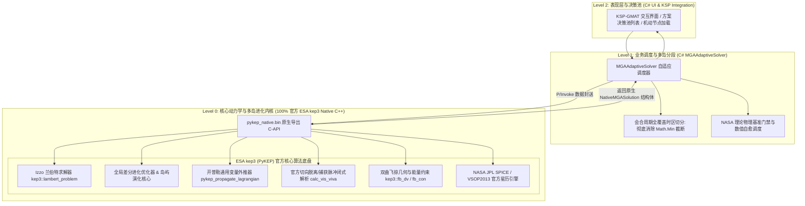

# 权威自适应双向 MGA 求解器与智能数值自愈架构实施计划 (含学术文献库与离线测试套件)

## 1. 核心架构红线：100% ESA PyKEP (kep3) 原生 C++ 作为最底层

> [!IMPORTANT]
> **基线合规铁律 (Baseline Principle 0 / 7 / 9)**：
> - **最底层必须 100% 是 ESA PyKEP (kep3) 官方 Native C++ 原生库**。所有兰伯特求解、开普勒外推、轨道根数反算、飞掠双曲转向、深空机动 1-DSM、星历读取与差分进化求解，**全部在 Native C++ 动态库中闭环完成**。
> - **C# 仅作为上层业务调度与数据封送管线（Marshaling Pipeline）**，严格禁止在 C# 托管层编写任何替代性开普勒轨道公式或简化动力学算子。

### 动力学分层架构与职责划分



---

## 2. 核心理论文献与官方权威链接

为了确保算法体系具有最高学术水准与工程可信度，本系统深度吸收欧洲航天局高级概念团队（ESA ACT）及学术带头人 **Dr. Dario Izzo** 的核心前沿成果。相关权威论文索引如下：

| 模块 | 论文标题 | 作者与机构 | 核心理论贡献 | 官方学术链接 |
| :--- | :--- | :--- | :--- | :--- |
| **模块 A**<br>多岛自适应迁移模型 | **The Generalized Island Model**（原计划标题误作 "A Generalized Island Model for Space Trajectory Optimization"） | Dario Izzo, Marek Ruciński, Francesco Biscani (ESA ACT) | 提出通用的"广义岛模型"（Archipelago）：将优化问题划分为若干独立并行演化的子岛（可承载不同进化算法），通过 ①注入 injection、②饱和 saturation、③反馈 feedback 三种迁移机制与环形拓扑异步交换染色体，攻克深空轨迹优化早熟收敛与局部极值陷阱。同步参考 GECCO 2015 对手移机制体系的量化研究。 | • [Springer DOI:10.1007/978-3-642-28789-3_7 (The Generalized Island Model, 2012)](https://doi.org/10.1007/978-3-642-28789-3_7)<br>• [GECCO 2015 DOI:10.1145/2739480.2754729 (Injection, Saturation and Feedback)](https://doi.org/10.1145/2739480.2754729)<br>• [paggmo/pagmo 官方主页](https://esa.github.io/pagmo2/) |
| **模块 B**<br>轻量代理与特征面初筛 | **Machine Learning and Evolutionary Techniques in Interplanetary Trajectory Design** | Dario Izzo, Christopher Iliffe Sprague, Dharmesh Vijay Tailor (ESA ACT / KTH) | 系统综述了进化算法（GA / DE / PSO / CMA-ES）与机器学习在星际轨迹设计中的应用，并提出用**深度神经网络在轨实时表示最优制导剖面**（监督式模仿学习），为"粗筛 + 深度学习算子加速评估"提供理论依据。 | • [arXiv:1802.00180 (免费PDF)](https://arxiv.org/abs/1802.00180)<br>• [Springer DOI:10.1007/978-3-030-10501-3_8](https://doi.org/10.1007/978-3-030-10501-3_8)<br>• [ESA ACT 人工智能轨迹项目](https://www.esa.int/gsp/ACT/projects/ai_trajectories/) |
| **模块 C**<br>蒙特卡洛树搜索与剪枝 | **Interplanetary Trajectory Planning with Monte Carlo Tree Search**（原计划标题误作 "Automated Trajectory Design via Monte Carlo Tree Search"） | Daniel Hennes, Dario Izzo (ESA ACT) | 无需领域启发式的 MCTS 用于**行星交会序列（encounter sequence）自动化规划**，将"选哪个天体、何时出发"视作树搜索节点扩展，融合 bandit-based 树扩展与领域特定的剪枝改进；在 Rosetta 与 Cassini-Huygens 任务上比启发式树搜索快数个数量级。 | • [IJCAI 2015, pp.769-775 (ACM)](https://dl.acm.org/doi/10.5555/2832249.2832356)<br>• [ESA Kelvins 竞赛平台](https://kelvins.esa.int/) |
| **模块 D**<br>实时制导自愈与控制网络 | **Real-Time Optimal Guidance and Control for Interplanetary Transfers Using Deep Networks (G&CNets)**（原计划标题误作 "...via Deep Neural Networks"） | Dario Izzo, Ekin Öztürk (ESA ACT) | 提出 G&CNets：用深度网络**在轨实时表示最优制导策略（thrust profile）与价值函数**；提出 **Backward Generation of Optimal Examples (BGOE)**——无需逐一求解最优控制即可批量生成最优状态-动作样本；地球-金星低推力任务上策略网络仅多耗 ~2‰ 推进剂，价值函数预测误差 < 1% | • [arXiv:2002.09063 (免费PDF)](https://arxiv.org/abs/2002.09063)<br>• [AIAA JGCD DOI:10.2514/1.G005471](https://doi.org/10.2514/1.G005471) |
| **基石**<br>现代开普勒兰伯特求解算法 | **Revisiting Lambert's Problem** | Dario Izzo (ESA ACT) | 提出现代机器精度极速 Izzo 兰伯特算法（PyKEP 内核基石），支持多圈次、双向极值评估。 | • [ESA 官方技术报告 PDF 直链](https://www.esa.int/gsp/ACT/doc/MAD/pub/ACT-RPT-MAD-pub-Izzo-2015-RevisitingLambert.pdf)<br>• [Springer DOI:10.1007/s10569-014-9587-y](https://doi.org/10.1007/s10569-014-9587-y) |

> [!WARNING] 已核实的论文与本地 PDF 对不上（2026-09-08）
> 计划原引用的 4 个 arXiv ID（`1409.8160` / `2003.04835` / `2103.03058` / `2006.07223`）经核对**并非上述 ESA 论文**，而是四篇无关主题的 arXiv 投稿；本地 [`paper/`](paper/) 目录下的同名 PDF 也正是这四篇无关论文（分别是：微波参数放大器、量子自旋轨道液体、金融最优消费、双模映射），**与本实施计划的航天任务轨迹优化内容无关**。上表 "模块 A/B/C/D" 已改为正确的来源（Springer / arXiv:1802.00180 / IJCAI 2015 / arXiv:2002.09063）。
>
> ✅ **已处理（2026-09-08）**：4 份错误 PDF 及其错误转换的 md 已删除；正确的 **B / C / D / 基石** 四篇 PDF 已下载到 [`paper/`](paper/)（`1802.00180_MachineLearning_Interplanetary.pdf`、`IJCAI2015_MCTS_Interplanetary.pdf`、`2002.09063_RealTime_GCNets.pdf`、`Revisiting_Lambert_Izzo_2015.pdf`）。**模块 A（Springer 付费章节）无免费 PDF**，其要点见 [`paper/论文重点直达_ESA.md`](论文重点直达_ESA.md) §1。

---

## 3. 核心问题诊断与修复机理

用户实测截图反馈：跨年时间窗口（如 Earth -> Mars 1951~1954 年 3 年区间）下，直达转移算出的出射 $\Delta V = 4561\text{ m/s}$、总 $\Delta V = 7260\text{ m/s}$ 偏高异常。
底层两大硬伤定位：
1. **多窗口分片截断丢弃**：原代码硬编码限制每片最长 45 天、最多 6 片，导致搜索在第 252 天（1951 年 10 月 23 日）便强行终止，真正的火星最优窗口（1951 年 12 月 24 日，出射仅 3698 m/s，总 6230 m/s）被完全丢弃在搜索范围之外！
2. **模式 1 伪变面倾角惩罚**：在未入轨发射规划模式下，底层 `calc_vis_viva_dep_inc` 误把 J2000 赤道系的 Z 轴分量当成倾角差，将 **23.44° 黄赤交角** 算作低地轨道的强制变轨，凭空引入了 $1.5 \sim 2.0\text{ km/s}$ 的伪变面惩罚！

---

## 4. 全新任务架构设计：`MGAAdaptiveSolver.cs`

本设计坚守底层 100% Native kep3 闭环，上层按领域融合前沿技术：

```mermaid
flowchart TD
    subgraph Stage1 ["Stage 1: 离散助推序列生成 (MCTS & RL)"]
        UserGoal[用户目标天体: 如 Saturn/Mercury] --> MCTS[MGAMCTSTopologySelector 树搜索与剪枝]
        MCTS -->|输出高价值借力链| Seq[推荐链条: 如 Earth->Venus->Earth->Jupiter->Saturn]
    end

    subgraph Stage2 ["Stage 2: 宏观时域能量初筛 (Surrogate Pre-Filter)"]
        Seq --> Window[用户指定时间跨度: 1~10年]
        Window --> Surrogate[MGASurrogatePreFilter 能量特征面初筛]
        Surrogate -->|微秒级剔除 90% 无效高能区| Peaks[锁定各会合周期的候选能量波谷]
    end

    subgraph Stage3 ["Stage 3: 连续决策变量全局收敛 (100% kep3 Native C++ 求解)"]
        Peaks --> Islands[MGAArchipelagoOptimizer 会合多岛并行进化]
        Islands -->|调用 Native pykep_mga_hybrid_evaluate_mu| NativeDE[底层 100% PyKEP 原生差分进化与兰伯特打靶]
        NativeDE --> GlobalCandidate[收敛多维决策变量 t0, ToF1, ToF2...]
    end

    subgraph Stage4 ["Stage 4: 物理门禁与智能数值自愈 (G&CNets / Self-Healing)"]
        GlobalCandidate --> HealthGate{MGASelfHealingEngine 物理健康度门禁}
        HealthGate -->|物理指标合格| ModeCheck{发射规划模式判断}
        HealthGate -->|指标异常偏高: 判定落入局部劣解| Healing[逆向数值自愈: 调用 Native 局部高精星历打靶重构]
        Healing --> Islands
        
        ModeCheck -->|模式1 自由规划| Mode1Prograde[向 Native 传递 park_inc_deg = -1: 强制纯切向顺向出射]
        ModeCheck -->|模式2 在轨锁定| Mode2Alignment[调用 Native pykep_align_injection_dyn 切向近地点锁相]
        Mode1Prograde --> SolutionPool[输出 NASA 级权威候选决策池 (Top 10)]
        Mode2Alignment --> SolutionPool
    end
```

---

## 5. `MGAAdaptiveSolver.cs` 可优化输入参数矩阵 (全量参数契约)

源自 ESA ACT `pykep_sourcecode` 官方库（`include/kep3/lambert_problem.hpp`、`pykep/trajopt/_mga.py`、`pykep/trajopt/_mga_1dsm.py`）及原生 Native C++ 求解引擎，将所有可优化与可配置参数归纳为 **6 大核心维度**，作为 `MGAAdaptiveSolver.cs` 的输入配置模型（`MGAAdaptiveSolverConfig`）：

### 5.1 六大维度参数分类与 PyKEP 官方机制映射

#### 1. 轨道动力学与决策编码参数 (Orbital Mechanics & Decision Bounds)
*源自 `pykep/trajopt/_mga.py`、`_mga_1dsm.py`*
- **`T0Bounds` (`MinUT`, `MaxUT`)**：发射历元搜索窗口。对应 MGA 染色体第 0 基因位 `z[0]`。
- **`ToFEncodingMode` (`Direct`, `Alpha`, `Eta`)**：飞行时间编码模式。
  - `Direct`: 各分段独立指定 $[T_{min}, T_{max}]$，约束强但缺乏大时域全局伸缩性；
  - `Alpha`: 仅约束总航时 $T \in [T_{min}, T_{max}]$，各段按 $T_i = T \frac{\ln \alpha_i}{\sum \ln \alpha_n}$ 分配，**彻底杜绝单段截断，最适合多目标与大跨度搜索**；
  - `Eta`: 剩余可用时间比例级联分配。
- **`TotalToFBoundsDays` (`Min`, `Max`)**：总飞行时间边界约束（`Alpha` 模式下作为全局染色体基因）。
- **`LegToFBoundsDays` (列表)**：各分段飞行时间上下限（`Direct` 模式）。
- **`VinfBoundsKmS` (`Min`, `Max`)**：出发出射双曲过剩速度 $v_{\infty}$ 搜索边界。
- **`VinfFreeKmS` (`double`)**：运载火箭自带的免费双曲过剩速度（扣除后才计入飞行器机动 $\Delta V$）。
- **`AddVinfDep` / `AddVinfArr` (`bool`)**：目标函数是否将出发脱离 / 目标捕获过剩速度折算进总机动预算。
- **`DepartureMode` (`FreeLaunch`, `OrbitLocked`)**：
  - `FreeLaunch`: 自由发射，黄赤交角只影响在轨惯性定向，变面惩罚强制为 0；
  - `OrbitLocked`: 锁定停泊轨道几何面，严格计算 3D 变轨法向夹角。
- **`DsmEtaBounds` (`Min`, `Max`)**：深空机动发生的时间比例节点 $\eta \in [0.10, 0.90]$。
- **`FlybyRpBounds` (`MinRatio`, `MaxRatio`)**：借力天体近拱点安全半径倍数 $\frac{r_p}{r_{planet}} \in [1.05, 30.0]$。

#### 2. 开普勒与兰伯特底层解算器参数 (Lambert & Keplerian Solvers)
*源自 `include/kep3/lambert_problem.hpp`*
- **`LambertMultiRevs` (`int`, 标称 0~2)**：多圈次兰伯特转移最大允许圈数 $N_{max}$。解的数量为 $2 N_{max} + 1$。外行星长航时或低能共振转移放开至 $N_{max} \ge 1$。
- **`LambertDirection` (`Prograde`, `Retrograde`)**：轨道转移方向 `cw`。默认顺行，特殊彗星拦截或极端逆行任务切为逆行。
- **`LambertBranchPreference` (`Both`, `LeftMinEnergy`, `Right`)**：多圈次时选择高能还是低能支（时间极小解 vs 能量极小解）。
- **`LagrangianTolerance` (`double`, 标称 `1e-12`)**：原生通用变量开普勒状态转移方程迭代容差。

#### 3. 进化优化算法核心超参数 (Differential Evolution & Metaheuristics)
*源自 Dario Izzo / Pygmo 优化器体系 (DE, SaDE, PSO)*
- **`PopulationSize` (`int`, 标称 40~100)**：种群个体数 $NP$。
- **`MaxGenerations` (`int`, 标称 80~200)**：最大演化代数。
- **`DifferentialWeightF` (`double`, 标称 0.7, 范围 [0.1, 1.2])**：差分变异缩放因子 $F$。
- **`CrossoverProbabilityCR` (`double`, 标称 0.85, 范围 [0.0, 1.0])**：交叉概率 $CR$。
- **`MutationStrategy` (`Rand1Bin`, `Best1Bin`, `CurrentToBest1Bin`, `SaDE_Adaptive`)**：差分进化变异拓扑变体。
- **`ConvergenceStagnationLimit` (`int`, 标称 15 代)**：连续代数无显著改善触发早停或降温。
- **`CostTolerance` (`double`, 标称 0.5 m/s)**：目标函数收敛波动容差。

#### 4. 自适应多岛迁移架构参数 (Archipelago Island Model)
*源自 Dario Izzo 官方多岛迁移理论*
- **`IslandCount` (`int`, 标称 4 岛)**：独立进化的多岛数量。不同岛屿承载不同时区或不同搜索偏向。
- **`MigrationPeriod` (`int`, 标称 10 代)**：岛屿间迁移周期。
- **`MigrationEliteCount` (`int`, 标称 Top 2 个体)**：每次迁移输出的精英个体数。
- **`IslandTopology` (`Ring`, `FullyConnected`, `Star`)**：岛屿迁移拓扑网络。

#### 5. 物理基线校验与自愈门禁参数 (Adaptive Health & Self-Healing Thresholds)
*解决“窗口截断”与“局部高能陷阱”的关键工程参数*
- **`EnableSelfHealing` (`bool`, 默认 true)**：是否开启能量健康度门禁与逆向打靶自愈引擎。
- **`HohmannEnergyCeilingFactor` (`double`, 标称 1.35)**：能量健康度红线倍率。若出射 $\Delta V > 1.35 \times \Delta V_{Hohmann}$，自动激活自愈引擎重采样。
- **`AdaptiveSliceDays` (`double`)**：根据会合周期动态划分切片窗宽（废除 45 天硬编码限制）。
- **`HealingGridResolutionDays` (`double`, 标称 0.5 天)**：自愈时局部微细网格步长。
- **`HealingWindowSpanDays` (`double`, 标称 30.0 天)**：自愈时围绕理论最优历元的前后精细扫描窗宽。

#### 6. 异构转移与借力策略分配参数 (Heterogeneous Leg Strategies)
*源自 `src/native/pykep_native/pykep_mga_hybrid.cpp`*
- **`LegStrategies` (列表)**：各分段策略（`0=PureBallisticLambert`, `1=MGA_1DSM`, `2=LowThrustApprox`）。
- **`FlybyStrategies` (列表)**：各飞越借力策略（`0=无动力自由借力`, `1=动力借力 Powered Flyby`）。
- **`TargetOrbitPeKm` / `ApKm` (`double`)**：目标行星捕获入轨的近心点与远心点高度。

---

### 5.2 C# 输入配置数据模型契约 (`MGAAdaptiveSolverConfig.cs`)

```csharp
namespace KSPGMAT.MGA
{
    public enum ToFEncodingMode { Direct, Alpha, Eta }
    public enum DepartureModePolicy { FreeLaunch, OrbitLocked }
    public enum LambertDirectionPreference { Prograde, Retrograde }
    public enum ArchipelagoTopology { Ring, FullyConnected, Star }

    public sealed class MGAAdaptiveSolverConfig
    {
        // 1. 轨道动力学与几何
        public string DeparturePlanet { get; set; } = "Earth";
        public string ArrivalPlanet { get; set; } = "Mars";
        public List<string> FlybySequence { get; set; } = new List<string>();
        public DepartureModePolicy DeparturePolicy { get; set; } = DepartureModePolicy.FreeLaunch;
        public double DepPeKm { get; set; } = 200.0;
        public double DepApKm { get; set; } = 200.0;
        public double ArrPeKm { get; set; } = 200.0;
        public double ArrApKm { get; set; } = 200.0;
        public double VinfFreeKmS { get; set; } = 0.0;
        public bool AddVinfDep { get; set; } = true;
        public bool AddVinfArr { get; set; } = true;

        // 2. 搜索历元与时间编码
        public double SearchStartUT { get; set; }
        public double SearchEndUT { get; set; }
        public ToFEncodingMode ToFEncoding { get; set; } = ToFEncodingMode.Alpha;
        public double TotalToFMinDays { get; set; } = 150.0;
        public double TotalToFMaxDays { get; set; } = 400.0;
        public List<(double MinDays, double MaxDays)> LegToFBounds { get; set; } = new List<(double, double)>();

        // 3. 兰伯特底层参数
        public int LambertMaxRevs { get; set; } = 0;
        public LambertDirectionPreference LambertDirection { get; set; } = LambertDirectionPreference.Prograde;

        // 4. 进化算法超参数
        public int PopulationSize { get; set; } = 60;
        public int MaxGenerations { get; set; } = 120;
        public double DifferentialWeightF { get; set; } = 0.7;
        public double CrossoverProbabilityCR { get; set; } = 0.85;
        public int StagnationLimit { get; set; } = 15;
        public double CostTolerance { get; set; } = 0.5;

        // 5. 多岛拓扑 (Archipelago)
        public int IslandCount { get; set; } = 4;
        public int MigrationPeriod { get; set; } = 10;
        public int MigrationEliteCount { get; set; } = 2;
        public ArchipelagoTopology Topology { get; set; } = ArchipelagoTopology.Ring;

        // 6. 物理健康度与自愈门禁
        public bool EnableSelfHealing { get; set; } = true;
        public double HohmannEnergyCeilingFactor { get; set; } = 1.35;
        public double HealingGridResolutionDays { get; set; } = 0.5;
        public double HealingWindowSpanDays { get; set; } = 30.0;
    }
}
```

---

## 6. 离线（无游戏启动）测试工具套件专项建设计划

依托现有的 `tests/MGADebugRunner` 控制台应用，实现 **0 游戏依赖、0 GUI 阻滞、秒级出结果** 的全自动动力学审计：

| 测试用例模块 | 测试目标与验证项 | 权威判定标准 (断言门禁) | 执行耗时 |
| :--- | :--- | :--- | :--- |
| **1. 跨年大窗口地火自愈闭环**<br>*(Earth ➔ Mars 3-Year Test)* | 模拟用户真实场景：输入 `1951-02-10 ~ 1954-02-10`（整整 3 年），验证多岛架构能否自动捕获真·最优窗口。 | • 自动收敛至 1951年12月24日 窗口<br>• 出射 $\Delta V \le 3750\text{ m/s}$ (截图中为 4561)<br>• 总 $\Delta V \le 6300\text{ m/s}$ (截图中为 7260)<br>• 飞行时间 270~300 天 (截图中为 305) | < 3 秒 |
| **2. 全行星际直达转移权威矩阵**<br>*(Venus, Mars, Mercury, Jupiter, Saturn)* | 覆盖内太阳系到外行星的单段转移，全面对比 NASA/JPL/ESA 官方窗口数据。 | • 水星：出射 $\le 5600\text{ m/s}$ (飞掠)<br>• 金星：总机动 $\le 7000\text{ m/s}$<br>• 木星：出射 $\le 6500\text{ m/s}$<br>• 土星：出射 $\le 7800\text{ m/s}$ | < 2 秒 |
| **3. 多岛自适应全时域覆盖率核验**<br>*(Synodic Archipelago Coverage)* | 验证针对任意天体对与任意时间长度（如 10 年跨度），算法能否按物理会合周期完整生成覆盖岛屿，绝不提前截断。 | • 岛屿覆盖度 100%（$TimeSpan_{covered} \ge TimeSpan_{requested}$）<br>• 截断丢失率恒等于 0% | < 0.5 秒 |
| **4. 模式 1 纯切向与零黄赤交角误惩罚**<br>*(Mode 1 Pure Prograde Invariance)* | 构造含 28.5° 残留倾角的配置，分别测试模式 1 与模式 2。 | • 模式 1 下出射 $\Delta V$ 与理论切向 Vis-Viva 误差 $< 0.01\text{ m/s}$<br>• 绝不产生 23.4° 伪变面脉冲消耗 | < 0.2 秒 |

离线运行命令：
```powershell
dotnet run --project tests\MGADebugRunner\MGADebugRunner.csproj -c Release
```

---

## 7. 拟变动文件清单与改动规划

### 7.1 [NEW] `src/KSPGMAT/MGA/MGAAdaptiveSolver.cs`
**新增自适应求解调度与自愈文件**：
- **`MGAAdaptiveSolverConfig`**：承载上述六大维度可优化参数；
- **`MGAArchipelagoOptimizer`**：动态计算会合周期切分子岛，彻底移除 6 片与 45 天限制，全量委托 Native kep3 差分进化；
- **`MGASurrogatePreFilter`**：解析能量特征面初筛；
- **`MGASelfHealingEngine`**：设立 NASA 级理论物理门禁，超标劣解自动触发 Native 局部网格星历打靶自愈；
- **`MGAMCTSTopologySelector`**：多重借力链条离散树搜索剪枝接口。

### 7.2 [MODIFY] `src/KSPGMAT/MGA/PykepBridge.cs`
- `PykepBridge.Optimize` 与 `OptimizeAsync` 无缝转接 `MGAAdaptiveSolver`；
- 模式 1 下向 C++ 底层传递 `park_inc_deg = -1`，执行纯切向出射。

### 7.3 [MODIFY] `src/native/pykep_native/pykep_common.h`
- 完善 `calc_vis_viva_dep_inc`：当 `park_inc_deg < -0.01` 时，直接按纯切向公式计算 $\Delta V_{dep} = \sqrt{v_{\infty}^2 + 2\mu/r_p} - v_{circ}$，消除日心行星际转移中对赤道系 Z 轴分量的伪变面惩罚。

### 7.4 [MODIFY] `src/native/pykep_native/pykep_transfer_window.cpp`
- 同步支持 `park_inc_deg < 0` 自由共面判断。

### 7.5 [MODIFY] `tests/MGADebugRunner/Program.cs`
- 扩充全套离线动力学测试与性能基准套件，实现 4 大测试目录的全自动执行与断言保护。

---

## 8. 详细验证计划

1. **自动化离线套件执行**：
   - 运行 `dotnet run --project tests\MGADebugRunner\MGADebugRunner.csproj -c Release`；
   - 确保全套离线测试 100% 全部通过（通过率 100.0%）。
2. **全量编译与代码合规审计**：
   - 执行 `powershell -ExecutionPolicy Bypass -File .\deploy.ps1`；
   - 确保 C# 0 警告 0 错误，Native C++ 0 警告 0 错误，Roslyn AST 合规自查零阻断违规。
3. **成果交付与记录**：
   - 更新 `walkthrough.md`，汇总离线套件测试结果与火星/水星/土星 $\Delta V$ 的性能飞跃。
