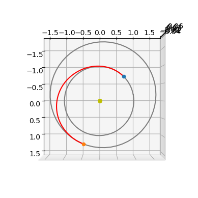
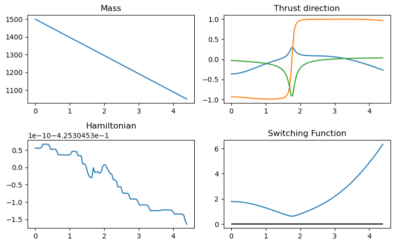
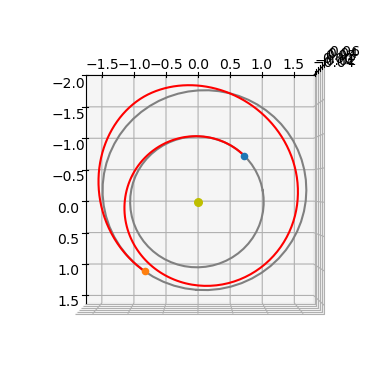
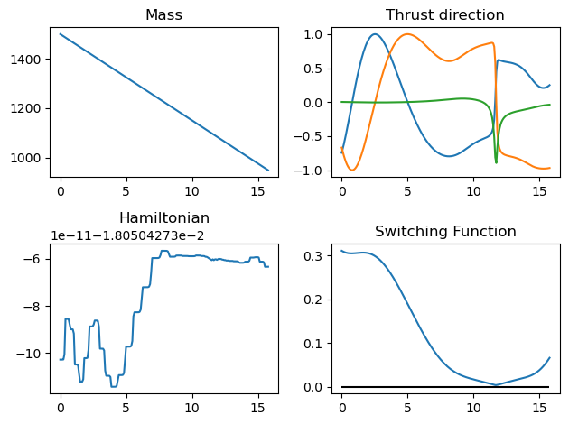

# Indirect methods II (minimum time, Cartesian)

This notebook presents a minimum-time low-thrust transfer solved with an indirect method in Cartesian coordinates.

We derive a TPBVP (Two-Point Boundary Value Problem) from Pontryagin's Minimum Principle (PMP), then solve it with single shooting.

Most symbolic and differentiation steps can be automated with `heyoka`, while `pykep` already exposes production-ready building blocks.

Compared with the fixed-time minimum-propellant case, the key difference is the objective function: for time optimality the PMP solution gives full throttle ($u=1$) under the assumptions used here, so homotopy on $\epsilon$ is not required since the resulting optimal thrust profile is smooth.

For comparison with the fixed-time mass-optimal formulation, see [Cartesian mass-optimal notebook](./pontryagin_cartesian_mass.ipynb). For the equinoctial counterpart, see [equinoctial time-optimal notebook](./pontryagin_equinoctial_time.ipynb).


```python
import pykep as pk
import numpy as np
import heyoka as hy
import pygmo as pg
import pygmo_plugins_nonfree as ppnf
import time

from matplotlib import pyplot as plt
```

## Manual construction of the TPBVP
We consider the dynamics of a spacecraft moving around a massive primary and equipped with a low-thrust propulsion system capable of delivering constant maximum thrust $T_{\max}$:

$$
\left\{
\begin{array}{l}
\dot{\mathbf r} = \mathbf v \\
\dot{\mathbf v} = -\frac{\mu}{r^3}\mathbf r + c_1\frac{u}{m}\hat{\mathbf i} \\
\dot m = -\frac{c_1}{c_2}u
\end{array}
\right.,
$$

with control constraints $0 \le u \le 1$ and $\|\hat{\mathbf i}\|=1$, where $c_1=T_{\max}$ and $c_2=I_{sp}g_0$.

Following PMP, we introduce one costate per state variable. Using `heyoka` as a symbolic manipulator, we define symbols for all time-dependent quantities:


```python
# State variables
x, y, z, vx, vy, vz, m = hy.make_vars("x", "y", "z", "vx", "vy", "vz", "m")
# Costate variables
lx, ly, lz, lvx, lvy, lvz, lm = hy.make_vars(
    "lx", "ly", "lz", "lvx", "lvy", "lvz", "lm"
)
# Control variables: throttle and thrust direction
u, ix, iy, iz = hy.make_vars("u", "ix", "iy", "iz")
```

To keep the derivation readable, we define compact expressions and group state/costate components into vectors.


```python
# Reusable scalar expressions
r3 = (x**2 + y**2 + z**2) ** (1.5)
lv_norm = hy.sqrt(lvx**2 + lvy**2 + lvz**2)

# Vectorized groupings for compact Hamiltonian expressions
lr = np.array([lx, ly, lz])
lv = np.array([lvx, lvy, lvz])
r = np.array([x, y, z])
v = np.array([vx, vy, vz])
i_vers = np.array([ix, iy, iz])
```

For API consistency with the mass-optimal notebook, we keep an $\epsilon$ slot in `heyoka` parameters (`hy.par[3]`), but it is not used in this time-optimal formulation.

The performance index is

$$
J = \lambda_0\frac{c_1}{c_2}\int_0^T dt,
$$

and the corresponding minimizer is already smooth in this setting (no continuation parameter is needed). Parameter ordering is kept as $[\mu, c_1, c_2, \epsilon, \lambda_0]$, with $c_1=T_{\max}$ and $c_2=I_{sp}g_0$.

The dynamics can then be written as:


```python
# Dynamics
fr = v
fv = hy.par[1] * u / m * i_vers - (hy.par[0] / r3) * r
fm = -hy.par[1] / hy.par[2] * u
```

We introduce the Hamiltonian ($\mathbf x$ is the full state, $\boldsymbol\lambda$ the full costate, and $\mathbf u$ the control tuple):

$$
\mathcal H(\mathbf x, \boldsymbol\lambda, \mathbf u) = \boldsymbol\lambda_r \cdot \mathbf f_r + \boldsymbol\lambda_v \cdot \mathbf f_v + \lambda_m f_m + \lambda_0\frac{c_1}{c_2}.
$$


```python
# Hamiltonian
H_full = lr @ fr + lv @ fv + lm * fm + hy.par[4] * hy.par[1] / hy.par[2]
```

And write the resulting Hamiltonian system:

$$
\left\{
\begin{array}{l}
\dot{\mathbf x} = \frac{\partial \mathcal H}{\partial \mathbf \lambda} \\
\dot{\mathbf \lambda} = - \frac{\partial \mathcal H}{\partial \mathbf x} \\
\end{array}\right.
$$


```python
# Augmented equations of motion
rhs = [
    hy.diff(H_full, var)
    for var in [lx, ly, lz, lvx, lvy, lvz, lm, x, y, z, vx, vy, vz, m]
]
for j in range(7, 14):
    rhs[j] = -rhs[j]
```

Pontryagin's minimum principle requires pointwise minimization of the Hamiltonian over the admissible control set

$$
\mathbf u^*(\mathbf x, \boldsymbol\lambda) = \arg\min_{\mathbf u \in \mathcal U} \mathcal H(\mathbf x, \boldsymbol\lambda, \mathbf u),
$$

with $\quad\mathcal U = \{(u,\hat{\mathbf i})\,|\,0 \le u \le 1,\ \|\hat{\mathbf i}\|=1\}$.

In this time-optimal case, the minimizer is:


```python
# We apply Pontryagin minimum principle (primer vector and u^* = 1.)
argmin_H_full = {
    ix: -lvx / lv_norm,
    iy: -lvy / lv_norm,
    iz: -lvz / lv_norm,
    u: hy.expression(1.)
}
```

:::{note}
This is the key difference with respect to the fixed-time mass-optimal formulation: the optimal thrust direction has the same primer-vector structure, while the throttle is saturated at full thrust ($u=1$) under the assumptions used here. 
:::

After substitution, controls become explicit functions of state and costate and the augmented dynamics close as

$$
H(\mathbf x, \boldsymbol\lambda) = \mathcal H(\mathbf x, \boldsymbol\lambda, \mathbf u^*).
$$


```python
rhs = hy.subs(rhs, argmin_H_full)

# We also build the Hamiltonian as a function of the state / co-state only
# (i.e. no longer of controls now solved thanks to the minimum principle)
H = hy.subs(H_full, argmin_H_full)
```

The next block instantiates the `heyoka` integrator for the augmented dynamics and helper evaluators used in the shooting implementation.


```python
# We compile the Hamiltonian into a C function (to be called with pars = [mu, c1, c2, eps, l0])
H_func = hy.cfunc([H], [x, y, z, vx, vy, vz, m, lx, ly, lz, lvx, lvy, lvz, lm])

# We compile also the thrust direction
i_vers_func = hy.cfunc(
    [argmin_H_full[ix], argmin_H_full[iy], argmin_H_full[iz]], [lvx, lvy, lvz]
)

# And we compile the dynamics for x,y,z,vx,vy,vz,lm.
# This is needed as to compute the analytical gradents with respect to tof. (not there for fixed time problems)
dyn_func = hy.cfunc([rhs[0], rhs[1],rhs[2],rhs[3],rhs[4],rhs[5],rhs[13]], [x, y, z, vx, vy, vz, m, lx, ly, lz, lvx, lvy, lvz, lm])

# We assemble the Taylor adaptive integrator
full_state = [x, y, z, vx, vy, vz, m, lx, ly, lz, lvx, lvy, lvz, lm]
sys = [(var, dvar) for var, dvar in zip(full_state, rhs)]
ta = hy.taylor_adaptive(sys)
aug_sys = hy.var_ode_sys(sys, [lx, ly, lz, lvx, lvy, lvz, lm, hy.par[4]], 1)
ta_var = hy.taylor_adaptive(aug_sys, tol=1e-16, compact_mode=True)

```

## Constructing the TPBVP using `pykep`

For this formulation, `pykep` provides pre-assembled components equivalent to the objects derived above.

In practice, these are the preferred tools for robust workflows, while the manual derivation remains valuable for understanding and debugging.


```python
# The Taylor integrator
ta = pk.ta.get_pc(1e-16, pk.optimality_type.TIME)
# The Variational Taylor integrator (8 digits generally enough)
ta_var = pk.ta.get_pc_var(1e-8, pk.optimality_type.TIME)
# The Hamiltonian
H_func = pk.ta.get_pc_H_cfunc(pk.optimality_type.TIME)
# The switching function (always negative, not useful for this time optimal case, but still)
SF_func = pk.ta.get_pc_SF_cfunc(pk.optimality_type.TIME)
# The magnitude of the throttle (always 1, but still)
u_func = pk.ta.get_pc_u_cfunc(pk.optimality_type.TIME)
# The thrust direction
i_vers_func = pk.ta.get_pc_i_vers_cfunc(pk.optimality_type.TIME)
# The dynamics cfunc
dyn_func = pk.ta.get_pc_dyn_cfunc(pk.optimality_type.TIME)
```

## Solving in single shooting

We use, as a test case, a simple Earth-Mars transfer and start from a relatively high thrust level $T_{\max}$.

Later, we apply continuation on $T_{\max}$ to explore lower-thrust solutions with more revolutions.

We instantiate a single shooting problem for this case using the UDP (User Defined Problem in the `pygmo` jargon) provided by `pykep`:


```python
# Factory for the pygmo udp.
def prob_factory(T_max, tof_guess):
    udp = pk.trajopt.pontryagin_cartesian_time(
        source=pk.planet(pk.udpla.jpl_lp("earth")),
        target=pk.planet(pk.udpla.jpl_lp("mars")),
        tof_guess=tof_guess,
        t0 = pk.epoch(400),
        lambda0 = None,  # We normalize the costates
        T_max=T_max,
        Isp=3000,
        m0=1500,
        L=pk.AU,
        MU=pk.MU_SUN,
        MASS=1500,
        with_gradient=True,
        taylor_tolerance=1e-8, # lower tolerance for the Taylor integrator since the problem is easy
        taylor_tolerance_var=1e-6
    )
    prob = pg.problem(udp)
    prob.c_tol = 1e-6
    return prob

prob = prob_factory(0.6, 250)
sparsity = prob.gradient_sparsity()
udp = prob.extract(pk.trajopt.pontryagin_cartesian_time)
```

The resulting TPBVP can be solved with interior-point optimizers or root-finding methods on boundary residuals.

Here we use IPOPT (via `pagmo`) and a MINPACK wrapper (via `scipy.optimize.root`).


```python
ip = pg.ipopt()
#ip.set_numeric_option("tol", 1e-1)  # Change the relative convergence tolerance
ip.set_integer_option("max_iter", 200)  # Change the maximum iterations
ip.set_integer_option("print_level", 0)  # Makes Ipopt unverbose
ip.set_string_option(
    "sb", "yes"
)
ip.set_string_option(
    "nlp_scaling_method", "none"
)  # Removes any scaling made in auto mode
ip.set_string_option(
    "mu_strategy", "adaptive"
)  # Alternative is to tune the initial mu value
ipopt200 = pg.algorithm(ip)
ip.set_integer_option("max_iter", 20)  # Change the maximum iterations
ipopt20 = pg.algorithm(ip)
```

MINPACK is available via scipy and is missing in the current pygmo version, but we can quickly provide a wrapper as a UDA:


```python
class my_solver:
    def __init__(self, gradient):
        self.gradient = gradient
    def evolve(self, pop: pg.population):
        from scipy.optimize import root
        prob = pop.problem
        x0 = pop.champion_x
        n = prob.get_nx()
        if self.gradient:
            def dense_grad(x):
                G = np.zeros((n,n))
                G[sparsity[:, 0], sparsity[:, 1]] = prob.gradient(x)
                return G.reshape(n,n)
            res = root(lambda x: [0] +  list(prob.fitness(x)[1:]), x0, method="hybr", tol=1e-8, options = {"factor": 1., "diag": [1]*(n)}, jac=dense_grad)  # factor=1 is very important for convergence
        else:
            res = root(lambda x: [0] +  list(prob.fitness(x)[1:]), x0, method="hybr", tol=1e-8, options = {"factor": 1., "diag": [1]*(n)})  # factor=1 is very important for convergence
        pop.set_x(0, res["x"])
        return pop
    def get_name(self):
        return "Minpack hybrd routine"

minpack = pg.algorithm(my_solver(False))
minpack_g = pg.algorithm(my_solver(True))
```

We use a multi-start strategy, which is generally good practice for indirect shooting due to sensitivity to initialization. In this case convergence is often immediate, but we still report robustness.


```python
def multistart(algo, n_trials=30):
    masses = []
    xs = []
    total_time = 0.0
    success = 0.

    for i in range(n_trials):
        pop = pg.population(udp,1)
        time_start = time.time()
        pop = algo.evolve(pop)
        time_end = time.time()
        total_time += time_end - time_start
        if prob.feasibility_f(pop.champion_f):
            print(".", end="")
            udp.fitness(pop.champion_x)
            xs.append(pop.champion_x)
            masses.append(udp.ta.state[6])
            success+=1
        else:
            print("x", end="")
    print(f"\nFinal mass is: {masses[0]*udp.MASS}")
    print(f"Total time to success: {total_time:.3f} seconds")
    print(f"Number of successes: {success} over {n_trials} trials ({success/n_trials*100:.1f} %)")
    return pop
```


```python
pop = multistart(ipopt200, 10)
```

    
    ******************************************************************************
    This program contains Ipopt, a library for large-scale nonlinear optimization.
     Ipopt is released as open source code under the Eclipse Public License (EPL).
             For more information visit https://github.com/coin-or/Ipopt
    ******************************************************************************
    
    .x........
    Final mass is: 1049.4338611669273
    Total time to success: 6.934 seconds
    Number of successes: 9.0 over 10 trials (90.0 %)
    


```python
pop = multistart(minpack_g, 10)
```

    ...x.x.xx.
    Final mass is: 1049.4338612158242
    Total time to success: 0.214 seconds
    Number of successes: 6.0 over 10 trials (60.0 %)
    

We now inspect the trajectory geometry obtained by the solver.


```python
ax3D = udp.plot(pop.champion_x, N=2000)
ax3D.view_init(90, 0)
```


    

    


The throttle is always on as dictated by the PMP as the trajectory is time optimal.


```python
udp.plot_misc(pop.champion_x, figsize = (8,5));
```


    

    


## Homotopy

For this time-optimal formulation, continuation on $\epsilon$ is not needed. Here we instead use continuation on $T_{\max}$ to track solutions toward the very-low-thrust regime.

## Exponential homotopy on $T_{\max}$
We decrease $T_{\max}$ geometrically and use the converged decision vector at each step as predictor for the next step.
If convergence fails, we backtrack on $T_{\max}$ and continue from the last successful solution.

The following block implements exponential continuation on $T_{\max}$.


```python
algo=minpack_g
```


```python
import time
from copy import deepcopy

# No initial guess
first = True
T_max = 0.6
tof_guess_days = 250
decrease_factor = 0.95

# Solve
while True:
    # Set the current epsilon in the udp and construct a problem 
    # (a copy here will be made, so that the udp inside the prob object
    # is a different udp)
    prob = prob_factory(T_max, tof_guess_days)
    udp = prob.extract(pk.trajopt.pontryagin_cartesian_time)

    # First time looks for a solution, then it continues it
    if first:
        # Creates a random ic population
        pop = pg.population(prob, 1)
        # Starts the time to profile the homotopy time only 
        # (i.e. we exclude the effort to find the first valid traj)
        tstart_tot = time.time()
    else:
        # Use predicted new chromosome
        pop = pg.population(prob)
        pop.push_back(predicted_chromosome)

    # Evolve
    tstart = time.time()
    pop = algo.evolve(pop)
    tend = time.time()

    # Compute constraint violation norm
    err = np.linalg.norm(pop.champion_f[1:])

    # If we find a feasible solution (either the first or a continued one, we log and start the predictor)
    if prob.feasibility_f(pop.champion_f):
        if first:
            # We decrease the number of iterations as to favour quick multistarts
            print("Initial solution found, starting homotopy...                                                                         ")
            #algo=ipopt20
            first = False
        tof_guess_days = pop.champion_x[-1] * udp.TIME * pk.SEC2DAY
        udp.fitness(pop.champion_x)
        print(
            f". Success!! | Error: {err:.2e} | CPU time: {tend-tstart:.2e} | T_max = {T_max:.4e} | Tof = {pop.champion_x[-1]*udp.TIME*pk.SEC2DAY:4e} | mass = {udp.ta.state[6]*udp.MASS:.4}"
        , end = "\r", flush=True)

        # Save decision vector for current epsilon (which will be used as an initial guess in the next iteration)
        predicted_chromosome = deepcopy(pop.champion_x)
        best_T_max = T_max

        # Save current epsilon (needed if iteration fails)
        T_max_previous = T_max

        # Decrease epsilon
        T_max = T_max * decrease_factor

        # Stopping condition (desired epsilon reached)
        if T_max < 0.2:
            udp.fitness(pop.champion_x)
            print(
                f". Success!! | Error: {err:.2e} | CPU time: {tend-tstart:.2e} | T_max = {T_max:.4e} | Tof = {pop.champion_x[-1]*udp.TIME*pk.SEC2DAY:4e} | mass = {udp.ta.state[6]*udp.MASS:.4}"
            )
            break

    else:
        udp.fitness(pop.champion_x)
        print(
            f"x Failedd!! | Error: {err:.2e} | CPU time: {tend-tstart:.2e} | T_max = {T_max:.4e} | Tof = {pop.champion_x[-1]*udp.TIME*pk.SEC2DAY:4e} | mass = {udp.ta.state[6]*udp.MASS:.4}"
        , end = "\r", flush=True)

        # If first iteration fails, try again with different initial guess
        if first:
            pass

        # T_max is too small, we need to increase it (halfway between previous and current)
        else:
            T_max = T_max + abs(T_max_previous - T_max) / 2
tend_tot = time.time()
print(f"Total CPU time: {tend_tot - tstart_tot:.2e}")
# Need to call the fitness once as to use the internal ta in the udp
udp.fitness(pop.champion_x)
print("mass", udp.ta.state[6]*udp.MASS)
print("time", pop.champion_x[-1]*udp.TIME*pk.SEC2DAY)
```

    Initial solution found, starting homotopy...                                                                         
    . Success!! | Error: 1.57e-08 | CPU time: 2.16e-02 | T_max = 1.9425e-01 | Tof = 9.172452e+02 | mass = 949.2e+03
    Total CPU time: 1.29e+00
    mass 949.205169027
    time 917.245217762
    

A larger decrease factor would reduce total runtime only if predictor quality remains sufficient for convergence.

With a previous-solution predictor, aggressive reductions in $T_{\max}$ may fail and trigger backtracking.

We now plot the converged solution.


```python
ax3D = udp.plot(pop.champion_x, N=300)
ax3D.view_init(90, 0)
```


    

    


```python
udp.plot_misc(pop.champion_x, N=200);
```


    

    

