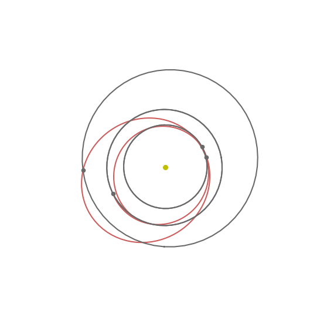
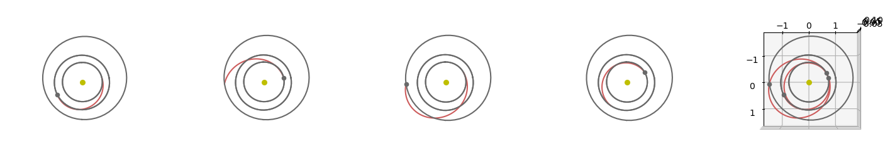
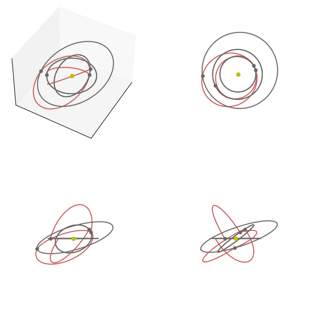

# Multiple Gravity Assist (MGA)

In this tutorial, we use the {class}`pykep.trajopt.mga` to design an interplanetary trajectory. The MGA encoding of an interplanetary trajectory
models multiple (pre-defined) planetary encounters, and enables for propulsion manovures in the form of instantaneous $\Delta V$ immediately after each fly-by.
The encoding is useful as a preliminar mission design tool automating the search for good planetary geometries giving the possibility to design trajectories through a process
mimicking natural evolution.

This encoding has also been used in the past to define instances of real-world optimization problems to be used in benchmarking optimization tools suitable for interplanetary mission design.

:::{note}
{class}`pykep.trajopt.mga` also implements different (unpublished) encodings for the time of flights, namely called $\alpha$-encoding and $\eta$-encoding which, albeit less studied and creating a more complex fitness landscape, are interesting in multiple ways: a) they show how the encoding influences evolvability in a drastic way b) they allow to box-bound the total trajectory time of flight c) they remove problem knowledge exploitation.

In the $\alpha$-encoding the $n$ time of flights $T_i$ are defined as:

$$T_i = T \frac{\log\alpha_i }{ \sum_n\log\alpha_n}$$

where $T$ is the total time of flight. This encoding ensures that all possible grids are equally probable if the $\alpha$ are uniformly distributed in [0,1].

In the $\eta$ encoding $n$ time of flights $T_i$ are defined as:

$$
T_i = \left(T_{max} - \sum_{j=0}^{(i-1)}T_j\right) \eta_i
$$
where $T_{max}$ is the maximum total time of flight, which will only happen if $\eta_{n}=1$. This encoding DOES NOT ensure that all possible grids are equally probable if the $\eta$ are uniformly distributed in [0,1].

We start, as often, with some fundamental imports:


```python
import pykep as pk
import pygmo as pg
import matplotlib.pyplot as plt
```

We will study the possibility of establishing an Earth return trajectory visiting venus in two different epochs and mars in between:


```python
earth = pk.planet(pk.udpla.jpl_lp("earth"))
venus = pk.planet(pk.udpla.jpl_lp("venus"))
mars = pk.planet(pk.udpla.jpl_lp("mars"))
udp = pk.trajopt.mga(
    seq=[
        earth,
        venus,
        mars,
        venus,
        earth
    ],
    tof_encoding = "direct",
    t0=[0, 1000],
    tof=[[30, 200], [30, 300], [30, 350], [30, 300]],
    vinf=5.,
)
```

To solve this problem we will use an adaptive version of differential evolution, even if other meta-heuristic would also be possible. We run the algorithm in mult-start, to get a sense of the fitness landscape and complexity.


```python
prob = pg.problem(udp)
# CMA-ES is also possible
#uda = pg.cmaes(1500, force_bounds=True, sigma0=0.5, ftol=1e-4)
# But we prefer a self adaptive version of differential evolution here
uda = pg.sade(2500, ftol=1e-4, xtol=1e-4)
algo = pg.algorithm(uda)
res = list()
for i in range(10):
    pop = pg.population(prob, 20)
    pop = algo.evolve(pop)
    res.append([pop.champion_f, pop.champion_x])
    print(i, pop.champion_f[0], flush=True)
    
best_x = sorted(res, key =  lambda x: x[0][0])[0][1]
```

    0 3786.7458551422774
    1 3786.218184219337
    2 4705.045732119015
    3 3786.233933114831
    4 3785.3512909367346
    5 4705.04384112345
    6 3783.628351330871
    7 3780.2606531715405
    8 3788.2488859850346
    9 3781.6632434710045
    

## Plotting the trajectory
There are several ways one can plot the solution, depending on what we want to 'see'. Lets start with one "at-a-glance" plot:


```python
ax = udp.plot(best_x, figsize=(7, 7))
ax.view_init(90, 0)
ax.axis("off");
```


    

    


If we need to disentangle the sequence of the varioous legs we may also subdivide them in subplots:


```python
# The figure
fig = plt.figure(figsize=(18,18))

# The single leg plots
for i in range(1,5):
    ax = fig.add_subplot(1, 5, i, projection="3d")
    ax.view_init(90, 0)
    ax = udp.plot(best_x, ax=ax, leg_ids=[i-1])
    ax.axis("off");
    
# All the legs
ax = fig.add_subplot(1, 5, 5, projection="3d")
ax.view_init(90, 0)
ax = udp.plot(best_x, ax=ax)
```


    

    


... or show the various xy, xy, xz views as well as a full 3D one:


```python
fig = plt.figure(figsize=(8,8))

ax = fig.add_subplot(2, 2, 1, projection="3d")
ax = udp.plot(best_x, ax=ax)
ax.view_init(45, 30)
ax.get_xaxis().set_ticks([])
ax.get_yaxis().set_ticks([])
ax.get_zaxis().set_ticks([])

ax = fig.add_subplot(2, 2, 2, projection="3d")
ax = udp.plot(best_x, ax=ax)
ax.view_init(90, 0)
ax.axis("off")

ax = fig.add_subplot(2, 2, 3, projection="3d")
ax = udp.plot(best_x, ax=ax)
ax.view_init(0, 0)
ax.axis("off")

ax = fig.add_subplot(2, 2, 4, projection="3d")
ax = udp.plot(best_x, ax=ax)
ax.view_init(0, 90)
ax.axis("off");
```


    

    


## Analyzing the trajectory
For a quick analysis of the trajectory we may use the pretty method.


```python
ax = udp.pretty(best_x)
```

    Multiple Gravity Assist (MGA) problem: 
    	Planet sequence:  ['earth(jpl_lp)', 'venus(jpl_lp)', 'mars(jpl_lp)', 'venus(jpl_lp)', 'earth(jpl_lp)']
    	Encoding for tofs:  direct
    	Orbit Insertion:  False
    Departure:  earth(jpl_lp)
    	Epoch:  930.5878294431398  [mjd2000]
    	Spacecraft velocity:  [24206.92086018095, 11157.529321513191, 3127.8072467220413] [m/s]
    	Hyperbolic velocity:  4237.286663380736 [m/s]
    	Initial DV:  0 [m/s]
    Fly-by:  venus(jpl_lp)
    	Epoch:  1075.2823144231038  [mjd2000]
    	DV:  0.00591890929172223 [m/s]
    Fly-by:  mars(jpl_lp)
    	Epoch:  1233.4115036750925  [mjd2000]
    	DV:  6.6990614868700504e-06 [m/s]
    Fly-by:  venus(jpl_lp)
    	Epoch:  1534.40975856382  [mjd2000]
    	DV:  0.00018808474578690948 [m/s]
    Arrival:  earth(jpl_lp)
    	Epoch:  1690.8404998839233  [mjd2000]
    	Spacecraft velocity:  [15698.476684341098, 21590.630802652595, 2455.156994214102] [m/s]
    	Arrival DV:  3780.2545394784415 [m/s]
    Time of flights:  [144.69448498 158.12918925 300.99825489 156.43074132] [days]
    
    Total DV:  3780.2606531715405
    
