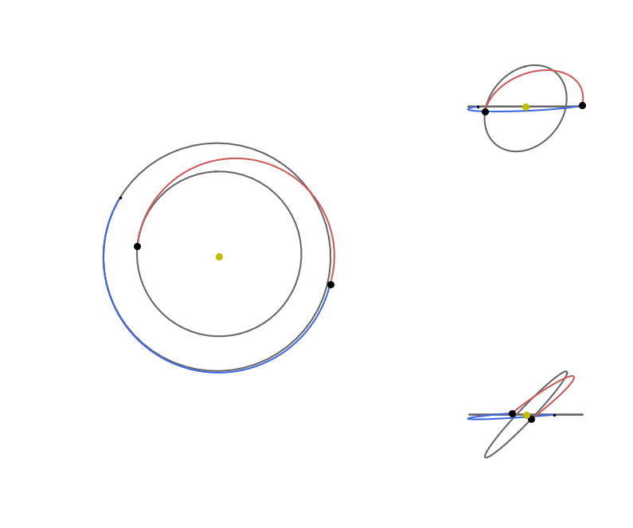
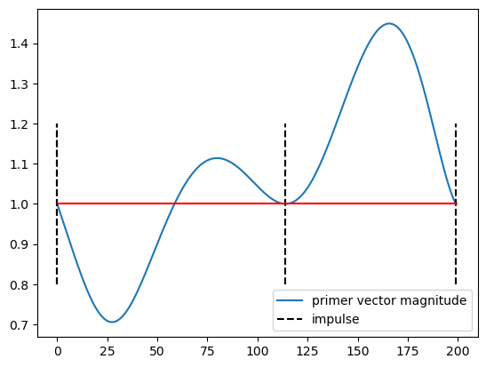
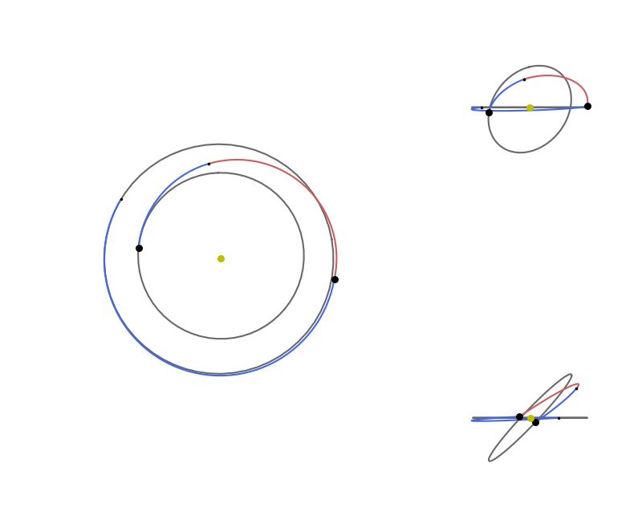
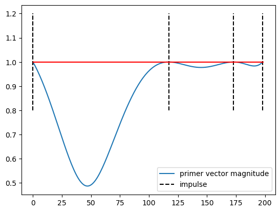

# Multiple impulses: planet to planet transfer

In this tutorial, we use the {class}`pykep.trajopt.pl2pl_N_impulses` to study a single direct transfer between planets. 

The encoding is original with `pykep` and makes use of a decision vector (chromosome) in the form:

$$
\mathbf x = [t_0,T] + \underbrace{[\alpha_0,u_0,v_0,\Delta V_0] + [\alpha_1,u_1,v_1,\Delta V_1] + ...}_{\text{propagations}} + \underbrace{[\alpha_{N-1}]}_{\text{Lambert}} + \underbrace{([t_f])}_{\text{Optional phase term}}
$$

to define an $N$ impulse trajectory starting at $t_0$ at the departure planet with a $\Delta V_0$ and arriving at the target planet with a $\Delta V_{N-1}$ and applying the remaining $\Delta V_i$ at epochs encoded using the $\alpha$-encoding for times (see [Multiple Gravity Assist (MGA)](<./udp_mga_1dsm.ipynb>)).

This optimization problem is a nice tool to visualize and study the famous "How many impulses?" question which has a very complicated answer in general.

We start, as often, with some fundamental imports:


```python
import pykep as pk
import numpy as np
import pygmo as pg
```

We define the problem as an Earth-Venus transfer. We set the transfer time as fixed as well as the departure epoch.


```python
start = pk.planet(pk.udpla.jpl_lp("earth"))
target = pk.planet(pk.udpla.jpl_lp("venus"))

tof_bounds = [360.0, 360.0]
DV_max_bounds = [0.0, 4]
phase_free = False
multi_objective = False
t0_bounds = [140, 140.]

udp3 = pk.trajopt.pl2pl_N_impulses(
    start=start,
    target=target,
    N_max=3,
    tof_bounds=tof_bounds,
    phase_free=phase_free,
    multi_objective=multi_objective,
    t0_bounds=t0_bounds,
    DV_max_bounds=DV_max_bounds
)
```


```python
def solve(udp, N=20):
    # We use CMA-ES 
    uda = pg.cmaes(4500, force_bounds=True, sigma0=0.5, ftol=1e-4)
    # But if you prefer a self adaptive version of differential evolution thats also OK.
    #uda = pg.sade(2500, ftol=1e-4, xtol=1e-4)
    algo = pg.algorithm(uda)

    print("Multi-start:")

    res = list()
    for i in range(N):
        pop = pg.population(udp, 20)
        pop = algo.evolve(pop)
        res.append([pop.champion_f, pop.champion_x])
        print(i, pop.champion_f[0], end= '\r')
        

    best_x = sorted(res, key =  lambda x: x[0][0])[0][1]

    print(f"\nThe best solution found has a DV of {udp.fitness(best_x)[0]/1000:.5e} km/s")
    return best_x

best_x_3 = solve(udp3)

```

    Multi-start:
    19 5986.389457561951
    The best solution found has a DV of 5.98639e+00 km/s
    

We can easily visualize the solution:


```python
def visualise(udp, best_x):
    import matplotlib.pyplot as plt
    import numpy as np

    # Create the figure and define the grid
    fig = plt.figure(figsize=(10, 10))
    gs = fig.add_gridspec(
        2, 2, width_ratios=[2, 1], height_ratios=[1, 1], wspace=0.01, hspace=0.01
    )

    # Top view (spans rows and columns)
    ax1 = fig.add_subplot(gs[:, 0], projection="3d")
    udp.plot(best_x, ax=ax1)
    ax1.view_init(90, 0)
    ax1.axis("off")

    # Ecliptic view 1
    ax1 = fig.add_subplot(gs[0, 1], projection="3d")
    udp.plot(best_x, ax=ax1)
    ax1.view_init(0, 0)
    ax1.axis("off")

    # Ecliptic view 2
    ax1 = fig.add_subplot(gs[1, 1], projection="3d")
    udp.plot(best_x, ax=ax1)
    ax1.view_init(0, 90)
    ax1.axis("off")
    return fig


visualise(udp3, best_x_3);
```


    

    


... and quickly investigate a human readable format for the solution found.


```python
udp3.pretty(best_x_3)
```

    Total DV (m/s):  5986.389457561951
    Dvs (m/s):  [219.52486107466606, 2899.304957414648, 2867.559639072637]
    Total DT (m/s):  31104000.000000004
    Tofs (days):  [17793484.53088946, 13310515.469110545]
    

# Are more impulses needed?
In the previous design we allowed maximum 3 impulses, but would more impulse be needed? We can quickly answer this question for this specific case by looking at the primer vector.


```python
ax, (grid, p) = udp3.plot_primer_vector(best_x_3)
```


    

    


... the primer vector goes above one this trajevtory IS NOT OPTIMAL. We need more impulses. Lets add one.


```python
udp4 = pk.trajopt.pl2pl_N_impulses(
    start=start,
    target=target,
    N_max=4,
    tof_bounds=tof_bounds,
    phase_free=phase_free,
    multi_objective=multi_objective,
    t0_bounds=t0_bounds,
    DV_max_bounds=DV_max_bounds
)
```


```python
best_x_4 = solve(udp4, N=20)
```

    Multi-start:
    19 5986.3894562564655
    The best solution found has a DV of 5.93793e+00 km/s
    


```python
visualise(udp4, best_x_4);
```


    

    


```python
udp4.pretty(best_x_4)
```

    Total DV (m/s):  5937.927393778519
    Dvs (m/s):  [197.65819561032322, 2732.3138722882486, 230.93079262863296, 2777.024533251314]
    Total DT (m/s):  31103999.999999996
    Tofs (days):  [18114971.603645075, 8855996.979107073, 4133031.4172478495]
    

We found a better solution! Four impulses are better than 4 in this case! This is quite rare and interesting as a case and its here found as the optimization problem was defined to have a fixed duration and starting date. Typically, when freeing these degrees of freedom, three impulses are enough.

Try to find other interesting cases where the number of impulses matter, and do not be fooled by artefacts. Some times impulses with zero $\Delta V$ are added to move around the starting date outside of the bounds. Whats the maximum number of impulses you can find to be optimal?

We conclude showing the primer vector for this case:


```python
ax, (grid, p) = udp4.plot_primer_vector(best_x_4)
```


    

    


The very same trajectory is also studied in [the notebook dedicated to the primer vector](<./primer_vector.ipynb>) where the whole theory is also developed and coded as to show its inner workings.
