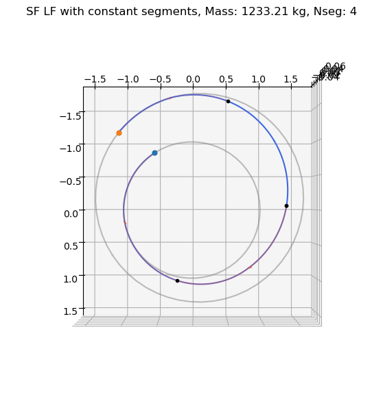
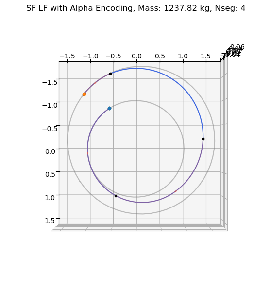

# Sims-Flanagan: planet to plane low-thrust transfer (with Alpha encoding)

In this tutorial we show the use of the {class}`pykep.trajopt.sf_pl2pl_alpha` to find a low-thrust (multiple impulses) trajectory connecting two moving planets. 
Unlike in the [previous tutorial](<./udp_sf_pl2pl.ipynb>), where all segments have the same duration, here we use what we call alpha encoding to unlock uneven
spacing between impulses. The impulse is still placed at the centre of each (non-uniform) time-interval. 

The decision vector for this class, compatible with pygmo {cite:p}`pagmo` UDPs (User Defined Problems), is:

$$
\mathbf x = [t_0, m_f, V_{sx}^\infty, V^\infty_{sy}, V^\infty_{sz}, V^\infty_{fx}, V^\infty_{fy}, V^\infty_{fz}, \alpha_{0}, \alpha_{1}, ..., u_{x0}, u_{y0}, u_{z0}, u_{x1}, u_{y1}, u_{z1}, ..., T_{tof}]
$$

containing the starting epoch $t_0$ as a MJD2000, the final mass $m_f$ as well as the starting and final $V^{\infty}$, throttles and the time-of-flight $T_{tof}$.

The time-intervals (direct) are encoded using the alpha encoding and represented in the optimisation vector as $\alpha_{0}, \alpha_{1}, ...,$. These can be converted to and from direct times using `alpha2direct` and `direct2alpha`.

:::{note}
This notebook makes use of the commercial solver SNOPT 7 and to run needs a valid `snopt_7_c` library installed in the system. (Currently no gradients have been implemented for the alpha encoding, so it can't use IPOPT or SLSQP)

Basic imports:


```python
import pykep as pk
import numpy as np
import time
import pygmo as pg
import pygmo_plugins_nonfree as ppnf
import time

from matplotlib import pyplot as plt
```

We start defining the problem data. For the purpose of this simple notebook we choose a simple Earth to Mars transfer.


```python
# # Problem data

####
## Testcase Earth-Mars
mu = pk.MU_SUN
max_thrust = 0.6
isp = 3000
veff = isp * pk.G0
tof = 550.0
tof_lb = tof
t0_lb = 0
t0_ub = 0

posvel0 = [
    [-125036811000.422, -83670919168.87277, 2610252.8064399767],
    [16081.829029183446, -24868.923007449284, 0.7758272135425942]
]
posvelf = [
    [-169327023332.1986, -161931354587.78766, 763967345.9733696],
    [17656.297796509956, -15438.116653052988, -756.9165272457421]
]

# Define initial and target
p1 = pk.planet(pk.udpla.keplerian(when=pk.epoch(0), posvel = posvel0, mu_central_body=mu))
p2 = pk.planet(pk.udpla.keplerian(when=pk.epoch(tof), posvel = posvelf, mu_central_body=mu))

# Initial state
ms = 1500.0
opt_mass = 1237.68
opt_thresh = 0.999

# Number of segments
nseg = 4
```

We here instantiate two different versions of the same UDP (User Defined Problem), with alpha encoding and without. 


```python
udp_lf = pk.trajopt.sf_pl2pl(
        pls=p1,
        plf=p2,
        ms=ms,
        mu=mu,
        max_thrust=max_thrust,
        veff=veff,
        t0_bounds=[t0_lb, t0_ub],
        tof_bounds=[tof_lb,tof],
        mf_bounds=[ms*0.25, ms],
        vinfs=0.,
        vinff=0.,
        nseg=nseg,
        cut=0.6,
        mass_scaling=ms,
        r_scaling=pk.AU,
        v_scaling=pk.EARTH_VELOCITY,
        with_gradient=False,
        high_fidelity=False
)

udp_alpha = pk.trajopt.sf_pl2pl_alpha(
        pls=p1,
        plf=p2,
        ms=ms,
        mu=mu,
        max_thrust=max_thrust,
        veff=veff,
        t0_bounds=[t0_lb, t0_ub],
        tof_bounds=[tof_lb,tof],
        mf_bounds=[ms*0.25, ms],
        vinfs=0.,
        vinff=0.,
        nseg=nseg,
        cut=0.6,
        mass_scaling=ms,
        r_scaling=pk.AU,
        v_scaling=pk.EARTH_VELOCITY,
        high_fidelity=False
)
```

## Solving the low-thrust transfer

We define (again) the optimization problem, and set a tolerance for *pagmo* to be able to judge the relative value of two individuals. 

:::{note}
This tolerance has a different role from the numerical tolerance set in the particular algorithm chosen to solve the problem and is only used by the *pagmo* machinery to decide outside the optimizer whether the new proposed indivdual is better than what was the previous *champion*.


```python

# Low Fidelity
prob_lf = pg.problem(udp_lf)
prob_lf.c_tol = 1e-6

# With Alpha
prob_alpha = pg.problem(udp_alpha)
prob_alpha.c_tol = 1e-6
```

... and we define an optimization algorithm.

SNOPT


```python
snopt72 = "/Users/dario.izzo/opt/libsnopt7_c.dylib"
uda = ppnf.snopt7(library=snopt72, minor_version=2, screen_output=False)
uda.set_integer_option("Major iterations limit", 2000)
uda.set_integer_option("Iterations limit", 20000)
uda.set_numeric_option("Major optimality tolerance", 1e-3)
uda.set_numeric_option("Major feasibility tolerance", 1e-11)

algo = pg.algorithm(uda)
```

We solve the problem from random initial guess ten times and only save the result if a feasible solution is found (as defined by the criterias above)

Without alpha encoding


```python
# Low fidelity
start_time = time.time()
steps = 10

masses_lf = []
xs_lf = []
for i in range(steps):
    pop_lf = pg.population(prob_lf, 1)
    pop_lf = algo.evolve(pop_lf)
    if(prob_lf.feasibility_f(pop_lf.champion_f)):
        print(".", end="")
        masses_lf.append(pop_lf.champion_x[1])
        xs_lf.append(pop_lf.champion_x)
        # break
    else:
        print("x", end ="")
print("\nLow-fidelity. Nseg: ", nseg)
print("Best mass: ", np.max(masses_lf))
comp_time = time.time() - start_time
print("Time: ", comp_time,'s',comp_time/steps,'per step')
best_idx_lf = np.argmax(masses_lf)
```

    .xxxx....x
    Low-fidelity. Nseg:  4
    Best mass:  1233.21252678
    Time:  3.579932928085327 s 0.3579932928085327 per step
    

Now solve with Alpha encoding


```python
# With Alpha
start_time = time.time()
steps = 10

masses_alpha = []
xs_alpha = []
for i in range(steps):
    pop_alpha = pg.population(prob_alpha, 1)
    
    # Push back average spacing
    x_tmp = pop_alpha.champion_x
    x_tmp[8:8+nseg] = pk.direct2alpha([1/nseg]*nseg)[0]
    pop_alpha.push_back(x_tmp)

    # if i == 0: # Push back the constant result
    # pop_alpha.push_back(x_tmp)
    
    pop_alpha = algo.evolve(pop_alpha)
    if(prob_alpha.feasibility_f(pop_alpha.champion_f)):
        print(".", end="")
        masses_alpha.append(pop_alpha.champion_x[1])
        xs_alpha.append(pop_alpha.champion_x)
        # break
    else:
        print("x", end ="")
print("\nLow-fidelity Alpha. Nseg: ", nseg)
print("Best mass: ", np.max(masses_alpha))
# print("Worst mass: ", np.min(masses_alpha))

comp_time = time.time() - start_time
print("Time: ", comp_time,'s',comp_time/steps,'per step')
best_idx_alpha = np.argmax(masses_alpha)
```

    ....x...x.
    Low-fidelity Alpha. Nseg:  4
    Best mass:  1237.81918046
    Time:  7.5450639724731445 s 0.7545063972473145 per step
    

Visualise the time intervals


```python
alphas = xs_alpha[best_idx_alpha][8:8+nseg]
talphas = pk.alpha2direct(alphas, 1)
print('Alphas: ',alphas)
print('talphas: ',talphas)
```

    Alphas:  [ 0.73972258  0.67921577  0.60653066  0.8824969 ]
    talphas:  [0.22955978304251273, 0.2945385348444719, 0.3807213456904122, 0.09518033642260301]
    

And we plot the trajectory found:


```python
# Plot with low-fidelity
ax = udp_lf.plot(xs_lf[best_idx_lf], show_gridpoints=True, show_throttles=True)
ax.view_init(90, 0)
ax.set_title(f'SF LF with constant segments, Mass: {np.max(masses_lf):.2f} kg, Nseg: {nseg}')

# Plot With Alpha
ax = udp_alpha.plot(xs_alpha[best_idx_alpha], show_gridpoints=True, show_throttles=True)
ax.view_init(90, 0)
ax.set_title(f'SF LF with Alpha Encoding, Mass: {np.max(masses_alpha):.2f} kg, Nseg: {nseg}')
```


    Text(0.5, 0.92, 'SF LF with Alpha Encoding, Mass: 1237.82 kg, Nseg: 4')


    

    


    

    

