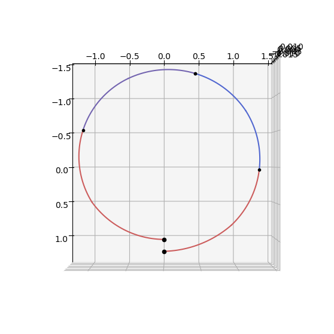
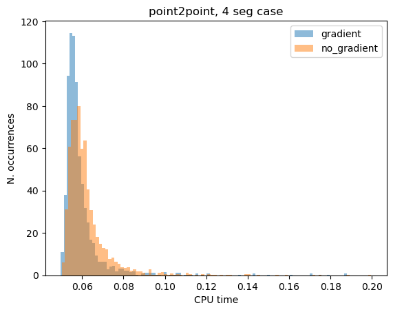

# Sims-Flanagan: point to point low-thrust transfer

In this tutorial we show the use of the {class}`pykep.trajopt.sf_point2point` to find a low-thrust trajectory connecting two fixed points in space. 
Since the points are considered fixed this effort has mainly an academic value, but it is informative in the study of the numerical properties of an optimization pipeline. 
The decision vector in this class, compatible with pygmo {cite:p}`pagmo` UDPs (User Defined Problems), is:

$$
\mathbf x = [m_f, u_{x0}, u_{y0}, u_{z0}, u_{x1}, u_{y1}, u_{z1}, ..., T_{tof}]
$$

:::{note}
This notebook makes use of the commercial solver SNOPT 7 and to run needs a valid `snopt_7_c` library installed in the system. In case SNOPT7 is not available, you can still run the notebook using, for example `uda = pg.algorithm.nlopt("slsqp")` with minor modifications.

Basic imports:


```python
import pykep as pk
import numpy as np
import time
import pygmo as pg
import pygmo_plugins_nonfree as ppnf
import time

from matplotlib import pyplot as plt
```


```python
# Problem data
mu = pk.MU_SUN
max_thrust = 0.22
isp = 3000

# Initial state
ms = 1000.0
rs = np.array([1.2, 0.0, -0.01]) * pk.AU
vs = np.array([0.01, 1, -0.01]) * pk.EARTH_VELOCITY

# Final state
rf = np.array([1, 0.0, -0.0]) * pk.AU
vf = np.array([0.01, 1.1, -0.0]) * pk.EARTH_VELOCITY

# Throttles and tof
nseg = 4
throttles = np.random.uniform(-1, 1, size=(nseg * 3))
tof = 2 * np.pi * np.sqrt(pk.AU**3 / pk.MU_SUN) / 4

udp_nog = pk.trajopt.sf_point2point(
    rvs=[rs, vs],
    rvf=[rf, vf],
    ms = 1000,
    mu=pk.MU_SUN,
    max_thrust=0.22,
    veff=3000*pk.G0,
    tof_bounds=[200, 500],
    mf_bounds=[200.0, 1000.0],
    nseg=nseg,
    cut=0.6,
    with_gradient=False,
)

udp_g = pk.trajopt.sf_point2point(
    rvs=[rs, vs],
    rvf=[rf, vf],
    ms = 1000,
    mu=pk.MU_SUN,
    max_thrust=0.22,
    veff=3000*pk.G0,
    tof_bounds=[200, 500],
    mf_bounds=[200.0, 1000.0],
    nseg=nseg,
    cut=0.6,
    with_gradient=True,
)
```


```python
snopt72 = "/Users/dario.izzo/opt/libsnopt7_c.dylib"
uda = ppnf.snopt7(library=snopt72, minor_version=2, screen_output=False)
uda.set_integer_option("Major iterations limit", 2000)
uda.set_integer_option("Iterations limit", 20000)
uda.set_numeric_option("Major optimality tolerance", 1e-3)
uda.set_numeric_option("Major feasibility tolerance", 1e-12)

# uda = pg.nlopt("slsqp")
algo = pg.algorithm(uda)
```


```python
prob_nog = pg.problem(udp_nog)
prob_nog.c_tol = 1e-6
prob_g = pg.problem(udp_g)
prob_g.c_tol = 1e-6
pop_g = pg.population(prob_g, 1)
pop_g = algo.evolve(pop_g)
print(prob_g.feasibility_f(pop_g.champion_f))
```

    True
    


```python
ax = udp_nog.plot(pop_g.get_x()[0], show_gridpoints=True)
ax.view_init(90, 0)
```


    

    


```python
from tqdm import tqdm

cpu_nog = []
cpu_g = []

fail_g = 0
fail_nog = 0

for i in tqdm(range(2000)):
    pop_nog = pg.population(prob_nog, 1)

    pop_g = pg.population(prob_g)
    pop_g.push_back(pop_nog.get_x()[0])

    start = time.time()
    pop_g = algo.evolve(pop_g)
    end = time.time()
    cpu_g.append(end - start)
    if not prob_g.feasibility_f(pop_g.champion_f):
        fail_g += 1

    start = time.time()
    pop_nog = algo.evolve(pop_nog)
    end = time.time()
    cpu_nog.append(end - start)
    if not prob_nog.feasibility_f(pop_nog.champion_f):
        fail_nog += 1

print(f"Gradient: {np.median(cpu_g):.4e}s")
print(f"No Gradient: {np.median(cpu_nog):.4e}s")

print(f"\nGradient (n.fails): {fail_g}")
print(f"No Gradient (n.fails): {fail_nog}")
```

    100%|██████████| 2000/2000 [1:57:55<00:00,  3.54s/it]    

    Gradient: 2.7463e-01s
    No Gradient: 2.7796e-01s
    
    Gradient (n.fails): 192
    No Gradient (n.fails): 189
    

    
    


```python
cpu_g = np.array(cpu_g)
cpu_nog = np.array(cpu_nog)
plt.hist(cpu_g[cpu_g < 0.2], bins=100, label="gradient", density=True, alpha=0.5)
plt.hist(cpu_nog[cpu_nog < 0.2], bins=100, label="no_gradient", density=True, alpha=0.5)
# plt.xlim([0,0.15])
plt.legend()
plt.title("point2point, 4 seg case")
plt.xlabel("CPU time")
plt.ylabel("N. occurrences")
```


    Text(0, 0.5, 'N. occurrences')


    

    

