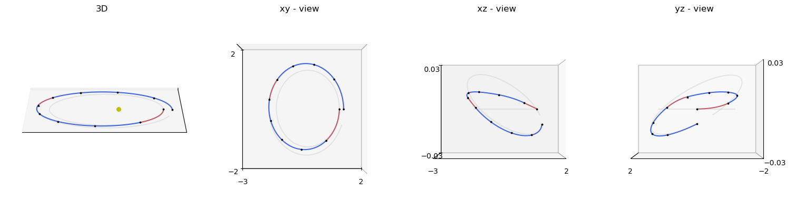
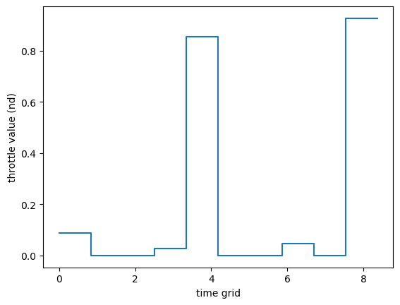
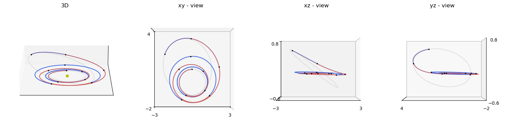
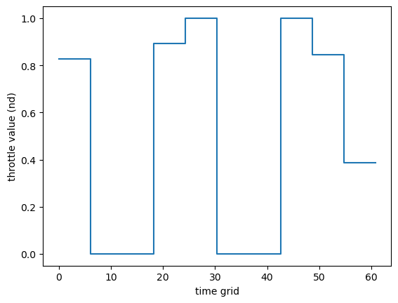
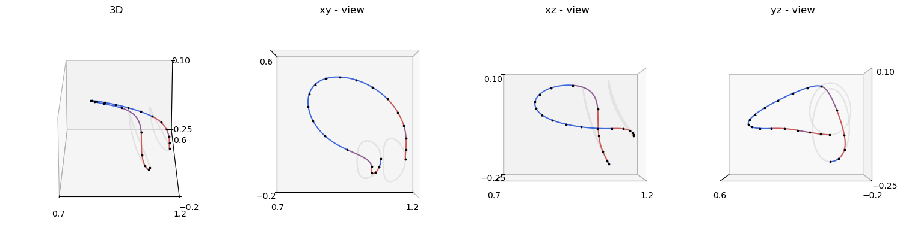
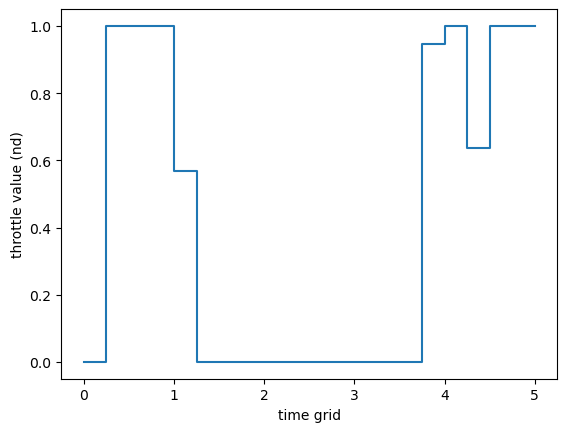
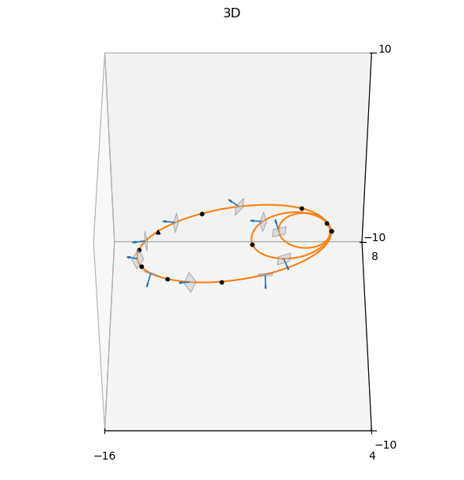

# Zero-Order Hold I

This tutorial shows how to solve benchmark problems from the TOPS database (Trajectory Optimisation Problems in Space) using pykep wrappers based on the Zero-Order Hold (ZOH) transcription described in {cite:p}`izzo2026zoh`.

We focus on four benchmark families exposed in the gym module:
- {class}`pykep.trajopt.gym.tops_twobody` (two-body, Cartesian state)
- {class}`pykep.trajopt.gym.tops_mee` (two-body, modified equinoctial elements)
- {class}`pykep.trajopt.gym.tops_cr3bp` (CR3BP)
- {class}`pykep.trajopt.gym.tops_ss` (solar sailing)

All of them are Non-Linear Programming Problems, in a UDP format compatible with pygmo {cite:p}`pagmo`,
and all follow the same workflow:
1. instantiate a TOPS benchmark wrapper,
2. build `pg.problem`,
3. verify analytical gradients against finite differences,
4. solve with IPOPT,
5. inspect the trajectory and controls.

For API details and background material, see:
- [Trajectory optimization API](../trajopt.rst)
- [TOPS benchmark overview](../gym.rst)
- [Zero-Order Hold leg tutorial](./leg_zoh.ipynb)

## Decision vectors and time encoding

The wrappers in this notebook are built on:
- {class}`pykep.trajopt.zoh_point2point` (low-thrust)
- {class}`pykep.trajopt.zoh_ss_point2point` (solar-sail)

For {class}`pykep.trajopt.zoh_point2point`, the decision vector is:

$$
\mathbf{x} = [m_f] + [T_0, i_{x0}, i_{y0}, i_{z0}] + \cdots + [T_{N-1}, i_{x,N-1}, i_{y,N-1}, i_{z,N-1}] + [tof] (+ [w_0,\ldots,w_{N-1}])
$$

where:
- $m_f$ is the final mass,
- $(T_k, i_{xk}, i_{yk}, i_{zk})$ is the segment thrust magnitude and direction,
- $tof$ is total time of flight,
- $w_k$ are optional softmax weights (only for `time_encoding="softmax"`).

For {class}`pykep.trajopt.zoh_ss_point2point`, the decision vector is:

$$
\mathbf{x} = [\alpha_0, \beta_0, \ldots, \alpha_{N-1}, \beta_{N-1}] + [tof] (+ [w_0,\ldots,w_{N-1}])
$$

where $(\alpha_k, \beta_k)$ are sail cone and clock angles (RTN frame) held constant on each segment.

### Uniform vs softmax time grids

With `time_encoding="uniform"`, segment durations are equal. With `time_encoding="softmax"`, durations are learned via weights and satisfy positivity and partition of unity:

$$
\Delta t_k = tof\,\mathrm{softmax}(\mathbf{w})_k, \qquad t_{k+1}=t_k+\Delta t_k.
$$

We start from a two-body Cartesian case and then repeat the same solver pipeline on MEE, CR3BP, and solar-sail dynamics.

This makes the notebook useful as both:
- a practical TOPS benchmark tutorial, and
- a template for your own ZOH-based optimization studies.

First, import the required packages.


```python
# Core numerics, optimization, and plotting imports used throughout the tutorial
import pykep as pk 
import numpy as np
import pygmo as pg

from matplotlib import pyplot as plt
```

Configure the nonlinear optimizer.

We use IPOPT with strict tolerances so the gradient checks and feasibility status are meaningful when comparing benchmark instances.


```python
# IPOPT reference setup used consistently across all TOPS sections
ipopt_integer_options = {
    "max_iter": 2000,
}
ipopt_numeric_options = {
    "tol": 1e-10,
}
ipopt_string_options = {
    "sb": "yes",
}

ipopt = pg.ipopt()
ipopt.set_integer_options(ipopt_integer_options)
ipopt.set_numeric_options(ipopt_numeric_options)
ipopt.set_string_options(ipopt_string_options)
algo = pg.algorithm(ipopt)
```

# Two-body dynamics (Cartesian)

This section uses a TOPS two-body benchmark wrapped by {class}`pykep.trajopt.gym.tops_twobody`.

Workflow:
1. load a named TOPS case (`P0`, `P1`, ...),
2. build the pygmo problem and set feasibility tolerance,
3. verify analytical gradients,
4. solve with IPOPT and inspect mass / time-of-flight / geometry.


```python
# 1) Select a TOPS benchmark case and build the wrapped UDP
prob_name = "P0"
udp = pk.trajopt.gym.tops_twobody(prob_name, nseg=10, time_encoding="uniform")
print(udp.extra_info)

# 2) Wrap into a pygmo problem and set feasibility tolerance for reporting
prob = pg.problem(udp)
prob.c_tol = 1e-7 # This affects pagmo feasibility checks, not IPOPT's internal tol
```

    Mildly-elliptic to mildly-elliptic transfer (e_s~0.201, e_f~0.210) in fixed tof -> T=0.22N, Isp=3000s
    

Check analytical gradients against finite differences before optimization.

For these direct methods, this is a key reliability step: if this check is poor, solver behavior and convergence claims are not trustworthy.


```python
# Compare analytical and finite-difference gradients at a random initial point
pop = pg.population(prob, 1)
grad_err = pg.estimate_gradient_h(udp.fitness, pop.champion_x, dx=1e-8) - udp.gradient(pop.champion_x)
grad_err.max(), grad_err.min()
```


    (3.6446017148694665e-07, -2.7905344757161998e-07)


```python
# Solve and report a compact set of diagnostics
pop = algo.evolve(pop)
print(prob.feasibility_f(pop.champion_f))
print("Objective:", pop.champion_f[0])
print("Final mass:", pop.champion_x[0] * udp.MASS)
print("Final tof:", pop.champion_x[4*udp.nseg+1] * udp.TIME)
```

    True
    Objective: -0.919693557939
    Final mass: 0.919693557939
    Final tof: 11.0
    


```python
axes = udp.plot(pop.champion_x, N=100, mark_segments=True, s=3, c="k")
```


    

    


```python
udp.plot_throttle(pop.champion_x)
```


    <Axes: xlabel='time grid', ylabel='throttle value (nd)'>


    

    


# Two-body dynamics (Modified Equinoctial Elements)

We now solve the MEE variant through {class}`pykep.trajopt.gym.tops_mee`, reusing the exact same numerical pipeline.

Only the internal dynamics/state representation changes; the user-facing optimization workflow remains identical.

For element definitions and conversions, see [Elements and conversions](../elements.rst).


```python
# 1) Load a TOPS MEE benchmark and inspect its metadata
prob_name = "P0"
udp = pk.trajopt.gym.tops_mee(prob_name, nseg=10, time_encoding="uniform")
print(udp.extra_info)

# 2) Create pygmo wrapper and harmonize feasibility tolerance across sections
prob = pg.problem(udp)
prob.c_tol = 1e-7 # This affects pagmo feasibility checks, not IPOPT's internal tol
```

    Dionysus problem (doi: 10.2514/1.G000379) - Fixed time
    


```python
# Gradient consistency check for the MEE benchmark
pop = pg.population(prob, 1)
grad_err = pg.estimate_gradient_h(udp.fitness, pop.champion_x, dx=1e-8) - udp.gradient(pop.champion_x)
grad_err.max(), grad_err.min()
```


    (1.643901670478527e-06, -1.9111350484379841e-06)


```python
# Solve and summarize
pop = algo.evolve(pop)
print(prob.feasibility_f(pop.champion_f))
print("Objective:", pop.champion_f[0])
print("Final mass:", pop.champion_x[0] * udp.MASS)
print("Final tof:", pop.champion_x[4*udp.nseg+1] * udp.TIME)
```

    True
    Objective: -0.589100288319
    Final mass: 0.589100288319
    Final tof: 60.7909197787
    


```python
axes = udp.plot(pop.champion_x, N=300, mark_segments=True, s=3, c="k")
```


    

    


```python
udp.plot_throttle(pop.champion_x)
```


    <Axes: xlabel='time grid', ylabel='throttle value (nd)'>


    

    


# Circular Restricted Three-Body Problem (CR3BP)

This section uses {class}`pykep.trajopt.gym.tops_cr3bp`.

The wrapper configures the CR3BP-specific dynamics and parameters internally, while keeping the same optimizer and validation structure used in previous sections.

For model background, see [CR3BP dynamics](../propagation.rst).


```python
# 1) Load a TOPS CR3BP benchmark
prob_name = "P0"
udp = pk.trajopt.gym.tops_cr3bp(prob_name, nseg=20, time_encoding="uniform")
print(udp.extra_info)

# 2) Wrap for optimization
prob = pg.problem(udp)
prob.c_tol = 1e-7 # This affects pagmo feasibility checks, not IPOPT's internal tol
```

    Halo 2 Halo in fixed tof
    


```python
# Gradient consistency check for the CR3BP benchmark
pop = pg.population(prob, 1)
grad_err = pg.estimate_gradient_h(udp.fitness, pop.champion_x, dx=1e-8) - udp.gradient(pop.champion_x)
grad_err.max(), grad_err.min()
```


    (1.4835070419449287e-06, -1.1432011767231742e-06)


```python
# Solve and summarize
pop = algo.evolve(pop)
print(prob.feasibility_f(pop.champion_f))
print("Objective:", pop.champion_f[0])
print("Final mass:", pop.champion_x[0])
print("Final tof:", pop.champion_x[4*udp.nseg+1])
```

    True
    Objective: -0.946927194474
    Final mass: 0.946927194474
    Final tof: 5.0
    


```python
axes = udp.plot(pop.champion_x, N=1000, mark_segments=True, s=3, c="k")
```


    

    


```python
udp.plot_throttle(pop.champion_x);

```


    

    


# Solar-sail dynamics

Finally, we solve a TOPS solar-sail benchmark with {class}`pykep.trajopt.gym.tops_ss`, internally based on {class}`pykep.trajopt.zoh_ss_point2point`.

As above, we keep the same verification-and-solve protocol (gradient check, IPOPT solve, trajectory inspection), so results are directly comparable across dynamics.

For additional sail-leg details, see the [Zero-Order Hold leg tutorial](./leg_zoh.ipynb) and [Trajectory optimization API](../trajopt.rst).


```python
# 1) Load a TOPS solar-sail benchmark
prob_name = "P1"
udp = pk.trajopt.gym.tops_ss(prob_name, nseg=10, time_encoding="uniform")
print(udp.extra_info)

# 2) Build pygmo wrapper
prob = pg.problem(udp)
prob.c_tol = 1e-7 # This affects pagmo feasibility checks, not IPOPT's internal tol
```

    Eccentric (e=0.5, a=2) to highly-eccentric (e=0.9, a=10) orbit at periapsis (rp=1, nd)
    


```python
# Gradient consistency check for the solar-sail benchmark
pop = pg.population(prob, 1)
grad_err = pg.estimate_gradient_h(udp.fitness, pop.champion_x, dx=1e-8) - udp.gradient(pop.champion_x)
grad_err.max(), grad_err.min()
```


    (1.6336881770939726e-05, -7.4573648817022331e-05)


```python
# Solve and summarize (for zoh_ss_point2point, tof is the last decision variable)
pop = algo.evolve(pop)
print(prob.feasibility_f(pop.champion_f))
print("Objective:", pop.champion_f[0])
print("Final tof:", pop.champion_x[-1] * udp.TIME)
```

    True
    Objective: 180.0
    Final tof: 180.0
    


```python
ax = udp.plot(pop.champion_x, N=100, mark_segments=True, sail_size=0.5, s=10, c='k')
```


    

    

